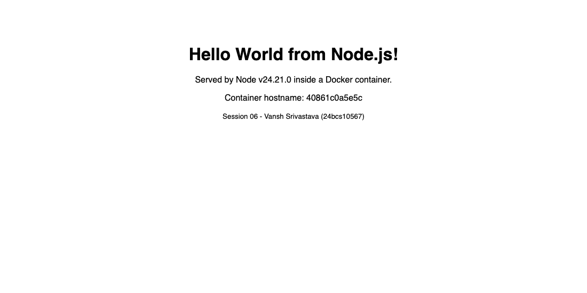
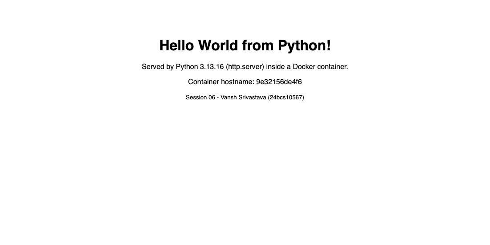
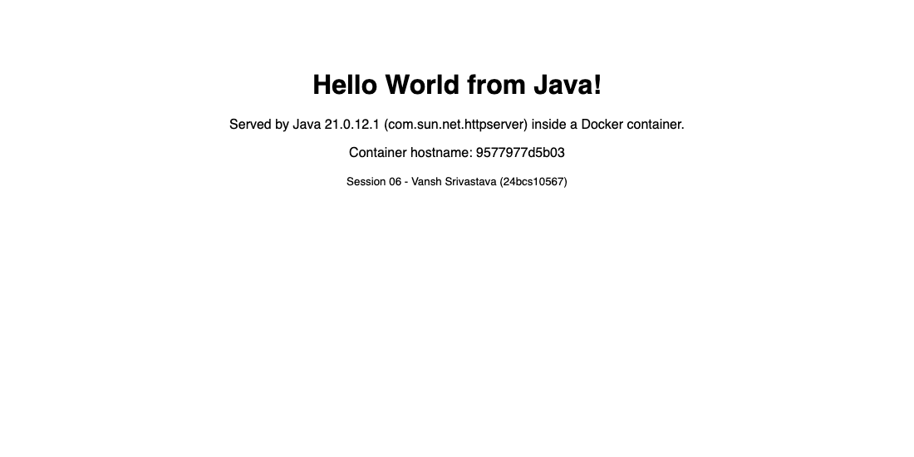
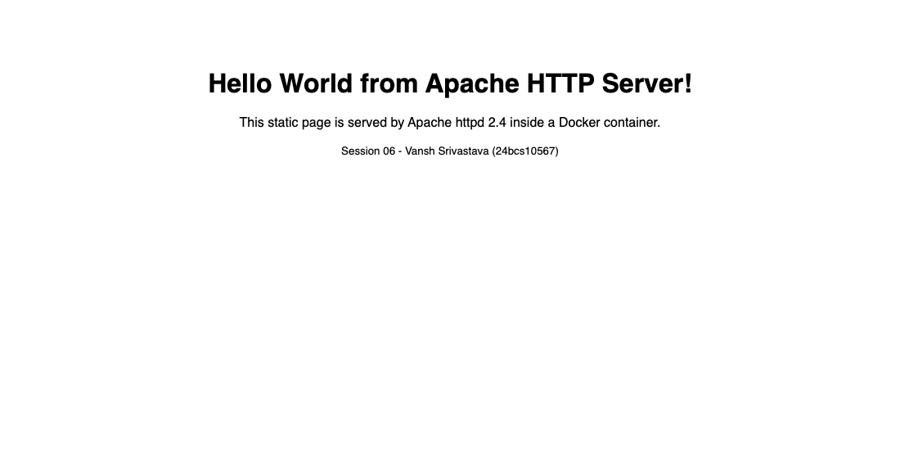
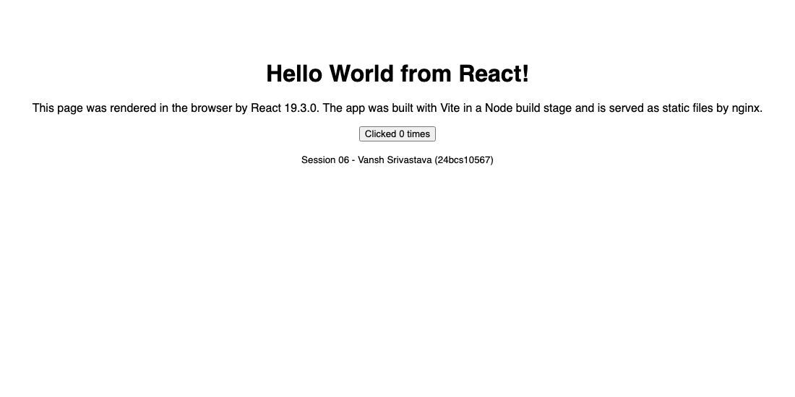
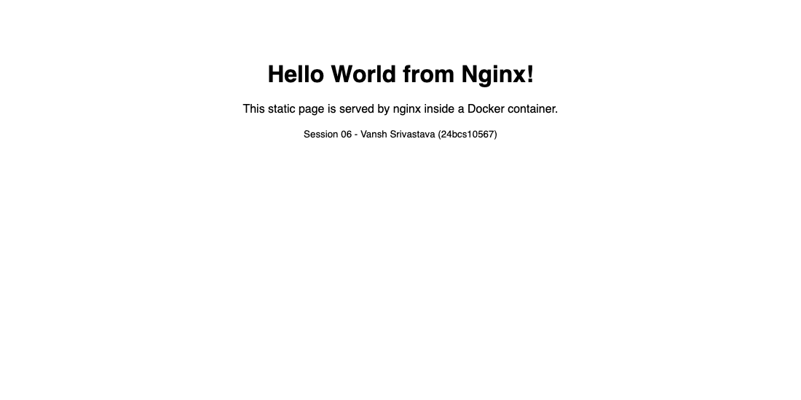

# Session 06: Docker Fundamentals

**Name:** Vansh Srivastava
**Enrollment No.:** 24bcs10567
**Session:** 06

This session is about the Docker basics: writing a Dockerfile, building an image, running a container and publishing a port. For the homework I built six small "Hello World" web apps (Node.js, Python, Java, Apache, React and Nginx), each in its own folder with its own Dockerfile and `.dockerignore`. I built every image, ran every container on my Mac, checked each page with `curl` and took a headless Chrome screenshot of each one.

## Folder structure

```text
session-06-docker-fundamentals/
├── README.md
├── .gitignore
├── nodejs-app/            # plain Node.js http server, no npm dependencies
│   ├── Dockerfile
│   ├── .dockerignore
│   ├── package.json
│   └── server.js
├── python-app/            # Python standard-library http.server, no pip dependencies
│   ├── Dockerfile
│   ├── .dockerignore
│   └── app.py
├── java-app/              # JDK built-in HttpServer, multi-stage build (JDK -> JRE)
│   ├── Dockerfile
│   ├── .dockerignore
│   └── src/HelloWorld.java
├── Apache-app/            # static page served by Apache httpd 2.4
│   ├── Dockerfile
│   ├── .dockerignore
│   └── index.html
├── React-app/             # React 19 + Vite, multi-stage build (Node build -> nginx)
│   ├── Dockerfile
│   ├── .dockerignore
│   ├── package.json
│   ├── package-lock.json
│   ├── index.html
│   ├── vite.config.js
│   └── src/{main.jsx,App.jsx}
├── nginx-app/             # static page served by nginx
│   ├── Dockerfile
│   ├── .dockerignore
│   └── index.html
└── screenshots/           # real headless Chrome captures of each running app
```

## Environment

```text
$ sw_vers -productVersion; uname -m
26.6.2
arm64
$ colima version | head -1
colima version 0.10.3
$ docker version --format 'Client {{.Client.Version}} / Server {{.Server.Version}} ({{.Server.Os}}/{{.Server.Arch}})'
Client 29.8.2 / Server 29.5.2 (linux/arm64)
```

macOS on Apple Silicon, Docker Engine running inside a Colima VM. All base images are multi-arch official images, so Docker pulls the `linux/arm64` variant automatically.

**Note about the base images.** When I started, Docker Hub was refusing anonymous pulls from my network with HTTP 429 (rate limit):

```bash
$ docker pull nginx:1.29-alpine 2>&1 | tail -5
Error response from daemon: unknown: failed to resolve reference "docker.io/library/nginx:1.29-alpine": unexpected status from HEAD request to https://registry-1.docker.io/v2/library/nginx/manifests/1.29-alpine: 429 Too Many Requests
```

So every `FROM` line uses `public.ecr.aws/docker/library/<image>:<tag>`. That is the AWS ECR Public mirror of the Docker Official Images, so `public.ecr.aws/docker/library/nginx:1.29-alpine` is the same image as `nginx:1.29-alpine` on Docker Hub. If Docker Hub works for you, you can drop the `public.ecr.aws/docker/library/` prefix and nothing else changes.

## Task: Hello World Applications

### Overview

| Folder | Stack | Base image(s) | Build type | Image | Host port -> container port |
|---|---|---|---|---|---|
| `nodejs-app` | Node.js 24, built-in `http` module | `node:24-alpine` | single stage | `s06-nodejs-app:1.0` | 8101 -> 3000 |
| `python-app` | Python 3.13, built-in `http.server` | `python:3.13-alpine` | single stage | `s06-python-app:1.0` | 8102 -> 5000 |
| `java-app` | Java 21, built-in `com.sun.net.httpserver` | `eclipse-temurin:21-jdk-alpine` -> `21-jre-alpine` | multi-stage | `s06-java-app:1.0` | 8103 -> 8080 |
| `Apache-app` | Apache httpd 2.4, static HTML | `httpd:2.4-alpine` | single stage | `s06-apache-app:1.0` | 8104 -> 80 |
| `React-app` | React 19 + Vite 8 | `node:24-alpine` -> `nginx:1.29-alpine` | multi-stage | `s06-react-app:1.0` | 8105 -> 80 |
| `nginx-app` | nginx 1.29, static HTML | `nginx:1.29-alpine` | single stage | `s06-nginx-app:1.0` | 8106 -> 80 |

Some choices I made:

- **No big dependency trees.** The Node.js, Python and Java apps use only the HTTP server that comes with the language, so there is no `npm install`, `pip install` or Maven step. The React app has 4 direct dependencies (`react`, `react-dom`, `vite`, `@vitejs/plugin-react`), and `npm ci` installs 19 packages from the committed `package-lock.json`.
- **Multi-stage where it helps.** The Java app is compiled with the JDK in a `build` stage, and only the `.class` file is copied into a JRE image. The React app is built by Node (`vite build`), and only the generated `dist/` folder is copied into an nginx image, so Node, npm and `node_modules` are not in the final image.
- **Non-root users.** The Node.js image runs as the built-in `node` user. The Python and Java images create an `appuser`. The nginx and httpd images keep their own defaults: the master process starts as root to bind port 80, and the workers drop privileges.
- **`.dockerignore` in every folder.** These keep `node_modules`, `dist`, `__pycache__`, `*.class`, the Dockerfile and docs out of the build context.
- The brief says "Node.js application (preferably React)". `nodejs-app` is a plain Node.js server, and the React part is in its own `React-app` folder, which is also in the brief's folder list.

### Dockerfiles

The two multi-stage ones are the most interesting:

`java-app/Dockerfile`

```dockerfile
FROM public.ecr.aws/docker/library/eclipse-temurin:21-jdk-alpine AS build
WORKDIR /src
COPY src/HelloWorld.java .
RUN javac -d /out HelloWorld.java

FROM public.ecr.aws/docker/library/eclipse-temurin:21-jre-alpine
WORKDIR /app
COPY --from=build /out/ ./
RUN adduser -D -H appuser
USER appuser
ENV PORT=8080
EXPOSE 8080
CMD ["java", "-cp", "/app", "HelloWorld"]
```

`React-app/Dockerfile`

```dockerfile
FROM public.ecr.aws/docker/library/node:24-alpine AS build
WORKDIR /app
COPY package.json package-lock.json ./
RUN npm ci --no-audit --no-fund
COPY index.html vite.config.js ./
COPY src ./src
RUN npm run build

FROM public.ecr.aws/docker/library/nginx:1.29-alpine
COPY --from=build /app/dist /usr/share/nginx/html
EXPOSE 80
```

I copy `package.json` and `package-lock.json` before the source, so the `npm ci` layer stays cached when only the code changes. The other four Dockerfiles are short and have comments; see each folder.

### Build the images

```bash
$ cd session-06-docker-fundamentals
$ for a in nodejs-app python-app java-app Apache-app React-app nginx-app; do
>   docker build --progress=plain -t s06-$(echo $a | tr 'A-Z' 'a-z'):1.0 $a
> done
```

All six builds finished with exit code 0. Below is part of the React build. It shows the two stages (`build` and `stage-1`) and the Vite output. Only `dist/` (one HTML file and one JS bundle) goes into the nginx stage:

```text
#5 [build 1/7] FROM public.ecr.aws/docker/library/node:24-alpine@sha256:ebfe2f90462722a7a4de65e91990e97fe0d401c70e0e762c5b53302f905ec1c1
...
#9 [stage-1 1/2] FROM public.ecr.aws/docker/library/nginx:1.29-alpine@sha256:5616878291a2eed594aee8db4dade5878cf7edcb475e59193904b198d9b830de
...
#10 [build 4/7] RUN npm ci --no-audit --no-fund
#10 2.313 
#10 2.313 added 19 packages in 2s
...
#13 [build 7/7] RUN npm run build
#13 0.157 
#13 0.157 > s06-react-app@1.0.0 build
#13 0.157 > vite build
#13 0.157 
#13 0.279 vite v8.3.3 building client environment for production...
#13 0.286 transforming...
#13 0.340 ✓ 15 modules transformed.
#13 0.362 rendering chunks...
#13 0.411 computing gzip size...
#13 0.414 dist/index.html                  0.32 kB │ gzip:  0.24 kB
#13 0.414 dist/assets/index-CnLgPXB8.js  220.06 kB │ gzip: 68.88 kB
#13 0.414 
#13 0.415 ✓ built in 135ms
#13 DONE 0.4s

#14 [stage-1 2/2] COPY --from=build /app/dist /usr/share/nginx/html
#14 DONE 0.0s
...
#15 naming to docker.io/library/s06-react-app:1.0 done
```

And the Java build, where `javac` runs in the JDK stage and only `/out` is copied into the JRE stage:

```text
#7 [build 1/4] FROM public.ecr.aws/docker/library/eclipse-temurin:21-jdk-alpine@sha256:0bfc69a4758a86710e5c474032d28400a8bd00874766f9e8b1642ac2fd293159
...
#11 [build 4/4] RUN javac -d /out HelloWorld.java
#11 DONE 0.5s

#12 [stage-1 3/4] COPY --from=build /out/ ./
#12 DONE 0.0s

#13 [stage-1 4/4] RUN adduser -D -H appuser
#13 DONE 0.1s
...
#14 naming to docker.io/library/s06-java-app:1.0 done
```

The images:

```bash
$ docker images --filter "reference=s06-*"
IMAGE                ID             DISK USAGE   CONTENT SIZE   EXTRA
s06-apache-app:1.0   e3f7be75f5ea        115MB           24MB   U    
s06-java-app:1.0     129e58340dc4        286MB         73.4MB   U    
s06-nginx-app:1.0    abe73a9ca9e1       91.8MB         25.8MB   U    
s06-nodejs-app:1.0   7802a89bba01        237MB         62.1MB   U    
s06-python-app:1.0   bd07069d1e99       82.9MB         20.3MB   U    
s06-react-app:1.0    106c81dbd61e       92.1MB         25.9MB   U    
```

Docker 29 uses the containerd image store, so `docker images` shows two sizes. `CONTENT SIZE` is the compressed size that gets pulled or pushed, and `DISK USAGE` is the unpacked size on disk. `U` means the image is in use by a container. The React image (92.1MB) is almost the same size as the plain nginx image (91.8MB), even though it was built with Node and 19 npm packages. That is the multi-stage build at work: only the 220 kB bundle is added on top of nginx.

### Run the containers

```bash
$ docker run -d --name s06-nodejs-app -p 8101:3000 s06-nodejs-app:1.0
40861c0a5e5c13437726d08869d0d744f8ea3aa27a4a447ff458474633879174
$ docker run -d --name s06-python-app -p 8102:5000 s06-python-app:1.0
9e32156de4f627f624c686a23ac7e38fa008ceef7e8343dcab9e301aefc5ec6c
$ docker run -d --name s06-java-app -p 8103:8080 s06-java-app:1.0
9577977d5b03271bde90631786b243da05a36e107a6d8381bb1aee33d2602f4f
$ docker run -d --name s06-apache-app -p 8104:80 s06-apache-app:1.0
94982a228d26d76df15dc9ee4c7dd2fc120fa04fef64175bed35e7b0645c9a4b
$ docker run -d --name s06-react-app -p 8105:80 s06-react-app:1.0
035131dcb451578da6a614c023d606fffdd16a5704fed358f9d4c2e8f5cfc684
$ docker run -d --name s06-nginx-app -p 8106:80 s06-nginx-app:1.0
ca43deb9d4fc57bdcd91c68ae491ae15bad7ae4a924ed069f55f34bb3128b4d4
$ docker ps --filter name=s06- --format 'table {{.Names}}\t{{.Image}}\t{{.Status}}\t{{.Ports}}'
NAMES            IMAGE                STATUS         PORTS
s06-nginx-app    s06-nginx-app:1.0    Up 3 seconds   0.0.0.0:8106->80/tcp, [::]:8106->80/tcp
s06-react-app    s06-react-app:1.0    Up 3 seconds   0.0.0.0:8105->80/tcp, [::]:8105->80/tcp
s06-apache-app   s06-apache-app:1.0   Up 3 seconds   0.0.0.0:8104->80/tcp, [::]:8104->80/tcp
s06-java-app     s06-java-app:1.0     Up 3 seconds   0.0.0.0:8103->8080/tcp, [::]:8103->8080/tcp
s06-python-app   s06-python-app:1.0   Up 3 seconds   0.0.0.0:8102->5000/tcp, [::]:8102->5000/tcp
s06-nodejs-app   s06-nodejs-app:1.0   Up 3 seconds   0.0.0.0:8101->3000/tcp, [::]:8101->3000/tcp
```

`-d` runs the container in the background. `-p HOST:CONTAINER` publishes the container port on my Mac (Colima forwards it from the VM to `localhost`). Each app listens on its usual port inside its own container, so I only had to choose free host ports (8101-8106).

### Verify "Hello World" with curl

```bash
$ curl -s http://localhost:8101/
<!DOCTYPE html>
<html>
<head><meta charset="utf-8"><title>Node.js Hello World</title></head>
<body style="font-family: sans-serif; text-align: center; margin-top: 15vh;">
  <h1>Hello World from Node.js!</h1>
  <p>Served by Node v24.21.0 inside a Docker container.</p>
  <p>Container hostname: 40861c0a5e5c</p>
  <p><small>Session 06 - Vansh Srivastava (24bcs10567)</small></p>
</body>
</html>
$ curl -s http://localhost:8102/
<!DOCTYPE html>
<html>
<head><meta charset="utf-8"><title>Python Hello World</title></head>
<body style="font-family: sans-serif; text-align: center; margin-top: 15vh;">
  <h1>Hello World from Python!</h1>
  <p>Served by Python 3.13.16 (http.server) inside a Docker container.</p>
  <p>Container hostname: 9e32156de4f6</p>
  <p><small>Session 06 - Vansh Srivastava (24bcs10567)</small></p>
</body>
</html>

$ curl -s http://localhost:8103/
<!DOCTYPE html>
<html>
<head><meta charset="utf-8"><title>Java Hello World</title></head>
<body style="font-family: sans-serif; text-align: center; margin-top: 15vh;">
  <h1>Hello World from Java!</h1>
  <p>Served by Java 21.0.12.1 (com.sun.net.httpserver) inside a Docker container.</p>
  <p>Container hostname: 9577977d5b03</p>
  <p><small>Session 06 - Vansh Srivastava (24bcs10567)</small></p>
</body>
</html>

$ curl -s http://localhost:8104/
<!DOCTYPE html>
<html>
<head>
  <meta charset="utf-8">
  <title>Apache Hello World</title>
</head>
<body style="font-family: sans-serif; text-align: center; margin-top: 15vh;">
  <h1>Hello World from Apache HTTP Server!</h1>
  <p>This static page is served by Apache httpd 2.4 inside a Docker container.</p>
  <p><small>Session 06 - Vansh Srivastava (24bcs10567)</small></p>
</body>
</html>

$ curl -s http://localhost:8105/
<!DOCTYPE html>
<html lang="en">
  <head>
    <meta charset="utf-8" />
    <meta name="viewport" content="width=device-width, initial-scale=1.0" />
    <title>React Hello World</title>
    <script type="module" crossorigin src="/assets/index-CnLgPXB8.js"></script>
  </head>
  <body>
    <div id="root"></div>
  </body>
</html>

$ curl -s http://localhost:8106/
<!DOCTYPE html>
<html>
<head>
  <meta charset="utf-8">
  <title>Nginx Hello World</title>
</head>
<body style="font-family: sans-serif; text-align: center; margin-top: 15vh;">
  <h1>Hello World from Nginx!</h1>
  <p>This static page is served by nginx inside a Docker container.</p>
  <p><small>Session 06 - Vansh Srivastava (24bcs10567)</small></p>
</body>
</html>
```

The "Container hostname" values match the short container IDs from `docker run`, which shows that the response really came from inside the container.

The React response only has an empty `<div id="root">`, because React renders the text in the browser with JavaScript. To confirm the rendered page, I asked headless Chrome for the DOM after the JavaScript had run:

```bash
$ chrome --headless=new --dump-dom http://localhost:8105/
<!DOCTYPE html>
<html lang="en"><head>
    <meta charset="utf-8">
    <meta name="viewport" content="width=device-width, initial-scale=1.0">
    <title>React Hello World</title>
    <script type="module" crossorigin="" src="/assets/index-CnLgPXB8.js"></script>
  </head>
  <body>
    <div id="root"><main style="font-family: sans-serif; text-align: center; margin-top: 15vh;"><h1>Hello World from React!</h1><p>This page was rendered in the browser by React 19.3.0. The app was built with Vite in a Node build stage and is served as static files by nginx.</p><button>Clicked 0 times</button><p><small>Session 06 - Vansh Srivastava (24bcs10567)</small></p></main></div>
  

</body></html>
```

(`chrome` here is `/Applications/Google Chrome.app/Contents/MacOS/Google Chrome`.)

### Container logs

Each app logs every request to stdout, so `docker logs` shows the curl and Chrome requests:

```bash
$ docker logs s06-nodejs-app
Node.js app listening on port 3000
2026-10-07T17:49:19.912Z GET /
2026-10-07T17:49:33.307Z GET /
2026-10-07T17:49:33.327Z GET /favicon.ico
$ docker logs s06-python-app
Python app listening on port 5000
2026-10-07T17:49:19.923652+00:00 172.17.0.1 "GET / HTTP/1.1" 200 -
2026-10-07T17:49:33.879746+00:00 172.17.0.1 "GET / HTTP/1.1" 200 -
2026-10-07T17:49:33.900823+00:00 172.17.0.1 "GET /favicon.ico HTTP/1.1" 200 -
$ docker logs s06-java-app
Java app listening on port 8080
2026-10-07T17:49:19.944557562Z GET /
2026-10-07T17:49:34.389709409Z GET /
2026-10-07T17:49:34.407546609Z GET /favicon.ico
$ docker logs s06-apache-app
...
172.17.0.1 - - [07/Oct/2026:17:49:19 +0000] "GET / HTTP/1.1" 200 391
172.17.0.1 - - [07/Oct/2026:17:49:34 +0000] "GET / HTTP/1.1" 200 391
172.17.0.1 - - [07/Oct/2026:17:49:34 +0000] "GET /favicon.ico HTTP/1.1" 404 236
```

The client address `172.17.0.1` is the gateway of Docker's default `bridge` network. Published-port traffic enters the container from there.

### Screenshots

These are real headless Chrome captures of the running containers, for example:

```bash
$ "/Applications/Google Chrome.app/Contents/MacOS/Google Chrome" --headless=new --disable-gpu --hide-scrollbars \
    --user-data-dir="$(mktemp -d)" --window-size=1100,550 \
    --screenshot=screenshots/01-nodejs-app.png http://localhost:8101/
```

**Node.js** (`nodejs-app`, http://localhost:8101)



**Python** (`python-app`, http://localhost:8102)



**Java** (`java-app`, http://localhost:8103)



**Apache** (`Apache-app`, http://localhost:8104)



**React** (`React-app`, http://localhost:8105). The text is rendered by React in the browser:



**Nginx** (`nginx-app`, http://localhost:8106)



### How to reproduce

```bash
cd session-06-docker-fundamentals
docker build -t s06-react-app:1.0 React-app          # same pattern for the other five folders
docker run -d --name s06-react-app -p 8105:80 s06-react-app:1.0
curl http://localhost:8105/                           # or open it in a browser
docker rm -f s06-react-app                            # clean up
```

## Cleanup

When I was done, I removed all six containers and images:

```bash
$ docker rm -f s06-nodejs-app s06-python-app s06-java-app s06-apache-app s06-react-app s06-nginx-app
s06-nodejs-app
s06-python-app
s06-java-app
s06-apache-app
s06-react-app
s06-nginx-app
$ docker rmi s06-nodejs-app:1.0 s06-python-app:1.0 s06-java-app:1.0 s06-apache-app:1.0 s06-react-app:1.0 s06-nginx-app:1.0
Untagged: s06-nodejs-app:1.0
Deleted: sha256:7802a89bba012239274e36d05e700e32559793faf4dbbd90542fac87dcbb289b
Untagged: s06-python-app:1.0
Deleted: sha256:bd07069d1e99b87eb1f8149a1e182b9535e4c13a3f6526fc44a15006f5394462
Untagged: s06-java-app:1.0
Deleted: sha256:129e58340dc48c91b226ec3f0e52c445b66296c3c953cb604d169bfc785b2ac2
Untagged: s06-apache-app:1.0
Deleted: sha256:e3f7be75f5ea82e486b722464671099d7699ae815b3d48809fb7bf51e6954631
Untagged: s06-react-app:1.0
Deleted: sha256:106c81dbd61eb8377be4b453c977abae6e6b0c8c80c11cf80068ac917da37940
Untagged: s06-nginx-app:1.0
Deleted: sha256:abe73a9ca9e17f04619a45db0e7dc3cad32a61023acabcc5fb0b3470f6c77e8d
$ docker ps -a --filter name=s06- --format '{{.Names}}' | wc -l
       0
```

## What I learned

- A Dockerfile is a recipe: `FROM` picks the base, `COPY` adds my files, `RUN` runs build steps, and `EXPOSE`/`CMD` say how the container starts. Each instruction becomes a cached layer, so copying the dependency manifests before the source code makes rebuilds much faster.
- `-p 8101:3000` maps a host port to a container port. Different containers can all listen on port 80 inside, as long as each uses a different host port.
- For compiled or bundled apps (Java, React), a multi-stage build keeps compilers, npm and `node_modules` out of the final image. My React image is only about 0.3 MB bigger than plain nginx.
- Alpine-based official images are multi-arch, so they run natively on Apple Silicon (arm64) with no emulation.
- A client-side React app looks empty to `curl`. To check what the user actually sees, I needed a real browser (headless Chrome `--dump-dom` or a screenshot).
- Registries can rate-limit you. The same official images are also published on other registries (here the AWS ECR Public mirror), and switching only changes the image name.
