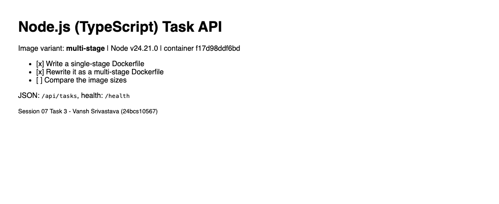
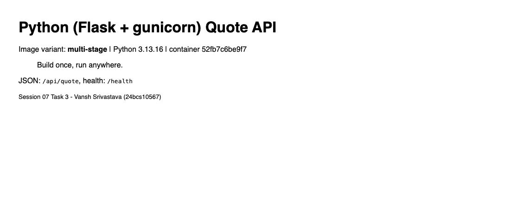
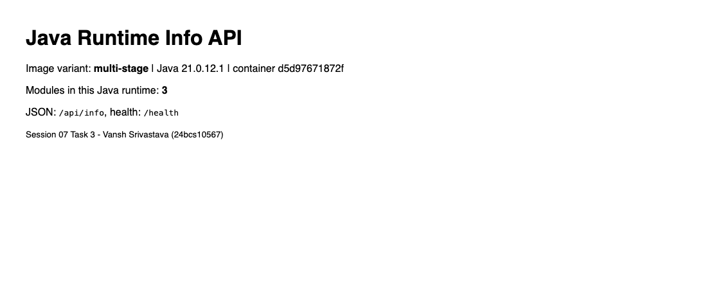

# Session 07: Dockerfiles & Images

**Name:** Vansh Srivastava
**Enrollment No.:** 24bcs10567
**Session:** 07

This session goes deeper into Dockerfiles and images, mainly multi-stage builds. First I ran the instructor's multi-stage Dockerfile from the course repo and confirmed it serves "Hello World from Docker Multi-Stage Build!" on port 8080. Then I deployed three more apps (Node.js/TypeScript, Python/Flask, Java). Each one has a single-stage and a multi-stage Dockerfile, so I could compare the image sizes with `docker images`.

## Folder structure

```text
session-07-dockerfiles-images/
├── README.md                         # this file (also the Task 2 documentation)
├── .gitignore
├── task1-multi-stage-dockerfile/     # copied unchanged from the course repo (Nency-Ravaliya/devops-heros)
│   ├── Dockerfile                    # 2 stages: builder + production (node:24-alpine)
│   ├── package.json                  # express ^5.1.0
│   └── server.js                     # Express app listening on port 3000
├── task3-deployments/
│   ├── node-api/                     # TypeScript task-list API (Node built-in http)
│   │   ├── Dockerfile.single         # one stage on node:24
│   │   ├── Dockerfile                # multi-stage: node:24 build -> node:24-alpine runtime
│   │   ├── .dockerignore
│   │   ├── package.json, package-lock.json, tsconfig.json
│   │   └── src/server.ts
│   ├── python-api/                   # Flask + gunicorn quote API
│   │   ├── Dockerfile.single         # one stage on python:3.13
│   │   ├── Dockerfile                # multi-stage: python:3.13 venv -> python:3.13-slim runtime
│   │   ├── .dockerignore
│   │   ├── requirements.txt
│   │   └── app.py
│   └── java-api/                     # runtime-info API (JDK built-in HttpServer)
│       ├── Dockerfile.single         # one stage on eclipse-temurin:21-jdk
│       ├── Dockerfile                # multi-stage: JDK + jlink -> alpine:3.22 + 3-module runtime
│       ├── .dockerignore
│       └── src/InfoApi.java
└── screenshots/                      # real headless Chrome captures
```

## Environment

```text
$ sw_vers -productVersion; uname -m
26.6.2
arm64
$ colima version | head -1
colima version 0.10.3
$ docker version --format 'Client {{.Client.Version}} / Server {{.Server.Version}} ({{.Server.Os}}/{{.Server.Arch}})'
Client 29.8.2 / Server 29.5.2 (linux/arm64)
```

Docker Hub was rate-limiting anonymous pulls from my network (HTTP 429) while I worked, so my own Dockerfiles pull the official images from the AWS ECR Public mirror: `public.ecr.aws/docker/library/<image>:<tag>` is the same official image as `<image>:<tag>` on Docker Hub. For the instructor's Dockerfile I did not edit the file at all (see Task 1).

## Task 1: Run Multi-Stage Dockerfile

### Clone the repository

The multi-stage example is in the instructor's course repo, [Nency-Ravaliya/devops-heros](https://github.com/Nency-Ravaliya/devops-heros), in the folder `session6-7-docker/multi-stage-dockerfile`. I already had a local clone (`course-repo`), and I copied the three files into `task1-multi-stage-dockerfile/` without changing them:

```bash
$ git -C course-repo remote -v
origin	https://github.com/Nency-Ravaliya/devops-heros.git (fetch)
origin	https://github.com/Nency-Ravaliya/devops-heros.git (push)
$ git -C course-repo log -1 --format='%h %ad %s' --date=short
8376590 2026-10-05 replicas from 2 to 5
$ cp course-repo/session6-7-docker/multi-stage-dockerfile/{Dockerfile,package.json,server.js} task1-multi-stage-dockerfile/
$ ls task1-multi-stage-dockerfile
Dockerfile
package.json
server.js
```

The instructor's Dockerfile:

```dockerfile
# -------------------------
# Stage 1: Build
# -------------------------
FROM node:24-alpine AS builder
WORKDIR /app
COPY package*.json ./
RUN npm install
COPY . .

# -------------------------
# Stage 2: Production
# -------------------------
FROM node:24-alpine AS production
WORKDIR /app
COPY --from=builder /app/package*.json ./
RUN npm install --omit=dev
COPY --from=builder /app/server.js ./
EXPOSE 3000
CMD ["npm", "start"]
```

### Build the image

My first build failed because Docker Hub rate-limited the `FROM node:24-alpine` pull:

```bash
$ cd task1-multi-stage-dockerfile
$ docker build --progress=plain -t s07-multistage-hello:1.0 .
...
 > [internal] load metadata for docker.io/library/node:24-alpine:
------
Dockerfile:4
--------------------
   2 |     # Stage 1: Build
   3 |     # -------------------------
   4 | >>> FROM node:24-alpine AS builder
   5 |     WORKDIR /app
   6 |     COPY package*.json ./
--------------------
ERROR: failed to build: failed to solve: node:24-alpine: failed to resolve source metadata for docker.io/library/node:24-alpine: unexpected status from HEAD request to https://registry-1.docker.io/v2/library/node/manifests/24-alpine: 429 Too Many Requests
```

To keep the Dockerfile exactly as the instructor wrote it, I used a BuildKit **named build context**. `--build-context node:24-alpine=docker-image://...` tells BuildKit that every `FROM node:24-alpine` should use the same official image from the ECR Public mirror:

```bash
$ docker build --progress=plain \
    --build-context node:24-alpine=docker-image://public.ecr.aws/docker/library/node:24-alpine \
    -t s07-multistage-hello:1.0 .
#0 building with "colima" instance using docker driver

#1 [internal] load build definition from Dockerfile
#1 transferring dockerfile: 468B done
#1 DONE 0.0s

#2 [context node:24-alpine] load metadata for public.ecr.aws/docker/library/node:24-alpine
#2 DONE 0.0s
...
#8 [builder 3/5] RUN npm install
#8 2.824 
#8 2.824 added 68 packages, and audited 69 packages in 3s
...
#9 [builder 4/5] COPY . .
#9 DONE 0.0s

#10 [production 2/5] COPY --from=builder /app/package*.json ./
#10 DONE 0.0s

#11 [production 3/5] RUN npm install --omit=dev
#11 0.737 
#11 0.737 added 68 packages, and audited 69 packages in 621ms
...
#12 [production 4/5] COPY --from=builder /app/server.js ./
#12 DONE 0.0s

#13 exporting to image
...
#13 naming to docker.io/library/s07-multistage-hello:1.0 done
#13 unpacking to docker.io/library/s07-multistage-hello:1.0 0.1s done
#13 DONE 0.2s
```

The log shows both stages: `builder` installs the dependencies and copies the source, then `production` starts again from a clean `node:24-alpine`. It takes only `package*.json` and `server.js` from `builder` (`COPY --from=builder`) and installs production dependencies only.

### Run the container and access the app

The app listens on port **3000 inside the container** (`const PORT = 3000` in `server.js`, `EXPOSE 3000` in the Dockerfile). The brief wants the app on **port 8080**, and host port 8080 was free on my Mac, so I published host port 8080 to container port 3000:

```bash
$ docker run -d --name s07-multistage-hello -p 8080:3000 s07-multistage-hello:1.0
fff34d07e781e57cdc51e43a30eb4754d5642770472034aa5ac01e49c4694190
$ docker port s07-multistage-hello
3000/tcp -> 0.0.0.0:8080
3000/tcp -> [::]:8080
$ curl -i http://localhost:8080/
HTTP/1.1 200 OK
X-Powered-By: Express
Content-Type: text/html; charset=utf-8
Content-Length: 51
ETag: W/"33-gCAsBJJtlso/BVPWoV3U/pWC3Ak"
Date: Wed, 07 Oct 2026 17:50:31 GMT
Connection: keep-alive
Keep-Alive: timeout=5

<h1>Hello World from Docker Multi-Stage Build!</h1>
$ docker logs s07-multistage-hello

> docker-hello-world@1.0.0 start
> node server.js

Server running on port 3000
```

The page shows the expected text, **"Hello World from Docker Multi-Stage Build!"**, and the `X-Powered-By: Express` header shows that the Express app inside the container answered.


### Verify the running container with docker ps (port 8080)

```bash
$ docker ps --filter name=s07-multistage-hello
CONTAINER ID   IMAGE                      COMMAND                  CREATED         STATUS         PORTS                                         NAMES
fff34d07e781   s07-multistage-hello:1.0   "docker-entrypoint.s…"   3 seconds ago   Up 3 seconds   0.0.0.0:8080->3000/tcp, [::]:8080->3000/tcp   s07-multistage-hello
```

`0.0.0.0:8080->3000/tcp` confirms the container is running and reachable on port 8080 of my machine, forwarded to the app's port 3000 inside the container.

### What ended up in the image

```bash
$ docker images s07-multistage-hello
IMAGE                      ID             DISK USAGE   CONTENT SIZE   EXTRA
s07-multistage-hello:1.0   69e153d838fc        249MB           64MB        
$ docker history s07-multistage-hello:1.0 --format "table {{.CreatedBy}}\t{{.Size}}" | head -8
CREATED BY                                      SIZE
CMD ["npm" "start"]                             0B
EXPOSE [3000/tcp]                               0B
COPY /app/server.js ./ # buildkit               12.3kB
RUN /bin/sh -c npm install --omit=dev # buil…   9.44MB
COPY /app/package*.json ./ # buildkit           45.1kB
WORKDIR /app                                    8.19kB
CMD ["node"]                                    0B
$ docker exec s07-multistage-hello ls -la /app
total 52
drwxr-xr-x    1 root     root          4096 Oct  7 17:50 .
drwxr-xr-x    1 root     root          4096 Oct  7 17:50 ..
drwxr-xr-x   67 root     root          4096 Oct  7 17:50 node_modules
-rw-r--r--    1 root     root         31046 Oct  7 17:50 package-lock.json
-rw-r--r--    1 root     root           178 Oct  7 17:50 package.json
-rw-r--r--    1 root     root           258 Oct  7 17:50 server.js
```

`docker history` lists only the `production` stage's layers on top of `node:24-alpine`. Nothing from `builder` is there except the files that were copied on purpose.

One thing I noticed: this app has only one dependency (`express`) and no `devDependencies`, so both stages install the same 68 packages. Here the multi-stage build mostly demonstrates the syntax and does not save much space. It pays off when the build stage needs things that the runtime does not, like a compiler, TypeScript or dev dependencies. That is what Task 3 shows.

### Freeing port 8080

I removed the container straight after collecting the evidence, so port 8080 was free again:

```bash
$ docker rm -f s07-multistage-hello
s07-multistage-hello
$ curl -s -o /dev/null -w "%{http_code}\n" --max-time 3 http://localhost:8080/ || echo "port 8080 closed"
000
port 8080 closed
```

## Task 2: Documentation

This README is the Task 2 document. It contains:

- my name (**Vansh Srivastava**) and enrollment number (**24bcs10567**) at the top,
- the output showing the app running (`curl` response with "Hello World from Docker Multi-Stage Build!", container logs, and the screenshot above),
- the `docker ps` output showing the running container published on port 8080 (`0.0.0.0:8080->3000/tcp`).

## Task 3: Docker Application Deployment

I deployed three different kinds of application: a **Node.js** (TypeScript) API, a **Python** (Flask + gunicorn) API and a **Java** API. They are different from my Session 06 apps. Each has a JSON endpoint and a `/health` endpoint, and each folder has two Dockerfiles:

- `Dockerfile.single`: the obvious first attempt. One stage, based on the full image that has the build tools, and the app runs in that same image.
- `Dockerfile`: a multi-stage build. A full image builds the app, and a small runtime image receives only the build output.

Every container gets an `IMAGE_VARIANT` environment variable from its Dockerfile, and the app prints it, so each response shows which image it came from.

### The three apps

**node-api** is a small task-list API written in TypeScript (`src/server.ts`) that uses only Node's `http` module. TypeScript and `@types/node` are dev dependencies, needed only to compile. The multi-stage runtime gets `dist/` and `package.json` and no `node_modules` at all:

```dockerfile
FROM public.ecr.aws/docker/library/node:24 AS build
WORKDIR /app
COPY package.json package-lock.json ./
RUN npm ci
COPY tsconfig.json ./
COPY src ./src
RUN npm run build

FROM public.ecr.aws/docker/library/node:24-alpine AS runtime
WORKDIR /app
ENV NODE_ENV=production PORT=3000 IMAGE_VARIANT=multi-stage
COPY --from=build /app/package.json ./
COPY --from=build /app/dist ./dist
USER node
EXPOSE 3000
HEALTHCHECK --interval=30s --timeout=3s CMD wget -qO- http://127.0.0.1:3000/health || exit 1
CMD ["node", "dist/server.js"]
```

**python-api** is a quote API with Flask, served by gunicorn with 2 workers. The build stage installs the requirements into a virtualenv at `/opt/venv`. The runtime stage (`python:3.13-slim`) copies that virtualenv. This works because both official images install Python at the same path (`/usr/local/bin/python3.13`):

```dockerfile
FROM public.ecr.aws/docker/library/python:3.13 AS build
RUN python -m venv /opt/venv
ENV PATH="/opt/venv/bin:$PATH"
COPY requirements.txt .
RUN pip install --no-cache-dir -r requirements.txt

FROM public.ecr.aws/docker/library/python:3.13-slim AS runtime
COPY --from=build /opt/venv /opt/venv
ENV PATH="/opt/venv/bin:$PATH" PYTHONUNBUFFERED=1 IMAGE_VARIANT=multi-stage
WORKDIR /app
COPY app.py .
RUN useradd --no-create-home --shell /usr/sbin/nologin appuser
USER appuser
EXPOSE 5000
CMD ["gunicorn", "--bind", "0.0.0.0:5000", "--workers", "2", "--access-logfile", "-", "app:app"]
```

**java-api** is a runtime-info API on the JDK's built-in `HttpServer`. The multi-stage build goes further than "JDK to JRE": it uses `jlink` to build a custom Java runtime with only the three modules the app uses, and puts that runtime on plain `alpine:3.22`:

```dockerfile
FROM public.ecr.aws/docker/library/eclipse-temurin:21-jdk-alpine AS build
WORKDIR /build
COPY src ./src
RUN javac -d classes src/InfoApi.java \
 && jar --create --file app.jar --main-class InfoApi -C classes . \
 && jlink --add-modules java.base,java.management,jdk.httpserver \
          --strip-debug --no-man-pages --no-header-files --compress=zip-6 \
          --output /opt/jre

FROM public.ecr.aws/docker/library/alpine:3.22 AS runtime
COPY --from=build /opt/jre /opt/jre
COPY --from=build /build/app.jar /app/app.jar
RUN adduser -D -H appuser
USER appuser
ENV PATH="/opt/jre/bin:$PATH" PORT=8080 IMAGE_VARIANT=multi-stage
EXPOSE 8080
CMD ["java", "-jar", "/app/app.jar"]
```

The JDK stage is also Alpine (musl libc), so the runtime produced by `jlink` runs on the Alpine runtime image.

### Build

```bash
$ cd task3-deployments
$ for a in node-api python-api java-api; do
>   docker build --progress=plain -f ${a}/Dockerfile.single -t "s07-${a}:single" ${a}
>   docker build --progress=plain -f ${a}/Dockerfile -t "s07-${a}:multi" ${a}
> done
```

All six builds finished with exit code 0. Some parts of the logs:

```text
# node-api, single stage
#8 [4/7] RUN npm ci
#8 1.645 
#8 1.645 added 3 packages, and audited 4 packages in 1s
...
#11 [7/7] RUN npm run build
#11 0.194 
#11 0.194 > s07-node-api@1.0.0 build
#11 0.194 > tsc
...
#12 naming to docker.io/library/s07-node-api:single done

# python-api, multi-stage
#5 [build 1/4] FROM public.ecr.aws/docker/library/python:3.13@sha256:9d72651cf7018c1f6a1dd6fd02bd68286631c33620bc0f37b0675b21aab915d5
#7 [runtime 1/5] FROM public.ecr.aws/docker/library/python:3.13-slim@sha256:bf44cdfcb76cd3b41e879bc058fc37ec5872002ccfde7fcb765e218cde0cd79c
...
#10 1.695 Successfully installed Flask-3.1.3 blinker-1.9.0 click-8.5.0 gunicorn-26.2.0 itsdangerous-2.2.0 jinja2-3.1.6 markupsafe-3.0.4 werkzeug-3.1.9
#11 [runtime 2/5] COPY --from=build /opt/venv /opt/venv
...
#15 naming to docker.io/library/s07-python-api:multi done

# java-api, multi-stage
#10 [build 4/4] RUN javac -d classes src/InfoApi.java  && jar --create --file app.jar --main-class InfoApi -C classes .  && jlink --add-modules java.base,java.management,jdk.httpserver           --strip-debug --no-man-pages --no-header-files --compress=zip-6           --output /opt/jre
#10 DONE 3.3s
#11 [runtime 2/4] COPY --from=build /opt/jre /opt/jre
#11 DONE 0.1s
#12 [runtime 3/4] COPY --from=build /build/app.jar /app/app.jar
#12 DONE 0.0s
```

### Image size comparison

```bash
$ docker images --filter "reference=s07-*"
IMAGE                      ID             DISK USAGE   CONTENT SIZE   EXTRA
s07-java-api:multi         837b084dd0c0       75.6MB         26.1MB        
s07-java-api:single        59fef7f8781f        756MB          225MB        
s07-multistage-hello:1.0   69e153d838fc        249MB           64MB        
s07-node-api:multi         820705e56568        238MB         62.1MB        
s07-node-api:single        4b1a4e5a008b       1.68GB          414MB        
s07-python-api:multi       9efb7cdd1296        229MB         49.3MB        
s07-python-api:single      55dee8a55d52       1.64GB          409MB        
```

`DISK USAGE` is the unpacked size on disk, and `CONTENT SIZE` is the compressed size that is pulled from or pushed to a registry. My summary:

| App | Single-stage (disk / content) | Multi-stage (disk / content) | Smaller by (disk / content) |
|---|---|---|---|
| node-api | 1.68GB / 414MB | 238MB / 62.1MB | about 86% / 85% |
| python-api | 1.64GB / 409MB | 229MB / 49.3MB | about 86% / 88% |
| java-api | 756MB / 225MB | 75.6MB / 26.1MB | about 90% / 88% |

Where the saving comes from, checked inside the running containers:

```bash
$ docker exec s07-node-api-single ls /app
dist
node_modules
package-lock.json
package.json
src
tsconfig.json
$ docker exec s07-node-api-single du -sh /app/node_modules /root/.npm
26M	/app/node_modules
4.8M	/root/.npm
$ docker exec s07-node-api-multi ls /app
dist
package.json
$ docker exec s07-python-api-single gcc --version | head -1
gcc (Debian 14.2.0-19) 14.2.0
$ docker exec s07-python-api-multi gcc --version
OCI runtime exec failed: exec failed: unable to start container process: exec: "gcc": executable file not found in $PATH
$ docker exec s07-node-api-single sh -c 'gcc --version | head -1; dpkg -l | grep -c -- "-dev:"'
gcc (Debian 12.2.0-14+deb12u1) 12.2.0
75
$ docker exec s07-python-api-single sh -c 'dpkg -l | grep -c -- "-dev:"'
99
$ docker exec s07-python-api-multi sh -c 'dpkg -l | grep -c -- "-dev:"'
0
$ docker exec s07-java-api-single javac -version
javac 21.0.12.1
$ docker exec s07-java-api-multi javac -version
OCI runtime exec failed: exec failed: unable to start container process: exec: "javac": executable file not found in $PATH
$ docker exec s07-java-api-multi java --list-modules
java.base@21.0.12.1
java.management@21.0.12.1
jdk.httpserver@21.0.12.1
$ docker exec s07-java-api-multi du -sh /opt/jre
38.3M	/opt/jre
$ docker exec s07-java-api-multi id
uid=1000(appuser) gid=1000(appuser) groups=1000(appuser)
```

- **Build toolchain gone.** The single-stage images still contain gcc, dozens of Debian `-dev` header packages (75 in `node:24`, 99 in `python:3.13`) and `javac`. The multi-stage runtimes do not, so there is less to download, less to patch and less for an attacker to use.
- **Dev dependencies and sources gone.** The Node single image carries `src/`, `tsconfig.json`, 26 MB of `node_modules` (TypeScript) and a 4.8 MB npm cache. The multi image has only `dist/` and `package.json`.
- **Smaller base.** This is honestly the biggest part of the saving. The full `node:24` and `python:3.13` images are Debian with many build packages. Multi-stage lets me use them only for building and run on `node:24-alpine` or `python:3.13-slim`. In a single stage I could not do that if the build needed those tools.
- **jlink.** The Java runtime in the multi-stage image has only 3 modules (38.3 MB). The full JDK image resolves 62 modules at startup (see `"modules":62` below).

### Run and verify

```bash
$ docker run -d --name s07-node-api-single -p 8111:3000 s07-node-api:single
3b3a7f327d64c2842804ffa97adc3efc5c41f313c5c93c5d4a8e41134c6d8699
$ docker run -d --name s07-node-api-multi -p 8112:3000 s07-node-api:multi
f17d98ddf6bd6a1d8bd4d67a208986e2d1294e980c4b669aa34d08f52745b9db
$ docker run -d --name s07-python-api-single -p 8121:5000 s07-python-api:single
a3c16d1d8ae6ea0866dbdb52dff72d8e7c477824d6d1accdcc9d4bd9e2f8a110
$ docker run -d --name s07-python-api-multi -p 8122:5000 s07-python-api:multi
52fb7c6be9f7cec511ff24c93d4c3a6fc61564924ff415979085b71f53cf9547
$ docker run -d --name s07-java-api-single -p 8131:8080 s07-java-api:single
c65bbbfaa8453f9644918836c8bc92efd5bdb7222fa84333c7104a69e5ff1f37
$ docker run -d --name s07-java-api-multi -p 8132:8080 s07-java-api:multi
d5d97671872f9ef4a9a8162d8594586b95292d15d5364e9d7a84b4e34681abb9
$ docker ps --filter name=s07- --format 'table {{.Names}}\t{{.Image}}\t{{.Status}}\t{{.Ports}}'
NAMES                   IMAGE                   STATUS                            PORTS
s07-java-api-multi      s07-java-api:multi      Up 5 seconds                      0.0.0.0:8132->8080/tcp, [::]:8132->8080/tcp
s07-java-api-single     s07-java-api:single     Up 5 seconds                      0.0.0.0:8131->8080/tcp, [::]:8131->8080/tcp
s07-python-api-multi    s07-python-api:multi    Up 5 seconds                      0.0.0.0:8122->5000/tcp, [::]:8122->5000/tcp
s07-python-api-single   s07-python-api:single   Up 5 seconds                      0.0.0.0:8121->5000/tcp, [::]:8121->5000/tcp
s07-node-api-multi      s07-node-api:multi      Up 6 seconds (health: starting)   0.0.0.0:8112->3000/tcp, [::]:8112->3000/tcp
s07-node-api-single     s07-node-api:single     Up 6 seconds                      0.0.0.0:8111->3000/tcp, [::]:8111->3000/tcp
```

`(health: starting)` on `s07-node-api-multi` comes from the `HEALTHCHECK` in its Dockerfile. Docker runs the `wget /health` command inside the container every 30 seconds.

```bash
$ curl -s http://localhost:8111/api/tasks
{"variant":"single-stage","tasks":[{"id":1,"title":"Write a single-stage Dockerfile","done":true},{"id":2,"title":"Rewrite it as a multi-stage Dockerfile","done":true},{"id":3,"title":"Compare the image sizes","done":false}]}
$ curl -s http://localhost:8112/api/tasks
{"variant":"multi-stage","tasks":[{"id":1,"title":"Write a single-stage Dockerfile","done":true},{"id":2,"title":"Rewrite it as a multi-stage Dockerfile","done":true},{"id":3,"title":"Compare the image sizes","done":false}]}
$ curl -s http://localhost:8121/api/quote
{"quote":"Small images start faster, pull faster and have fewer CVEs.","variant":"single-stage"}
$ curl -s http://localhost:8122/api/quote
{"quote":"Small images start faster, pull faster and have fewer CVEs.","variant":"multi-stage"}
$ curl -s http://localhost:8131/api/info
{"variant":"single-stage","javaVersion":"21.0.12.1","vendor":"Eclipse Adoptium","modules":62,"uptimeMs":10857}
$ curl -s http://localhost:8132/api/info
{"variant":"multi-stage","javaVersion":"21.0.12.1","vendor":"Eclipse Adoptium","modules":3,"uptimeMs":10674}
$ curl -s http://localhost:8112/health
{"status":"ok"}
$ curl -s http://localhost:8122/health
{"status":"ok"}

$ curl -s http://localhost:8132/health
{"status":"ok"}
```

Both variants of each app return the same data, so the multi-stage images work exactly like the big ones. The only difference is the `variant` field. The Java responses also show the effect of jlink: 62 modules in the full JDK runtime against 3 in the custom runtime, with the same Java version.

Screenshots of the multi-stage versions:







## Cleanup

```bash
$ docker rm -f s07-node-api-single s07-node-api-multi s07-python-api-single s07-python-api-multi s07-java-api-single s07-java-api-multi
s07-node-api-single
s07-node-api-multi
s07-python-api-single
s07-python-api-multi
s07-java-api-single
s07-java-api-multi
$ docker rmi s07-node-api:single s07-node-api:multi s07-python-api:single s07-python-api:multi s07-java-api:single s07-java-api:multi s07-multistage-hello:1.0
Untagged: s07-node-api:single
Deleted: sha256:4b1a4e5a008b7837ab1398a415493a2a7c886cb0b70bc0c4e7a0867460707b1c
Untagged: s07-node-api:multi
Deleted: sha256:820705e56568c88f1105d407fea5be2165527ec1df7fefda2783a1b509bad1b8
Untagged: s07-python-api:single
Deleted: sha256:55dee8a55d52b49d3b92e7f3e2386ce718850ca91cd147e39ef751f95f267317
Untagged: s07-python-api:multi
Deleted: sha256:9efb7cdd1296167c9ea1d927d8a08504476ad9511754fb3a2a337278311eb6c6
Untagged: s07-java-api:single
Deleted: sha256:59fef7f8781f25c91ed4d181e45ec8deac8f34b774f59d974f869c37a20d8ec2
Untagged: s07-java-api:multi
Deleted: sha256:837b084dd0c062b46c9d7243e3acff843ac18b04c69c6f29d7ce3b855a71c23d
Untagged: s07-multistage-hello:1.0
Deleted: sha256:69e153d838fce3878c55c24d76900fe72a59b8499ba39ead9a99fed5bcdef44e
$ docker ps -a --filter name=s07- --format '{{.Names}}' | wc -l
       0
```

## What I learned

- In a multi-stage build, every `FROM` starts a new stage, and only what I copy with `COPY --from=<stage>` reaches the final image. Compilers, dev dependencies, caches and sources stay behind in the build stage.
- The biggest wins come from compiled or transpiled apps (TypeScript, Java). For an app like the instructor's Express example, with one runtime dependency and no build step, multi-stage hardly changes the size.
- `jlink` makes a custom Java runtime with only the modules the app needs. Here that was 38 MB instead of a full JDK, and the final image was 75.6 MB instead of 756 MB.
- When copying a Python virtualenv between stages, both stages must have Python at the same path. Using the official `python:3.13` and `python:3.13-slim` pair keeps that true.
- `docker images` on Docker 29 shows both the unpacked disk usage and the compressed content size. The compressed size is what actually gets pushed and pulled.
- `--build-context name=docker-image://...` can redirect a `FROM` to another registry without editing the Dockerfile. That was handy when Docker Hub rate-limited me.
- The port in `-p HOST:CONTAINER` must match the port the app really listens on inside the container (3000 for the instructor's app), even if the brief asks for a different outside port (8080).
