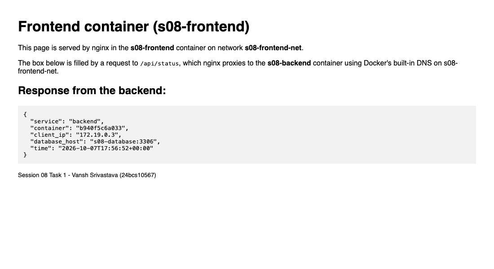
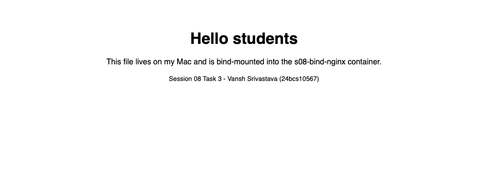
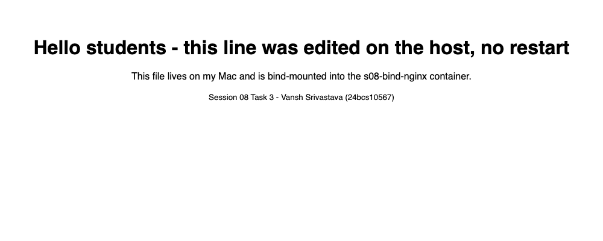

# Session 08: Docker Networking & Volumes

**Name:** Vansh Srivastava
**Enrollment No.:** 24bcs10567
**Session:** 08

This session covers how containers talk to each other (user-defined bridge networks, the host network, overlay networks) and how they share files with the host (bind mounts). I built a frontend / backend / database setup on three separate networks and tested which containers can and cannot reach each other. I also ran Apache on the host network on port 80, showed that a bind-mounted `index.html` can change while nginx keeps running, and ran a short single-node swarm demo of an overlay network so I could see the VXLAN device that carries it.

## Folder structure

```text
session-08-docker-networking-volumes/
├── README.md
├── .gitignore
├── task1-networking/
│   ├── frontend/               # nginx: static page + reverse proxy /api/ -> s08-backend
│   │   ├── Dockerfile
│   │   ├── .dockerignore
│   │   ├── default.conf
│   │   └── index.html
│   └── backend/                # nginx: returns a small JSON status document
│       ├── Dockerfile
│       ├── .dockerignore
│       └── default.conf
├── task3-bind-mount/
│   └── site/index.html         # bind-mounted into nginx (edited live during Task 3)
└── screenshots/                # real headless Chrome captures
```

Task 2 (Apache on the host network) and Task 4 (overlay network) use stock images, so they need no files. The commands and outputs are below.

## Environment

```text
$ sw_vers -productVersion; uname -m
26.6.2
arm64
$ colima version | head -1
colima version 0.10.3
$ docker version --format 'Client {{.Client.Version}} / Server {{.Server.Version}} ({{.Server.Os}}/{{.Server.Arch}})'
Client 29.8.2 / Server 29.5.2 (linux/arm64)
```

Docker Engine runs inside a Colima Linux VM on my Mac. Two things about this setup matter for this session:

- The "Docker host" is the Colima VM, not macOS. Bridge networks, `--network host` and `docker0` all live inside the VM. Published ports reach `localhost` on the Mac because Colima forwards them over SSH.
- Colima mounts my macOS home folder into the VM with virtiofs at the same path, so a bind mount of a folder under `/Users/vanshsrivastava/...` works like it would on a Linux host.

Docker Hub was answering anonymous pulls with `429 Too Many Requests` while I worked, so the images come from the AWS ECR Public mirror of the official images (`public.ecr.aws/docker/library/<image>`). These are the same official `nginx`, `mysql`, `httpd` and `alpine` images. Task 2 shows the Docker Hub error.

## Task 1: Container networking

### Design

The brief asks for three containers (Frontend, Backend, Database), three networks, and the backend on two networks:

```text
                 host :8181
                     |
          +----------v----------+
          |    s08-frontend     |  nginx (static page + proxy /api/)
          +----------+----------+
                     |  s08-frontend-net (bridge)
          +----------v----------+
          |     s08-backend     |  nginx (JSON API)    <- on 2 networks
          +----------+----------+
                     |  s08-backend-net (bridge, --internal)
          +----------v----------+
          |    s08-database     |  mysql:8.4
          +----------+----------+
                     |  s08-database-net (bridge, --internal)
                (data tier only)
```

| Network | Driver | `--internal` | Members | Purpose |
|---|---|---|---|---|
| `s08-frontend-net` | bridge | no | frontend, backend | public-facing tier. Has a gateway, so the frontend port can be published and the backend can reach the internet |
| `s08-backend-net` | bridge | yes | backend, database | the only path to MySQL. No outbound internet |
| `s08-database-net` | bridge | yes | database | the data tier's private network, where a backup or replica container would go. No outbound internet |

The **backend is the only container on both the frontend network and the backend network**, so it is the bridge between the tiers. The frontend and the database share no network, so they cannot see each other at all.

Frontend nginx config (`task1-networking/frontend/default.conf`):

```nginx
location /api/ {
    proxy_pass http://s08-backend:80/api/;
    proxy_set_header Host $host;
    proxy_set_header X-Real-IP $remote_addr;
}
```

`s08-backend` is resolved by Docker's embedded DNS server (`127.0.0.11`). That only works on user-defined networks and only for containers on the same network.

### Create the networks and containers

```bash
$ docker build -q -t s08-backend:1.0 backend
sha256:5c54072cac980a2bfe5dc8e5f22ec9417a3f1582b7de8e72522e80aa04749ab1
$ docker build -q -t s08-frontend:1.0 frontend
sha256:798925201dbda0f162dc31e0d21cdc7a3aeabb701974e599a98d6d758bd23494
$ docker network create s08-frontend-net
1dbff289f883373ab75b394875897ebd39afe9c8a1d81673d9fb00339e1108b0
$ docker network create --internal s08-backend-net
9e1f1352137367c0a28379fbf7d6ae2d0dd50717cb71d1a8befd1f4e0671e051
$ docker network create --internal s08-database-net
8a84c581b11e6dec2aef7b86384877184952d519dae47e2a490e30f6ef17530b
$ docker network ls --filter name=s08-
NETWORK ID     NAME               DRIVER    SCOPE
9e1f13521373   s08-backend-net    bridge    local
8a84c581b11e   s08-database-net   bridge    local
1dbff289f883   s08-frontend-net   bridge    local
$ docker run -d --name s08-database --network s08-backend-net -e MYSQL_ROOT_PASSWORD=demo-password-123 -e MYSQL_DATABASE=s08demo -v s08-mysql-data:/var/lib/mysql public.ecr.aws/docker/library/mysql:8.4
355c039150acb5f1b0bbe5681191cc1a8cbd67267ede7f48e98840cf63c38b9d
$ docker network connect s08-database-net s08-database
$ docker run -d --name s08-backend --network s08-frontend-net s08-backend:1.0
b940f5c6a033777d76fe5f12a43da0e2b9789362238f1bbb530ca4fcea0b23b3
$ docker network connect s08-backend-net s08-backend
$ docker run -d --name s08-frontend --network s08-frontend-net -p 8181:80 s08-frontend:1.0
73db21160cd5e7d48700a5c018ecd6e7a02e7410dffee2dbb287c1f5bd7cae7d
```

`docker run --network` attaches a container to its first network, and `docker network connect` adds another one to a running container. The MySQL password is an obvious demo value. MySQL data goes into a named volume, `s08-mysql-data`.

```bash
$ docker logs s08-database 2>&1 | grep "ready for connections" | tail -1
2026-10-07T17:56:41.690324Z 0 [System] [MY-010931] [Server] /usr/sbin/mysqld: ready for connections. Version: '8.4.11'  socket: '/var/run/mysqld/mysqld.sock'  port: 3306  MySQL Community Server - GPL.
$ docker ps --filter name=s08- --format "table {{.Names}}\t{{.Image}}\t{{.Status}}\t{{.Ports}}"
NAMES          IMAGE                                     STATUS         PORTS
s08-frontend   s08-frontend:1.0                          Up 6 seconds   0.0.0.0:8181->80/tcp, [::]:8181->80/tcp
s08-backend    s08-backend:1.0                           Up 6 seconds   80/tcp
s08-database   public.ecr.aws/docker/library/mysql:8.4   Up 6 seconds   3306/tcp, 33060/tcp
```

Only the frontend publishes a port to the host. The backend's `80/tcp` and the database's `3306/tcp` are reachable only from inside their networks.

### Which container is on which network

```bash
$ docker inspect s08-frontend --format '{{range $net, $cfg := .NetworkSettings.Networks}}{{$net}}={{$cfg.IPAddress}} {{end}}'
s08-frontend-net=172.19.0.3 
$ docker inspect s08-backend --format '{{range $net, $cfg := .NetworkSettings.Networks}}{{$net}}={{$cfg.IPAddress}} {{end}}'
s08-backend-net=172.20.0.3 s08-frontend-net=172.19.0.2 
$ docker inspect s08-database --format '{{range $net, $cfg := .NetworkSettings.Networks}}{{$net}}={{$cfg.IPAddress}} {{end}}'
s08-backend-net=172.20.0.2 s08-database-net=172.21.0.2 
$ docker network inspect s08-frontend-net --format '{{.Name}} subnet={{(index .IPAM.Config 0).Subnet}} internal={{.Internal}} containers={{range .Containers}}{{.Name}} {{end}}'
s08-frontend-net subnet=172.19.0.0/16 internal=false containers=s08-frontend s08-backend 
$ docker network inspect s08-backend-net --format '{{.Name}} subnet={{(index .IPAM.Config 0).Subnet}} internal={{.Internal}} containers={{range .Containers}}{{.Name}} {{end}}'
s08-backend-net subnet=172.20.0.0/16 internal=true containers=s08-database s08-backend 
$ docker network inspect s08-database-net --format '{{.Name}} subnet={{(index .IPAM.Config 0).Subnet}} internal={{.Internal}} containers={{range .Containers}}{{.Name}} {{end}}'
s08-database-net subnet=172.21.0.0/16 internal=true containers=s08-database
```

The backend has two interfaces, one on each subnet: `172.19.0.2` on the frontend network and `172.20.0.3` on the backend network. Each network got its own subnet and its own Linux bridge in the VM.

### Connectivity checks

**1. Frontend -> Backend: works** (both are on `s08-frontend-net`)

```bash
$ docker exec s08-frontend ping -c 2 -W 2 s08-backend
PING s08-backend (172.19.0.2): 56 data bytes
64 bytes from 172.19.0.2: seq=0 ttl=64 time=1.011 ms
64 bytes from 172.19.0.2: seq=1 ttl=64 time=0.054 ms

--- s08-backend ping statistics ---
2 packets transmitted, 2 packets received, 0% packet loss
round-trip min/avg/max = 0.054/0.532/1.011 ms
[exit code: 0]
$ docker exec s08-frontend wget -qO- http://s08-backend/api/status
{"service":"backend","container":"b940f5c6a033","client_ip":"172.19.0.3","database_host":"s08-database:3306","time":"2026-10-07T17:56:43+00:00"}
[exit code: 0]
```

**2. Backend -> Database: works** (both are on `s08-backend-net`)

```bash
$ docker exec s08-backend ping -c 2 -W 2 s08-database
PING s08-database (172.20.0.2): 56 data bytes
64 bytes from 172.20.0.2: seq=0 ttl=64 time=0.429 ms
64 bytes from 172.20.0.2: seq=1 ttl=64 time=0.067 ms

--- s08-database ping statistics ---
2 packets transmitted, 2 packets received, 0% packet loss
round-trip min/avg/max = 0.067/0.248/0.429 ms
[exit code: 0]
$ docker exec s08-backend nc -zv -w 3 s08-database 3306
s08-database (172.20.0.2:3306) open
[exit code: 0]
$ docker exec s08-backend sh -c 'nc -w 2 s08-database 3306 </dev/null | head -c 16 | hexdump -C'
00000000  4a 00 00 00 0a 38 2e 34  2e 31 31 00 09 00 00 00  |J....8.4.11.....|
00000010
[exit code: 0]
```

The last command reads the first bytes MySQL sends to a new client (its handshake packet). They contain the server version `8.4.11`, so this is really MySQL answering across the network, not just an open port.

**3. Frontend -> Database: blocked** (no shared network)

```bash
$ docker exec s08-frontend ping -c 2 -W 2 s08-database
ping: bad address 's08-database'
[exit code: 1]
$ docker exec s08-frontend nslookup s08-database
Server:		127.0.0.11
Address:	127.0.0.11:53

Non-authoritative answer:

** server can't find s08-database: NXDOMAIN

[exit code: 1]
$ docker exec s08-frontend ping -c 2 -W 2 172.20.0.2
PING 172.20.0.2 (172.20.0.2): 56 data bytes

--- 172.20.0.2 ping statistics ---
2 packets transmitted, 0 packets received, 100% packet loss
[exit code: 1]
$ docker exec s08-frontend nc -zv -w 3 172.20.0.2 3306
nc: 172.20.0.2 (172.20.0.2:3306): Operation timed out
[exit code: 1]
```

The block works at two levels. First, **DNS**: Docker's embedded DNS only answers with names of containers on the same network, so the frontend gets `NXDOMAIN` for `s08-database`. Second, **packets**: even when I used the database's real IP, Docker's firewall rules in the VM drop traffic between different bridge networks, so the ping and the TCP connection both time out.

**4. Database -> Frontend: blocked. Database -> Backend: works**

```bash
$ docker exec s08-database curl -sS -m 3 http://s08-frontend/
curl: (6) Could not resolve host: s08-frontend
[exit code: 6]
$ docker exec s08-database curl -sS -m 3 http://172.19.0.3/
curl: (7) Couldn't connect to server
[exit code: 7]
$ docker exec s08-database curl -sS -m 3 http://s08-backend/
Hello from the backend container (b940f5c6a033)
[exit code: 0]
```

The isolation works in both directions. The database can reach the backend, because they share `s08-backend-net`, but it cannot reach the frontend by name or by IP.

**5. Effect of `--internal`: no outbound internet for the database**

```bash
$ docker exec s08-backend sh -c 'wget -q -T 5 -O /dev/null http://example.com && echo backend reached example.com'
backend reached example.com
[exit code: 0]
$ docker exec s08-database curl -sS -m 5 -o /dev/null http://example.com
curl: (6) Could not resolve host: example.com
[exit code: 6]
$ docker exec s08-database curl -sS -m 5 -o /dev/null http://1.1.1.1
curl: (7) Couldn't connect to server
[exit code: 7]
```

The backend can reach the internet through `s08-frontend-net`, which is a normal bridge with a gateway. The database is only on `--internal` networks, which have no gateway, so it cannot resolve outside names or connect to outside IPs. That is a sensible default for a database.

**Summary**

| From \ To | frontend | backend | database |
|---|---|---|---|
| **frontend** | - | yes (shared `s08-frontend-net`) | **no** (no shared network: NXDOMAIN, packets dropped) |
| **backend** | yes | - | yes (shared `s08-backend-net`) |
| **database** | **no** | yes | - |

### End to end from the browser

The page on `http://localhost:8181` is served by the frontend. Its JavaScript calls `/api/status`, which nginx proxies to the backend over `s08-frontend-net`:

```bash
$ curl -s http://localhost:8181/api/status
{"service":"backend","container":"b940f5c6a033","client_ip":"172.19.0.3","database_host":"s08-database:3306","time":"2026-10-07T17:56:51+00:00"}
```

`client_ip` is `172.19.0.3`, which is the frontend container's IP. So the backend received the request from the frontend's nginx proxy and not directly from my Mac.



## Task 2: Host network

### Pull the Apache2 (httpd) image

I tried Docker Hub first, as the brief says:

```bash
$ docker pull httpd:2.4
Error response from daemon: unknown: failed to resolve reference "docker.io/library/httpd:2.4": unexpected status from HEAD request to https://registry-1.docker.io/v2/library/httpd/manifests/2.4: 429 Too Many Requests
```

Docker Hub was rate-limiting anonymous pulls from my network, so I pulled the same official `httpd` image from the AWS ECR Public mirror of the Docker Official Images:

```bash
$ docker pull public.ecr.aws/docker/library/httpd:2.4
2.4: Pulling from docker/library/httpd
Digest: sha256:c842ac797bd1fe8b3cd26d002ac9d948aa2814097544600600b35aef42e6785a
Status: Image is up to date for public.ecr.aws/docker/library/httpd:2.4
public.ecr.aws/docker/library/httpd:2.4
$ docker image inspect public.ecr.aws/docker/library/httpd:2.4 --format '{{.Os}}/{{.Architecture}} {{index .Config.Env 1}}'
linux/arm64 HTTPD_PREFIX=/usr/local/apache2
```

### Run Apache with `--network host`

```bash
$ docker run -d --name s08-apache-host --network host public.ecr.aws/docker/library/httpd:2.4
40dc2c909cb04fd9b8916afc8ce6de7d8d5a598d3b21ffec98baa4e97f77959b
$ docker ps --filter name=s08-apache-host --format "table {{.Names}}\t{{.Status}}\t{{.Ports}}\t{{.Networks}}"
NAMES             STATUS         PORTS     NETWORKS
s08-apache-host   Up 3 seconds             host
$ docker inspect s08-apache-host --format 'NetworkMode={{.HostConfig.NetworkMode}} Ports={{json .NetworkSettings.Ports}} PortBindings={{json .HostConfig.PortBindings}}'
NetworkMode=host Ports={} PortBindings={}
$ docker logs s08-apache-host 2>&1 | tail -3
AH00558: httpd: Could not reliably determine the server's fully qualified domain name, using 127.0.0.1. Set the 'ServerName' directive globally to suppress this message
[Wed Oct 07 17:57:21.228623 2026] [mpm_event:notice] [pid 1:tid 1] AH00489: Apache/2.4.69 (Unix) configured -- resuming normal operations
[Wed Oct 07 17:57:21.229726 2026] [core:notice] [pid 1:tid 1] AH00094: Command line: 'httpd -D FOREGROUND'
```

There is no `-p` flag and the `PORTS` column is empty. With host networking there is no port mapping at all: the container uses the Docker host's own network stack, and httpd binds port 80 directly on the host.

The container shares the host's network namespace, and here the Docker host is the Colima VM. The container sees the VM's hostname and every VM interface (`eth0`, `docker0`, all the `br-*` bridges and `veth*` pairs). A normal bridge container like `s08-backend` sees only its own interfaces:

```bash
$ docker exec s08-apache-host hostname
colima
$ colima ssh -- hostname
colima
$ docker exec s08-apache-host sh -c 'tail -n +3 /proc/net/dev | cut -d: -f1 | wc -l'
38
$ docker exec s08-backend sh -c 'tail -n +3 /proc/net/dev | cut -d: -f1'
    lo
  eth0
  eth1
```

### Access the site directly on port 80

**Inside the Colima VM (the actual Docker host):** works

```bash
$ colima ssh -- sudo ss -ltnp 'sport = :80'
State  Recv-Q Send-Q Local Address:Port Peer Address:PortProcess
LISTEN 0      511                *:80              *:*    users:(("httpd",pid=312044,fd=4),("httpd",pid=312043,fd=4),("httpd",pid=312042,fd=4),("httpd",pid=311912,fd=4))
$ colima ssh -- curl -s -i http://localhost:80/
HTTP/1.1 200 OK
Date: Wed, 07 Oct 2026 17:57:24 GMT
Server: Apache/2.4.69 (Unix)
Last-Modified: Fri, 07 Nov 2025 08:23:08 GMT
ETag: "bf-642fce432f300"
Accept-Ranges: bytes
Content-Length: 191
Content-Type: text/html

<!DOCTYPE HTML PUBLIC "-//W3C//DTD HTML 4.01//EN" "http://www.w3.org/TR/html4/strict.dtd">
<html>
<head>
<title>It works! Apache httpd</title>
</head>
<body>
<p>It works!</p>
</body>
</html>
```

`ss` shows the `httpd` processes themselves listening on `*:80` in the VM. There is no `docker-proxy` and no NAT in between.

**From macOS, `http://localhost:80`:** also works

```bash
$ curl -s -i --max-time 5 http://localhost:80/
HTTP/1.1 200 OK
Date: Wed, 07 Oct 2026 17:57:34 GMT
Server: Apache/2.4.69 (Unix)
Last-Modified: Fri, 07 Nov 2025 08:23:08 GMT
ETag: "bf-642fce432f300"
Accept-Ranges: bytes
Content-Length: 191
Content-Type: text/html

<!DOCTYPE HTML PUBLIC "-//W3C//DTD HTML 4.01//EN" "http://www.w3.org/TR/html4/strict.dtd">
<html>
<head>
<title>It works! Apache httpd</title>
</head>
<body>
<p>It works!</p>
</body>
</html>
[exit code: 0]
$ lsof -nP -iTCP:80 -sTCP:LISTEN
COMMAND  PID            USER   FD   TYPE             DEVICE SIZE/OFF NODE NAME
ssh     3856 vanshsrivastava   18u  IPv4 0x9c262cc5a5f34479      0t0  TCP *:80 (LISTEN)
[exit code: 0]
```

This works on my Mac because Colima (Lima) watches for ports that open inside the VM and forwards them to macOS through an `ssh` process. `lsof` shows that this `ssh` process, not Apache, owns port 80 on the Mac. On a real Linux Docker host, the host network would be the machine's own network and no forwarder would be needed.


I removed the container straight away so port 80 in the VM was free again:

```bash
$ docker rm -f s08-apache-host
s08-apache-host
$ colima ssh -- sudo ss -ltn 'sport = :80'
State Recv-Q Send-Q Local Address:Port Peer Address:PortProcess
$ curl -s -o /dev/null --max-time 3 -w '%{http_code}' http://localhost:80/; echo
000
```

**Host network: pros and cons.** There is no NAT or port mapping, so it has the lowest overhead and the app sees real client IPs. On the other hand, there is no network isolation, two containers cannot both use port 80, and `-p` is ignored. On Docker Desktop and Colima, "host" means the Linux VM, not the Mac.

## Task 3: Bind mount

### Create the folder and index.html

The source folder must be inside my home directory, because Colima only shares `/Users/vanshsrivastava` with the VM. I used `task3-bind-mount/site/`:

```bash
$ cd task3-bind-mount
$ ls -la site
total 8
drwxr-xr-x@ 3 vanshsrivastava  staff   96 Oct  7 23:24 .
drwxr-xr-x@ 3 vanshsrivastava  staff   96 Oct  7 23:24 ..
-rw-r--r--@ 1 vanshsrivastava  staff  380 Oct  7 23:24 index.html
$ grep h1 site/index.html
  <h1>Hello students</h1>
```

### Run nginx with the folder bind-mounted

```bash
$ docker run -d --name s08-bind-nginx -p 8182:80 -v "$PWD/site":/usr/share/nginx/html:ro public.ecr.aws/docker/library/nginx:1.29-alpine
39c1059766509f9dbac74c445759b75c3627a2cae65283046bcc85d1de9e54f7
$ docker inspect s08-bind-nginx --format '{{range .Mounts}}Type={{.Type}} Source={{.Source}} Destination={{.Destination}} RW={{.RW}}{{end}}'
Type=bind Source=/Users/vanshsrivastava/DevOPS-ASSIGNMENT-VANSH-SRIVASTAVA/session-08-docker-networking-volumes/task3-bind-mount/site Destination=/usr/share/nginx/html RW=false
$ docker ps --filter name=s08-bind-nginx --format "table {{.Names}}\t{{.Status}}\t{{.Ports}}"
NAMES            STATUS         PORTS
s08-bind-nginx   Up 3 seconds   0.0.0.0:8182->80/tcp, [::]:8182->80/tcp
$ docker inspect s08-bind-nginx --format 'StartedAt={{.State.StartedAt}} Pid={{.State.Pid}} RestartCount={{.RestartCount}}'
StartedAt=2026-10-07T17:58:11.643173791Z Pid=368103 RestartCount=0
```

`-v "$PWD/site":/usr/share/nginx/html:ro` puts my host folder over nginx's document root. `Type=bind` and the `Source` path confirm it is a bind mount of my folder. `:ro` (`RW=false`) makes it read-only inside the container, because nginx only needs to read the files.

### Access and verify

```bash
$ curl -s http://localhost:8182/
<!DOCTYPE html>
<html>
<head>
  <meta charset="utf-8">
  <title>Bind mount demo</title>
</head>
<body style="font-family: sans-serif; text-align: center; margin-top: 15vh;">
  <h1>Hello students</h1>
  <p>This file lives on my Mac and is bind-mounted into the s08-bind-nginx container.</p>
  <p><small>Session 08 Task 3 - Vansh Srivastava (24bcs10567)</small></p>
</body>
</html>
```



### Modify index.html and verify without restarting

I edited the file **on the Mac** and did not touch the container:

```bash
$ sed -i '' 's|<h1>Hello students</h1>|<h1>Hello students - this line was edited on the host, no restart</h1>|' site/index.html
$ grep h1 site/index.html
  <h1>Hello students - this line was edited on the host, no restart</h1>
$ docker exec s08-bind-nginx grep h1 /usr/share/nginx/html/index.html
  <h1>Hello students - this line was edited on the host, no restart</h1>
$ curl -s http://localhost:8182/
<!DOCTYPE html>
<html>
<head>
  <meta charset="utf-8">
  <title>Bind mount demo</title>
</head>
<body style="font-family: sans-serif; text-align: center; margin-top: 15vh;">
  <h1>Hello students - this line was edited on the host, no restart</h1>
  <p>This file lives on my Mac and is bind-mounted into the s08-bind-nginx container.</p>
  <p><small>Session 08 Task 3 - Vansh Srivastava (24bcs10567)</small></p>
</body>
</html>
$ docker ps --filter name=s08-bind-nginx --format "table {{.Names}}\t{{.Status}}\t{{.Ports}}"
NAMES            STATUS          PORTS
s08-bind-nginx   Up 17 seconds   0.0.0.0:8182->80/tcp, [::]:8182->80/tcp
$ docker inspect s08-bind-nginx --format 'StartedAt={{.State.StartedAt}} Pid={{.State.Pid}} RestartCount={{.RestartCount}}'
StartedAt=2026-10-07T17:58:11.643173791Z Pid=368103 RestartCount=0
```



I checked again about five minutes later:

```bash
$ docker ps --filter name=s08-bind-nginx --format "table {{.Names}}\t{{.Status}}\t{{.Ports}}"
NAMES            STATUS         PORTS
s08-bind-nginx   Up 5 minutes   0.0.0.0:8182->80/tcp, [::]:8182->80/tcp
$ docker inspect s08-bind-nginx --format 'StartedAt={{.State.StartedAt}} Pid={{.State.Pid}} RestartCount={{.RestartCount}}'
StartedAt=2026-10-07T17:58:11.643173791Z Pid=368103 RestartCount=0
$ curl -s http://localhost:8182/ | grep h1
  <h1>Hello students - this line was edited on the host, no restart</h1>
$ docker logs s08-bind-nginx 2>&1 | grep 'GET / '
172.17.0.1 - - [07/Oct/2026:17:58:14 +0000] "GET / HTTP/1.1" 200 380 "-" "curl/8.7.1" "-"
172.17.0.1 - - [07/Oct/2026:17:58:15 +0000] "GET / HTTP/1.1" 200 380 "-" "Mozilla/5.0 (Macintosh; Intel Mac OS X 10_15_7) AppleWebKit/537.36 (KHTML, like Gecko) HeadlessChrome/155.0.0.0 Safari/537.36" "-"
172.17.0.1 - - [07/Oct/2026:17:58:29 +0000] "GET / HTTP/1.1" 200 427 "-" "curl/8.7.1" "-"
172.17.0.1 - - [07/Oct/2026:17:58:30 +0000] "GET / HTTP/1.1" 200 427 "-" "Mozilla/5.0 (Macintosh; Intel Mac OS X 10_15_7) AppleWebKit/537.36 (KHTML, like Gecko) HeadlessChrome/155.0.0.0 Safari/537.36" "-"
172.17.0.1 - - [07/Oct/2026:18:03:36 +0000] "GET / HTTP/1.1" 200 427 "-" "curl/8.7.1" "-"
```

What this shows:

- `StartedAt`, the main process `Pid` (368103) and `RestartCount=0` are the same before and after the edit, and the status kept counting up (`Up 3 seconds`, then `Up 17 seconds`, then `Up 5 minutes`). The container was never restarted or recreated.
- The nginx access log shows the response size change from 380 to 427 bytes between requests in the same nginx process.
- This works because a bind mount does not copy anything. The container sees the host's directory itself (macOS folder -> virtiofs into the Colima VM -> bind mount into the container), and nginx reads `index.html` from disk on every request.
- Bind mounts are different from named volumes (like `s08-mysql-data` in Task 1). A named volume is managed by Docker under `/var/lib/docker/volumes` and starts empty or with the image's content. A bind mount shows an existing host path and depends on that path being there.

## Task 4: Overlay network

### What an overlay network is

A **bridge** network (as in Task 1) only exists on one Docker host: its Linux bridge, subnet and DNS live on that one machine. An **overlay** network is a single virtual layer-2 network spread across **many Docker hosts**. Containers on different machines get IPs from the same subnet, resolve each other by name, and talk as if they were plugged into the same switch.

### How it works across multiple Docker hosts

- **Swarm mode provides the control plane.** Overlay networks need Docker Swarm (`docker swarm init` on one node, `docker swarm join` on the others). The managers store the network definitions in their Raft database. Nodes then use a gossip protocol (TCP/UDP **7946**) to learn which container IP and MAC address lives on which host. Swarm management traffic uses TCP **2377**.
- **VXLAN carries the data.** When a container sends a frame to a container on another host, Docker wraps the whole Ethernet frame in a **VXLAN** header and sends it as a **UDP packet on port 4789** to the other host's real IP. That host unwraps it and delivers the frame to the target container. Each overlay network gets its own 24-bit **VXLAN ID (VNI)**, which keeps networks apart even though they share the same physical links.
- **Inside each host:** for each overlay network Docker creates a separate network namespace with a bridge (`br0`) and a `vxlan0` device. Containers connect to `br0` with veth pairs. Containers also get a second interface on the local `docker_gwbridge` network for traffic to the outside world (NAT), because the overlay itself has no gateway to the internet.
- **MTU:** VXLAN adds about 50 bytes of headers, so overlay interfaces use MTU 1450 instead of 1500.
- **Service discovery and load balancing:** swarm services on an overlay get a DNS name and a virtual IP, and traffic is spread across replicas with IPVS. The special `ingress` overlay network provides the **routing mesh**: a published service port answers on every node, even nodes that run no replica.
- **Encryption (`--opt encrypted`):** VXLAN traffic is normally plain text on the wire. With `--opt encrypted`, Docker sets up **IPsec (ESP)** tunnels between the nodes that have tasks on that network. It uses AES-GCM, and the managers rotate the keys automatically (every 12 hours). This costs CPU and needs IP protocol 50 (ESP) allowed between hosts.
- **`--attachable`:** by default only swarm services can use an overlay network. `--attachable` lets ordinary `docker run` containers join it too.

**Use cases:** microservices spread across several hosts that must talk privately (web tier on one machine, API on another, database on a third); service discovery by name across a cluster; keeping each application on its own network across the whole cluster; encrypting east-west traffic between data centres or cloud VMs; and letting a standalone container (for example a one-off debugging or migration container) join a swarm application's network. Kubernetes solves the same problem with CNI plugins, and some of them (for example Flannel in VXLAN mode) use the same VXLAN idea.

**Setting it up across two real hosts** (not possible here, because I have only one Docker host):

```bash
# host A (manager)
docker swarm init --advertise-addr <IP-of-A>
docker network create -d overlay --attachable app-net
docker run -d --name api --network app-net nginx:alpine
# host B (worker), using the token printed by "swarm init"
docker swarm join --token <worker-token> <IP-of-A>:2377
docker run --rm --network app-net alpine ping -c 2 api     # reaches the container on host A
# firewall between A and B must allow 2377/tcp, 7946/tcp+udp, 4789/udp (and ESP if encrypted)
```

### Single-node demo

I only have one Docker host (the Colima VM), so I could not show traffic between two machines. I did a short single-node demo to see the overlay pieces for real. Before starting, I checked that swarm mode was off and that `ingress` and `docker_gwbridge` did not exist. At the end I left swarm mode and removed everything I had created.

```bash
$ docker info --format 'Swarm: {{.Swarm.LocalNodeState}}'
Swarm: inactive
$ docker network ls --filter name=docker_gwbridge --filter name=ingress
NETWORK ID   NAME      DRIVER    SCOPE
$ colima ssh -- ip -4 -br addr show eth0
eth0             UP             192.168.5.1/24 metric 200
```

Initialise swarm and create two attachable overlay networks, one of them encrypted. I piped the init output through `sed` so the join token is not printed:

```bash
$ docker swarm init --advertise-addr 192.168.5.1 | sed -E 's/SWMTKN-[A-Za-z0-9-]+/<join-token-hidden>/'
Swarm initialized: current node (aamyo9idfam5whcwlgsrlu4oo) is now a manager.

To add a worker to this swarm, run the following command:

    docker swarm join --token <join-token-hidden> 192.168.5.1:2377

To add a manager to this swarm, run 'docker swarm join-token manager' and follow the instructions.
$ docker info --format 'Swarm: {{.Swarm.LocalNodeState}}, managers: {{.Swarm.Managers}}, nodes: {{.Swarm.Nodes}}'
Swarm: active, managers: 1, nodes: 1
$ docker node ls
ID                            HOSTNAME   STATUS    AVAILABILITY   MANAGER STATUS   ENGINE VERSION
aamyo9idfam5whcwlgsrlu4oo *   colima     Ready     Active         Leader           29.5.2
$ docker network ls --filter driver=overlay
NETWORK ID     NAME      DRIVER    SCOPE
v9efnd66vcvd   ingress   overlay   swarm
$ docker network create -d overlay --attachable s08-overlay-net
0tk6lt2cfcihgx4gj7iwbylsb
$ docker network create -d overlay --attachable --opt encrypted s08-overlay-encrypted
zx1uc108g6vbjvkwbpv4rq7el
$ docker network ls --filter name=s08-overlay
NETWORK ID     NAME                    DRIVER    SCOPE
zx1uc108g6vb   s08-overlay-encrypted   overlay   swarm
0tk6lt2cfcih   s08-overlay-net         overlay   swarm
$ docker network inspect s08-overlay-net --format 'Driver={{.Driver}} Scope={{.Scope}} Attachable={{.Attachable}} Subnet={{(index .IPAM.Config 0).Subnet}} Options={{json .Options}}'
Driver=overlay Scope=swarm Attachable=true Subnet=10.0.1.0/24 Options={"com.docker.network.driver.overlay.vxlanid_list":"4097"}
$ docker network inspect s08-overlay-encrypted --format 'Driver={{.Driver}} Scope={{.Scope}} Subnet={{(index .IPAM.Config 0).Subnet}} Options={{json .Options}}'
Driver=overlay Scope=swarm Subnet=10.0.2.0/24 Options={"com.docker.network.driver.overlay.vxlanid_list":"4098","encrypted":""}
```

Swarm init created the `ingress` overlay (for the routing mesh). The overlay networks have `Scope=swarm` instead of `local`, and each one got its own VXLAN ID: 4097 and 4098.

Two standalone containers on the attachable overlay can reach each other by name:

```bash
$ docker run -d --name s08-overlay-a --network s08-overlay-net public.ecr.aws/docker/library/alpine:3.22 sleep 600
63303c9a7cf301cd78c285be70f749718e7d192540de8faddc5d74bf2f954c1c
$ docker run -d --name s08-overlay-b --network s08-overlay-net public.ecr.aws/docker/library/alpine:3.22 sleep 600
d814caf4992da7d07491f0fc33b76b6c29734f900c017e039425853291d3f904
$ docker exec s08-overlay-a ping -c 2 s08-overlay-b
PING s08-overlay-b (10.0.1.4): 56 data bytes
64 bytes from 10.0.1.4: seq=0 ttl=64 time=0.080 ms
64 bytes from 10.0.1.4: seq=1 ttl=64 time=0.054 ms

--- s08-overlay-b ping statistics ---
2 packets transmitted, 2 packets received, 0% packet loss
round-trip min/avg/max = 0.054/0.067/0.080 ms
$ docker network inspect s08-overlay-net --format '{{range .Containers}}{{.Name}} {{.IPv4Address}}  {{end}}'
s08-overlay-a 10.0.1.2/24  s08-overlay-b 10.0.1.4/24  s08-overlay-net-endpoint 10.0.1.3/24
$ docker exec s08-overlay-a ip -4 addr show
1: lo: <LOOPBACK,UP,LOWER_UP> mtu 65536 qdisc noqueue state UNKNOWN qlen 1000
    inet 127.0.0.1/8 scope host lo
       valid_lft forever preferred_lft forever
216: eth0@if217: <BROADCAST,MULTICAST,UP,LOWER_UP,M-DOWN> mtu 1450 qdisc noqueue state UP 
    inet 10.0.1.2/24 brd 10.0.1.255 scope global eth0
       valid_lft forever preferred_lft forever
218: eth1@if219: <BROADCAST,MULTICAST,UP,LOWER_UP,M-DOWN> mtu 1500 qdisc noqueue state UP 
    inet 172.23.0.3/16 brd 172.23.255.255 scope global eth1
       valid_lft forever preferred_lft forever
$ docker exec s08-overlay-a ip route
default via 172.23.0.1 dev eth1 
10.0.1.0/24 dev eth0 scope link  src 10.0.1.2 
172.23.0.0/16 dev eth1 scope link  src 172.23.0.3 
$ docker network ls --filter name=docker_gwbridge
NETWORK ID     NAME              DRIVER    SCOPE
3c7fb66538af   docker_gwbridge   bridge    local
```

This matches the theory. `eth0` is on the overlay subnet (`10.0.1.0/24`) with **MTU 1450**, which leaves room for the VXLAN header. `eth1` is on `docker_gwbridge` (`172.23.0.0/16`), and the default route uses it to reach the outside world. The extra `s08-overlay-net-endpoint` (10.0.1.3) is the network's internal load-balancer endpoint.

The VXLAN device inside the overlay network's namespace in the VM (Docker names the namespace `1-` plus the first 10 characters of the network ID):

```bash
$ colima ssh -- sudo ls /var/run/docker/netns
...
1-0tk6lt2cfc
1-v9efnd66vc
...
ingress_sbox
lb_0tk6lt2cf
$ colima ssh -- sudo nsenter --net=/var/run/docker/netns/1-0tk6lt2cfc ip -d link show type vxlan
info: Using default fan map value (33)
213: vxlan0@if213: <BROADCAST,MULTICAST,UP,LOWER_UP> mtu 1450 qdisc noqueue master br0 state UNKNOWN mode DEFAULT group default 
    link/ether ce:10:c4:88:12:1f brd ff:ff:ff:ff:ff:ff link-netnsid 0 promiscuity 1  allmulti 1 minmtu 68 maxmtu 65535 
    vxlan id 4097 srcport 0 0 dstport 4789 proxy l2miss l3miss ttl auto ageing 300 udpcsum noudp6zerocsumtx noudp6zerocsumrx 
...
$ colima ssh -- sudo nsenter --net=/var/run/docker/netns/1-0tk6lt2cfc ip -br link
lo               UNKNOWN        00:00:00:00:00:00 <LOOPBACK,UP,LOWER_UP> 
br0              UP             6a:10:61:32:ee:b5 <BROADCAST,MULTICAST,UP,LOWER_UP> 
vxlan0@if213     UNKNOWN        ce:10:c4:88:12:1f <BROADCAST,MULTICAST,UP,LOWER_UP> 
veth0@if214      UP             6a:10:61:32:ee:b5 <BROADCAST,MULTICAST,UP,LOWER_UP> 
veth1@if216      UP             92:a7:f8:04:da:df <BROADCAST,MULTICAST,UP,LOWER_UP> 
veth2@if220      UP             be:73:8d:ff:b9:c2 <BROADCAST,MULTICAST,UP,LOWER_UP> 
```

Here is the real VXLAN tunnel endpoint: `vxlan0` with **`vxlan id 4097`** (the same VNI that `docker network inspect` reported) and **`dstport 4789`**, attached to the `br0` bridge (`master br0`) along with the containers' veth pairs.

Being honest about the limits of this demo: with only one node, the ping between `s08-overlay-a` and `s08-overlay-b` stays on `br0` inside the VM and never needs to be encapsulated. VXLAN packets (and IPsec for the encrypted network) only appear on the wire when the peer container is on a **different** host. For the same reason, I could only show that `--opt encrypted` is accepted and recorded (`"encrypted":""`). No IPsec security associations are created until a second node joins.

### Leaving swarm mode

```bash
$ docker rm -f s08-overlay-a s08-overlay-b
s08-overlay-a
s08-overlay-b
$ docker network rm s08-overlay-net s08-overlay-encrypted
s08-overlay-net
s08-overlay-encrypted
$ docker swarm leave --force
Node left the swarm.
$ docker info --format 'Swarm: {{.Swarm.LocalNodeState}}'
Swarm: inactive
$ docker network inspect docker_gwbridge --format '{{len .Containers}} containers attached'
0 containers attached
$ docker network rm docker_gwbridge
docker_gwbridge
$ docker network ls --filter driver=overlay
NETWORK ID   NAME      DRIVER    SCOPE
$ docker network ls --filter name=docker_gwbridge
NETWORK ID   NAME      DRIVER    SCOPE
```

`docker swarm leave --force` removed the `ingress` network, but `docker_gwbridge` stays behind after leaving a swarm, so I removed it myself after checking that nothing was attached to it. I compared the full `docker network ls` before `swarm init` and after this cleanup, and the two lists were identical.

## Cleanup

```bash
$ docker rm -f s08-frontend s08-backend s08-database s08-bind-nginx
s08-frontend
s08-backend
s08-database
s08-bind-nginx
$ docker network rm s08-frontend-net s08-backend-net s08-database-net
s08-frontend-net
s08-backend-net
s08-database-net
$ docker volume rm s08-mysql-data
s08-mysql-data
$ docker rmi s08-frontend:1.0 s08-backend:1.0
Untagged: s08-frontend:1.0
Deleted: sha256:798925201dbda0f162dc31e0d21cdc7a3aeabb701974e599a98d6d758bd23494
Untagged: s08-backend:1.0
Deleted: sha256:5c54072cac980a2bfe5dc8e5f22ec9417a3f1582b7de8e72522e80aa04749ab1
$ docker ps -a --filter name=s08- --format '{{.Names}}' | wc -l
       0
$ docker network ls --filter name=s08- --format '{{.Name}}' | wc -l
       0
```

## What I learned

- On user-defined bridge networks, containers find each other by **container name** through Docker's embedded DNS (`127.0.0.11`). Containers with no shared network get neither DNS answers nor packets through.
- A container can be on several networks (`docker network connect`). Making the backend the only container on both the frontend and backend networks gives a simple tiered design where the frontend can never reach the database directly.
- `--internal` networks have no gateway. That is a good default for databases, which should not reach the internet.
- `--network host` removes the network namespace, so there is no `-p` and no NAT, and the app binds the host's ports directly. On Colima or Docker Desktop, "host" means the Linux VM. Port 80 also worked on my Mac only because Colima forwards VM ports with `ssh`.
- Bind mounts show a live host folder inside the container: edits appear immediately, with no rebuild or restart, which is ideal for development. `:ro` stops the container from changing my files.
- Overlay networks stretch one network across many hosts by wrapping Ethernet frames in VXLAN (UDP 4789). Swarm handles the control plane, and `--opt encrypted` adds IPsec. I could see the actual `vxlan0` device with its VNI inside the Docker network namespace.
