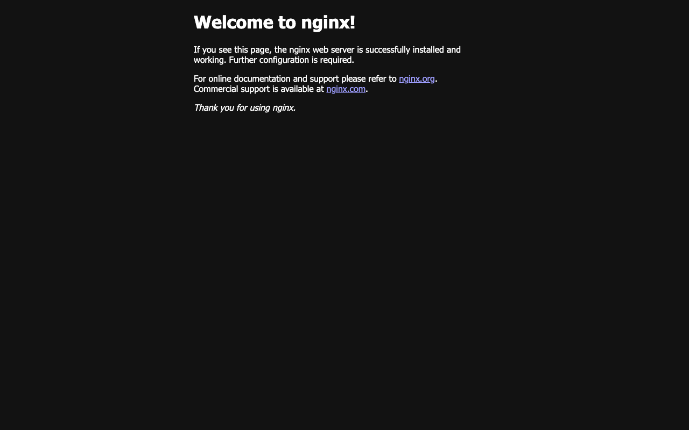

# Session 11: Kubernetes Networking & Services

**Name:** Vansh Srivastava
**Enrollment No.:** 24bcs10567
**Session:** 11

This session is about how traffic finds Pods. I deployed and tested all five kinds of Service (ClusterIP, NodePort, LoadBalancer, ExternalName and Headless), and checked each one with `get`/`describe`/EndpointSlices and with real requests from client Pods. I wrote a comparison of the workload objects with real owner-reference output, plus two DNS write-ups ([fqdn/README.md](fqdn/README.md) and [coredns/README.md](coredns/README.md)) based on lookups across two namespaces.

## Folder structure

```text
session-11-kubernetes-services/
├── README.md                     # Task 1 (all five Services) + links to Tasks 2-4
├── .gitignore
├── 01-clusterip/                 # app-deployment.yaml (3 x nginx), service.yaml (port 8080 -> 80), client-pod.yaml
├── 02-nodeport/                  # app-deployment.yaml (2 x nginx), service.yaml (NodePort)
├── 03-loadbalancer/              # app-deployment.yaml (3 x nginx), service.yaml (LoadBalancer, port 18120)
├── 04-externalname/              # service.yaml (course: nencyravaliya.me), service-example-com.yaml (mine), client-pod.yaml
├── 05-headless/                  # app-statefulset.yaml (3 x nginx), service.yaml (clusterIP: None), client-pod.yaml
├── troubleshooting/              # empty-endpoints.yaml (wrong selector) + backend-deployment.yaml it should point at
├── object-comparison/
│   ├── README.md                 # Task 2: Deployment vs ReplicaSet, Deployment vs DaemonSet vs StatefulSet, ReplicaSet vs Service
│   └── *.yaml                    # deployment, replicaset, daemonset, statefulset (+ headless svc), service used for the outputs
├── fqdn/
│   ├── README.md                 # Task 3: FQDN and Service DNS, tested across two namespaces
│   └── dns-client.yaml           # second namespace s11-dns-client + client Pod
├── coredns/
│   ├── README.md                 # Task 4: CoreDNS, the real Corefile, query resolution, troubleshooting
│   ├── dnsutils.yaml             # debug Pod with dig (from the official DNS debugging guide)
│   └── broken-dns-pod.yaml       # Pod with a deliberately wrong nameserver
└── screenshots/
    └── 01-loadbalancer-tunnel.png
```

The YAML files in `01-` to `05-` and `troubleshooting/` come from the course repository [Nency-Ravaliya/devops-heros](https://github.com/Nency-Ravaliya/devops-heros) (folder `session-11-kubernetes-services`). Every copied file starts with two comment lines naming its source and any change I made. The files in `object-comparison/`, `fqdn/`, `coredns/` and `04-externalname/service-example-com.yaml` are mine.

## Environment

```text
macOS on Apple Silicon (arm64), Docker from Colima
minikube v1.39.0 (docker driver, containerd 2.3.4), Kubernetes v1.37.0, kube-proxy in iptables mode, CoreDNS v1.14.6
Shared single-node cluster; my namespaces: s11-services, s11-compare, s11-dns-client
```

Changes to the course files:

- **Images:** `nginx:1.25-alpine` → `public.ecr.aws/docker/library/nginx:1.25-alpine`, `curlimages/curl:8.5.0` → `quay.io/curl/curl:8.5.0`, and `python:3.11-alpine3.19` → the ECR copy. These are the same images on registries that do not rate-limit me; Docker Hub was answering `429 Too Many Requests` on this network (shown in Session 09).
- **NodePort:** removed the fixed `nodePort: 30080`. NodePorts are cluster-wide and this cluster is shared, so I let Kubernetes pick one.
- **LoadBalancer:** Service port `80` → `18120`, so that `minikube tunnel` can open it on the Mac without `sudo` (ports below 1024 need root) and it stays inside the host-port range I was given.

The node IP `192.168.49.2` is not reachable from macOS with the docker driver, so I did most tests from client Pods inside the cluster, and used `kubectl port-forward` / `minikube tunnel` for the Mac.

### Port vocabulary used below

| Field | Meaning |
| --- | --- |
| `port` | the port the Service listens on (on its ClusterIP) |
| `targetPort` | the container port the traffic is forwarded to |
| `nodePort` | a port in 30000-32767 opened on every node (NodePort and LoadBalancer types) |

---

## Task 1: Services

All five Services were deployed into namespace `s11-services`. This is how they looked side by side at the end (the first one is from the extra troubleshooting drill at the end of this task):

```bash
$ kubectl get svc -n s11-services -o wide
NAME                        TYPE           CLUSTER-IP       EXTERNAL-IP        PORT(S)           AGE     SELECTOR
broken-backend-service      ClusterIP      10.101.217.86    <none>             80/TCP            6m38s   app=yatri-backend
external-database-service   ExternalName   <none>           nencyravaliya.me   <none>            7m18s   <none>
external-example-service    ExternalName   <none>           example.com        <none>            7m18s   <none>
web-service-clusterip       ClusterIP      10.96.103.40     <none>             8080/TCP          9m25s   app=web-clusterip
web-service-headless        ClusterIP      None             <none>             80/TCP            6m54s   app=web-headless
web-service-loadbalancer    LoadBalancer   10.111.224.106   127.0.0.1          18120:31261/TCP   8m29s   app=web-loadbalancer
web-service-nodeport        NodePort       10.100.134.212   <none>             80:31122/TCP      8m56s   app=web-nodeport
$ kubectl get endpointslices -n s11-services
NAME                             ADDRESSTYPE   PORTS   ENDPOINTS                                AGE
broken-backend-service-hvp2l     IPv4          5000    10.244.0.231,10.244.0.229,10.244.0.230   6m38s
web-service-clusterip-wh6n2      IPv4          80      10.244.0.204,10.244.0.206,10.244.0.205   9m25s
web-service-headless-llpgj       IPv4          80      10.244.0.222,10.244.0.223,10.244.0.224   6m54s
web-service-loadbalancer-q8fz2   IPv4          80      10.244.0.217,10.244.0.216,10.244.0.218   8m29s
web-service-nodeport-jvbn8       IPv4          80      10.244.0.208,10.244.0.207                8m56s
```

The ExternalName Services have no EndpointSlice at all: they are only a DNS alias.

### 1. ClusterIP (internal only, the default type)

```yaml
# 01-clusterip/service.yaml
apiVersion: v1
kind: Service
metadata:
  name: web-service-clusterip
  labels:
    app: web-clusterip
spec:
  type: ClusterIP
  selector:
    app: web-clusterip
  ports:
    - name: http
      port: 8080
      targetPort: 80
      protocol: TCP
```

**Deploy the app, the Service and the client Pod:**

```bash
$ kubectl create namespace s11-services
namespace/s11-services created
$ kubectl apply -n s11-services -f 01-clusterip/
deployment.apps/web-app-clusterip created
pod/curl-client created
service/web-service-clusterip created
$ kubectl rollout status deployment/web-app-clusterip -n s11-services --timeout=180s
Waiting for deployment "web-app-clusterip" rollout to finish: 0 of 3 updated replicas are available...
Waiting for deployment "web-app-clusterip" rollout to finish: 1 of 3 updated replicas are available...
Waiting for deployment "web-app-clusterip" rollout to finish: 2 of 3 updated replicas are available...
deployment "web-app-clusterip" successfully rolled out
$ kubectl wait -n s11-services --for=condition=Ready pod/curl-client --timeout=120s
pod/curl-client condition met
$ kubectl get deploy,pods -n s11-services -l app=web-clusterip -o wide
NAME                                READY   UP-TO-DATE   AVAILABLE   AGE   CONTAINERS   IMAGES                                            SELECTOR
deployment.apps/web-app-clusterip   3/3     3            3           1s    nginx-web    public.ecr.aws/docker/library/nginx:1.25-alpine   app=web-clusterip

NAME                                     READY   STATUS    RESTARTS   AGE   IP             NODE       NOMINATED NODE   READINESS GATES
pod/web-app-clusterip-58948dcbd7-75bqq   1/1     Running   0          1s    10.244.0.205   minikube   <none>           <none>
pod/web-app-clusterip-58948dcbd7-fbs2n   1/1     Running   0          1s    10.244.0.204   minikube   <none>           <none>
pod/web-app-clusterip-58948dcbd7-qhhlj   1/1     Running   0          1s    10.244.0.206   minikube   <none>           <none>
```

**Verify the Service:**

```bash
$ kubectl get svc web-service-clusterip -n s11-services -o wide
NAME                    TYPE        CLUSTER-IP     EXTERNAL-IP   PORT(S)    AGE   SELECTOR
web-service-clusterip   ClusterIP   10.96.103.40   <none>        8080/TCP   1s    app=web-clusterip
$ kubectl describe svc web-service-clusterip -n s11-services
Name:                     web-service-clusterip
Namespace:                s11-services
Labels:                   app=web-clusterip
Annotations:              <none>
Selector:                 app=web-clusterip
Type:                     ClusterIP
IP Family Policy:         SingleStack
IP Families:              IPv4
IP:                       10.96.103.40
IPs:                      10.96.103.40
Port:                     http  8080/TCP
TargetPort:               80/TCP
Endpoints:                10.244.0.204:80,10.244.0.206:80,10.244.0.205:80
Session Affinity:         None
Internal Traffic Policy:  Cluster
Events:                   <none>
$ kubectl get endpointslices -n s11-services -l kubernetes.io/service-name=web-service-clusterip -o wide
NAME                          ADDRESSTYPE   PORTS   ENDPOINTS                                AGE
web-service-clusterip-wh6n2   IPv4          80      10.244.0.204,10.244.0.206,10.244.0.205   1s
```

The Service got the virtual IP `10.96.103.40` with port `8080` and target port `80`, and its endpoints are exactly the three Pod IPs. The EndpointSlice is the object that kube-proxy and CoreDNS read to learn those Pod IPs.

**Test connectivity from the client Pod:**

```bash
$ kubectl exec -n s11-services curl-client -- nslookup web-service-clusterip.s11-services.svc.cluster.local
Server:		10.96.0.10
Address:	10.96.0.10:53


Name:	web-service-clusterip.s11-services.svc.cluster.local
Address: 10.96.103.40

$ kubectl exec -n s11-services curl-client -- curl -s http://web-service-clusterip:8080 | grep -i '<title>'
<title>Welcome to nginx!</title>
$ kubectl exec -n s11-services curl-client -- curl -s -o /dev/null -w 'HTTP %{http_code} from %{remote_ip}:%{remote_port}\n' http://10.96.103.40:8080
HTTP 200 from 10.96.103.40:8080
$ kubectl exec -n s11-services curl-client -- curl -s --max-time 3 http://web-service-clusterip:80; echo "exit code: $?"
command terminated with exit code 28
exit code: 28
```

The name resolves to the ClusterIP, and both the name and the IP answer on port 8080. Port 80 times out (curl exit 28) because the Service only listens on its `port` (8080); `targetPort: 80` is the port on the Pods, not on the Service.

**Load balancing.** I sent 30 requests and then counted the access-log lines in each nginx Pod:

```bash
$ kubectl exec -n s11-services curl-client -- sh -c 'for i in $(seq 1 30); do curl -s -o /dev/null http://web-service-clusterip:8080; done'
$ kubectl logs -n s11-services -l app=web-clusterip --prefix --tail=-1 | grep -c 'GET / HTTP'
32
$ kubectl logs -n s11-services -l app=web-clusterip --prefix --tail=-1 | grep 'GET / HTTP' | cut -d' ' -f1 | sort | uniq -c
  10 [pod/web-app-clusterip-58948dcbd7-75bqq/nginx-web]
  10 [pod/web-app-clusterip-58948dcbd7-fbs2n/nginx-web]
  12 [pod/web-app-clusterip-58948dcbd7-qhhlj/nginx-web]
```

The 32 requests (my 30 plus the 2 above) were spread 10/10/12 over the three Pods.

**ClusterIP is internal only.** The same IP and port do not answer from my Mac:

```bash
$ curl -s --max-time 3 http://10.96.103.40:8080; echo "exit code from the Mac: $?"
exit code from the Mac: 28
```

### 2. NodePort (a port on every node)

```yaml
# 02-nodeport/service.yaml (fixed nodePort removed)
apiVersion: v1
kind: Service
metadata:
  name: web-service-nodeport
  labels:
    app: web-nodeport
spec:
  type: NodePort
  selector:
    app: web-nodeport
  ports:
    - name: http
      port: 80
      targetPort: 80
      protocol: TCP
```

```bash
$ kubectl apply -n s11-services -f 02-nodeport/
deployment.apps/web-app-nodeport created
service/web-service-nodeport created
$ kubectl rollout status deployment/web-app-nodeport -n s11-services --timeout=180s
Waiting for deployment "web-app-nodeport" rollout to finish: 0 of 2 updated replicas are available...
Waiting for deployment "web-app-nodeport" rollout to finish: 1 of 2 updated replicas are available...
deployment "web-app-nodeport" successfully rolled out
$ kubectl get svc web-service-nodeport -n s11-services -o wide
NAME                   TYPE       CLUSTER-IP       EXTERNAL-IP   PORT(S)        AGE   SELECTOR
web-service-nodeport   NodePort   10.100.134.212   <none>        80:31122/TCP   1s    app=web-nodeport
$ kubectl describe svc web-service-nodeport -n s11-services | grep -E '^(Type|IP|Port|TargetPort|NodePort|Endpoints|External Traffic Policy):'
Type:                     NodePort
IP:                       10.100.134.212
Port:                     http  80/TCP
TargetPort:               80/TCP
NodePort:                 http  31122/TCP
Endpoints:                10.244.0.208:80,10.244.0.207:80
External Traffic Policy:  Cluster
$ kubectl get endpointslices -n s11-services -l kubernetes.io/service-name=web-service-nodeport
NAME                         ADDRESSTYPE   PORTS   ENDPOINTS                   AGE
web-service-nodeport-jvbn8   IPv4          80      10.244.0.208,10.244.0.207   1s
```

Kubernetes picked NodePort `31122`. A NodePort Service is also a ClusterIP Service (`10.100.134.212:80`); the NodePort is an extra door on the node.

**Test connectivity:** from a Pod through the node IP, from inside the node, from the Mac (fails, as expected with the docker driver), and from the Mac through a port-forward on my port 18111:

```bash
$ kubectl get nodes -o jsonpath='{.items[0].status.addresses}{"\n"}'
[{"address":"192.168.49.2","type":"InternalIP"},{"address":"minikube","type":"Hostname"}]
$ kubectl exec -n s11-services curl-client -- curl -s -o /dev/null -w 'HTTP %{http_code} via node IP 192.168.49.2:31122\n' http://192.168.49.2:31122
HTTP 200 via node IP 192.168.49.2:31122
$ minikube ssh -- curl -s -o /dev/null -w "'HTTP %{http_code} from inside the node on localhost:31122\n'" http://localhost:31122
HTTP 200 from inside the node on localhost:31122
$ curl -s --max-time 5 http://192.168.49.2:31122; echo "exit code from the Mac: $?"
exit code from the Mac: 28
$ kubectl port-forward -n s11-services svc/web-service-nodeport 18111:80 &
Forwarding from 127.0.0.1:18111 -> 80
Forwarding from [::1]:18111 -> 80
$ curl -s http://localhost:18111 | grep '<title>'
<title>Welcome to nginx!</title>
```

### 3. LoadBalancer (an external IP from a load balancer outside the cluster)

```yaml
# 03-loadbalancer/service.yaml (port changed 80 -> 18120)
apiVersion: v1
kind: Service
metadata:
  name: web-service-loadbalancer
  labels:
    app: web-loadbalancer
spec:
  type: LoadBalancer
  selector:
    app: web-loadbalancer
  ports:
    - name: http
      port: 18120
      targetPort: 80
      protocol: TCP
```

```bash
$ kubectl apply -n s11-services -f 03-loadbalancer/
deployment.apps/web-app-loadbalancer created
service/web-service-loadbalancer created
$ kubectl rollout status deployment/web-app-loadbalancer -n s11-services --timeout=180s
Waiting for deployment "web-app-loadbalancer" rollout to finish: 0 of 3 updated replicas are available...
Waiting for deployment "web-app-loadbalancer" rollout to finish: 1 of 3 updated replicas are available...
Waiting for deployment "web-app-loadbalancer" rollout to finish: 2 of 3 updated replicas are available...
deployment "web-app-loadbalancer" successfully rolled out
$ sleep 5; kubectl get svc web-service-loadbalancer -n s11-services -o wide
NAME                       TYPE           CLUSTER-IP       EXTERNAL-IP   PORT(S)           AGE   SELECTOR
web-service-loadbalancer   LoadBalancer   10.111.224.106   <pending>     18120:31261/TCP   6s    app=web-loadbalancer
$ kubectl describe svc web-service-loadbalancer -n s11-services | grep -E '^(Type|IP|LoadBalancer Ingress|Port|TargetPort|NodePort|Endpoints|Events):'
Type:                     LoadBalancer
IP:                       10.111.224.106
Port:                     http  18120/TCP
TargetPort:               80/TCP
NodePort:                 http  31261/TCP
Endpoints:                10.244.0.217:80,10.244.0.216:80,10.244.0.218:80
Events:                   <none>
```

`EXTERNAL-IP` is `<pending>`. In a cloud, the cloud-controller-manager would now create a real load balancer (an AWS NLB, for example) and write its address into the Service status. Minikube has no cloud provider, so nothing fills it in. A LoadBalancer Service also gets a ClusterIP and a NodePort (`31261`); the cloud load balancer would forward to that NodePort on every node.

**`minikube tunnel` as the "cloud".** I started it in the background without `sudo` and with stdin closed, so it could never wait for a password:

```bash
$ minikube tunnel < /dev/null > tunnel.log 2>&1 &
```

The tunnel log (colour codes removed):

```text
* Tunnel successfully started

* NOTE: Please do not close this terminal as this process must stay alive for the tunnel to be accessible ...

* Starting tunnel for service web-service-loadbalancer.
...
```

In the lines I cut, the tunnel also found Ingress objects that other sessions had created on this shared cluster and said it would ask for `sudo` to open ports 80/443 for them. It never got a password, so those ports were not opened. I only used my own Service, whose port 18120 does not need root. The tunnel set `EXTERNAL-IP` to `127.0.0.1` and forwarded port 18120 from the Mac:

```bash
$ kubectl get svc web-service-loadbalancer -n s11-services -o wide
NAME                       TYPE           CLUSTER-IP       EXTERNAL-IP   PORT(S)           AGE   SELECTOR
web-service-loadbalancer   LoadBalancer   10.111.224.106   127.0.0.1     18120:31261/TCP   35s   app=web-loadbalancer
$ curl -s http://127.0.0.1:18120 | grep '<title>'
<title>Welcome to nginx!</title>
$ for i in 1 2 3 4 5 6; do curl -s -o /dev/null -w '%{http_code} ' http://127.0.0.1:18120; done; echo
200 200 200 200 200 200 
```



After this I stopped the tunnel and the ssh port-forward it had started, so it would not interfere with anyone else. The Mac can no longer connect, but the same Service still works inside the cluster through its ClusterIP port and its NodePort:

```bash
$ curl -s --max-time 3 http://127.0.0.1:18120; echo "exit code after stopping the tunnel: $?"
exit code after stopping the tunnel: 7
$ kubectl exec -n s11-services curl-client -- curl -s -o /dev/null -w 'HTTP %{http_code} via ClusterIP port 18120\n' http://web-service-loadbalancer:18120
HTTP 200 via ClusterIP port 18120
$ kubectl exec -n s11-services curl-client -- curl -s -o /dev/null -w 'HTTP %{http_code} via NodePort 192.168.49.2:31261\n' http://192.168.49.2:31261
HTTP 200 via NodePort 192.168.49.2:31261
```

The Service kept showing `127.0.0.1` as EXTERNAL-IP afterwards (see the summary at the top of this task), because I stopped the tunnel with a signal and it did not clean up the status. The namespace was deleted soon after.

### 4. ExternalName (a DNS alias for something outside the cluster)

```yaml
# 04-externalname/service.yaml (course file)
apiVersion: v1
kind: Service
metadata:
  name: external-database-service
spec:
  type: ExternalName
  externalName: nencyravaliya.me
```

The course target did not resolve from this network, so I added a second Service that points at `example.com` ([04-externalname/service-example-com.yaml](04-externalname/service-example-com.yaml)):

```yaml
apiVersion: v1
kind: Service
metadata:
  name: external-example-service
spec:
  type: ExternalName
  externalName: example.com
```

```bash
$ kubectl apply -n s11-services -f 04-externalname/
pod/dns-test-client created
service/external-example-service created
service/external-database-service created
$ kubectl wait -n s11-services --for=condition=Ready pod/dns-test-client --timeout=120s
pod/dns-test-client condition met
$ kubectl get svc external-database-service external-example-service -n s11-services -o wide
NAME                        TYPE           CLUSTER-IP   EXTERNAL-IP        PORT(S)   AGE   SELECTOR
external-database-service   ExternalName   <none>       nencyravaliya.me   <none>    1s    <none>
external-example-service    ExternalName   <none>       example.com        <none>    1s    <none>
$ kubectl describe svc external-database-service -n s11-services
Name:              external-database-service
Namespace:         s11-services
Labels:            <none>
Annotations:       <none>
Selector:          <none>
Type:              ExternalName
IP Families:       <none>
IP:                
IPs:               <none>
External Name:     nencyravaliya.me
Session Affinity:  None
Events:            <none>
$ kubectl get endpointslices -n s11-services -l kubernetes.io/service-name=external-example-service
No resources found in s11-services namespace.
```

No ClusterIP, no selector, no endpoints. **Test from the client Pod:**

```bash
$ kubectl exec -n s11-services dns-test-client -- nslookup external-database-service.s11-services.svc.cluster.local
Server:		10.96.0.10
Address:	10.96.0.10:53

external-database-service.s11-services.svc.cluster.local	canonical name = nencyravaliya.me

external-database-service.s11-services.svc.cluster.local	canonical name = nencyravaliya.me

$ kubectl exec -n s11-services dns-test-client -- nslookup external-example-service.s11-services.svc.cluster.local
Server:		10.96.0.10
Address:	10.96.0.10:53

external-example-service.s11-services.svc.cluster.local	canonical name = example.com

external-example-service.s11-services.svc.cluster.local	canonical name = example.com
Name:	example.com
Address: 104.20.23.154
Name:	example.com
Address: 172.66.147.243

```

CoreDNS answers the Service name with a `CNAME` to the external name. For `example.com` the resolver then follows the CNAME to real public IPs. For the course target `nencyravaliya.me` there is only the CNAME and no address, because that domain does not resolve from this network. Kubernetes does not check the target at all: ExternalName is pure DNS.

```bash
$ kubectl exec -n s11-services dns-test-client -- curl -s -o /dev/null -w 'HTTP %{http_code} from %{remote_ip}\n' -H 'Host: example.com' http://external-example-service.s11-services.svc.cluster.local
HTTP 200 from 172.66.147.243
$ kubectl exec -n s11-services dns-test-client -- curl -s -H 'Host: example.com' http://external-example-service.s11-services.svc.cluster.local | grep -o '<title>.*</title>'
<title>Example Domain</title>
$ kubectl exec -n s11-services dns-test-client -- curl -s -o /dev/null -w 'HTTP %{http_code} (Host header = the Service name)\n' http://external-example-service.s11-services.svc.cluster.local
HTTP 409 (Host header = the Service name)
$ kubectl exec -n s11-services dns-test-client -- curl -s --max-time 5 http://external-database-service.s11-services.svc.cluster.local; echo "exit code: $?"
command terminated with exit code 6
exit code: 6
```

With `Host: example.com` the request reached the real example.com (`HTTP 200`, title "Example Domain"). Without it, curl sends the Service name as the Host header and the remote web server rejects it (`409`). This is the main limitation of ExternalName for HTTP and TLS: only the address lookup is redirected, the client still uses the in-cluster name. The course target fails with curl exit 6 (could not resolve host). ExternalName fits best for something like a managed database endpoint, where the client does not care about the hostname.

### 5. Headless (`clusterIP: None`: DNS returns the Pod IPs)

```yaml
# 05-headless/service.yaml
apiVersion: v1
kind: Service
metadata:
  name: web-service-headless
  labels:
    app: web-headless
spec:
  clusterIP: None
  selector:
    app: web-headless
  ports:
    - name: web
      port: 80
      targetPort: 80
      protocol: TCP
```

The StatefulSet in [05-headless/app-statefulset.yaml](05-headless/app-statefulset.yaml) sets `serviceName: web-service-headless`, which gives each Pod its own DNS name.

```bash
$ kubectl apply -n s11-services -f 05-headless/
statefulset.apps/web-stateful created
pod/headless-dns-client created
service/web-service-headless created
$ kubectl rollout status statefulset/web-stateful -n s11-services --timeout=180s
Waiting for 3 pods to be ready...
Waiting for 2 pods to be ready...
Waiting for 2 pods to be ready...
Waiting for 1 pods to be ready...
Waiting for 1 pods to be ready...
partitioned roll out complete: 3 new pods have been updated...
$ kubectl wait -n s11-services --for=condition=Ready pod/headless-dns-client --timeout=120s
pod/headless-dns-client condition met
$ kubectl get svc web-service-headless -n s11-services -o wide
NAME                   TYPE        CLUSTER-IP   EXTERNAL-IP   PORT(S)   AGE   SELECTOR
web-service-headless   ClusterIP   None         <none>        80/TCP    2s    app=web-headless
$ kubectl get pods -n s11-services -l app=web-headless -o wide
NAME             READY   STATUS    RESTARTS   AGE   IP             NODE       NOMINATED NODE   READINESS GATES
web-stateful-0   1/1     Running   0          2s    10.244.0.222   minikube   <none>           <none>
web-stateful-1   1/1     Running   0          1s    10.244.0.223   minikube   <none>           <none>
web-stateful-2   1/1     Running   0          1s    10.244.0.224   minikube   <none>           <none>
$ kubectl describe svc web-service-headless -n s11-services | grep -E '^(Type|IP|IPs|Port|TargetPort|Endpoints):'
Type:                     ClusterIP
IP:                       None
IPs:                      None
Port:                     web  80/TCP
TargetPort:               80/TCP
Endpoints:                10.244.0.222:80,10.244.0.223:80,10.244.0.224:80
$ kubectl get endpointslices -n s11-services -l kubernetes.io/service-name=web-service-headless -o yaml | grep -E 'hostname|addresses' -A1 | grep -v '^--'
  - addresses:
    - 10.244.0.222
    hostname: web-stateful-0
    nodeName: minikube
  - addresses:
    - 10.244.0.223
    hostname: web-stateful-1
    nodeName: minikube
  - addresses:
    - 10.244.0.224
    hostname: web-stateful-2
    nodeName: minikube
```

`CLUSTER-IP` is `None`, so there is no virtual IP and kube-proxy does no load balancing for it. The EndpointSlice still lists the Pods, and each one carries a `hostname`.

**Test from the client Pod:**

```bash
$ kubectl exec -n s11-services headless-dns-client -- nslookup web-service-headless.s11-services.svc.cluster.local
Server:		10.96.0.10
Address:	10.96.0.10:53


Name:	web-service-headless.s11-services.svc.cluster.local
Address: 10.244.0.222
Name:	web-service-headless.s11-services.svc.cluster.local
Address: 10.244.0.223
Name:	web-service-headless.s11-services.svc.cluster.local
Address: 10.244.0.224

$ kubectl exec -n s11-services headless-dns-client -- nslookup web-stateful-0.web-service-headless.s11-services.svc.cluster.local
Server:		10.96.0.10
Address:	10.96.0.10:53

Name:	web-stateful-0.web-service-headless.s11-services.svc.cluster.local
Address: 10.244.0.222

$ kubectl exec -n s11-services headless-dns-client -- nslookup -type=SRV web-service-headless.s11-services.svc.cluster.local
Server:		10.96.0.10
Address:	10.96.0.10:53

web-service-headless.s11-services.svc.cluster.local	service = 0 33 80 web-stateful-0.web-service-headless.s11-services.svc.cluster.local
web-service-headless.s11-services.svc.cluster.local	service = 0 33 80 web-stateful-1.web-service-headless.s11-services.svc.cluster.local
web-service-headless.s11-services.svc.cluster.local	service = 0 33 80 web-stateful-2.web-service-headless.s11-services.svc.cluster.local
```

A ClusterIP name returns one virtual IP (see section 1), but the headless name returns **all three Pod IPs**, and every Pod also has its own A record `web-stateful-N.web-service-headless...`. The SRV records list the per-Pod names together with the port. Clients such as database drivers use these to reach one specific replica:

```bash
$ for i in 0 1 2; do kubectl exec -n s11-services web-stateful-$i -- sh -c 'echo served by $(hostname) > /usr/share/nginx/html/index.html'; done
$ for i in 0 1 2; do kubectl exec -n s11-services headless-dns-client -- curl -s http://web-stateful-$i.web-service-headless; done
served by web-stateful-0
served by web-stateful-1
served by web-stateful-2
```

### Extra: the "empty endpoints" drill (course `troubleshooting/` folder)

[troubleshooting/empty-endpoints.yaml](troubleshooting/empty-endpoints.yaml) selects `app: wrong-backend-name`, but the backend Pods from [troubleshooting/backend-deployment.yaml](troubleshooting/backend-deployment.yaml) are labelled `app: yatri-backend`:

```bash
$ kubectl apply -n s11-services -f troubleshooting/backend-deployment.yaml -f troubleshooting/empty-endpoints.yaml
deployment.apps/yatri-backend created
service/broken-backend-service created
$ kubectl rollout status deployment/yatri-backend -n s11-services --timeout=180s
Waiting for deployment "yatri-backend" rollout to finish: 0 of 3 updated replicas are available...
Waiting for deployment "yatri-backend" rollout to finish: 1 of 3 updated replicas are available...
Waiting for deployment "yatri-backend" rollout to finish: 2 of 3 updated replicas are available...
deployment "yatri-backend" successfully rolled out
$ kubectl get svc broken-backend-service -n s11-services -o wide
NAME                     TYPE        CLUSTER-IP      EXTERNAL-IP   PORT(S)   AGE   SELECTOR
broken-backend-service   ClusterIP   10.101.217.86   <none>        80/TCP    1s    app=wrong-backend-name
$ kubectl get endpoints broken-backend-service -n s11-services
Warning: v1 Endpoints is deprecated in v1.33+; use discovery.k8s.io/v1 EndpointSlice
NAME                     ENDPOINTS   AGE
broken-backend-service   <none>      1s
$ kubectl exec -n s11-services curl-client -- curl -s --max-time 3 http://broken-backend-service/healthz; echo "exit code: $?"
command terminated with exit code 7
exit code: 7
$ kubectl get pods -n s11-services -l tier=api --show-labels
NAME                             READY   STATUS    RESTARTS   AGE   LABELS
yatri-backend-6ff6ff4c87-fxnxq   1/1     Running   0          1s    app=yatri-backend,pod-template-hash=6ff6ff4c87,tier=api
yatri-backend-6ff6ff4c87-p48td   1/1     Running   0          1s    app=yatri-backend,pod-template-hash=6ff6ff4c87,tier=api
yatri-backend-6ff6ff4c87-swthn   1/1     Running   0          1s    app=yatri-backend,pod-template-hash=6ff6ff4c87,tier=api
```

The Service exists and has an IP, but `ENDPOINTS <none>`, so every request is refused (curl exit 7): there is nothing to forward to. Comparing the Service selector with the Pod labels shows the typo. Fixing the selector fills the endpoints immediately:

```bash
$ kubectl patch svc broken-backend-service -n s11-services -p '{"spec":{"selector":{"app":"yatri-backend"}}}'
service/broken-backend-service patched
$ kubectl get endpoints broken-backend-service -n s11-services
Warning: v1 Endpoints is deprecated in v1.33+; use discovery.k8s.io/v1 EndpointSlice
NAME                     ENDPOINTS                                               AGE
broken-backend-service   10.244.0.229:5000,10.244.0.230:5000,10.244.0.231:5000   1s
$ kubectl exec -n s11-services curl-client -- curl -s http://broken-backend-service/healthz
command terminated with exit code 7
```

The very first request after the patch was still refused. kube-proxy (iptables mode) applies rule changes in batches, so a request sent in the same second can miss them. A few seconds later it worked:

```bash
$ sleep 3; kubectl exec -n s11-services curl-client -- curl -s http://broken-backend-service/healthz
{"status":"healthy","service":"yatri-backend"}
$ kubectl get endpointslices -n s11-services -l kubernetes.io/service-name=broken-backend-service
NAME                           ADDRESSTYPE   PORTS   ENDPOINTS                                AGE
broken-backend-service-hvp2l   IPv4          5000    10.244.0.231,10.244.0.229,10.244.0.230   15s
```

## Task 2: Object comparison

See **[object-comparison/README.md](object-comparison/README.md)**. It covers:

- Deployment vs ReplicaSet, with the real `ownerReferences` chain Deployment → ReplicaSet → Pod, and a bare ReplicaSet that does not roll out a new image.
- Deployment vs DaemonSet vs StatefulSet: use cases, Pod creation, scaling, networking and storage, with real output.
- ReplicaSet vs Service: deleting a Pod changes its IP but not the Service IP, plus the actual kube-proxy iptables rules that carry the traffic.

## Task 3: FQDN

See **[fqdn/README.md](fqdn/README.md)**. It covers what an FQDN is, the `<svc>.<ns>.svc.cluster.local` convention, Pod A records, headless per-Pod records and SRV records, and namespace-based resolution, with real lookups from a second namespace (`s11-dns-client`) into `s11-services`.

## Task 4: CoreDNS

See **[coredns/README.md](coredns/README.md)**. It covers what CoreDNS is, how the kubelet points every Pod at it, the real Corefile from the `coredns` ConfigMap, how search domains and `ndots:5` turn one lookup into four queries (taken from the CoreDNS query log), and a troubleshooting walkthrough that includes a Pod with a broken nameserver.

## Cleanup

```bash
$ kubectl delete namespace s11-services s11-compare s11-dns-client
namespace "s11-services" deleted
namespace "s11-compare" deleted
namespace "s11-dns-client" deleted
$ kubectl get ns | grep -E '^s(09|10|11)-' || echo 'no s09-/s10-/s11- namespaces left'
no s09-/s10-/s11- namespaces left
$ kubectl get pv | grep -E 's1[01]-' || echo 'no PVs left from my namespaces'
no PVs left from my namespaces
```

The tunnel, its ssh forward and the port-forwards were stopped earlier.

## What I learned

- A Service is a stable name plus a virtual IP, and the EndpointSlice is the list of ready Pod IPs behind it. If the selector matches nothing, the Service still exists but every request is refused.
- `port` belongs to the Service and `targetPort` to the container. Calling the ClusterIP on the container port (80 instead of 8080) just times out.
- NodePort and LoadBalancer are built on top of ClusterIP. LoadBalancer needs something outside Kubernetes (a cloud controller, or `minikube tunnel` locally) to get an external IP.
- ExternalName is only a DNS CNAME. Nothing checks the target, and HTTP clients still send the in-cluster Host header.
- A headless Service turns DNS into the load balancer: the name returns every Pod IP, and StatefulSet Pods get their own stable names.
- kube-proxy updates take a moment, so a request sent in the same second as a Service change can be refused. Clients should retry.
