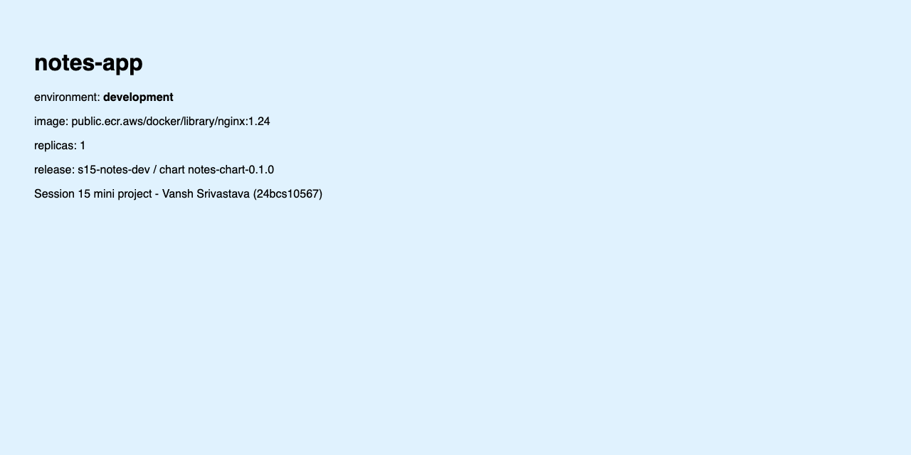
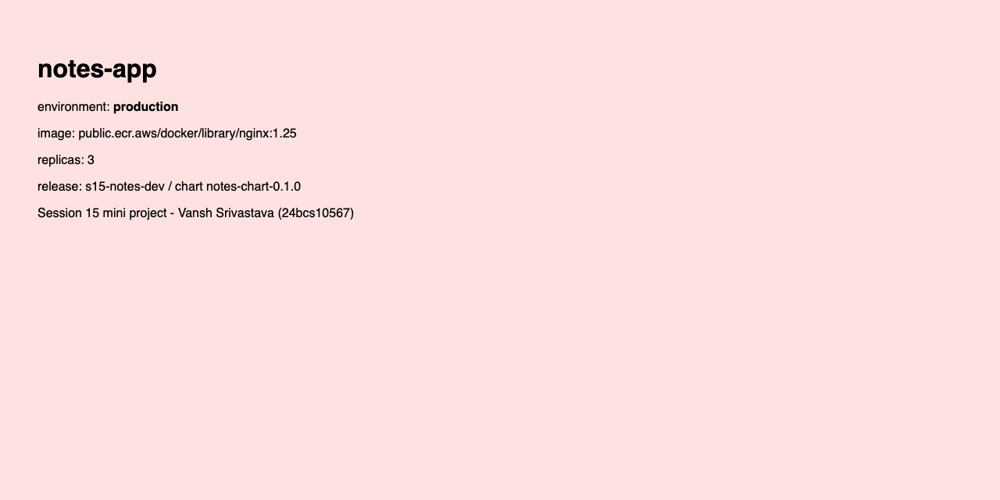

# Task 3: Mini Project - Package and Deploy the Notes App with Helm

This is the course mini project (`session-15-helm/mini-project` in the course repo [Nency-Ravaliya/devops-heros](https://github.com/Nency-Ravaliya/devops-heros)). I followed its 15 steps: build `notes-chart` (Chart.yaml, values.yaml, values-prod.yaml, templates), lint and render it, install it with development values, upgrade it to production values, simulate a bad upgrade, roll back to the healthy revision, and clean up. I checked every step with `helm history`, `kubectl`, and curl through a port-forward.

- Namespace: `s15-notes`. Release: `s15-notes-dev` (the course calls it `notes-dev`; on the shared cluster all my releases start with `s15-`).
- Host port for port-forward: `18320` (`18311` for the screenshots).

Back to the session overview: [../README.md](../README.md)

## Files

```text
03-mini-project/
├── notes-chart/
│   ├── Chart.yaml               from the course, unchanged
│   ├── values.yaml              development values (1 replica, nginx 1.24)
│   ├── values-prod.yaml         production values (3 replicas, nginx 1.25)
│   └── templates/
│       ├── configmap.yaml       APP_NAME / ENVIRONMENT (course, unchanged)
│       ├── deployment.yaml      course file + probe, resources, page mount, checksums
│       ├── service.yaml         NodePort 30090 (course, unchanged)
│       ├── page-configmap.yaml  added: small HTML page so curl can show the revision
│       └── NOTES.txt            added: how to reach the app
└── check.sh                     prints history, pods/images, ConfigMap data and curls the app
```

The chart files come from the course repo. These are my changes, each one marked with a comment in the files:

| Change | Why |
|--------|-----|
| `image.repository: public.ecr.aws/docker/library/nginx` (course: `nginx`) in both values files | Docker Hub answered `429 Too Many Requests` on this machine; ECR Public mirrors the same official image |
| `resources` (50m / 32Mi requests, 100m / 64Mi limits) | The minikube cluster is shared |
| `readinessProbe` on `/` | `--wait` and the Service only use pods that really answer |
| `page-configmap.yaml` + mount at `/usr/share/nginx/html/index.html` | The course chart only sets env vars, which plain nginx does not show. The page lets me see the environment, image and replica count with curl |
| `subPath` for that mount | What I learned in Task 2: a subPath file is not updated inside a running pod, so a bad upgrade cannot change what healthy pods serve |
| `checksum/config` and `checksum/page` pod annotations | When only a ConfigMap changes, the pods are still replaced, so they pick up the new env vars and page |

Everything else (names, labels, NodePort 30090, values structure) is as in the course.

## Steps 1-7: The chart

The chart layout, `Chart.yaml`, `values.yaml`, `values-prod.yaml`, `configmap.yaml`, `deployment.yaml` and `service.yaml` are in [`notes-chart/`](notes-chart/):

```bash
$ find notes-chart -type f | sort
notes-chart/Chart.yaml
notes-chart/templates/NOTES.txt
notes-chart/templates/configmap.yaml
notes-chart/templates/deployment.yaml
notes-chart/templates/page-configmap.yaml
notes-chart/templates/service.yaml
notes-chart/values-prod.yaml
notes-chart/values.yaml
```

## Step 8: Lint

```bash
$ helm lint notes-chart
==> Linting notes-chart
[INFO] Chart.yaml: icon is recommended

1 chart(s) linted, 0 chart(s) failed

$ helm lint notes-chart -f notes-chart/values-prod.yaml
==> Linting notes-chart
[INFO] Chart.yaml: icon is recommended

1 chart(s) linted, 0 chart(s) failed
```

The chart passes lint with the default values and with the production values. The `[INFO]` about a missing icon is only a recommendation.

## Step 9: Render locally

```bash
$ helm template s15-notes-dev notes-chart -n s15-notes
---
# Source: notes-chart/templates/configmap.yaml
apiVersion: v1
kind: ConfigMap
metadata:
  name: s15-notes-dev-config
data:
  APP_NAME: "notes-app"
  ENVIRONMENT: "development"

---
# Source: notes-chart/templates/page-configmap.yaml
# Added by me: a small HTML page so that I can verify each revision with curl.
# The course chart only sets APP_NAME / ENVIRONMENT as env vars, which plain
# nginx does not show anywhere.
apiVersion: v1
kind: ConfigMap
metadata:
  name: s15-notes-dev-page
  labels:
    app: s15-notes-dev
data:
  index.html: |
    <!doctype html>
    <html>
    <head><meta charset="utf-8"><title>notes-app (development)</title></head>
    <body style="font-family: sans-serif; padding: 40px; background: #e0f2fe;">
      <h1>notes-app</h1>
      <p>environment: <b>development</b></p>
      <p>image: public.ecr.aws/docker/library/nginx:1.24</p>
      <p>replicas: 1</p>
      <p>release: s15-notes-dev / chart notes-chart-0.1.0</p>
      <p>Session 15 mini project - Vansh Srivastava (24bcs10567)</p>
    </body>
    </html>

---
# Source: notes-chart/templates/service.yaml
apiVersion: v1
kind: Service
metadata:
  name: s15-notes-dev-svc
spec:
  type: NodePort
  selector:
    app: s15-notes-dev
  ports:
    - port: 80
      targetPort: 80
      nodePort: 30090

---
# Source: notes-chart/templates/deployment.yaml
apiVersion: apps/v1
kind: Deployment
metadata:
  name: s15-notes-dev-deploy
  labels:
    app: s15-notes-dev
    environment: development
spec:
  replicas: 1
  selector:
    matchLabels:
      app: s15-notes-dev
  template:
    metadata:
      labels:
        app: s15-notes-dev
      # Added by me: roll the pods when either ConfigMap changes.
      annotations:
        checksum/config: aea82bf10633139edf7f4bc57c8e2606717319734d937cd8ca979a53c5bbf79f
        checksum/page: defc13168730bf760d1b211ae075c2e1afca6b5eaba72a649a5b594642295bd9
    spec:
      containers:
        - name: notes
          image: "public.ecr.aws/docker/library/nginx:1.24"
          ports:
            - containerPort: 80
          envFrom:
            - configMapRef:
                name: s15-notes-dev-config
          # Added by me: readiness probe, resources and the page mount.
          readinessProbe:
            httpGet:
              path: /
              port: 80
            periodSeconds: 3
          resources:
            limits:
              cpu: 100m
              memory: 64Mi
            requests:
              cpu: 50m
              memory: 32Mi
          volumeMounts:
            # subPath mount: the file is fixed for the life of the pod, so a
            # later (or failed) upgrade cannot change what a running pod serves.
            - name: page
              mountPath: /usr/share/nginx/html/index.html
              subPath: index.html
              readOnly: true
      volumes:
        - name: page
          configMap:
            name: s15-notes-dev-page
```

All `{{ }}` are replaced: the names come from the release name (`s15-notes-dev-config`, `-page`, `-svc`, `-deploy`), and the image, replicas, NodePort and environment come from `values.yaml`. Rendering with the production file shows the values that will change in step 11:

```bash
$ helm template s15-notes-dev notes-chart -n s15-notes -f notes-chart/values-prod.yaml | grep -E "replicas:|image:|ENVIRONMENT:|environment:"
  ENVIRONMENT: "production"
      <p>environment: <b>production</b></p>
      <p>image: public.ecr.aws/docker/library/nginx:1.25</p>
      <p>replicas: 3</p>
    environment: production
  replicas: 3
          image: "public.ecr.aws/docker/library/nginx:1.25"
```

NodePorts are shared by the whole cluster, so before installing I checked that nobody else was using 30090:

```bash
$ kubectl get svc -A -o jsonpath="{range .items[*]}{.spec.ports[*].nodePort}{\"\\n\"}{end}" | grep -c 30090
0
```

## Step 10: Install (development)

```bash
$ helm install s15-notes-dev notes-chart -n s15-notes --create-namespace --wait --timeout 3m
NAME: s15-notes-dev
LAST DEPLOYED: Wed Oct  7 23:29:27 2026
NAMESPACE: s15-notes
STATUS: deployed
REVISION: 1
DESCRIPTION: Install complete
TEST SUITE: None
NOTES:
notes-app (development) is deployed as release s15-notes-dev, revision 1.
Image: public.ecr.aws/docker/library/nginx:1.24, replicas: 1

Open it from the laptop:
  kubectl port-forward -n s15-notes svc/s15-notes-dev-svc 18320:80
  curl http://localhost:18320/
Inside the cluster it is also on NodePort 30090.

$ kubectl get pods -n s15-notes -o wide
NAME                                   READY   STATUS    RESTARTS   AGE   IP            NODE       NOMINATED NODE   READINESS GATES
s15-notes-dev-deploy-8885dc487-brsds   1/1     Running   0          1s    10.244.0.95   minikube   <none>           <none>

$ kubectl get services -n s15-notes
NAME                TYPE       CLUSTER-IP     EXTERNAL-IP   PORT(S)        AGE
s15-notes-dev-svc   NodePort   10.106.46.99   <none>        80:30090/TCP   1s

$ kubectl get configmaps -n s15-notes
NAME                   DATA   AGE
kube-root-ca.crt       1      1s
s15-notes-dev-config   2      1s
s15-notes-dev-page     1      1s

$ kubectl exec -n s15-notes deploy/s15-notes-dev-deploy -- printenv APP_NAME ENVIRONMENT
notes-app
development
```

One pod, a NodePort Service on `80:30090`, the two ConfigMaps from the chart, and the env vars `APP_NAME=notes-app` and `ENVIRONMENT=development` inside the container (they come from the ConfigMap through `envFrom`).

### Verify (revision 1)

[`check.sh`](check.sh) prints the Helm history, the image of every pod, the ConfigMap data, and then curls the app through `kubectl port-forward svc/s15-notes-dev-svc 18320:80`:

```bash
$ ./check.sh
$ helm history s15-notes-dev -n s15-notes
REVISION  UPDATED                   STATUS    CHART              APP VERSION  DESCRIPTION
1         Wed Oct  7 23:29:27 2026  deployed  notes-chart-0.1.0  1.0          Install complete

$ kubectl get pods -n s15-notes -o custom-columns=POD:.metadata.name,IMAGE:.spec.containers[0].image,READY:.status.containerStatuses[0].ready,STATE:.status.containerStatuses[0].state.waiting.reason
POD                                    IMAGE                                      READY   STATE
s15-notes-dev-deploy-8885dc487-brsds   public.ecr.aws/docker/library/nginx:1.24   true    <none>

$ kubectl get configmap s15-notes-dev-config -n s15-notes -o jsonpath='{.data}'
{"APP_NAME":"notes-app","ENVIRONMENT":"development"}

$ curl -s http://localhost:18320/ | grep -E '<h1>|environment|image|replicas'
<h1>notes-app</h1>
<p>environment: <b>development</b></p>
<p>image: public.ecr.aws/docker/library/nginx:1.24</p>
<p>replicas: 1</p>

$ curl -sI http://localhost:18320/ | grep Server
Server: nginx/1.24.0
```

The minikube node IP (192.168.49.2) cannot be reached from my Mac, so I checked the NodePort from a temporary pod inside the cluster:

```bash
$ kubectl run s15-nodeport-check -n s15-notes --rm -i --restart=Never --image=public.ecr.aws/docker/library/busybox:1.37 -- wget -qO- http://192.168.49.2:30090/ | grep -E "<h1>|environment"
All commands and output from this session will be recorded in container logs, including credentials and sensitive information passed through the command prompt.
If you don't see a command prompt, try pressing enter.
  <h1>notes-app</h1>
  <p>environment: <b>development</b></p>
```

(The two lines before the HTML are a notice printed by `kubectl run -i`.)



## Step 11: Upgrade to production values

```bash
$ helm upgrade s15-notes-dev notes-chart -n s15-notes -f notes-chart/values-prod.yaml --wait --timeout 3m
Release "s15-notes-dev" has been upgraded. Happy Helming!
NAME: s15-notes-dev
LAST DEPLOYED: Wed Oct  7 23:29:59 2026
NAMESPACE: s15-notes
STATUS: deployed
REVISION: 2
DESCRIPTION: Upgrade complete
TEST SUITE: None
NOTES:
notes-app (production) is deployed as release s15-notes-dev, revision 2.
Image: public.ecr.aws/docker/library/nginx:1.25, replicas: 3

Open it from the laptop:
  kubectl port-forward -n s15-notes svc/s15-notes-dev-svc 18320:80
  curl http://localhost:18320/
Inside the cluster it is also on NodePort 30090.

$ kubectl rollout status deploy/s15-notes-dev-deploy -n s15-notes
deployment "s15-notes-dev-deploy" successfully rolled out

$ sleep 5; kubectl get pods -n s15-notes
NAME                                    READY   STATUS    RESTARTS   AGE
s15-notes-dev-deploy-58d7855d4f-l4db2   1/1     Running   0          7s
s15-notes-dev-deploy-58d7855d4f-lz6z4   1/1     Running   0          6s
s15-notes-dev-deploy-58d7855d4f-wk87x   1/1     Running   0          32s
```

### Verify (revision 2)

```bash
$ ./check.sh
$ helm history s15-notes-dev -n s15-notes
REVISION  UPDATED                   STATUS      CHART              APP VERSION  DESCRIPTION
1         Wed Oct  7 23:29:27 2026  superseded  notes-chart-0.1.0  1.0          Install complete
2         Wed Oct  7 23:29:59 2026  deployed    notes-chart-0.1.0  1.0          Upgrade complete

$ kubectl get pods -n s15-notes -o custom-columns=POD:.metadata.name,IMAGE:.spec.containers[0].image,READY:.status.containerStatuses[0].ready,STATE:.status.containerStatuses[0].state.waiting.reason
POD                                     IMAGE                                      READY   STATE
s15-notes-dev-deploy-58d7855d4f-l4db2   public.ecr.aws/docker/library/nginx:1.25   true    <none>
s15-notes-dev-deploy-58d7855d4f-lz6z4   public.ecr.aws/docker/library/nginx:1.25   true    <none>
s15-notes-dev-deploy-58d7855d4f-wk87x   public.ecr.aws/docker/library/nginx:1.25   true    <none>

$ kubectl get configmap s15-notes-dev-config -n s15-notes -o jsonpath='{.data}'
{"APP_NAME":"notes-app","ENVIRONMENT":"production"}

$ curl -s http://localhost:18320/ | grep -E '<h1>|environment|image|replicas'
<h1>notes-app</h1>
<p>environment: <b>production</b></p>
<p>image: public.ecr.aws/docker/library/nginx:1.25</p>
<p>replicas: 3</p>

$ curl -sI http://localhost:18320/ | grep Server
Server: nginx/1.25.5

$ kubectl exec -n s15-notes deploy/s15-notes-dev-deploy -- printenv APP_NAME ENVIRONMENT
notes-app
production

$ helm get values s15-notes-dev -n s15-notes
USER-SUPPLIED VALUES:
app:
  environment: production
  name: notes-app
image:
  repository: public.ecr.aws/docker/library/nginx
  tag: "1.25"
replicaCount: 3
service:
  nodePort: 30090
  port: 80
```

Revision 2 runs three pods on nginx 1.25, `ENVIRONMENT` is `production` in the ConfigMap and inside the container, and the page shows production. `helm get values` shows that the whole `values-prod.yaml` was passed as user-supplied values.



## Step 12: Check release history

This is in the `check.sh` output above:

```bash
$ helm history s15-notes-dev -n s15-notes
REVISION  UPDATED                   STATUS      CHART              APP VERSION  DESCRIPTION
1         Wed Oct  7 23:29:27 2026  superseded  notes-chart-0.1.0  1.0          Install complete
2         Wed Oct  7 23:29:59 2026  deployed    notes-chart-0.1.0  1.0          Upgrade complete
```

## Step 13: Simulate a bad upgrade

I ran the exact command from the course, which sets only a broken image tag:

```bash
$ helm upgrade s15-notes-dev notes-chart -n s15-notes --set image.tag=broken-tag-does-not-exist
Release "s15-notes-dev" has been upgraded. Happy Helming!
NAME: s15-notes-dev
LAST DEPLOYED: Wed Oct  7 23:30:40 2026
NAMESPACE: s15-notes
STATUS: deployed
REVISION: 3
DESCRIPTION: Upgrade complete
TEST SUITE: None
NOTES:
notes-app (development) is deployed as release s15-notes-dev, revision 3.
Image: public.ecr.aws/docker/library/nginx:broken-tag-does-not-exist, replicas: 1

Open it from the laptop:
  kubectl port-forward -n s15-notes svc/s15-notes-dev-svc 18320:80
  curl http://localhost:18320/
Inside the cluster it is also on NodePort 30090.

$ sleep 40; kubectl get pods -n s15-notes
NAME                                    READY   STATUS             RESTARTS   AGE
s15-notes-dev-deploy-55fbbd64f4-npnpk   0/1     ImagePullBackOff   0          40s
s15-notes-dev-deploy-58d7855d4f-wk87x   1/1     Running            0          81s

$ kubectl get deploy s15-notes-dev-deploy -n s15-notes -o wide
NAME                   READY   UP-TO-DATE   AVAILABLE   AGE    CONTAINERS   IMAGES                                                          SELECTOR
s15-notes-dev-deploy   1/1     1            1           113s   notes        public.ecr.aws/docker/library/nginx:broken-tag-does-not-exist   app=s15-notes-dev

$ kubectl get events -n s15-notes --field-selector reason=Failed -o custom-columns=OBJECT:.involvedObject.name,MESSAGE:.message | tail -3
s15-notes-dev-deploy-55fbbd64f4-npnpk   Failed to pull image "public.ecr.aws/docker/library/nginx:broken-tag-does-not-exist": rpc error: code = NotFound desc = failed to pull and unpack image "public.ecr.aws/docker/library/nginx:broken-tag-does-not-exist": failed to resolve reference "public.ecr.aws/docker/library/nginx:broken-tag-does-not-exist": public.ecr.aws/docker/library/nginx:broken-tag-does-not-exist: not found
s15-notes-dev-deploy-55fbbd64f4-npnpk   Error: ErrImagePull
s15-notes-dev-deploy-55fbbd64f4-npnpk   Error: ImagePullBackOff
```

```bash
$ ./check.sh
$ helm history s15-notes-dev -n s15-notes
REVISION  UPDATED                   STATUS      CHART              APP VERSION  DESCRIPTION
1         Wed Oct  7 23:29:27 2026  superseded  notes-chart-0.1.0  1.0          Install complete
2         Wed Oct  7 23:29:59 2026  superseded  notes-chart-0.1.0  1.0          Upgrade complete
3         Wed Oct  7 23:30:40 2026  deployed    notes-chart-0.1.0  1.0          Upgrade complete

$ kubectl get pods -n s15-notes -o custom-columns=POD:.metadata.name,IMAGE:.spec.containers[0].image,READY:.status.containerStatuses[0].ready,STATE:.status.containerStatuses[0].state.waiting.reason
POD                                     IMAGE                                                           READY   STATE
s15-notes-dev-deploy-55fbbd64f4-npnpk   public.ecr.aws/docker/library/nginx:broken-tag-does-not-exist   false   ImagePullBackOff
s15-notes-dev-deploy-58d7855d4f-wk87x   public.ecr.aws/docker/library/nginx:1.25                        true    <none>

$ kubectl get configmap s15-notes-dev-config -n s15-notes -o jsonpath='{.data}'
{"APP_NAME":"notes-app","ENVIRONMENT":"development"}

$ curl -s http://localhost:18320/ | grep -E '<h1>|environment|image|replicas'
<h1>notes-app</h1>
<p>environment: <b>production</b></p>
<p>image: public.ecr.aws/docker/library/nginx:1.25</p>
<p>replicas: 3</p>

$ curl -sI http://localhost:18320/ | grep Server
Server: nginx/1.25.5

$ helm get values s15-notes-dev -n s15-notes
USER-SUPPLIED VALUES:
image:
  tag: broken-tag-does-not-exist
```

What happened:

1. **Helm said `deployed` even though the new pod cannot start.** Without `--wait`, Helm 4 only waits for hooks and does not check whether the pods become ready. Helm is not health monitoring; `kubectl get pods` shows the real state (`ImagePullBackOff`, image tag `not found`).
2. **The upgrade also dropped the production values.** The command did not repeat `-f notes-chart/values-prod.yaml` (and did not use `--reuse-values`), so Helm started again from the chart's `values.yaml`. Revision 3 therefore has `replicas: 1` and `ENVIRONMENT: development`, and `helm get values` only contains the broken tag. NOTES.txt also showed `development ... replicas: 1`.
3. **The app stayed up.** The Deployment scaled down to 1 replica, and the rolling update would not remove the last healthy pod (`58d7855d4f-wk87x`, nginx 1.25) while the new one was not ready. That pod kept serving traffic.
4. **The `subPath` page mount did its job.** The page ConfigMap in the API now says `development`, but the running pod still serves the `production` page it started with. In Task 2, without subPath, the old pods had served the broken revision's content:

```bash
$ kubectl get configmap s15-notes-dev-page -n s15-notes -o jsonpath='{.data.index\.html}' | grep environment
  <p>environment: <b>development</b></p>

$ kubectl exec -n s15-notes s15-notes-dev-deploy-58d7855d4f-wk87x -- grep environment /usr/share/nginx/html/index.html
  <p>environment: <b>production</b></p>
```

## Step 14: Rollback to revision 2

```bash
$ helm rollback s15-notes-dev 2 -n s15-notes --wait --timeout 3m
Rollback was a success! Happy Helming!

$ kubectl rollout status deploy/s15-notes-dev-deploy -n s15-notes
deployment "s15-notes-dev-deploy" successfully rolled out

$ sleep 5; kubectl get pods -n s15-notes
NAME                                    READY   STATUS    RESTARTS   AGE
s15-notes-dev-deploy-58d7855d4f-c4r7z   1/1     Running   0          8s
s15-notes-dev-deploy-58d7855d4f-gffmq   1/1     Running   0          7s
s15-notes-dev-deploy-58d7855d4f-wk87x   1/1     Running   0          105s
```

### Verify after the rollback

```bash
$ ./check.sh
$ helm history s15-notes-dev -n s15-notes
REVISION  UPDATED                   STATUS      CHART              APP VERSION  DESCRIPTION
1         Wed Oct  7 23:29:27 2026  superseded  notes-chart-0.1.0  1.0          Install complete
2         Wed Oct  7 23:29:59 2026  superseded  notes-chart-0.1.0  1.0          Upgrade complete
3         Wed Oct  7 23:30:40 2026  superseded  notes-chart-0.1.0  1.0          Upgrade complete
4         Wed Oct  7 23:31:36 2026  deployed    notes-chart-0.1.0  1.0          Rollback to 2

$ kubectl get pods -n s15-notes -o custom-columns=POD:.metadata.name,IMAGE:.spec.containers[0].image,READY:.status.containerStatuses[0].ready,STATE:.status.containerStatuses[0].state.waiting.reason
POD                                     IMAGE                                      READY   STATE
s15-notes-dev-deploy-58d7855d4f-c4r7z   public.ecr.aws/docker/library/nginx:1.25   true    <none>
s15-notes-dev-deploy-58d7855d4f-gffmq   public.ecr.aws/docker/library/nginx:1.25   true    <none>
s15-notes-dev-deploy-58d7855d4f-wk87x   public.ecr.aws/docker/library/nginx:1.25   true    <none>

$ kubectl get configmap s15-notes-dev-config -n s15-notes -o jsonpath='{.data}'
{"APP_NAME":"notes-app","ENVIRONMENT":"production"}

$ curl -s http://localhost:18320/ | grep -E '<h1>|environment|image|replicas'
<h1>notes-app</h1>
<p>environment: <b>production</b></p>
<p>image: public.ecr.aws/docker/library/nginx:1.25</p>
<p>replicas: 3</p>

$ curl -sI http://localhost:18320/ | grep Server
Server: nginx/1.25.5

$ kubectl exec -n s15-notes deploy/s15-notes-dev-deploy -- printenv APP_NAME ENVIRONMENT
notes-app
production

$ helm get values s15-notes-dev -n s15-notes
USER-SUPPLIED VALUES:
app:
  environment: production
  name: notes-app
image:
  repository: public.ecr.aws/docker/library/nginx
  tag: "1.25"
replicaCount: 3
service:
  nodePort: 30090
  port: 80

$ kubectl get rs -n s15-notes -o wide
NAME                              DESIRED   CURRENT   READY   AGE     CONTAINERS   IMAGES                                                          SELECTOR
s15-notes-dev-deploy-55fbbd64f4   0         0         0       64s     notes        public.ecr.aws/docker/library/nginx:broken-tag-does-not-exist   app=s15-notes-dev,pod-template-hash=55fbbd64f4
s15-notes-dev-deploy-58d7855d4f   3         3         3       105s    notes        public.ecr.aws/docker/library/nginx:1.25                        app=s15-notes-dev,pod-template-hash=58d7855d4f
s15-notes-dev-deploy-8885dc487    0         0         0       2m17s   notes        public.ecr.aws/docker/library/nginx:1.24                        app=s15-notes-dev,pod-template-hash=8885dc487
```

The rollback created revision 4 (`Rollback to 2`). The broken pod is gone, there are three nginx 1.25 pods again, `ENVIRONMENT` is back to `production`, and the full production values are back. The ReplicaSet list shows that the Deployment just scaled the revision 2 ReplicaSet (`58d7855d4f`) back to 3, and the surviving pod `wk87x` is still there.


## Step 15: Clean up

```bash
$ helm uninstall s15-notes-dev -n s15-notes --wait
release "s15-notes-dev" uninstalled

$ kubectl get pods -n s15-notes
NAME                                    READY   STATUS        RESTARTS   AGE
s15-notes-dev-deploy-58d7855d4f-c4r7z   1/1     Terminating   0          21s
s15-notes-dev-deploy-58d7855d4f-gffmq   1/1     Terminating   0          20s
s15-notes-dev-deploy-58d7855d4f-wk87x   1/1     Terminating   0          118s

$ kubectl get services -n s15-notes
No resources found in s15-notes namespace.

$ kubectl get configmaps -n s15-notes
NAME               DATA   AGE
kube-root-ca.crt   1      2m30s

$ kubectl delete namespace s15-notes
namespace "s15-notes" deleted

$ helm list -A --filter '^s15-'
NAME	NAMESPACE	REVISION	UPDATED	STATUS	CHART	APP VERSION

$ kubectl get ns | grep s15- || echo "no s15- namespaces left"
no s15- namespaces left
```

`helm uninstall` removed the Deployment, Service, both ConfigMaps and the release Secrets in one command. The pods shown were in the middle of shutting down, and `kube-root-ca.crt` is created by Kubernetes in every namespace. Then I deleted the namespace, and no `s15-` releases or namespaces were left.

## What I practised (course checklist)

- [x] Created a Helm chart (the course `notes-chart`, extended a little)
- [x] Used `values.yaml` and `values-prod.yaml`
- [x] Deployed to Kubernetes with `helm install`
- [x] Upgraded the release with different values (`-f values-prod.yaml`)
- [x] Simulated a bad upgrade (broken image tag)
- [x] Rolled back to a healthy revision (`helm rollback s15-notes-dev 2`)
- [x] Cleaned up with `helm uninstall`
