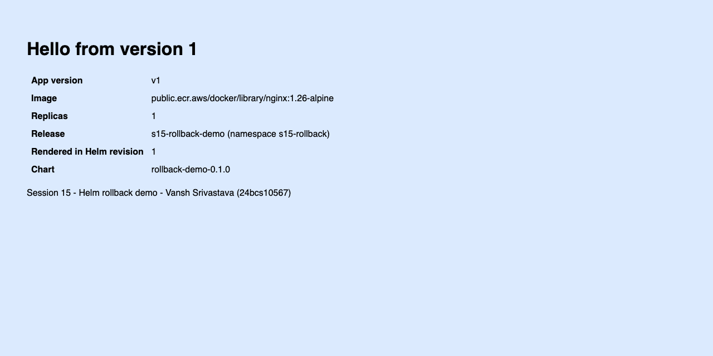
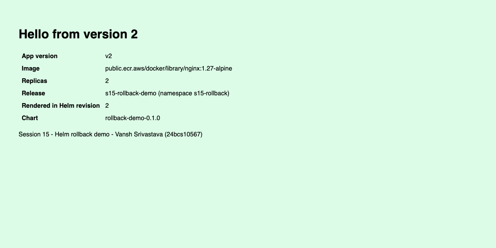
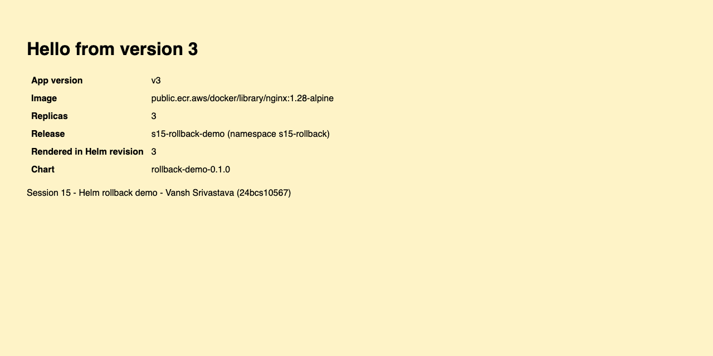

# Session 15: Helm

**Name:** Vansh Srivastava
**Enrollment No.:** 24bcs10567
**Session:** 15

This session is about Helm, the package manager for Kubernetes. I ran all the important Helm commands on a chart I generated with `helm create`, and I built a second chart to go through a complete install, upgrade and rollback workflow, checking every revision with curl. I also completed the course's Notes App mini project (`notes-chart`) with development and production values, a deliberately broken upgrade, and a rollback. Everything ran on my local minikube cluster.

## Folder structure

```text
session-15-helm/
├── README.md                     this file (overview of all three tasks)
├── .gitignore                    ignores packaged charts (*.tgz)
├── 01-helm-commands/
│   ├── README.md                 Task 1: every Helm command with real output
│   └── webapp/                   chart generated with `helm create` (small edits listed in the README)
├── 02-rollback/
│   ├── README.md                 Task 2: install -> upgrade -> upgrade -> rollback, verified each time
│   ├── rollback-demo/            my chart: ConfigMap page + Deployment + Service
│   ├── values-v2.yaml            values for revision 2
│   ├── values-v3.yaml            values for revision 3
│   └── verify.sh                 helm history + running image + curl through port-forward
├── 03-mini-project/
│   ├── README.md                 Task 3: course Notes App mini project, steps 1-15
│   ├── notes-chart/              course chart (values.yaml, values-prod.yaml, templates) + my additions
│   └── check.sh                  helm history + pods/images + ConfigMap + curl through port-forward
└── screenshots/                  headless Chrome captures of the app at each revision
```

## Environment

```text
macOS 26 on Apple Silicon (arm64), Docker via Colima
minikube v1.39.0, Kubernetes v1.37.0 (single arm64 node, containerd), kubectl v1.37.1
Helm v4.3.0
```

Notes:

- **Helm 4.** The course notes are written for Helm 3. The differences I ran into: `--dry-run` takes `client`/`server`, `--atomic` is deprecated in favour of `--rollback-on-failure`, `helm list --all` no longer exists, and Helm 4 applies resources with server-side apply.
- **Images.** Docker Hub returned `429 Too Many Requests` for anonymous pulls on this machine, so all charts pull the official `nginx` and `busybox` images from the AWS ECR Public mirror (`public.ecr.aws/docker/library/...`), which has the same images.
- **Shared cluster.** The minikube cluster was shared with other work, so I used only the namespaces `s15-commands`, `s15-rollback` and `s15-notes`, release names starting with `s15-`, small resource requests, and the local ports 18300, 18310, 18311 and 18320 for `kubectl port-forward`. The node IP is not reachable from the Mac, so I reached the apps through port-forwards.

## Task 1: Helm Commands

Full write-up with the output of every command: **[01-helm-commands/README.md](01-helm-commands/README.md)**

I created the chart `webapp` with `helm create`, then ran `helm lint` (on the good chart and on a copy I broke on purpose), `helm template`, `helm install --dry-run=client`, `helm install`, `helm list`, `helm status`, all `helm get` subcommands (`values`, `manifest`, `notes`, `hooks`, `metadata`, `all`), `helm test`, `helm upgrade` (first with `--dry-run=server`), `helm history`, `helm rollback`, `helm repo add/list/update`, `helm search repo/hub`, `helm show chart`, an install of a public chart from a repository, `helm package`/`helm pull`, and `helm uninstall` with and without `--keep-history`.

The release went through install, upgrade and rollback:

```bash
$ helm history s15-web -n s15-commands | column -t -s $'\t'
REVISION  UPDATED                   STATUS      CHART         APP VERSION  DESCRIPTION
1         Wed Oct  7 23:19:41 2026  superseded  webapp-0.1.0  1.27-alpine  Install complete
2         Wed Oct  7 23:20:22 2026  superseded  webapp-0.1.0  1.27-alpine  Upgrade complete
3         Wed Oct  7 23:20:51 2026  deployed    webapp-0.1.0  1.27-alpine  Rollback to 1
```

Adding repositories and searching them, and searching Artifact Hub:

```bash
$ helm repo list
NAME                	URL
bitnami             	https://charts.bitnami.com/bitnami
prometheus-community	https://prometheus-community.github.io/helm-charts

$ helm search repo nginx
NAME                                          	CHART VERSION	APP VERSION	DESCRIPTION
bitnami/nginx                                 	25.2.1       	1.31.6     	NGINX Open Source is a web server that can be a...
bitnami/nginx-ingress-controller              	12.0.7       	1.13.1     	NGINX Ingress Controller is an Ingress controll...
bitnami/nginx-intel                           	2.1.15       	0.4.9      	DEPRECATED NGINX Open Source for Intel is a lig...
prometheus-community/prometheus-nginx-exporter	1.23.1       	1.5.3      	A Helm chart for NGINX Prometheus Exporter

$ helm search hub nginx --max-col-width 60 | head -8
URL                                                         	CHART VERSION  	APP VERSION                                     	DESCRIPTION
https://artifacthub.io/packages/helm/cloudpirates-nginx/n...	0.16.12        	1.31.6                                          	Nginx is a high-performance HTTP server and reverse proxy.
https://artifacthub.io/packages/helm/quench-nginx/nginx     	0.0.15         	1.30.5                                          	High-performance web server, reverse proxy, and load bala...
https://artifacthub.io/packages/helm/krakazyabra/nginx      	1.0.0          	1.19.0                                          	Nginx Helm chart for Kubernetes
...
```

Things I learned from the outputs: `helm get values` shows only my overrides unless I add `--all`; Helm keeps each revision as a Secret (`sh.helm.release.v1.<release>.v<N>`); test hook pods are not removed by `helm uninstall`; and `helm search repo` only searches added repositories, while `helm search hub` searches Artifact Hub.

## Task 2: Helm Rollback

Full write-up: **[02-rollback/README.md](02-rollback/README.md)**

I wrote the chart `rollback-demo`, in which each revision changes the nginx image tag, the replica count, and a message and colour from a ConfigMap. After every step, [`verify.sh`](02-rollback/verify.sh) prints `helm history`, the image that is really running, and the app's response through a port-forward.

| Step | Command | Running image | Replicas | App says |
|------|---------|---------------|----------|----------|
| Install (rev 1) | `helm install s15-rollback-demo ./rollback-demo` | nginx 1.26.3 | 1 | Hello from version 1 |
| Upgrade (rev 2) | `helm upgrade ... -f values-v2.yaml` | nginx 1.27.5 | 2 | Hello from version 2 |
| Upgrade again (rev 3) | `helm upgrade ... -f values-v3.yaml` | nginx 1.28.3 | 3 | Hello from version 3 |
| Rollback (rev 4) | `helm rollback s15-rollback-demo 2` | nginx 1.27.5 | 2 | Hello from version 2 |

Verification after the rollback:

```bash
$ helm rollback s15-rollback-demo 2 -n s15-rollback --wait --timeout 3m
Rollback was a success! Happy Helming!

$ ./verify.sh
$ helm history s15-rollback-demo -n s15-rollback
REVISION  UPDATED                   STATUS      CHART                APP VERSION  DESCRIPTION
1         Wed Oct  7 23:23:33 2026  superseded  rollback-demo-0.1.0  1.0          Install complete
2         Wed Oct  7 23:23:57 2026  superseded  rollback-demo-0.1.0  1.0          Upgrade complete
3         Wed Oct  7 23:24:10 2026  superseded  rollback-demo-0.1.0  1.0          Upgrade complete
4         Wed Oct  7 23:24:25 2026  deployed    rollback-demo-0.1.0  1.0          Rollback to 2

$ kubectl get deploy s15-rollback-demo-web -n s15-rollback -o jsonpath='{.spec.template.spec.containers[0].image}{"  replicas="}{.status.readyReplicas}{"\n"}'
public.ecr.aws/docker/library/nginx:1.27-alpine  replicas=2

$ kubectl get pods -n s15-rollback -l app.kubernetes.io/instance=s15-rollback-demo -o custom-columns=POD:.metadata.name,IMAGE:.spec.containers[0].image,PHASE:.status.phase
POD                                     IMAGE                                             PHASE
s15-rollback-demo-web-cf698bdcd-kk4sk   public.ecr.aws/docker/library/nginx:1.27-alpine   Running
s15-rollback-demo-web-cf698bdcd-rggz5   public.ecr.aws/docker/library/nginx:1.27-alpine   Running

$ curl -s http://localhost:18310/version.txt
version=v2
message=Hello from version 2
image=public.ecr.aws/docker/library/nginx:1.27-alpine
replicas=2
renderedInRevision=2

$ curl -sI http://localhost:18310/ | grep Server
Server: nginx/1.27.5
```

| Revision 1 | Revision 2 | Revision 3 | After rollback to 2 |
|---|---|---|---|
|  |  |  |  |

What I observed:

- A rollback adds a new revision (`4  Rollback to 2`) and keeps the whole history.
- Helm re-applies the manifest it saved for revision 2 and does not render the chart again (the page still says `renderedInRevision=2`). Kubernetes scaled the old revision 2 ReplicaSet back up.
- As an extra, I ran an upgrade with a non-existent image tag using `--atomic` (deprecated in Helm 4) and `--rollback-on-failure`. Helm marked the revision `failed` and rolled back on its own. I also found a real problem: the old pods served the *failed* revision's page for about 80 seconds, because the kubelet updates mounted ConfigMap files in running pods. The README shows how I found it and how to avoid it (subPath mounts or versioned ConfigMap names). I used the subPath fix in Task 3.

## Task 3: Mini Project

Full write-up: **[03-mini-project/README.md](03-mini-project/README.md)**

I followed the course mini project steps 1-15 with the course `notes-chart` (`Chart.yaml`, `values.yaml`, `values-prod.yaml`, ConfigMap/Deployment/Service templates), copied from the course repo [Nency-Ravaliya/devops-heros](https://github.com/Nency-Ravaliya/devops-heros) (`session-15-helm/mini-project`). I changed the image registry, added resources, a readiness probe, and a small HTML page (mounted with subPath) so that curl can show which revision is running. Then I ran lint, template, install (development), upgrade with `-f values-prod.yaml`, a bad upgrade with a broken image tag, rollback to revision 2, and uninstall.

```bash
$ helm history s15-notes-dev -n s15-notes
REVISION  UPDATED                   STATUS      CHART              APP VERSION  DESCRIPTION
1         Wed Oct  7 23:29:27 2026  superseded  notes-chart-0.1.0  1.0          Install complete
2         Wed Oct  7 23:29:59 2026  superseded  notes-chart-0.1.0  1.0          Upgrade complete
3         Wed Oct  7 23:30:40 2026  superseded  notes-chart-0.1.0  1.0          Upgrade complete
4         Wed Oct  7 23:31:36 2026  deployed    notes-chart-0.1.0  1.0          Rollback to 2
```

| Revision | Environment | Image | Pods |
|----------|-------------|-------|------|
| 1 install | development | nginx 1.24.0 | 1 |
| 2 upgrade `-f values-prod.yaml` | production | nginx 1.25.5 | 3 |
| 3 upgrade `--set image.tag=broken-tag-does-not-exist` | development (values reset) | broken tag -> `ImagePullBackOff`; old pod kept serving | 1 healthy + 1 failing |
| 4 rollback to 2 | production | nginx 1.25.5 | 3 |

What I observed in the bad upgrade: Helm reported `deployed` because it did not wait for the pods. The command also reset the production values to the chart defaults, because it did not repeat `-f values-prod.yaml`. The rolling update kept one healthy old pod serving, so the app never went down. `helm rollback s15-notes-dev 2` restored everything.

| Development (rev 1) | Production (rev 2) | After rollback (rev 4) |
|---|---|---|
|  |  |  |

## Clean up

After each task I uninstalled the releases with `helm uninstall` and deleted my namespaces (`s15-commands`, `s15-rollback`, `s15-notes`). I stopped all port-forwards. The outputs are at the end of each task README. The final check:

```bash
$ helm list -A --filter '^s15-'
NAME	NAMESPACE	REVISION	UPDATED	STATUS	CHART	APP VERSION

$ kubectl get ns | grep s15- || echo "no s15- namespaces left"
no s15- namespaces left
```

The only thing I left is the two chart repositories in my local Helm config (`bitnami`, `prometheus-community`).

## What I learned

- A **chart** is a template package (`Chart.yaml`, `values.yaml`, `templates/`), a **release** is one installed copy of it, and every install, upgrade or rollback creates a numbered **revision**, stored as a Secret in the namespace.
- `helm lint`, `helm template` and `--dry-run=client|server` let me check a chart before anything changes in the cluster.
- `helm upgrade` starts again from the chart defaults unless I pass the values again (`-f values-prod.yaml`) or use `--reuse-values`. Keeping values files in Git (one per environment) is safer than many `--set` flags.
- `helm rollback <release> <N>` re-applies the saved manifest of revision N as a new revision. History is never rewritten.
- Without `--wait`, Helm reports `deployed` even if the pods never start. `--wait` and `--rollback-on-failure` (Helm 3's `--atomic`) make Helm check that the release is healthy and roll it back automatically if not.
- A checksum annotation on the pod template makes ConfigMap-only changes roll the pods. Mounted ConfigMap files change inside running pods unless they are mounted with `subPath` or the ConfigMap is versioned, and this matters during failed upgrades.
- `helm repo add/update` and `helm search repo` work with repositories I added. `helm search hub` searches Artifact Hub. `helm show` and `helm pull` let me inspect a chart before installing it.
