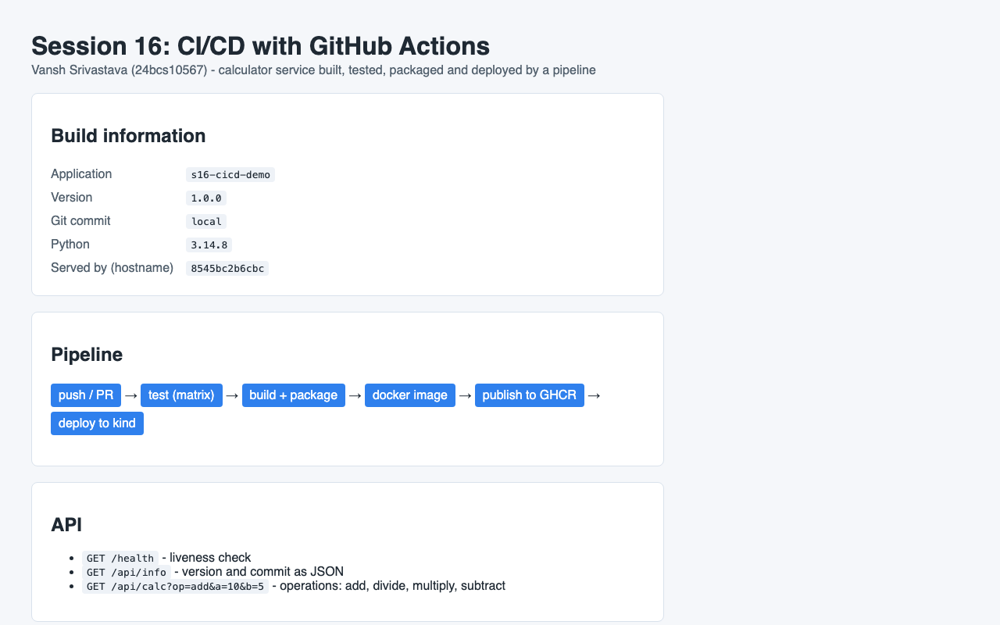
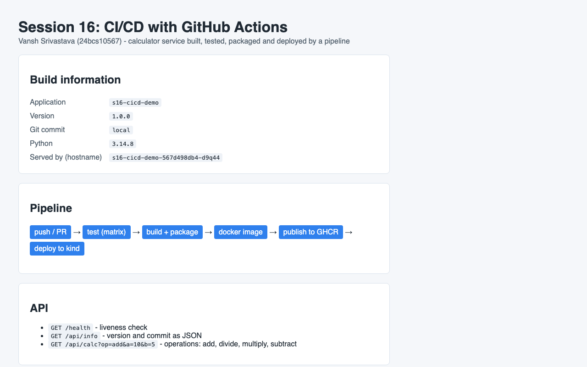

# Session 16: CI/CD & GitHub Actions

**Name:** Vansh Srivastava
**Enrollment No.:** 24bcs10567
**Session:** 16

This session is about automating the path from `git push` to a running application: CI (build and test every change) and CD (deliver and deploy what passed). Following the instructor's `10-final-cicd-pipeline` example, I built a small Flask calculator service with unit tests, a build script, a Dockerfile, Kubernetes manifests and one GitHub Actions workflow. The workflow tests on three Python versions, packages the app, builds and smoke-tests a Docker image, publishes it to GitHub Container Registry (GHCR) and deploys it to a throwaway Kubernetes (kind) cluster inside the runner. Everything except the GitHub run itself was run locally and the real output is below. The GitHub run gets added after the repo is pushed.

## Folder structure

```text
session-16-cicd-github-actions/
├── README.md                        # this file
├── .github/workflows/session-16-cicd.yml  # COPY of the live workflow (see "Where the workflow lives")
├── .gitignore                       # ignores reports/, build/, dist/, caches, venvs, image tarballs
├── .dockerignore                    # keeps tests, reports and git data out of the image
├── app/
│   ├── __init__.py
│   ├── calculator.py                # add / subtract / multiply / divide (same functions as the instructor's demo)
│   ├── main.py                      # Flask app: /, /health, /api/info, /api/calc
│   └── templates/index.html         # page that shows version, commit and hostname
├── tests/
│   ├── test_calculator.py           # 5 unit tests for the functions
│   └── test_api.py                  # 6 tests for the HTTP endpoints
├── k8s/
│   ├── deployment.yaml              # 2 replicas, probes, resource limits, non-root
│   └── service.yaml                 # ClusterIP service on port 80
├── build.sh                         # build step: byte-compile + package into build/ and dist/*.tar.gz
├── Dockerfile                       # python:3.14-slim-trixie, gunicorn, non-root user
├── VERSION                          # 1.0.0
├── pytest.ini                       # test paths and verbose output
├── requirements.txt                 # flask, werkzeug, gunicorn (pinned)
├── requirements-dev.txt             # + pytest, pytest-cov (pinned)
└── screenshots/
    ├── 01-s16-app-docker.png        # app running in Docker
    └── 02-s16-app-kubernetes.png    # app running in Kubernetes (local rehearsal of the deploy job)
```

## Environment

```text
macOS 26 (Apple Silicon, arm64), Docker 29.5.2 via Colima, minikube v1.39.0 / Kubernetes v1.37.0
Python 3.12.15 / 3.13.16 / 3.14.8 (official python:*-slim-trixie images, because the Mac only has Python 3.9)
actionlint 1.7.12 (Docker image), gh CLI (read-only, used to check action versions)
GitHub-hosted runner for the real pipeline: ubuntu-latest
```

Docker Hub refused anonymous pulls from my network during this session, so every Docker Hub image was pulled through a mirror of the same image (AWS ECR Public for `python`, `mirror.gcr.io` for actionlint). This is the error I got:

```text
$ docker pull -q python:3.14-slim-trixie
Error response from daemon: unknown: failed to resolve reference "docker.io/library/python:3.14-slim-trixie": unexpected status from HEAD request to https://registry-1.docker.io/v2/library/python/manifests/3.14-slim-trixie: 429 Too Many Requests
```

The mirror holds the identical image (same manifest digest as Google's Docker Hub mirror):

```bash
$ docker buildx imagetools inspect public.ecr.aws/docker/library/python:3.14-slim-trixie | grep -m1 Digest
Digest:    sha256:f85c5697265c178cc6887276c55fe16cf3d14ca35c3df6a5eab3b360534a55d2
$ docker buildx imagetools inspect mirror.gcr.io/library/python:3.14-slim-trixie | grep -m1 Digest
Digest:    sha256:f85c5697265c178cc6887276c55fe16cf3d14ca35c3df6a5eab3b360534a55d2
```

That is why the Dockerfile's `ARG PYTHON_IMAGE` defaults to `public.ecr.aws/docker/library/python:3.14-slim-trixie`. GitHub-hosted runners can reach the same mirror.

## Task 1: Demo Project - complete CI/CD demo using GitHub Actions

### Where the workflow lives

GitHub only runs workflow files from `.github/workflows/` at the **root of the repository**. A `.github` folder inside a sub-folder is ignored. So the live file is:

```text
.github/workflows/session-16-cicd.yml        <- the one GitHub runs
session-16-cicd-github-actions/.github/workflows/session-16-cicd.yml   <- identical copy, for reading next to the code
```

The copy is byte-for-byte the same as the live file:

```bash
$ cmp .github/workflows/session-16-cicd.yml session-16-cicd-github-actions/.github/workflows/session-16-cicd.yml && echo "s16 copy identical"
s16 copy identical
```

If the live file is edited, the copy has to be updated as well. All line numbers below refer to this file. Because this repo holds many sessions, the workflow only reacts to changes in this folder or in the workflow file itself (`paths:` filter), and `defaults.run.working-directory` makes every `run:` step start inside `session-16-cicd-github-actions/`.

### Deliverable: application source code

`app/calculator.py` keeps the instructor's four functions (`add`, `subtract`, `multiply`, `divide`, with `ValueError` on divide by zero). `app/main.py` puts them behind a small Flask API:

| Route | What it returns |
|---|---|
| `GET /` | HTML page with version, git commit, Python version and the serving hostname |
| `GET /health` | `{"status": "ok"}` (used by Docker smoke test and Kubernetes probes) |
| `GET /api/info` | the same build information as JSON |
| `GET /api/calc?op=add&a=10&b=5` | `{"op": "add", "a": 10.0, "b": 5.0, "result": 15.0}`, HTTP 400 for bad input |

The version and commit come from environment variables `APP_VERSION` and `GIT_SHA`. The pipeline bakes them into the image with `--build-arg` (workflow lines 123-126), so the running app always shows which commit it was built from.

### Deliverable: CI pipeline - Test

The `test` job (lines 42-83) installs `requirements-dev.txt` and runs pytest with a JUnit report and coverage. Here is the same command run locally in the Python 3.14 image:

```bash
$ docker run --rm --name s16-pytest -v "$PWD:/src" -w /src public.ecr.aws/docker/library/python:3.14-slim-trixie \
    sh -c 'pip install -q --root-user-action=ignore --disable-pip-version-check -r requirements-dev.txt && pytest --junitxml=reports/junit.xml --cov=app --cov-report=term-missing --cov-report=xml:reports/coverage.xml'
============================= test session starts ==============================
platform linux -- Python 3.14.8, pytest-9.1.1, pluggy-1.6.0 -- /usr/local/bin/python3.14
cachedir: .pytest_cache
rootdir: /src
configfile: pytest.ini
testpaths: tests
plugins: cov-7.1.0
collecting ... collected 11 items

tests/test_api.py::test_index_page PASSED                                [  9%]
tests/test_api.py::test_health PASSED                                    [ 18%]
tests/test_api.py::test_info_uses_build_env PASSED                       [ 27%]
tests/test_api.py::test_calc_add PASSED                                  [ 36%]
tests/test_api.py::test_calc_divide_by_zero_is_400 PASSED                [ 45%]
tests/test_api.py::test_calc_rejects_unknown_op_and_bad_numbers PASSED   [ 54%]
tests/test_calculator.py::test_add PASSED                                [ 63%]
tests/test_calculator.py::test_subtract PASSED                           [ 72%]
tests/test_calculator.py::test_multiply PASSED                           [ 81%]
tests/test_calculator.py::test_divide PASSED                             [ 90%]
tests/test_calculator.py::test_divide_by_zero PASSED                     [100%]

------------------ generated xml file: /src/reports/junit.xml ------------------
================================ tests coverage ================================
_______________ coverage: platform linux, python 3.14.8-final-0 ________________

Name                Stmts   Miss  Cover   Missing
-------------------------------------------------
app/__init__.py         0      0   100%
app/calculator.py      11      0   100%
app/main.py            35      0   100%
-------------------------------------------------
TOTAL                  46      0   100%
Coverage XML written to file reports/coverage.xml
============================== 11 passed in 0.14s ==============================
```

The job runs as a matrix over Python 3.12, 3.13 and 3.14 (line 48). I ran the suite on the same three versions locally:

```bash
$ for v in 3.12 3.13 3.14; do docker run --rm -v "$PWD:/src:ro" -w /tmp public.ecr.aws/docker/library/python:$v-slim-trixie sh -c 'cp -r /src /tmp/w && cd /tmp/w && pip install -q --root-user-action=ignore --disable-pip-version-check -r requirements-dev.txt && echo "$(python --version): $(pytest -p no:cacheprovider 2>&1 | tail -1)"'; done
Python 3.12.15: ============================== 11 passed in 0.06s ==============================
Python 3.13.16: ============================== 11 passed in 0.06s ==============================
Python 3.14.8: ============================== 11 passed in 0.06s ==============================
```

**What happens when a test fails.** This is the instructor's failure scenario: change `add()` to `return a + b + 1`. I did it on a throwaway copy inside a container (the repo file was not touched):

```bash
$ grep -n "return a + b" app/calculator.py
5:    return a + b + 1
$ pytest
...
FAILED tests/test_api.py::test_calc_add - assert 16.0 == 15
FAILED tests/test_calculator.py::test_add - assert 16 == 15
========================= 2 failed, 9 passed in 0.07s ==========================
pytest exit code: 1
```

pytest exits with 1, so the "Run unit tests with coverage" step fails, so the `test` job fails. `build` has `needs: test` (line 88), so it never starts, and `publish`/`deploy` depend on `build`. A broken commit cannot reach the registry or the cluster.

### Deliverable: CI pipeline - Build

The `build` job (lines 86-152) has two outputs: an application package and a Docker image.

`build.sh` is the build step from the instructor's example, extended a bit: it byte-compiles the code (a syntax error fails the build), copies the app into `build/`, writes `build-info.txt` and creates a versioned tarball in `dist/`:

```bash
$ docker run --rm -v "$PWD:/src" -w /src public.ecr.aws/docker/library/python:3.14-slim-trixie ./build.sh
== Building s16-cicd-demo-1.0.0 (commit local)
== build/
build/VERSION
build/app/__init__.py
build/app/calculator.py
build/app/main.py
build/app/templates/index.html
build/build-info.txt
build/requirements.txt
== dist/
total 4
-rw-r--r-- 1 root root 2246 Oct  7 18:16 s16-cicd-demo-1.0.0.tar.gz
== build-info.txt
Application : s16-cicd-demo
Version     : 1.0.0
Git commit  : local
Built at    : 2026-10-07T18:16:35Z
Python      : Python 3.14.8
Build completed successfully.
```

Locally the commit says `local` because the repo had no commits yet. In the pipeline, line 103 passes `GIT_SHA: ${{ github.sha }}`.

### Deliverable: Dockerfile

`Dockerfile` builds on `python:3.14-slim-trixie` (via the mirror, see Environment). It installs the pinned requirements in their own layer, so that layer stays cached when only code changes. It records version and commit as labels and environment variables, and runs gunicorn as UID 10001 instead of root. Gunicorn 26 tries to create a control socket in `$HOME` by default. The `appuser` has no home directory, so my first run logged `Control server error: [Errno 13] Permission denied: '/home/appuser'`, and I added `--no-control-socket`.

```bash
$ docker build --progress=plain --build-arg APP_VERSION=1.0.0 --build-arg GIT_SHA=local -t s16-cicd-demo:1.0.0 .
#0 building with "colima" instance using docker driver
...
#4 [1/6] FROM public.ecr.aws/docker/library/python:3.14-slim-trixie@sha256:f85c5697265c178cc6887276c55fe16cf3d14ca35c3df6a5eab3b360534a55d2
...
#6 [2/6] WORKDIR /app
#6 CACHED
#7 [3/6] COPY requirements.txt .
#7 CACHED
#8 [4/6] RUN pip install --no-cache-dir --root-user-action=ignore -r requirements.txt
#8 CACHED
#9 [5/6] COPY app ./app
#9 DONE 0.1s
#10 [6/6] RUN useradd --system --uid 10001 --no-create-home --shell /usr/sbin/nologin appuser
#10 0.141 useradd warning: appuser's uid 10001 is greater than SYS_UID_MAX 999
#10 DONE 0.2s
#11 exporting to image
...
#11 naming to docker.io/library/s16-cicd-demo:1.0.0 done
$ docker images --format 'table {{.Repository}}:{{.Tag}}\t{{.ID}}\t{{.Size}}' s16-cicd-demo:1.0.0
REPOSITORY:TAG        IMAGE ID       SIZE
s16-cicd-demo:1.0.0   fa0adb679ceb   215MB
```

The `useradd` warning only means 10001 is above the range Debian reserves for system accounts, which is what I want. The pipeline runs the same kind of smoke test after building (lines 129-140). Locally I ran the container on port 8216:

```bash
$ docker run -d --name s16-cicd-demo -p 127.0.0.1:8216:8000 s16-cicd-demo:1.0.0
8545bc2b6cbce002ef9beb013536286bb3d30412e40d97c7bd6579777c8e32d5
$ docker ps --filter name=s16-cicd-demo
NAMES           IMAGE                 STATUS         PORTS
s16-cicd-demo   s16-cicd-demo:1.0.0   Up 4 seconds   127.0.0.1:8216->8000/tcp
$ curl -s http://localhost:8216/health
{"status":"ok"}
$ curl -s http://localhost:8216/api/info
{"app":"s16-cicd-demo","git_sha":"local","hostname":"8545bc2b6cbc","python":"3.14.8","version":"1.0.0"}
$ curl -s "http://localhost:8216/api/calc?op=multiply&a=6&b=7"
{"a":6.0,"b":7.0,"op":"multiply","result":42.0}
$ curl -s -w 'HTTP %{http_code}\n' "http://localhost:8216/api/calc?op=divide&a=1&b=0"
{"error":"Cannot divide by zero"}
HTTP 400
$ docker exec s16-cicd-demo id
uid=10001(appuser) gid=999(appuser) groups=999(appuser)
$ docker logs s16-cicd-demo
[2026-10-07 18:17:13 +0000] [1] [INFO] Starting gunicorn 26.2.0
[2026-10-07 18:17:13 +0000] [1] [INFO] Listening at: http://0.0.0.0:8000 (1)
[2026-10-07 18:17:13 +0000] [1] [INFO] Using worker: sync
[2026-10-07 18:17:13 +0000] [7] [INFO] Booting worker with pid: 7
[2026-10-07 18:17:13 +0000] [8] [INFO] Booting worker with pid: 8
172.17.0.1 - - [07/Oct/2026:18:17:17 +0000] "GET /health HTTP/1.1" 200 16 "-" "curl/8.7.1"
...
```

The hostname `8545bc2b6cbc` is the container ID, and the process runs as UID 10001.



### Deliverable: GitHub Actions workflow, CD pipeline

CD has two parts here:

1. **Continuous Delivery: `publish` job (lines 181-216).** It runs only for a push to `main` (line 184), never for a pull request. It downloads the image the `build` job saved as an artifact, loads it, logs in to GHCR with the automatic `GITHUB_TOKEN` (lines 202-207) and pushes `ghcr.io/vanshhhhhhhhh/s16-cicd-demo:sha-<commit>` and `:latest`. The job asks for `packages: write` (lines 186-188). The rest of the workflow only has `contents: read` (lines 23-24). It pushes the image that was already built and smoke-tested instead of building a new one.
2. **Continuous Deployment: `deploy` job (lines 219-277).** It creates a throwaway kind cluster on the runner with `helm/kind-action` (lines 242-245). A GitHub-hosted runner cannot reach my laptop's minikube, and the instructor's `03-kubernetes-deployment` notes make the same point. GHCR packages start out private, so instead of pulling from the registry, the job loads the image into the kind node with `kind load docker-image` (line 248). It renders `k8s/deployment.yaml` with the new image tag (`sed` on the `image:` line plus a `grep` that fails if the substitution did not happen, lines 253-254), applies it, waits for the rollout (line 258) and curls the service through `kubectl port-forward` (lines 260-270). The condition on line 223 (`!cancelled() && !failure() && github.event_name != 'pull_request'`) means it runs after a successful publish on `main`, and also on a manual `workflow_dispatch` run (where `publish` is skipped), but never for PRs and never after a failure. `environment: s16-kind-demo` (line 225) makes the run show up as a deployment on the repo page.

**Local rehearsal of the deploy job.** I ran the same commands against the shared minikube, in a temporary namespace with my prefix (`s17-s16-cicd`). The image tag was different from the one in the manifest, as it will be in CI. `minikube image load` did the job of `kind load docker-image`. The rehearsal caught a real bug: my first version used `kubectl set image --local -o yaml`, which prints **nothing** when the image does not change. The rendered file came out empty, `kubectl apply` created only the Service, and `rollout status` failed with `deployments.apps "s16-cicd-demo" not found`. I replaced it with the `sed` + `grep` check. This is the run after the fix:

```bash
$ minikube image load --overwrite=true s16-cicd-demo:sha-local   # stands in for "kind load docker-image" in CI
$ kubectl create namespace "${NAMESPACE}"
namespace/s17-s16-cicd created
$ sed "s#^\( *image: \).*#\1${IMAGE}#" k8s/deployment.yaml > "${RUNNER_TEMP}/deployment.yaml"
$ grep -F "image: ${IMAGE}" "${RUNNER_TEMP}/deployment.yaml"
          image: s16-cicd-demo:sha-local
$ kubectl apply -n "${NAMESPACE}" -f "${RUNNER_TEMP}/deployment.yaml" -f k8s/service.yaml
deployment.apps/s16-cicd-demo created
service/s16-cicd-demo created
$ kubectl -n "${NAMESPACE}" rollout status deployment/s16-cicd-demo --timeout=180s
Waiting for deployment "s16-cicd-demo" rollout to finish: 0 out of 2 new replicas have been updated...
Waiting for deployment "s16-cicd-demo" rollout to finish: 0 of 2 updated replicas are available...
Waiting for deployment "s16-cicd-demo" rollout to finish: 1 of 2 updated replicas are available...
deployment "s16-cicd-demo" successfully rolled out
$ kubectl -n "${NAMESPACE}" port-forward svc/s16-cicd-demo 8226:80 > port-forward.log 2>&1 &
$ curl -fsS http://127.0.0.1:8226/health
{"status":"ok"}
$ curl -fsS http://127.0.0.1:8226/api/info
{"app":"s16-cicd-demo","git_sha":"local","hostname":"s16-cicd-demo-567d498db4-d9q44","python":"3.14.8","version":"1.0.0"}
$ curl -fsS "http://127.0.0.1:8226/api/calc?op=multiply&a=6&b=7"
{"a":6.0,"b":7.0,"op":"multiply","result":42.0}
$ kubectl -n "${NAMESPACE}" get deployment,replicaset,pods,service -o wide
NAME                            READY   UP-TO-DATE   AVAILABLE   AGE   CONTAINERS   IMAGES                    SELECTOR
deployment.apps/s16-cicd-demo   2/2     2            2           10s   app          s16-cicd-demo:sha-local   app=s16-cicd-demo

NAME                                       DESIRED   CURRENT   READY   AGE   CONTAINERS   IMAGES                    SELECTOR
replicaset.apps/s16-cicd-demo-567d498db4   2         2         2       10s   app          s16-cicd-demo:sha-local   app=s16-cicd-demo,pod-template-hash=567d498db4

NAME                                 READY   STATUS    RESTARTS   AGE   IP            NODE       NOMINATED NODE   READINESS GATES
pod/s16-cicd-demo-567d498db4-d9q44   1/1     Running   0          10s   10.244.0.14   minikube   <none>           <none>
pod/s16-cicd-demo-567d498db4-wtnzz   1/1     Running   0          10s   10.244.0.15   minikube   <none>           <none>

NAME                    TYPE        CLUSTER-IP     EXTERNAL-IP   PORT(S)   AGE   SELECTOR
service/s16-cicd-demo   ClusterIP   10.109.155.7   <none>        80/TCP    10s   app=s16-cicd-demo
```

This time the hostname is a pod name, so the request went Service -> Pod. I deleted the namespace afterwards.



### Deliverable: GitHub Actions workflow, checks before pushing

The workflow has to pass on the first push, so I verified the action versions and linted the file first.

Action versions are pinned to the current major release. I checked the latest tags with `gh` (read-only):

```bash
$ gh api repos/actions/checkout/releases/latest --jq .tag_name
v7.0.1
$ gh api repos/actions/setup-python/releases/latest --jq .tag_name
v7.0.0
$ gh api repos/actions/upload-artifact/releases/latest --jq .tag_name
v7.0.2
$ gh api repos/actions/download-artifact/releases/latest --jq .tag_name
v8.0.2
$ gh api repos/docker/login-action/releases/latest --jq .tag_name
v4.6.0
$ gh api repos/helm/kind-action/releases/latest --jq .tag_name
v1.15.1
```

So the workflow uses `actions/checkout@v7`, `actions/setup-python@v7`, `actions/upload-artifact@v7`, `actions/download-artifact@v8` and `docker/login-action@v4`. For `helm/kind-action` I used the full `@v1.15.1`: its moving `v1` tag still points at v1.14.0 (commit `ef37e7f`, checked with `gh api repos/helm/kind-action/commits/v1`), not at the latest release. I also read the breaking-change notes: `download-artifact@v8` now fails on a digest mismatch and skips unzipping non-zip files, and `upload-artifact@v7` only uploads unzipped when `archive: false` is set. Neither affects this workflow.

actionlint (the version is the same as `rhysd/actionlint:latest`; it runs shellcheck on every `run:` block too):

```bash
$ docker run --rm -v "$PWD:/repo" -w /repo mirror.gcr.io/rhysd/actionlint:1.7.12 -version
1.7.12
installed by building from source
built with go1.26.1 compiler for linux/arm64
$ docker run --rm -v "$PWD:/repo" -w /repo mirror.gcr.io/rhysd/actionlint:1.7.12 -verbose .github/workflows/session-16-cicd.yml .github/workflows/session-17-devsecops.yml
verbose: Linting 2 files
verbose: Linting .github/workflows/session-17-devsecops.yml
verbose: Using project at /repo
verbose: Linting .github/workflows/session-16-cicd.yml
verbose: Using project at /repo
verbose: verbose: Found 0 parse errors in 0 ms for .github/workflows/session-17-devsecops.yml
Found 0 parse errors in 0 ms for .github/workflows/session-16-cicd.yml
verbose: Found total 0 errors in 105 ms for .github/workflows/session-16-cicd.yml
verbose: Found total 0 errors in 128 ms for .github/workflows/session-17-devsecops.yml
verbose: Found 0 errors in 2 files
exit code: 0
```

To confirm shellcheck was actually active, I fed actionlint a scratch workflow containing `run: echo $FOO`. It reported `SC2086:info:1:6: Double quote to prevent globbing and word splitting [shellcheck]`, so the clean result above includes the shell checks.

### Concepts, with the exact workflow lines

All line numbers are in `.github/workflows/session-16-cicd.yml`.

| Concept | What it means | Where it is in my workflow |
|---|---|---|
| **CI vs CD** | CI = every change is built and tested automatically. CD = what passed is delivered (Continuous Delivery: a release-ready artifact) and possibly deployed automatically (Continuous Deployment). | CI = jobs `test` (42-83) and `build` (86-152), run for every push and PR. Continuous Delivery = `publish` (181-216), image in GHCR. Continuous Deployment = `deploy` (219-277), image rolled out to Kubernetes. The split is summarised in the header comment, lines 5-6. |
| **CI/CD pipeline** | A chain of automated stages where each stage only runs if the previous one passed. | `needs:` builds the chain: `build` needs `test` (88), `secrets-demo` needs `test` (157), `publish` needs `build` (183), `deploy` needs `build` and `publish` (221). Result: test -> build -> publish -> deploy. |
| **GitHub Actions** | GitHub's automation service: it reads YAML files from `.github/workflows/` and runs them on events. | The whole file. It is in the root `.github/workflows/` (see "Where the workflow lives"). The `uses:` lines pull in reusable actions, e.g. `actions/checkout@v7` (51), `actions/setup-python@v7` (61), `helm/kind-action@v1.15.1` (243). |
| **Workflow** | One YAML file: a name, the events that trigger it (WHEN) and the jobs (WHAT). | `name:` line 7. Triggers lines 9-20: `push` to `main` (10-14), `pull_request` to `main` (15-19), each with a `paths:` filter so other sessions don't trigger it, and `workflow_dispatch` (20) for a manual "Run workflow" button. Workflow-wide settings: `permissions` (23-24), `concurrency` (27-29, a newer push cancels the older run), `env` (31-33), `defaults.run` (35-38). |
| **Jobs** | Independent units of work. Each gets a fresh runner. They run in parallel unless `needs:` orders them. | `jobs:` line 40, then five jobs: `test` (42), `build` (86), `secrets-demo` (155), `publish` (181), `deploy` (219). `secrets-demo` and `build` both wait only for `test`, so they run in parallel. |
| **Steps** | The ordered commands inside a job, sharing that job's runner and file system. A step is either `uses:` (an action) or `run:` (shell). | For example the `test` job steps (49-83): checkout (50-51, `uses`), runner details (53-58, `run`), setup Python (60-65, `uses` with `with:` inputs), install (67-68), pytest (70-75), upload reports (77-83). If one step fails, the remaining steps are skipped unless they have `if: always()` (line 78). |
| **Runners** | The machine that executes a job. GitHub-hosted runners are fresh VMs that are thrown away after the job. Self-hosted runners are your own machines. | `runs-on: ubuntu-latest` on every job (44, 89, 158, 185, 224). The matrix (45-48) starts **three** runners for `test`, one per Python version. Lines 53-58 print the runner's name, OS, architecture and CPU count. Because every job is a new machine, each job checks out the code again, and files are passed between jobs as artifacts. |
| **Secrets** | Encrypted values that GitHub injects at run time and masks in logs. They are never written in the YAML. | `secrets-demo` job (155-178). Line 165 uses the automatic `GITHUB_TOKEN` for an authenticated `gh api` call. Lines 170-178 use the optional repository secret `DEMO_API_KEY`: the step prints only whether it is set and still passes when it is not. The token is used again for the GHCR login (207). The workflow-level `permissions` block (23-24) limits what the token can do. |
| **Artifacts** | Files a job uploads so they survive after the runner is destroyed. You can download them from the run page, and other jobs can download them too. | Test reports for each Python version (77-83), the application package `build/` + `dist/` (106-113) and the Docker image tarball (147-152). The image artifact is downloaded again by `publish` (193-197) and `deploy` (233-237), which is how one job hands its output to another. |
| **Build** | Turn source into something deployable. | `bash build.sh` (101-104) makes the package. `docker build` (119-127) makes the image, tagged `sha-<first 7 chars of the commit>` (115-117), then a smoke test runs the container and curls it (129-140). |
| **Test** | Automated checks that decide whether the change may move on. | pytest with JUnit XML and coverage (70-75), on 3 Python versions. A failing test stops the pipeline, as shown in the failure demo above. |
| **Pipeline execution** | What actually happens on a push: the events trigger the run, jobs start in `needs:` order, and the run page shows logs, artifacts and a summary. | Push to `main` -> `test` x3 -> (`build`, `secrets-demo`) -> `publish` -> `deploy`. The publish step writes the pushed image name to the run summary (line 216). For a pull request, `publish` and `deploy` are skipped (184, 223). The real run is recorded in the next section. |

### Deliverables checklist

| Deliverable | Where |
|---|---|
| Application source code | `app/`, `tests/` |
| Dockerfile | `Dockerfile` |
| GitHub Actions workflow | `/.github/workflows/session-16-cicd.yml` (copy in `.github/workflows/` here) |
| CI pipeline | jobs `test` and `build` |
| CD pipeline | jobs `publish` (GHCR) and `deploy` (kind) |
| Screenshots of successful pipeline execution | "Pipeline execution" below (added after the push) |
| README explaining each concept with line references | this file, table above |

## Pipeline execution

<!-- TODO-POSTPUSH: fill this section after the repo is pushed to GitHub -->
**TODO-POSTPUSH** - The workflow runs on GitHub after the lead pushes the repository. It cannot run before that, so this section is still empty. To fill it in:

```bash
gh run list --workflow "Session 16 - CI/CD Pipeline" --limit 5
gh run watch <run-id>
gh run view <run-id> --log | grep -E "passed|Published|successfully rolled out"
```

Screenshots to add to `screenshots/`:

- `03-actions-run-graph.png`: the run summary page with the job graph test (x3) -> build / secrets-demo -> publish -> deploy, all green
- `04-actions-test-log.png`: the "Run unit tests with coverage" step log (11 passed)
- `05-actions-artifacts.png`: the Artifacts list (test reports x3, s16-app-package, s16-image)
- `06-actions-deploy-log.png`: the deploy job's rollout + smoke-test output
- `07-ghcr-package.png`: the `s16-cicd-demo` package on GHCR with the `sha-...` and `latest` tags

Optional: to see the "secret is set" branch of `secrets-demo`, add a repository secret `DEMO_API_KEY` with any fake value (Settings > Secrets and variables > Actions) and re-run the workflow.

## What I learned

- CI and CD map directly onto jobs: everything up to a tested, packaged image is CI. Pushing it to a registry is Continuous Delivery, and rolling it out automatically is Continuous Deployment.
- `needs:` is what turns separate jobs into a pipeline. A failed test really does stop the build, the publish and the deploy.
- Every job runs on a fresh runner, so files only move between jobs as artifacts. Building the image once and passing it on means the image I deploy is the one I tested.
- In a repo with many projects, `paths:` filters and `defaults.run.working-directory` keep each workflow in its own folder. `uses:` steps ignore `working-directory`, so artifact paths need the folder prefix.
- Least privilege for `GITHUB_TOKEN`: read-only by default and `packages: write` only in the job that pushes. Secrets are checked for presence and never echoed.
- Rehearsing the pipeline locally pays off. It found the empty-output behaviour of `kubectl set image --local` and the gunicorn 26 control-socket error before either could break the real run.
