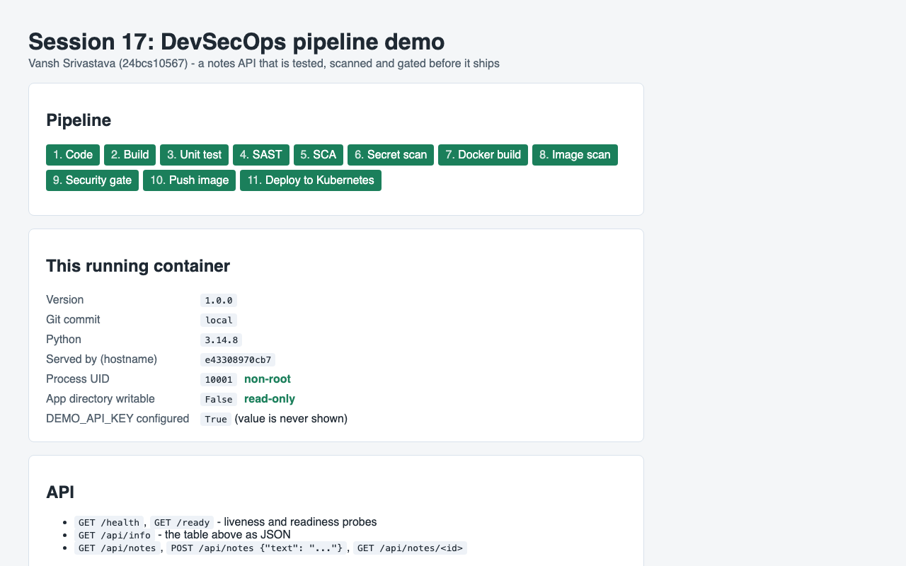
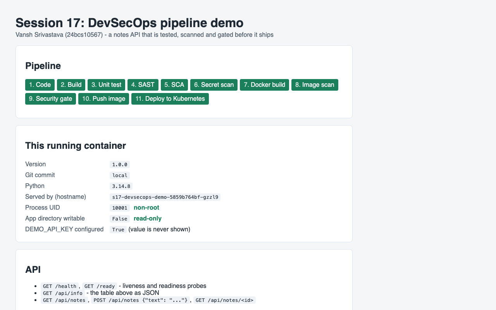
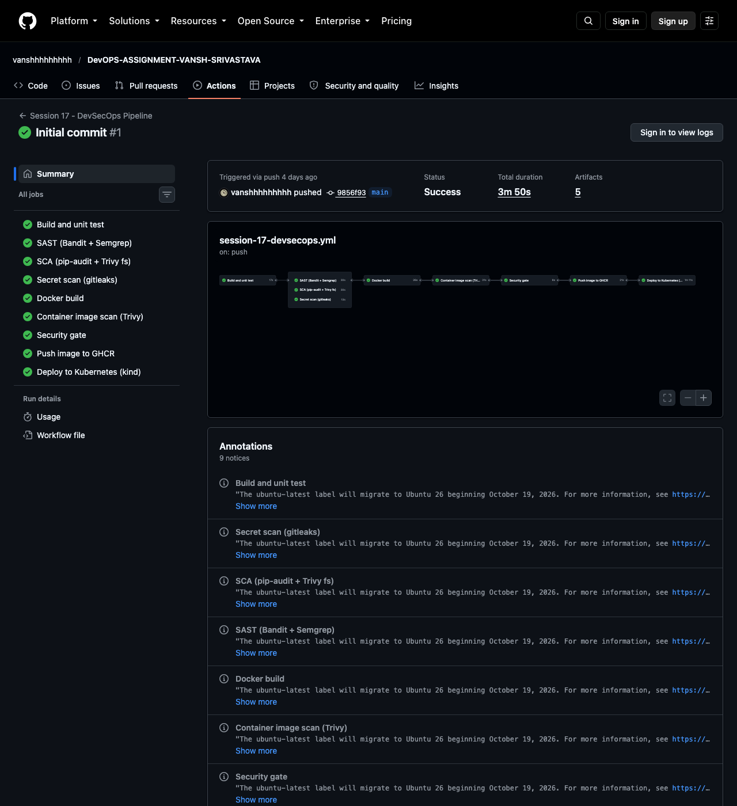

# Session 17: Complete CI/CD & DevSecOps

**Name:** Vansh Srivastava
**Enrollment No.:** 24bcs10567
**Session:** 17

DevSecOps adds security checks to the CI/CD pipeline itself instead of leaving them for a separate review at the end. For this session I built a small Flask "notes" API and one GitHub Actions workflow that follows the brief's flow: Code -> Build -> Unit Test -> SAST -> SCA -> Secret Scan -> Docker Build -> Container Image Scan -> Security Gate -> Push Image -> Deploy to Kubernetes. The scanners (Bandit, Semgrep, pip-audit, Trivy, gitleaks) write JSON reports, and one gate script turns those reports into a pass/fail decision. Only an image that passes is pushed to GHCR and deployed, to hardened Kubernetes manifests. I ran every tool locally against my code and image (all clean), then ran them against a deliberately insecure copy to show the gate blocking it. I also deployed the manifests to minikube. After the repo was pushed, the workflow ran on GitHub and every stage passed (see "Pipeline execution"). The stages follow the instructor's `session-17-devsecops` material and demo workflow in the course repo (https://github.com/Nency-Ravaliya/devops-heros). I wrote my own app, workflow and configs and did not copy those files.

## Folder structure

```text
session-17-devsecops/
├── README.md                         # this file
├── .github/workflows/session-17-devsecops.yml  # COPY of the live workflow at the repo root (see below)
├── .gitignore / .dockerignore
├── app/
│   ├── __init__.py
│   ├── main.py                       # Flask API: /, /health, /ready, /api/info, /api/notes
│   ├── templates/index.html          # page showing UID, read-only fs, hostname, pipeline stages
│   └── static/style.css              # CSS as a file so the CSP can stay "default-src 'self'"
├── tests/test_app.py                 # 9 test functions / 14 test cases (incl. security headers, validation)
├── Dockerfile                        # multi-stage, python:3.14-alpine, no pip at runtime, UID 10001
├── k8s/
│   ├── namespace.yaml                # s17-devsecops, enforces Pod Security "restricted"
│   ├── deployment.yaml               # securityContext, limits, startup/liveness/readiness probes
│   └── service.yaml                  # ClusterIP :80 -> 8080
├── security/                         # security tools configuration
│   ├── bandit.yaml                   # Bandit (SAST) config
│   ├── semgrep.yml                   # 4 custom Semgrep (SAST) rules, used together with p/python
│   ├── gitleaks.toml                 # gitleaks (secrets) config: default rules + 1 custom rule + allowlists
│   └── security-gate.sh              # the security gate: policy that turns reports into PASS/FAIL
├── VERSION, pytest.ini, requirements.txt, requirements-dev.txt
└── screenshots/
    ├── 01-s17-app-docker.png         # hardened container in Docker
    ├── 02-s17-app-minikube.png       # same image deployed to minikube
    └── 03-actions-run-37668580592.png  # the GitHub Actions run page of the first push
```

## Environment

```text
macOS 26 (Apple Silicon, arm64), Docker 29.5.2 via Colima, minikube v1.39.0 / Kubernetes v1.37.0 (containerd)
Python 3.14.8 in official python images (the Mac only has 3.9)
Scanners: bandit 1.9.4, semgrep 1.179.0, pip-audit 2.10.1 (pip), Trivy 0.75.0 and gitleaks 8.30.1 (official images from ghcr.io)
actionlint 1.7.12 (Docker image)
```

I checked that these are the current releases:

```bash
$ gh api repos/aquasecurity/trivy/releases/latest --jq .tag_name
v0.75.0
$ gh api repos/gitleaks/gitleaks/releases/latest --jq .tag_name
v8.30.1
$ gh api repos/semgrep/semgrep/releases/latest --jq .tag_name
v1.179.0
$ gh api repos/PyCQA/bandit/releases/latest --jq .tag_name
1.9.4
$ gh api repos/pypa/pip-audit/releases/latest --jq .tag_name
v2.10.1
```

Docker Hub refused anonymous pulls from my network during this session:

```text
$ docker pull -q python:3.14-slim-trixie
Error response from daemon: unknown: failed to resolve reference "docker.io/library/python:3.14-slim-trixie": unexpected status from HEAD request to https://registry-1.docker.io/v2/library/python/manifests/3.14-slim-trixie: 429 Too Many Requests
```

So the Dockerfile pulls the official Python image through the AWS ECR Public mirror. It is the same image: `public.ecr.aws/docker/library/python:3.14-alpine` and `mirror.gcr.io/library/python:3.14-alpine` both resolve to `sha256:f6a589d43c42b9e7f7dc67a12d37132491f362859a5d750607710cc56da3bc72`. Trivy and gitleaks come from their official ghcr.io images, and the Python scanners are installed with pip.

## Task 1: DevSecOps Demo Project

### Where the workflow lives

GitHub only runs workflows from `.github/workflows/` at the **repository root**, so the live file is `/.github/workflows/session-17-devsecops.yml`. The file in this folder's `.github/workflows/` is an identical copy, kept here so the code and the pipeline can be read together:

```bash
$ cmp .github/workflows/session-17-devsecops.yml session-17-devsecops/.github/workflows/session-17-devsecops.yml && echo "s17 copy identical"
s17 copy identical
```

Line numbers below refer to it. The workflow triggers on push and pull_request to `main`, but only when this folder or the workflow file changes (`paths:`, lines 10-21), plus `workflow_dispatch`. `defaults.run.working-directory` (lines 41-44) makes every `run:` step start in `session-17-devsecops/`.

### Expected flow -> jobs

| # | Stage (from the brief) | Job (lines) | Tool | Blocks the pipeline when |
|---|---|---|---|---|
| 1-3 | Code -> Build -> Unit Test | `build-test` (48-82) | compileall + import, pytest + pytest-cov | a test fails or coverage < 90% |
| 4 | SAST | `sast` (85-123) | Bandit, Semgrep (`p/python` + 4 custom rules) | Bandit MEDIUM/HIGH, Semgrep above INFO |
| 5 | SCA | `sca` (126-168) | pip-audit, Trivy fs (also Dockerfile/K8s misconfig) | any known vuln (pip-audit), HIGH/CRITICAL (Trivy) |
| 6 | Secret Scan | `secret-scan` (171-197) | gitleaks on this folder only | any finding |
| 7 | Docker Build | `docker-build` (200-247) | docker build + hardened smoke test | build or smoke test fails |
| 8 | Container Image Scan | `image-scan` (250-280) | Trivy image + CycloneDX SBOM | (report only, decided in 9) |
| 9 | Security Gate | `security-gate` (283-301) | `security/security-gate.sh` on all reports | any CRITICAL, or a HIGH with a fix, in the image, or any check above |
| 10 | Push Image | `push-image` (304-339) | docker push to GHCR with `GITHUB_TOKEN` | only runs on push to `main` after the gate passes |
| 11 | Deploy to Kubernetes | `deploy` (342-420) | kind cluster + kubectl | rollout or smoke/security check fails |

`needs:` puts the stages in order: SAST, SCA and secret scan wait for `build-test` (lines 87, 128, 173) and run in parallel. `docker-build` waits for all three (line 202). `image-scan` waits for `docker-build` (252). `security-gate` waits for all scans (285). `push-image` waits for the gate (306). `deploy` waits for build, gate and push (344).

### CI/CD: application build and unit testing

`app/main.py` is a notes API (`GET/POST /api/notes`, `GET /api/notes/<id>`) plus `/health`, `/ready`, `/api/info` and an HTML page. The security-relevant parts are: input validation (JSON object, non-empty string, at most 200 chars), a 16 KB request body limit (HTTP 413), JSON error handlers, security headers on every response (`X-Content-Type-Options`, `X-Frame-Options`, `Referrer-Policy`, `Content-Security-Policy`), and `DEMO_API_KEY` read from the environment and reported only as present or absent.

The `build-test` job (48-82) byte-compiles and imports the app (the "build" for a Python service, lines 65-68), then runs pytest with a 90% coverage floor (70-74). The same commands, run locally:

```bash
$ docker run --rm --name s17-pytest -v "$PWD:/src" -w /src public.ecr.aws/docker/library/python:3.14-slim-trixie sh -c 'pip install -q --root-user-action=ignore --disable-pip-version-check -r requirements-dev.txt && python -m compileall -q app && python -c "import app.main; print(\"import OK:\", app.main.app.name)" && pytest --junitxml=reports/junit.xml --cov=app --cov-report=term-missing --cov-report=xml:reports/coverage.xml --cov-fail-under=90'
import OK: app.main
============================= test session starts ==============================
platform linux -- Python 3.14.8, pytest-9.1.1, pluggy-1.6.0 -- /usr/local/bin/python3.14
cachedir: .pytest_cache
rootdir: /src
configfile: pytest.ini
testpaths: tests
plugins: cov-7.1.0
collecting ... collected 14 items

tests/test_app.py::test_index_page PASSED                                [  7%]
tests/test_app.py::test_health_and_ready PASSED                          [ 14%]
tests/test_app.py::test_security_headers_on_every_response PASSED        [ 21%]
tests/test_app.py::test_info_reports_api_key_presence_but_never_the_value PASSED [ 28%]
tests/test_app.py::test_create_list_and_get_note PASSED                  [ 35%]
tests/test_app.py::test_invalid_notes_are_rejected[no-body] PASSED       [ 42%]
tests/test_app.py::test_invalid_notes_are_rejected[json-list] PASSED     [ 50%]
tests/test_app.py::test_invalid_notes_are_rejected[empty] PASSED         [ 57%]
tests/test_app.py::test_invalid_notes_are_rejected[blank] PASSED         [ 64%]
tests/test_app.py::test_invalid_notes_are_rejected[not-a-string] PASSED  [ 71%]
tests/test_app.py::test_invalid_notes_are_rejected[too-long] PASSED      [ 78%]
tests/test_app.py::test_unknown_note_and_route_return_json_404 PASSED    [ 85%]
tests/test_app.py::test_wrong_method_returns_405 PASSED                  [ 92%]
tests/test_app.py::test_oversized_body_returns_413 PASSED                [100%]

------------------ generated xml file: /src/reports/junit.xml ------------------
================================ tests coverage ================================
_______________ coverage: platform linux, python 3.14.8-final-0 ________________

Name              Stmts   Miss  Cover   Missing
-----------------------------------------------
app/__init__.py       0      0   100%
app/main.py          69      0   100%
-----------------------------------------------
TOTAL                69      0   100%
Coverage XML written to file reports/coverage.xml
Required test coverage of 90% reached. Total coverage: 100.00%
============================== 14 passed in 0.11s ==============================
```

The JUnit and coverage XML files are uploaded as the `s17-test-reports` artifact (76-82).

### Security tools configuration

All configuration lives in `security/`, and the workflow pins the tool versions in one block (lines 34-39).

| File | What it configures |
|---|---|
| `security/bandit.yaml` | Bandit scans `app/` and excludes `tests/` (tests use `assert`, rule B101, and are not shipped). No rule is skipped. |
| `security/semgrep.yml` | 4 custom rules: Flask debug mode, hard-coded Flask `secret_key`, `subprocess(..., shell=True)`, `render_template_string()`. They run together with the community `p/python` ruleset (155 rules in total). |
| `security/gitleaks.toml` | Extends gitleaks' default rules. Adds a custom rule `s17-demo-api-key` (a literal value assigned to `DEMO_API_KEY`). Allowlists obviously fake placeholders (`not-a-real`) and the generated `reports/` folder. |
| `security/security-gate.sh` | The policy (see "Security gates"). It reads the JSON reports, prints a table, writes it to the GitHub job summary and exits 1 on any blocking finding. A missing report also fails (fail closed). |

I did not need a `.trivyignore`. Every finding I hit was fixed (see "Container image scanning"), not suppressed.

### Security: SAST (Bandit + Semgrep)

SAST reads the source without running it. Job `sast` (85-123) installs both tools (98-99), runs Bandit with JSON and text output (101-105) and Semgrep with my rules plus `p/python` (107-110), then runs the gate for the SAST reports only (112-113). Same commands, locally:

```bash
$ docker run --rm --name s17-sast -v "$PWD:/src" -w /src public.ecr.aws/docker/library/python:3.14-slim-trixie sh -c 'pip install -q --root-user-action=ignore --disable-pip-version-check bandit==1.9.4 semgrep==1.179.0 >/dev/null 2>&1; mkdir -p reports; bandit -c security/bandit.yaml -r app -f json -o reports/bandit.json --exit-zero --quiet; bandit -c security/bandit.yaml -r app --exit-zero; semgrep scan --config security/semgrep.yml --config p/python --metrics=off --json --output reports/semgrep.json app'
[main]	INFO	profile include tests: None
[main]	INFO	profile exclude tests: None
[main]	INFO	cli include tests: None
[main]	INFO	cli exclude tests: None
[main]	INFO	using config: security/bandit.yaml
[main]	INFO	running on Python 3.14.8
Run started:2026-10-07 18:11:44.532028+00:00

Test results:
	No issues identified.

Code scanned:
	Total lines of code: 88
	Total lines skipped (#nosec): 0
...
┌─────────────┐
│ Scan Status │
└─────────────┘
  Scanning 6 files tracked by git with 155 Code rules:
  Scanning 2 files with 155 python rules.
...
┌──────────────┐
│ Scan Summary │
└──────────────┘
✅ Scan completed successfully.
 • Findings: 0 (0 blocking)
 • Rules run: 155
 • Targets scanned: 2
 • Parsed lines: ~100.0%
 • No ignore information available
Ran 155 rules on 2 files: 0 findings.
```

Bandit found no issues in 88 lines of code. Semgrep ran 155 rules (the `p/python` ruleset plus my 4 custom rules) with 0 findings. The tools are run with `--exit-zero` / without `--error` on purpose. A non-zero exit then means the tool itself broke, and the gate script is the single place that decides on findings. The SAST rules do detect real problems: see the insecure-variant run under "Security gates".

### Security: SCA (pip-audit + Trivy fs)

SCA checks third-party code. Job `sca` (126-168):

- **pip-audit** (142-148) resolves `requirements.txt` and everything it pulls in, then looks each package up in the PyPI advisory database.
- **Trivy fs** (150-155) scans the folder's dependency files for known CVEs. With `--scanners vuln,misconfig` it also checks the Dockerfile and the Kubernetes YAML against its built-in misconfiguration checks (root user, missing limits, privilege escalation and so on).

```bash
$ docker run --rm --name s17-pip-audit -v "$PWD:/src" -w /src public.ecr.aws/docker/library/python:3.14-slim-trixie sh -c 'pip install -q --root-user-action=ignore --disable-pip-version-check pip-audit==2.10.1 >/dev/null 2>&1; pip-audit --version; pip-audit -r requirements.txt --format json --output reports/pip-audit.json || echo "pip-audit exited with $?"'
pip-audit 2.10.1
No known vulnerabilities found
$ jq -r '.dependencies[] | "\(.name) \(.version): \((.vulns // []) | length) known vulnerabilities"' reports/pip-audit.json
flask 3.1.3: 0 known vulnerabilities
werkzeug 3.1.9: 0 known vulnerabilities
gunicorn 26.2.0: 0 known vulnerabilities
blinker 1.9.0: 0 known vulnerabilities
click 8.5.0: 0 known vulnerabilities
itsdangerous 2.2.0: 0 known vulnerabilities
jinja2 3.1.6: 0 known vulnerabilities
markupsafe 3.0.4: 0 known vulnerabilities
```

pip-audit audited all 8 packages: the 3 I pin and the 5 they depend on. Pinning matters here. In the insecure-variant run below, pip-audit reports `CVE-2026-102598 werkzeug ... (fixed: 3.1.9)`, and 3.1.9 is exactly the version pinned in my `requirements.txt` (released 2026-09-27).

```bash
$ docker run --rm -v "${PWD}:/src" -v s17-trivy-cache:/root/.cache/trivy ghcr.io/aquasecurity/trivy:0.75.0 fs --skip-db-update --scanners vuln,misconfig --format table /src
2026-10-07T18:23:48Z	INFO	[vuln] Vulnerability scanning is enabled
2026-10-07T18:23:48Z	INFO	[misconfig] Misconfiguration scanning is enabled
2026-10-07T18:23:48Z	INFO	[checks-client] Using existing checks from cache	path="/root/.cache/trivy/policy/content"
2026-10-07T18:23:49Z	WARN	[pip] Unable to find python `site-packages` directory. License detection is skipped.	err="unable to find path to Python executable"
2026-10-07T18:23:49Z	INFO	Number of language-specific files	num=1
2026-10-07T18:23:49Z	INFO	[pip] Detecting vulnerabilities...
2026-10-07T18:23:49Z	INFO	Detected config files	num=4

Report Summary

┌─────────────────────┬────────────┬─────────────────┬───────────────────┐
│       Target        │    Type    │ Vulnerabilities │ Misconfigurations │
├─────────────────────┼────────────┼─────────────────┼───────────────────┤
│ requirements.txt    │    pip     │        0        │         -         │
├─────────────────────┼────────────┼─────────────────┼───────────────────┤
│ Dockerfile          │ dockerfile │        -        │         0         │
├─────────────────────┼────────────┼─────────────────┼───────────────────┤
│ k8s/deployment.yaml │ kubernetes │        -        │         0         │
├─────────────────────┼────────────┼─────────────────┼───────────────────┤
│ k8s/namespace.yaml  │ kubernetes │        -        │         0         │
├─────────────────────┼────────────┼─────────────────┼───────────────────┤
│ k8s/service.yaml    │ kubernetes │        -        │         0         │
└─────────────────────┴────────────┴─────────────────┴───────────────────┘
Legend:
- '-': Not scanned
- '0': Clean (no security findings detected)
```

The JSON report shows how many checks ran per file:

```bash
$ jq -r '.Results[] | "\(.Target) misconf=\(.MisconfSummary)"' reports/trivy-fs.json
requirements.txt misconf=null
Dockerfile misconf={"Successes":27,"Failures":0}
k8s/deployment.yaml misconf={"Successes":99,"Failures":0}
k8s/namespace.yaml misconf={"Successes":99,"Failures":0}
k8s/service.yaml misconf={"Successes":99,"Failures":0}
```

### Security: secret scanning (gitleaks)

Job `secret-scan` (171-197) runs gitleaks in `dir` mode on **this folder only** (181-186). This is deliberate (comment on lines 179-180): other sessions in this repo contain Kubernetes Secret manifests with fake demo values on purpose, and scanning the whole repo or its git history would flag those. `--redact` keeps any matched value out of the logs. Locally, on the finished folder (including this README and the workflow copy):

```bash
$ docker run --rm -v "${PWD}:/src" -w /src ghcr.io/gitleaks/gitleaks:v8.30.1 dir . --config security/gitleaks.toml --redact --verbose --report-format json --report-path reports/gitleaks.json --exit-code 0
...
6:27PM INF scanned ~114864 bytes (114.86 KB) in 39.4ms
6:27PM INF no leaks found
$ cat reports/gitleaks.json
[]
```

No leaks were found (the `...` line replaces the gitleaks ASCII-art banner). The only allowlisted values are the documented fake placeholder `demo-not-a-real-key` and the generated `reports/` folder.

### Security: container image scanning (Trivy) and choosing the base image

I scanned the candidate base images with Trivy before writing the Dockerfile (`trivy image --scanners vuln --format json <image>`, through the Docker socket). Summarised with a small jq filter (`severity-summary.jq`, which counts findings per severity and the HIGH/CRITICAL ones that have a fixed version):

```bash
$ jq -r -f severity-summary.jq trivy-base-slim-trixie.json
python:3.14-slim-trixie (debian 13.7) [os-pkgs]: HIGH=44 LOW=61 MEDIUM=58 UNKNOWN=2 | HIGH/CRITICAL with a fix: 0
Python [lang-pkgs]: HIGH=4 MEDIUM=2 | HIGH/CRITICAL with a fix: 4
$ jq -r -f severity-summary.jq trivy-base-alpine.json
python:3.14-alpine (alpine 3.24.2) [os-pkgs]: MEDIUM=1 | HIGH/CRITICAL with a fix: 0
Python [lang-pkgs]: HIGH=4 MEDIUM=2 | HIGH/CRITICAL with a fix: 4
$ jq -r '.Results[] | select(.Class == "lang-pkgs") | .Vulnerabilities[] | "\(.Severity) \(.VulnerabilityID) \(.PkgName) \(.InstalledVersion) -> \(.FixedVersion)"' trivy-base-alpine.json
HIGH GHSA-6v7p-g79w-8964 msgpack 1.1.2 -> 1.2.1
HIGH CVE-2025-47273 setuptools 70.3.0 -> 78.1.1
MEDIUM CVE-2026-59890 setuptools 70.3.0 -> 83.0.0
HIGH CVE-2026-97687 urllib3 2.7.0 -> 2.8.0
HIGH CVE-2026-97689 urllib3 2.7.0 -> 2.8.0
MEDIUM CVE-2026-97688 urllib3 2.7.0 -> 2.8.0
```

What this showed me:

1. **Debian slim** carries 44 HIGH OS-package CVEs that have no fix yet. I could not patch them, so the only way to pass a HIGH gate would be to ignore them. **Alpine** has no HIGH OS CVEs, so I chose `python:3.14-alpine`. Flask and gunicorn are pure Python, so musl is not a problem.
2. Both images had 4 fixable HIGH findings in **Python packages I never install**: msgpack, setuptools and urllib3 are libraries vendored inside **pip**. The app does not need pip at runtime, so the Dockerfile removes it twice: from the virtualenv after installing the requirements, and from the base image (`python -m pip uninstall -y pip`).

My first build with that Dockerfile left one finding:

```bash
$ jq -r '.Results[].Vulnerabilities[]? | "\(.Severity) \(.VulnerabilityID) \(.PkgName) \(.InstalledVersion) -> \(.FixedVersion)"' trivy-image-first-build.json
MEDIUM CVE-2026-85091 zlib 1.3.2-r0 -> 1.3.2-r1
```

Alpine had already published the fixed package, so I added `apk upgrade --no-cache` to the runtime stage. The next build pulled it in:

```text
#8 4.555 (1/2) Upgrading zlib (1.3.2-r0 -> 1.3.2-r1)
#8 4.755 (2/2) Upgrading tzdata (2026d-r0 -> 2026e-r0)
#8 5.127 OK: 12.6 MiB in 30 packages
```

**The final image.** `docker-build` (200-247) builds the image, smoke-tests it and saves it as a tarball artifact. `image-scan` (250-280) scans that exact tarball with `trivy image --input` and also writes a CycloneDX SBOM (264-270). Locally:

```bash
$ docker build --progress=plain --build-arg APP_VERSION=1.0.0 --build-arg GIT_SHA=local -t s17-devsecops-demo:1.0.0 .
...
#5 [deps 1/3] FROM public.ecr.aws/docker/library/python:3.14-alpine@sha256:f6a589d43c42b9e7f7dc67a12d37132491f362859a5d750607710cc56da3bc72
...
#6 [stage-1 2/5] RUN apk upgrade --no-cache  && python -m pip uninstall -y --root-user-action=ignore pip  && addgroup -S -g 10001 app  && adduser -S -D -H -u 10001 -G app -s /sbin/nologin app
#6 CACHED
#7 [deps 3/3] RUN python -m venv /opt/venv  && /opt/venv/bin/pip install -r /tmp/requirements.txt  && /opt/venv/bin/pip uninstall -y pip
#7 CACHED
...
#11 [stage-1 5/5] COPY app ./app
#11 DONE 0.0s
#12 exporting to image
...
#12 exporting config sha256:fb5db3e4ccfb706b4583453be4960b1a4b1e50fadd496ac5900dd3d5a9e3034c done
...
#12 naming to docker.io/library/s17-devsecops-demo:1.0.0 done
$ docker images --format 'table {{.Repository}}:{{.Tag}}\t{{.ID}}\t{{.Size}}' s17-devsecops-demo:1.0.0
REPOSITORY:TAG             IMAGE ID       SIZE
s17-devsecops-demo:1.0.0   810465409292   98.9MB
$ docker save s17-devsecops-demo:1.0.0 | gzip > s17-image.tar.gz; ls -lh s17-image.tar.gz
23M s17-image.tar.gz
$ docker run --rm -v "${PWD}:/src" -v s17-trivy-cache:/root/.cache/trivy ghcr.io/aquasecurity/trivy:0.75.0 image --skip-db-update --input /src/s17-image.tar.gz --scanners vuln --format table
2026-10-07T18:12:17Z	INFO	[vuln] Vulnerability scanning is enabled
2026-10-07T18:12:17Z	INFO	Detected OS	family="alpine" version="3.24.2"
2026-10-07T18:12:17Z	INFO	[alpine] Detecting vulnerabilities...	os_version="3.24" repository="3.24" pkg_num=30
2026-10-07T18:12:17Z	INFO	Number of language-specific files	num=1
2026-10-07T18:12:17Z	INFO	[python-pkg] Detecting vulnerabilities...

Report Summary

┌─────────────────────────────────────────────────────────────────────────────┬────────────┬─────────────────┐
│                                   Target                                    │    Type    │ Vulnerabilities │
├─────────────────────────────────────────────────────────────────────────────┼────────────┼─────────────────┤
│ /src/s17-image.tar.gz (alpine 3.24.2)                                       │   alpine   │        0        │
├─────────────────────────────────────────────────────────────────────────────┼────────────┼─────────────────┤
│ opt/venv/lib/python3.14/site-packages/blinker-1.9.0.dist-info/METADATA      │ python-pkg │        0        │
├─────────────────────────────────────────────────────────────────────────────┼────────────┼─────────────────┤
│ opt/venv/lib/python3.14/site-packages/click-8.5.0.dist-info/METADATA        │ python-pkg │        0        │
├─────────────────────────────────────────────────────────────────────────────┼────────────┼─────────────────┤
│ opt/venv/lib/python3.14/site-packages/flask-3.1.3.dist-info/METADATA        │ python-pkg │        0        │
├─────────────────────────────────────────────────────────────────────────────┼────────────┼─────────────────┤
│ opt/venv/lib/python3.14/site-packages/gunicorn-26.2.0.dist-info/METADATA    │ python-pkg │        0        │
├─────────────────────────────────────────────────────────────────────────────┼────────────┼─────────────────┤
│ opt/venv/lib/python3.14/site-packages/itsdangerous-2.2.0.dist-info/METADATA │ python-pkg │        0        │
├─────────────────────────────────────────────────────────────────────────────┼────────────┼─────────────────┤
│ opt/venv/lib/python3.14/site-packages/jinja2-3.1.6.dist-info/METADATA       │ python-pkg │        0        │
├─────────────────────────────────────────────────────────────────────────────┼────────────┼─────────────────┤
│ opt/venv/lib/python3.14/site-packages/markupsafe-3.0.4.dist-info/METADATA   │ python-pkg │        0        │
├─────────────────────────────────────────────────────────────────────────────┼────────────┼─────────────────┤
│ opt/venv/lib/python3.14/site-packages/werkzeug-3.1.9.dist-info/METADATA     │ python-pkg │        0        │
└─────────────────────────────────────────────────────────────────────────────┴────────────┴─────────────────┘
Legend:
- '-': Not scanned
- '0': Clean (no security findings detected)
$ docker run --rm -v "${PWD}:/src" -v s17-trivy-cache:/root/.cache/trivy ghcr.io/aquasecurity/trivy:0.75.0 image --skip-db-update --input /src/s17-image.tar.gz --format cyclonedx --output /src/reports/sbom.cdx.json
$ jq -r '"SBOM: " + .bomFormat + " " + .specVersion + ", components=" + (.components|length|tostring)' reports/sbom.cdx.json
SBOM: CycloneDX 1.7, components=39
```

The final image has **0 known vulnerabilities**: 30 Alpine packages and 8 Python packages, and pip is no longer in the list. The SBOM lists all 39 components and is uploaded as an artifact (272-280), so the contents of a released image can be checked later.

I ran the container with the same restrictions Kubernetes applies (read-only root filesystem, all capabilities dropped, no privilege escalation). The CI smoke test on lines 224-235 does the same:

```bash
$ docker run -d --name s17-devsecops-demo --read-only --tmpfs /tmp:size=16m --cap-drop ALL --security-opt no-new-privileges -e DEMO_API_KEY=demo-not-a-real-key -p 127.0.0.1:8217:8080 s17-devsecops-demo:1.0.0
e43308970cb797fdfd213b7a6e77bf6865fb69e4ae29d85a0ae6d5d8e933aa57
$ docker ps --filter name=s17-devsecops-demo
NAMES                IMAGE                      STATUS                   PORTS
s17-devsecops-demo   s17-devsecops-demo:1.0.0   Up 6 seconds (healthy)   127.0.0.1:8217->8080/tcp
$ curl -s http://localhost:8217/health
{"status":"ok"}
$ curl -s http://localhost:8217/api/info
{"api_key_configured":true,"app":"s17-devsecops-demo","git_sha":"local","hostname":"e43308970cb7","python":"3.14.8","root_fs_writable":false,"uid":10001,"version":"1.0.0"}
$ curl -s -X POST -H 'Content-Type: application/json' -d '{"text":"run trivy before push"}' http://localhost:8217/api/notes
{"id":1,"text":"run trivy before push"}
$ curl -s http://localhost:8217/api/notes
{"notes":[{"id":1,"text":"run trivy before push"}]}
$ curl -s -w 'HTTP %{http_code}\n' -X POST -H 'Content-Type: application/json' -d '{"text":""}' http://localhost:8217/api/notes
{"error":"'text' must be a non-empty string"}
HTTP 400
$ curl -sI http://localhost:8217/ | grep -iE "^(HTTP|x-|content-security|referrer)"
HTTP/1.1 200 OK
X-Content-Type-Options: nosniff
X-Frame-Options: DENY
Referrer-Policy: no-referrer
Content-Security-Policy: default-src 'self'; frame-ancestors 'none'
$ docker exec s17-devsecops-demo id
uid=10001(app) gid=10001(app) groups=10001(app)
$ docker exec s17-devsecops-demo touch /app/probe
touch: /app/probe: Read-only file system
$ docker exec s17-devsecops-demo sh -c "command -v pip || echo no pip in image"
no pip in image
$ docker inspect --format "{{.State.Health.Status}}" s17-devsecops-demo
healthy
```

The API key is reported as configured, but its value never appears. To work under a read-only filesystem, gunicorn uses `--worker-tmp-dir /dev/shm` and `--no-control-socket`, so it never writes to the image.



### Security: security gates

There are two layers of gates:

1. **Stage gates.** Each scan job ends with `security-gate.sh reports <check>` for its own reports (SAST line 113, SCA line 158, secrets line 189). A failing check fails that job, and because `docker-build` `needs: [sast, sca, secret-scan]` (line 202), no image is even built.
2. **The final Security Gate.** Job `security-gate` (283-301) downloads every `s17-reports-*` artifact into one folder (291-296) and runs the full policy, including the image scan, which no earlier job decides on. `push-image` needs this job (306), and `deploy` needs `push-image` (344). So nothing is pushed or deployed unless the gate passes.

The policy (header of `security/security-gate.sh`):

| Check | Report | Blocks when |
|---|---|---|
| SAST Bandit | `bandit.json` | an issue has severity MEDIUM or HIGH |
| SAST Semgrep | `semgrep.json` | a finding is above INFO/LOW |
| SCA pip-audit | `pip-audit.json` | any known vulnerability (counted once per advisory ID) |
| SCA Trivy fs | `trivy-fs.json` | a dependency CVE is HIGH or CRITICAL |
| IaC Trivy fs | `trivy-fs.json` | a Dockerfile/Kubernetes misconfiguration is HIGH or CRITICAL |
| Secrets gitleaks | `gitleaks.json` | any finding |
| Image Trivy | `trivy-image.json` | any CRITICAL, or a HIGH that has a fixed version |

For the image, a HIGH CVE that has no fix yet is reported but does not block, because there is nothing I could upgrade to. Today that rule changes nothing, since the image has zero findings of any severity. The point is that a CVE published tomorrow without a fix won't block every build with no way for me to act on it. CRITICAL always blocks.

**Gate on my project (all reports from the runs above):**

```bash
$ ./security/security-gate.sh reports
| Check | Report | Findings | Blocking | Result |
|---|---|---:|---:|---|
| SAST: Bandit | bandit.json | 0 | 0 | PASS |
| SAST: Semgrep | semgrep.json | 0 | 0 | PASS |
| SCA: pip-audit | pip-audit.json | 0 | 0 | PASS |
| SCA: Trivy fs (dependencies) | trivy-fs.json | 0 | 0 | PASS |
| IaC: Trivy fs (misconfig) | trivy-fs.json | 0 | 0 | PASS |
| Secrets: gitleaks | gitleaks.json | 0 | 0 | PASS |
| Image: Trivy | trivy-image.json | 0 | 0 | PASS |

Security gate (sast sca secrets image): PASSED
exit code: 0
```

**Gate on a deliberately insecure variant.** To check that the gate really blocks, I made an insecure copy in my scratch folder (not in this repo): a Flask app with `debug=True`, `subprocess.check_output(..., shell=True)` on a query parameter, MD5, a hard-coded `secret_key`; `flask==2.2.2`, `werkzeug==2.2.2`, `gunicorn==20.1.0`; a `settings.env` with a fake `DEMO_API_KEY` value and a fake AWS-style key; and a Dockerfile on the old `python:3.11-alpine3.19` running as root. I ran the same tools, with the same config files, then the gate:

```bash
$ ./security/security-gate.sh reports      # in the insecure copy
| Check | Report | Findings | Blocking | Result |
|---|---|---:|---:|---|
| SAST: Bandit | bandit.json | 6 | 4 | FAIL |
| SAST: Semgrep | semgrep.json | 9 | 9 | FAIL |
| SCA: pip-audit | pip-audit.json | 15 | 15 | FAIL |
| SCA: Trivy fs (dependencies) | trivy-fs.json | 14 | 5 | FAIL |
| IaC: Trivy fs (misconfig) | trivy-fs.json | 2 | 1 | FAIL |
| Secrets: gitleaks | gitleaks.json | 2 | 2 | FAIL |
| Image: Trivy | trivy-image.json | 45 | 15 | FAIL |

Blocking findings:
SAST: Bandit:
  - HIGH B602 app/main.py:13 subprocess call with shell=True identified, security issue.
  - HIGH B324 app/main.py:18 Use of weak MD5 hash for security. Consider usedforsecurity=False
  - HIGH B201 app/main.py:22 A Flask app appears to be run with debug=True, which exposes the Werkzeug debugger and allows the execution of arbitrary code.
  - MEDIUM B104 app/main.py:22 Possible binding to all interfaces.
SAST: Semgrep:
  - ERROR security.s17-hardcoded-flask-secret-key app/main.py:7
  - ERROR python.flask.security.injection.subprocess-injection.subprocess-injection app/main.py:13
  - ERROR security.s17-subprocess-shell-true app/main.py:13
  - ERROR python.lang.security.dangerous-subprocess-use.dangerous-subprocess-use app/main.py:13
  - ERROR python.lang.security.audit.subprocess-shell-true.subprocess-shell-true app/main.py:13
  - WARNING python.lang.security.insecure-hash-algorithms-md5.insecure-hash-algorithm-md5 app/main.py:18
  - WARNING python.flask.security.audit.app-run-param-config.avoid_app_run_with_bad_host app/main.py:22
  - WARNING python.flask.security.audit.debug-enabled.debug-enabled app/main.py:22
  - ERROR security.s17-flask-debug-enabled app/main.py:22
SCA: pip-audit:
  - PYSEC-2023-62 flask 2.2.2 (fixed: 2.2.5, 2.3.2)
  - PYSEC-2026-2151 flask 2.2.2 (fixed: 3.1.3)
  - CVE-2026-102598 werkzeug 2.2.2 (fixed: 3.1.9)
...
  - PYSEC-2026-1434 gunicorn 20.1.0 (fixed: 22.0.0)
SCA: Trivy fs (dependencies):
  - HIGH CVE-2023-30861 flask 2.2.2 (fixed: 2.3.2, 2.2.5)
  - HIGH CVE-2024-1135 gunicorn 20.1.0 (fixed: 22.0.0)
  - HIGH CVE-2024-6827 gunicorn 20.1.0 (fixed: 22.0.0)
  - HIGH CVE-2023-25577 werkzeug 2.2.2 (fixed: 2.2.3)
  - HIGH CVE-2024-34069 werkzeug 2.2.2 (fixed: 3.0.3)
IaC: Trivy fs (misconfig):
  - HIGH DS-0002 Dockerfile: Image user should not be 'root'
Secrets: gitleaks:
  - s17-demo-api-key settings.env:1
  - aws-access-token settings.env:2
Image: Trivy:
  - HIGH CVE-2025-26519 musl 1.2.4_git20230717-r4 (fixed: 1.2.4_git20230717-r5)
  - HIGH CVE-2026-40200 musl 1.2.4_git20230717-r4 (fixed: 1.2.4_git20230717-r6)
...
  - HIGH CVE-2024-6345 setuptools 65.5.1 (fixed: 70.0.0)
  - HIGH CVE-2025-47273 setuptools 65.5.1 (fixed: 78.1.1)
  - HIGH CVE-2026-24049 wheel 0.45.1 (fixed: 0.46.2)

Security gate (sast sca secrets image): FAILED
```

Every category caught its planted problem, and my 4 custom Semgrep rules fired alongside the `p/python` ones. The gitleaks output for that copy shows that `--redact` hides the values while still naming the rule and line:

```text
Finding:     REDACTED
Secret:      REDACTED
RuleID:      aws-access-token
Entropy:     4.121928
File:        settings.env
Line:        2
Fingerprint: settings.env:aws-access-token:2

Finding:     DEMO_API_KEY=REDACTED
Secret:      REDACTED
RuleID:      s17-demo-api-key
Entropy:     4.169925
File:        settings.env
Line:        1
Fingerprint: settings.env:s17-demo-api-key:1

6:19PM INF scanned ~2375 bytes (2.38 KB) in 2.28ms
6:19PM WRN leaks found: 2
gitleaks exit code: 1
```

One fix came out of this run: pip-audit's JSON listed some advisories twice for the same package (27 entries for 15 unique IDs). I changed the gate to count each advisory ID once (`unique_by(.id)`).

### CI/CD: container registry (GHCR)

Job `push-image` (304-339) only runs for a push to `main` (line 307), never for pull requests. It asks for `packages: write` (309-311); the rest of the workflow has only `contents: read` (23-24). It logs in to `ghcr.io` with the automatic `GITHUB_TOKEN` (325-330) and pushes `ghcr.io/vanshhhhhhhhh/s17-devsecops-demo:sha-<commit>` and `:latest` (332-339). It does **not** rebuild. It downloads the tarball that `image-scan` scanned and `docker load`s it (316-323), so the image pushed is exactly the one that was scanned. The Dockerfile's `org.opencontainers.image.source` label links the package to this repository.

### CI/CD: Kubernetes deployment

**Manifests** (`k8s/`). The namespace enforces the Kubernetes **restricted** Pod Security Standard, so the API server itself refuses pods that are not hardened. The deployment's security settings:

| Requirement | Where in `k8s/deployment.yaml` |
|---|---|
| Non-root | pod and container `runAsNonRoot: true`, `runAsUser/runAsGroup: 10001` (the image also has `USER 10001:10001`) |
| Read-only root filesystem | `readOnlyRootFilesystem: true`, plus a 16 Mi `emptyDir` on `/tmp` as the only writable path |
| Dropped capabilities | `capabilities.drop: ["ALL"]`, `allowPrivilegeEscalation: false`, `privileged: false`, `seccompProfile: RuntimeDefault` |
| Resource limits | requests 50m CPU / 64Mi, limits 250m CPU / 128Mi |
| Probes | `startupProbe` and `livenessProbe` on `/health`, `readinessProbe` on `/ready` |
| Other | `automountServiceAccountToken: false`. `DEMO_API_KEY` comes from an optional Secret, so it is never baked into the image. |

**Deployment in the pipeline.** A GitHub runner cannot reach my laptop, so `deploy` (342-420) creates a throwaway kind cluster on the runner (365-368). The GHCR package is private by default, so instead of pulling, it loads the image with `kind load docker-image` (370-371). It applies the namespace (373-376), turns the optional `DEMO_API_KEY` repository secret into a Kubernetes Secret only if it is set (378-387), renders the deployment with the new image (`sed` on the `image:` line, with a `grep` that fails if it did not match, 389-394), waits for the rollout, and then (396-413) curls the app through `kubectl port-forward`, checks the security headers, prints `id` from inside the pod and asserts that writing to `/app` fails with "Read-only file system". The `if:` on line 346 runs it after a successful push on `main` and on manual runs, never for pull requests.

**Local deployment to minikube** (namespace `s17-devsecops`):

```bash
$ minikube image load --overwrite=true s17-devsecops-demo:1.0.0
$ minikube image ls | grep s17-devsecops-demo
docker.io/library/s17-devsecops-demo:1.0.0
$ kubectl apply -f k8s/namespace.yaml
namespace/s17-devsecops created
$ kubectl -n s17-devsecops create secret generic s17-demo-api-key --from-literal=api-key=demo-not-a-real-key
secret/s17-demo-api-key created
$ kubectl apply -f k8s/deployment.yaml -f k8s/service.yaml
deployment.apps/s17-devsecops-demo created
service/s17-devsecops-demo created
$ kubectl -n s17-devsecops rollout status deployment/s17-devsecops-demo --timeout=120s
Waiting for deployment "s17-devsecops-demo" rollout to finish: 0 of 2 updated replicas are available...
Waiting for deployment "s17-devsecops-demo" rollout to finish: 1 of 2 updated replicas are available...
deployment "s17-devsecops-demo" successfully rolled out
$ kubectl -n s17-devsecops get deployment,pods,service -o wide
NAME                                 READY   UP-TO-DATE   AVAILABLE   AGE   CONTAINERS   IMAGES                     SELECTOR
deployment.apps/s17-devsecops-demo   2/2     2            2           3s    app          s17-devsecops-demo:1.0.0   app.kubernetes.io/name=s17-devsecops-demo

NAME                                      READY   STATUS    RESTARTS   AGE   IP             NODE       NOMINATED NODE   READINESS GATES
pod/s17-devsecops-demo-5859b764bf-gzzl9   1/1     Running   0          3s    10.244.0.227   minikube   <none>           <none>
pod/s17-devsecops-demo-5859b764bf-zl6bw   1/1     Running   0          3s    10.244.0.226   minikube   <none>           <none>

NAME                         TYPE        CLUSTER-IP     EXTERNAL-IP   PORT(S)   AGE   SELECTOR
service/s17-devsecops-demo   ClusterIP   10.104.161.7   <none>        80/TCP    3s    app.kubernetes.io/name=s17-devsecops-demo
$ kubectl get namespace s17-devsecops --show-labels
NAME            STATUS   AGE   LABELS
s17-devsecops   Active   3s    kubernetes.io/metadata.name=s17-devsecops,pod-security.kubernetes.io/enforce-version=latest,pod-security.kubernetes.io/enforce=restricted,pod-security.kubernetes.io/warn=restricted
$ kubectl -n s17-devsecops get pods -o jsonpath='{range .items[*]}{.metadata.name} {.status.containerStatuses[0].imageID}{"\n"}{end}'
s17-devsecops-demo-5859b764bf-gzzl9 sha256:fb5db3e4ccfb706b4583453be4960b1a4b1e50fadd496ac5900dd3d5a9e3034c
s17-devsecops-demo-5859b764bf-zl6bw sha256:fb5db3e4ccfb706b4583453be4960b1a4b1e50fadd496ac5900dd3d5a9e3034c
```

The pods report image ID `sha256:fb5db3e4...`, which is the `exporting config` digest from the build above, so the pods run exactly the image that was scanned. The pods passed the namespace's restricted admission check on the first try.

Verification through port-forward, plus checks from inside the pod:

```bash
$ kubectl -n s17-devsecops port-forward svc/s17-devsecops-demo 8227:80 &
Forwarding from 127.0.0.1:8227 -> 8080
Forwarding from [::1]:8227 -> 8080
$ curl -s http://localhost:8227/health
{"status":"ok"}
$ curl -s http://localhost:8227/ready
{"status":"ready"}
$ curl -s http://localhost:8227/api/info
{"api_key_configured":true,"app":"s17-devsecops-demo","git_sha":"local","hostname":"s17-devsecops-demo-5859b764bf-gzzl9","python":"3.14.8","root_fs_writable":false,"uid":10001,"version":"1.0.0"}
$ curl -s -X POST -H 'Content-Type: application/json' -d '{"text":"deployed to minikube"}' http://localhost:8227/api/notes
{"id":1,"text":"deployed to minikube"}
$ curl -sI http://localhost:8227/ | grep -iE "^(HTTP|x-content|x-frame|content-security)"
HTTP/1.1 200 OK
X-Content-Type-Options: nosniff
X-Frame-Options: DENY
Content-Security-Policy: default-src 'self'; frame-ancestors 'none'
$ POD=$(kubectl -n s17-devsecops get pod -l app.kubernetes.io/name=s17-devsecops-demo -o jsonpath='{.items[0].metadata.name}')
$ kubectl -n s17-devsecops exec "$POD" -- id
uid=10001(app) gid=10001(app) groups=10001(app)
$ kubectl -n s17-devsecops exec "$POD" -- touch /app/probe
touch: /app/probe: Read-only file system
command terminated with exit code 1
exit=1
$ kubectl -n s17-devsecops exec "$POD" -- sh -c "touch /tmp/ok && echo /tmp is writable (emptyDir)"
/tmp is writable (emptyDir)
$ kubectl -n s17-devsecops exec "$POD" -- grep -E "^Cap(Prm|Eff|Bnd)|^NoNewPrivs|^Seccomp:" /proc/1/status
CapPrm:	0000000000000000
CapEff:	0000000000000000
CapBnd:	0000000000000000
NoNewPrivs:	1
Seccomp:	2
$ kubectl -n s17-devsecops exec "$POD" -- ls /var/run/secrets/kubernetes.io/serviceaccount
ls: /var/run/secrets/kubernetes.io/serviceaccount: No such file or directory
command terminated with exit code 1
exit=1
```

Each line of the manifest shows up in the running process. Capabilities are all zero, `NoNewPrivs` is 1, `Seccomp: 2` means a seccomp filter is active, the root filesystem is read-only while `/tmp` is writable, and no service-account token is mounted. `api_key_configured: true` comes from the Kubernetes Secret.

The restricted Pod Security Standard really does reject a pod that is not hardened (server-side dry run, nothing was created):

```bash
$ kubectl -n s17-devsecops run s17-psa-test --image=public.ecr.aws/docker/library/busybox:1.36 --restart=Never --dry-run=server -- sleep 60
Error from server (Forbidden): pods "s17-psa-test" is forbidden: violates PodSecurity "restricted:latest": allowPrivilegeEscalation != false (container "s17-psa-test" must set securityContext.allowPrivilegeEscalation=false), unrestricted capabilities (container "s17-psa-test" must set securityContext.capabilities.drop=["ALL"]), runAsNonRoot != true (pod or container "s17-psa-test" must set securityContext.runAsNonRoot=true), seccompProfile (pod or container "s17-psa-test" must set securityContext.seccompProfile.type to "RuntimeDefault" or "Localhost")
exit=1
$ kubectl -n s17-devsecops get deploy s17-devsecops-demo -o jsonpath='{.spec.template.spec.containers[0].securityContext}'
{"allowPrivilegeEscalation":false,"capabilities":{"drop":["ALL"]},"privileged":false,"readOnlyRootFilesystem":true,"runAsGroup":10001,"runAsNonRoot":true,"runAsUser":10001,"seccompProfile":{"type":"RuntimeDefault"}}
$ kubectl -n s17-devsecops get deploy s17-devsecops-demo -o jsonpath='{.spec.template.spec.containers[0].resources}'
{"limits":{"cpu":"250m","memory":"128Mi"},"requests":{"cpu":"50m","memory":"64Mi"}}
```



The screenshot shows a pod name as hostname, UID 10001 and a read-only app directory. I also ran the deploy job's smoke-test script (lines 398-413) against this deployment, with only the local port changed. It ended with `touch /app/probe -> touch: /app/probe: Read-only file system` and exit code 0. I deleted the namespace when I was done.

### GitHub Actions workflow: checks before pushing

Both workflows have to pass on the first push, so I linted them and checked the action versions before handing them over. Actions are pinned to the current major (`actions/checkout@v7`, `actions/setup-python@v7`, `actions/upload-artifact@v7`, `actions/download-artifact@v8`, `docker/login-action@v4`) and `helm/kind-action@v1.15.1`. The version check output is in the Session 16 README. actionlint (it runs shellcheck on every `run:` block):

```bash
$ docker run --rm -v "$PWD:/repo" -w /repo mirror.gcr.io/rhysd/actionlint:1.7.12 -verbose .github/workflows/session-16-cicd.yml .github/workflows/session-17-devsecops.yml
verbose: Linting 2 files
verbose: Linting .github/workflows/session-17-devsecops.yml
verbose: Using project at /repo
verbose: Linting .github/workflows/session-16-cicd.yml
verbose: Using project at /repo
verbose: verbose: Found 0 parse errors in 0 ms for .github/workflows/session-17-devsecops.yml
Found 0 parse errors in 0 ms for .github/workflows/session-16-cicd.yml
verbose: Found total 0 errors in 105 ms for .github/workflows/session-16-cicd.yml
verbose: Found total 0 errors in 128 ms for .github/workflows/session-17-devsecops.yml
verbose: Found 0 errors in 2 files
exit code: 0
```

Every `run:` command in the scan jobs was run locally, in the same form, before I wrote it into the workflow (the blocks above). The deploy job's shell logic was rehearsed against minikube.

### Deliverables checklist

| Deliverable | Where |
|---|---|
| Application | `app/`, `tests/` |
| Dockerfile | `Dockerfile` |
| GitHub Actions workflow | `/.github/workflows/session-17-devsecops.yml` (copy in `.github/workflows/` here) |
| Security tools configuration | `security/bandit.yaml`, `security/semgrep.yml`, `security/gitleaks.toml`, `security/security-gate.sh`, pinned versions in workflow lines 34-39 |
| Kubernetes manifests (non-root, read-only fs, dropped caps, limits, probes) | `k8s/namespace.yaml`, `k8s/deployment.yaml`, `k8s/service.yaml` |
| Successful pipeline output | GitHub run 37668580592 in "Pipeline execution" (screenshot + logs), local outputs above |
| Complete README | this file |

## Pipeline execution

These are the real GitHub Actions results from the **first push of the repository**: commit `9856f93` ("Initial commit") on `main`, 2026-10-07, run [37668580592](https://github.com/vanshhhhhhhhh/DevOPS-ASSIGNMENT-VANSH-SRIVASTAVA/actions/runs/37668580592) of "Session 17 - DevSecOps Pipeline". The workflow that ran is byte-identical to the one in the repo now:

```bash
$ git show 9856f93:.github/workflows/session-17-devsecops.yml | cmp - .github/workflows/session-17-devsecops.yml && echo "identical"
identical
```

Nothing in this session's code changed after that commit either. Only README text was edited afterwards. Any later push that touches this folder or the workflow file triggers the workflow again, so newer runs will appear on the Actions page.

The public run page (headless Chrome, not signed in, 1280x1400):



Run result and jobs (read-only `gh` calls):

```bash
$ gh run view 37668580592 -R vanshhhhhhhhh/DevOPS-ASSIGNMENT-VANSH-SRIVASTAVA --json displayTitle,event,headSha,conclusion,createdAt,updatedAt,workflowName \
    --jq '"\(.workflowName) | event=\(.event) | sha=\(.headSha[0:7]) | conclusion=\(.conclusion) | \(.createdAt) -> \(.updatedAt)"'
Session 17 - DevSecOps Pipeline | event=push | sha=9856f93 | conclusion=success | 2026-10-07T18:40:07Z -> 2026-10-07T18:43:57Z
$ gh run view 37668580592 -R vanshhhhhhhhh/DevOPS-ASSIGNMENT-VANSH-SRIVASTAVA --json jobs \
    --jq '.jobs[] | "\(.conclusion | ascii_upcase)  \(.name)  (\(((.completedAt|fromdate) - (.startedAt|fromdate)))s)"'
SUCCESS  Build and unit test  (17s)
SUCCESS  SAST (Bandit + Semgrep)  (30s)
SUCCESS  Secret scan (gitleaks)  (13s)
SUCCESS  SCA (pip-audit + Trivy fs)  (30s)
SUCCESS  Docker build  (26s)
SUCCESS  Container image scan (Trivy)  (31s)
SUCCESS  Security gate  (8s)
SUCCESS  Push image to GHCR  (21s)
SUCCESS  Deploy to Kubernetes (kind)  (71s)
```

Key lines from the job logs (filtered with grep. The `...` lines mark where I cut echoed script lines):

```bash
$ gh run view 37668580592 -R vanshhhhhhhhh/DevOPS-ASSIGNMENT-VANSH-SRIVASTAVA --log \
  | perl -pe 's/(\e|\^\[)\[[0-9;]*m//g' \
  | grep -E 'passed in|Required test coverage|No issues identified|Ran [0-9]+ rules|No known vulnerabilities|known vulnerabilities$|Detected config files|no leaks found|^Security gate\t.*\| (SAST|SCA|IaC|Secrets|Image): |Security gate \(|"status":"ok"|"app":"s17|\(alpine 3\.[0-9.]+\)|: digest: sha256|enforce=restricted|DEMO_API_KEY is not|successfully rolled out|pod/s17-devsecops-demo|uid=10001|touch /app/probe|(X-Content-Type|X-Frame|Content-Security)' \
  | grep -vE '36;1m|##\[group\]|^\S+\s+\S+\s+\S+\s+echo ' \
  | awk -F'\t' '{line=$3; for (i=4; i<=NF; i++) line=line " " $i; sub(/^[^ ]+ +/, "", line); print $1 " | " line}'
Build and unit test | Required test coverage of 90% reached. Total coverage: 100.00%
Build and unit test | ============================== 14 passed in 0.25s ==============================
SAST (Bandit + Semgrep) | No issues identified.
SAST (Bandit + Semgrep) | Ran 155 rules on 2 files: 0 findings.
SAST (Bandit + Semgrep) | Security gate (sast): PASSED
Secret scan (gitleaks) | 6:40PM INF no leaks found
Secret scan (gitleaks) | Security gate (secrets): PASSED
SCA (pip-audit + Trivy fs) | No known vulnerabilities found
SCA (pip-audit + Trivy fs) | flask 3.1.3: 0 known vulnerabilities
SCA (pip-audit + Trivy fs) | werkzeug 3.1.9: 0 known vulnerabilities
SCA (pip-audit + Trivy fs) | gunicorn 26.2.0: 0 known vulnerabilities
SCA (pip-audit + Trivy fs) | blinker 1.9.0: 0 known vulnerabilities
SCA (pip-audit + Trivy fs) | click 8.5.0: 0 known vulnerabilities
SCA (pip-audit + Trivy fs) | itsdangerous 2.2.0: 0 known vulnerabilities
SCA (pip-audit + Trivy fs) | jinja2 3.1.6: 0 known vulnerabilities
SCA (pip-audit + Trivy fs) | markupsafe 3.0.4: 0 known vulnerabilities
SCA (pip-audit + Trivy fs) | 2026-10-07T18:40:54Z INFO Detected config files num=4
SCA (pip-audit + Trivy fs) | 2026-10-07T18:40:57Z INFO Detected config files num=4
SCA (pip-audit + Trivy fs) | Security gate (sca): PASSED
Docker build | {"status":"ok"}
Docker build | {"api_key_configured":false,"app":"s17-devsecops-demo","git_sha":"9856f93","hostname":"25b0c4f5c031","python":"3.14.8","root_fs_writable":false,"uid":10001,"version":"1.0.0"}
Docker build | X-Content-Type-Options: nosniff
Container image scan (Trivy) | │ /src/s17-image.tar.gz (alpine 3.24.2)                                       │   alpine   │        0        │
Security gate | | SAST: Bandit | bandit.json | 0 | 0 | PASS |
Security gate | | SAST: Semgrep | semgrep.json | 0 | 0 | PASS |
Security gate | | SCA: pip-audit | pip-audit.json | 0 | 0 | PASS |
Security gate | | SCA: Trivy fs (dependencies) | trivy-fs.json | 0 | 0 | PASS |
Security gate | | IaC: Trivy fs (misconfig) | trivy-fs.json | 0 | 0 | PASS |
Security gate | | Secrets: gitleaks | gitleaks.json | 0 | 0 | PASS |
Security gate | | Image: Trivy | trivy-image.json | 0 | 0 | PASS |
Security gate | Security gate (sast sca secrets image): PASSED
Push image to GHCR | sha-9856f93: digest: sha256:14458956374e5b6bad7a69ef491a54c6e35d4b1771fa1c66749622613c4453ca size: 1992
Push image to GHCR | latest: digest: sha256:14458956374e5b6bad7a69ef491a54c6e35d4b1771fa1c66749622613c4453ca size: 1992
Deploy to Kubernetes (kind) | s17-devsecops   Active   0s    kubernetes.io/metadata.name=s17-devsecops,pod-security.kubernetes.io/enforce-version=latest,pod-security.kubernetes.io/enforce=restricted,pod-security.kubernetes.io/warn=restricted
...
Deploy to Kubernetes (kind) | DEMO_API_KEY is not set - skipping. The app will report api_key_configured=false.
Deploy to Kubernetes (kind) | deployment "s17-devsecops-demo" successfully rolled out
...
Deploy to Kubernetes (kind) | {"status":"ok"}
Deploy to Kubernetes (kind) | {"api_key_configured":false,"app":"s17-devsecops-demo","git_sha":"9856f93","hostname":"s17-devsecops-demo-54bfd4f95f-5wsc9","python":"3.14.8","root_fs_writable":false,"uid":10001,"version":"1.0.0"}
Deploy to Kubernetes (kind) | X-Content-Type-Options: nosniff
Deploy to Kubernetes (kind) | X-Frame-Options: DENY
Deploy to Kubernetes (kind) | Content-Security-Policy: default-src 'self'; frame-ancestors 'none'
Deploy to Kubernetes (kind) | uid=10001(app) gid=10001(app) groups=10001(app)
Deploy to Kubernetes (kind) | touch /app/probe -> touch: /app/probe: Read-only file system
Deploy to Kubernetes (kind) | pod/s17-devsecops-demo-54bfd4f95f-5wsc9   1/1     Running   0          6s    10.244.0.6   s17-kind-control-plane   <none>           <none>
Deploy to Kubernetes (kind) | pod/s17-devsecops-demo-54bfd4f95f-9mxv2   1/1     Running   0          6s    10.244.0.5   s17-kind-control-plane   <none>           <none>
```

Artifacts of the run:

```bash
$ gh api repos/vanshhhhhhhhh/DevOPS-ASSIGNMENT-VANSH-SRIVASTAVA/actions/runs/37668580592/artifacts --jq '.artifacts[] | "\(.name)  \(.size_in_bytes) bytes  expires \(.expires_at)"'
s17-reports-sca  992 bytes  expires 2026-10-21T18:40:58Z
s17-reports-secrets  145 bytes  expires 2026-10-21T18:40:40Z
s17-reports-sast  994 bytes  expires 2026-10-21T18:40:57Z
s17-test-reports  1322 bytes  expires 2026-10-21T18:40:25Z
s17-reports-image  19138 bytes  expires 2026-10-21T18:42:01Z
```

What the run shows:

- **Every stage passed in order:** 14 tests at 100% coverage, Bandit "No issues identified", Semgrep 155 rules and 0 findings, pip-audit 0 vulnerabilities for all 8 packages, Trivy fs on the 4 config files, gitleaks "no leaks found", and each stage gate `PASSED`.
- **Image scan and gate:** Trivy found 0 vulnerabilities in the Alpine 3.24.2 image, and the final Security gate table is all `PASS` with `Security gate (sast sca secrets image): PASSED`. These are the same results as my local runs.
- **Registry:** `push-image` pushed `ghcr.io/vanshhhhhhhhh/s17-devsecops-demo:sha-9856f93` and `latest`, both with digest `sha256:14458956...`.
- **Deploy:** the namespace was created with `enforce=restricted`, the pods rolled out in kind, and the smoke test showed `uid 10001`, the security headers, and `touch /app/probe -> ... Read-only file system`. `api_key_configured:false` because the optional `DEMO_API_KEY` repository secret is not set.
- **Artifacts:** the test, SAST, SCA, secrets and image reports (the image one includes the SBOM) are listed above. The image tarball artifact had a 3-day retention (workflow line 247) and has expired. Its upload is in the log: `Artifact s17-image has been successfully uploaded! Final size is 22427651 bytes.`
- The run page shows a notice on every job: "The ubuntu-latest label will migrate to Ubuntu 26 beginning October 19, 2026". Runs after that date will use the newer runner image. I have not tested the workflow on it.

## What I learned

- A scanner only finds problems; the gate decides. Keeping the policy in one script (`security-gate.sh`) that the stage jobs and the final gate share means the rules are written once, fail closed, and can be run locally.
- Base image choice is a security decision. Debian slim came with 44 unfixable HIGH CVEs, Alpine with none. Tools you don't need at runtime (pip) are attack surface too: removing pip removed 4 HIGH findings.
- Pin and update dependencies. One of the advisories the insecure run found is fixed in werkzeug 3.1.9, exactly the version I had pinned.
- Push the exact bytes you scanned. Building once, saving to a tarball and passing it between jobs means the scanned image, the pushed image and the deployed image are the same (confirmed by the image digest on the pods).
- The restricted Pod Security Standard turns the securityContext checklist into an admission rule, and `/proc/1/status` shows that the settings really apply to the running process.
- Secret scanning has to be scoped carefully in a monorepo, and secrets should be checked for presence, never printed (`--redact`, masked GitHub secrets, `api_key_configured: true/false`).
