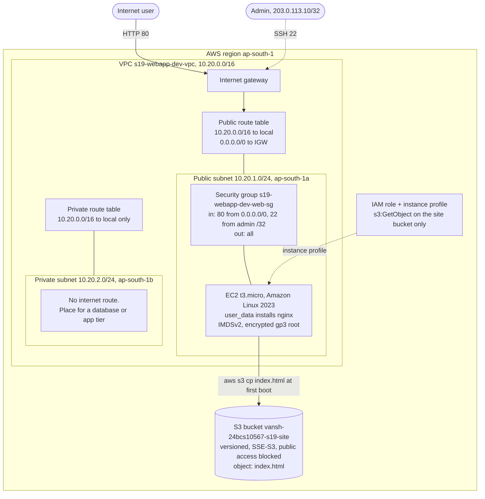

# Session 19: Cloud & Terraform in Action

**Name:** Vansh Srivastava
**Enrollment No.:** 24bcs10567
**Session:** 19

This session puts cloud networking and Terraform together. I built one Terraform project that creates a small but complete AWS setup: a VPC with a public and a private subnet, an internet gateway with route tables, a security group, an EC2 web server that configures itself with `user_data`, an S3 bucket holding the site content, and an IAM role so the instance can read that bucket without keys. I applied it against LocalStack (local AWS emulator), checked every resource with the AWS CLI, looked at the state and the dependency graph, moved the state into an S3 backend with DynamoDB locking, and destroyed everything again.

## Folder structure

```text
session-19-terraform-project/
├── README.md                    # this file
├── .gitignore                   # .terraform/, *.tfstate*, plan files
├── .terraform.lock.hcl          # provider version + checksums from terraform init (committed)
├── versions.tf                  # required Terraform and provider versions
├── providers.tf                 # aws provider: LocalStack or real AWS via var.use_localstack, default_tags
├── variables.tf                 # all inputs, with types, defaults and a validation rule
├── terraform.tfvars             # the values I used (no secrets)
├── main.tf                      # locals + data sources (availability zones, Amazon Linux 2023 AMI)
├── network.tf                   # VPC, public/private subnets, internet gateway, route tables, associations
├── security.tf                  # web security group (HTTP open, SSH only from one CIDR)
├── iam.tf                       # role, least-privilege S3 read policy, instance profile
├── storage.tf                   # S3 bucket (versioning, encryption, public access block) + index.html object
├── compute.tf                   # EC2 instance with user_data, IMDSv2, encrypted root disk, depends_on
├── outputs.tf                   # IDs, IPs, URL, bucket, role ARN
├── templates/
│   ├── user_data.sh.tftpl       # boot script: install nginx, copy index.html from S3
│   └── index.html.tftpl         # the page stored in S3
├── backend.tf.example           # optional remote state: S3 backend + DynamoDB locking
└── localstack.s3.tfbackend      # extra backend settings when the backend is LocalStack
```

## Environment

```text
macOS 26 (arm64), Docker via Colima
Terraform v1.16.4, provider hashicorp/aws v6.67.0 (constraint ~> 6.0)
LocalStack Community 4.14.0 (Docker container "localstack", 127.0.0.1:4566)
AWS CLI v2.37.10 (amazon/aws-cli image, run through Docker)
Region: ap-south-1 (Mumbai)
```

The LocalStack container is shared with my other sessions. [Session 18](../session-18-terraform-iac/README.md#localstack-setup) explains why it is pinned to `4.14.0`: `latest` now refuses to start without a paid auth token. `awsl` is the same helper as in Session 18. It runs the official AWS CLI image against LocalStack:

```bash
awsl() {
  docker run --rm -i --network container:localstack -v "$PWD":/aws \
    -e AWS_ACCESS_KEY_ID=test -e AWS_SECRET_ACCESS_KEY=test -e AWS_DEFAULT_REGION=ap-south-1 \
    amazon/aws-cli:2.37.10 --endpoint-url http://localhost:4566 "$@"
}
```

```bash
$ terraform version
Terraform v1.16.4
on darwin_arm64

Your version of Terraform is out of date! The latest version
is 1.16.5. You can update by downloading from https://developer.hashicorp.com/terraform/install

$ curl -s localhost:4566/_localstack/health | jq '{edition, version, ec2: .services.ec2, s3: .services.s3, iam: .services.iam, sts: .services.sts}'
{
  "edition": "community",
  "version": "4.14.0",
  "ec2": "running",
  "s3": "running",
  "iam": "running",
  "sts": "running"
}
```

## Task: End-to-end cloud infrastructure with Terraform

### Architecture diagram



How a request flows: a user's HTTP request reaches the VPC through the internet gateway. The public route table (`0.0.0.0/0 -> IGW`) is what makes the public subnet public. The security group lets port 80 in, and nginx on the instance serves `index.html`. At first boot the instance copied that file from S3, using temporary credentials from its IAM role. The private subnet's route table has only the `local` route, so nothing in it can reach or be reached from the internet. I left out a NAT gateway on purpose, because it is the one component that costs money by the hour.

### Concepts demonstrated

| Brief item | Where |
|---|---|
| **Providers** | `versions.tf` pins `hashicorp/aws ~> 6.0` and Terraform `>= 1.6.0`. `providers.tf` configures the region, `default_tags` and the LocalStack/AWS switch (below). |
| **Variables** | `variables.tf`: 13 typed inputs (strings, a bool, a nullable string), a `validation` block on `environment`, values in `terraform.tfvars`. `main.tf` builds names from them with `locals`. |
| **Resources** | 18 managed resources across `network.tf`, `security.tf`, `iam.tf`, `storage.tf` and `compute.tf`. 4 data sources: the AZs and the AMI are looked up from AWS, and the two IAM policy documents are rendered locally. |
| **Outputs** | `outputs.tf`: 14 outputs (VPC/subnet/IGW/SG IDs, instance ID and IPs, URL, bucket, role ARN, target). |
| **Dependencies, implicit** | Every reference creates an edge, e.g. `aws_subnet.public.vpc_id = aws_vpc.main.id`, `aws_route_table.public` -> `aws_internet_gateway.main.id`, `aws_instance.web.iam_instance_profile` -> `aws_iam_instance_profile.web.name`, IAM policy -> `aws_s3_bucket.site.arn`. |
| **Dependencies, explicit** | `compute.tf`: `depends_on = [aws_route_table_association.public, aws_s3_object.index]`. The instance never references these, but its boot script needs both: the route to the internet and the `index.html` object in the bucket. |
| **AWS infrastructure** | VPC, 2 subnets, IGW, 2 route tables + associations, security group, EC2, S3 bucket + settings + object, IAM role/policy/instance profile. |
| **Terraform state** | `terraform state list` / `show`, a look inside `terraform.tfstate`, then migration to an S3 backend with DynamoDB locking and a real lock conflict (Step 10). |
| **plan / apply / destroy** | Steps 4, 5 and 11 below. |

#### One provider block for LocalStack and real AWS

```hcl
provider "aws" {
  region = var.aws_region

  access_key = var.use_localstack ? "test" : null
  secret_key = var.use_localstack ? "test" : null

  skip_credentials_validation = var.use_localstack
  skip_metadata_api_check     = var.use_localstack
  skip_requesting_account_id  = var.use_localstack
  s3_use_path_style           = var.use_localstack

  dynamic "endpoints" {
    for_each = var.use_localstack ? [1] : []
    content {
      ec2 = var.localstack_endpoint
      iam = var.localstack_endpoint
      s3  = var.localstack_endpoint
      sts = var.localstack_endpoint
    }
  }

  default_tags { tags = { Project = ..., Environment = ..., Owner = ..., ManagedBy = "Terraform" } }
}
```

With `use_localstack = true` (my `terraform.tfvars`), the provider uses the dummy credentials and skips the account and credential checks that only real AWS supports. It sends EC2, IAM, S3 and STS calls to `http://localhost:4566` and uses path-style S3 URLs. With `false` (the variable's default), every one of those arguments becomes `null`/`false`, the `endpoints` block is not rendered, and the provider uses the normal AWS credential chain.

#### Why `depends_on` is needed here

Terraform orders work only by references. `aws_instance.web` references the subnet, security group, instance profile and bucket name, but **not** the route table association or the S3 object. Without `depends_on`, Terraform could launch the instance while the public subnet still has no route to the internet gateway, or before `index.html` is uploaded. The boot script would then fail to install nginx or to copy the page, and since `user_data` runs only once, the server would stay broken. The apply output below shows the effect: `aws_instance.web: Creating...` starts only after `aws_route_table_association.public` and `aws_s3_object.index` are complete.

#### Other choices

- **AMI lookup**: `data "aws_ami"` finds the newest Amazon-owned AL2023 x86_64 image, so no region-specific AMI ID is hard-coded. LocalStack ships the same image names, so the lookup works there too.
- **SSH** is only opened when `ssh_allowed_cidr` is set (a `dynamic "ingress"` block), and only to that one CIDR. My tfvars uses `203.0.113.10/32` from the documentation range as a stand-in. On real AWS I would put my own `/32` or set it to `null` and use SSM Session Manager.
- **Explicit egress rule**: Terraform deletes the allow-all egress rule that AWS adds to new security groups, so it has to be declared.
- **IMDSv2 only** (`http_tokens = "required"`) and an **encrypted gp3** root disk.
- **IAM policies** are written with `aws_iam_policy_document` data sources instead of JSON strings, so a typo is caught by `validate` and the bucket ARN is a real reference.

### Step 1: terraform init

```bash
$ terraform init
Initializing the backend...

Initializing provider plugins...
- Finding hashicorp/aws versions matching "~> 6.0"...
- Installing hashicorp/aws v6.67.0...
- Installed hashicorp/aws v6.67.0 (signed by HashiCorp)

Terraform has created a lock file .terraform.lock.hcl to record the provider
selections it made above. Include this file in your version control repository
so that Terraform can guarantee to make the same selections by default when
you run "terraform init" in the future.

Terraform has been successfully initialized!

You may now begin working with Terraform. Try running "terraform plan" to see
any changes that are required for your infrastructure. All Terraform commands
should now work.

If you ever set or change modules or backend configuration for Terraform,
rerun this command to reinitialize your working directory. If you forget, other
commands will detect it and remind you to do so if necessary.
```

The provider was downloaded and `.terraform.lock.hcl` was created. The lock file is committed. `.terraform/` (the downloaded provider binary) is not.

### Step 2: terraform fmt

```bash
$ terraform fmt -recursive

$ terraform fmt -recursive -check && echo 'fmt -check: nothing left to format'
fmt -check: nothing left to format
```

No files were listed, so the code was already in canonical format. `-recursive` also covers sub-folders.

### Step 3: terraform validate

```bash
$ terraform validate
Success! The configuration is valid.
```

### Step 4: terraform plan

```bash
$ terraform plan -out=tfplan
data.aws_availability_zones.available: Reading...
data.aws_ami.al2023: Reading...
data.aws_iam_policy_document.ec2_assume: Reading...
data.aws_iam_policy_document.ec2_assume: Read complete after 0s [id=2851119427]
data.aws_availability_zones.available: Read complete after 0s [id=ap-south-1]
data.aws_ami.al2023: Read complete after 0s [id=ami-0ff5003538b60d5ec]

Terraform used the selected providers to generate the following execution
plan. Resource actions are indicated with the following symbols:
  + create
 <= read (data resources)

Terraform will perform the following actions:

  # data.aws_iam_policy_document.read_site will be read during apply
  # (config refers to values not yet known)
...
  # aws_instance.web will be created
  + resource "aws_instance" "web" {
      + ami                                  = "ami-0ff5003538b60d5ec"
      + arn                                  = (known after apply)
      + associate_public_ip_address          = (known after apply)
      + availability_zone                    = (known after apply)
      + disable_api_stop                     = (known after apply)
      + disable_api_termination              = (known after apply)
      + ebs_optimized                        = (known after apply)
      + enable_primary_ipv6                  = (known after apply)
      + force_destroy                        = false
      + get_password_data                    = false
      + host_id                              = (known after apply)
      + host_resource_group_arn              = (known after apply)
      + iam_instance_profile                 = "s19-webapp-dev-web-profile"
      + id                                   = (known after apply)
      + instance_initiated_shutdown_behavior = (known after apply)
      + instance_lifecycle                   = (known after apply)
      + instance_state                       = (known after apply)
      + instance_type                        = "t3.micro"
      + ipv6_address_count                   = (known after apply)
      + ipv6_addresses                       = (known after apply)
      + key_name                             = (known after apply)
      + monitoring                           = (known after apply)
      + outpost_arn                          = (known after apply)
      + password_data                        = (known after apply)
      + placement_group                      = (known after apply)
      + placement_group_id                   = (known after apply)
      + placement_partition_number           = (known after apply)
      + primary_network_interface_id         = (known after apply)
      + private_dns                          = (known after apply)
      + private_ip                           = (known after apply)
      + public_dns                           = (known after apply)
      + public_ip                            = (known after apply)
      + region                               = "ap-south-1"
      + secondary_private_ips                = (known after apply)
      + security_groups                      = (known after apply)
      + source_dest_check                    = true
      + spot_instance_request_id             = (known after apply)
      + subnet_id                            = (known after apply)
      + tags                                 = {
          + "Name" = "s19-webapp-dev-web"
        }
      + tags_all                             = {
          + "Environment" = "dev"
          + "ManagedBy"   = "Terraform"
          + "Name"        = "s19-webapp-dev-web"
          + "Owner"       = "vansh-srivastava"
          + "Project"     = "s19-webapp"
        }
      + tenancy                              = (known after apply)
      + user_data                            = <<-EOT
            #!/bin/bash
            # Runs once, as root, on the first boot of the instance (cloud-init).
            set -euxo pipefail
            
            dnf install -y nginx
            
            # The instance profile gives this machine s3:GetObject on the site bucket, so no keys are needed.
            aws s3 cp "s3://vansh-24bcs10567-s19-site/index.html" /usr/share/nginx/html/index.html --region "ap-south-1"
            
            systemctl enable --now nginx
        EOT
      + user_data_base64                     = (known after apply)
      + user_data_replace_on_change          = true
      + vpc_security_group_ids               = (known after apply)

      + capacity_reservation_specification (known after apply)

      + cpu_options (known after apply)

      + ebs_block_device (known after apply)

      + enclave_options (known after apply)

      + ephemeral_block_device (known after apply)

      + instance_market_options (known after apply)

      + maintenance_options (known after apply)

      + metadata_options {
          + http_endpoint               = "enabled"
          + http_protocol_ipv6          = "disabled"
          + http_put_response_hop_limit = (known after apply)
          + http_tokens                 = "required"
          + instance_metadata_tags      = (known after apply)
        }

      + network_interface (known after apply)

      + primary_network_interface (known after apply)

      + private_dns_name_options (known after apply)

      + root_block_device {
          + delete_on_termination = true
          + device_name           = (known after apply)
          + encrypted             = true
          + iops                  = (known after apply)
          + kms_key_id            = (known after apply)
          + tags_all              = (known after apply)
          + throughput            = (known after apply)
          + volume_id             = (known after apply)
          + volume_size           = 8
          + volume_type           = "gp3"
        }

      + secondary_network_interface (known after apply)
    }

...
  # aws_security_group.web will be created
  + resource "aws_security_group" "web" {
      + arn                    = (known after apply)
      + description            = "HTTP from anywhere, SSH only from one admin CIDR"
      + egress                 = [
          + {
              + cidr_blocks      = [
                  + "0.0.0.0/0",
                ]
              + description      = "All outbound IPv4"
              + from_port        = 0
              + ipv6_cidr_blocks = []
              + prefix_list_ids  = []
              + protocol         = "-1"
              + security_groups  = []
              + self             = false
              + to_port          = 0
            },
        ]
      + id                     = (known after apply)
      + ingress                = [
          + {
              + cidr_blocks      = [
                  + "0.0.0.0/0",
                ]
              + description      = "HTTP"
              + from_port        = 80
              + ipv6_cidr_blocks = []
              + prefix_list_ids  = []
              + protocol         = "tcp"
              + security_groups  = []
              + self             = false
              + to_port          = 80
            },
          + {
              + cidr_blocks      = [
                  + "203.0.113.10/32",
                ]
              + description      = "SSH from admin"
              + from_port        = 22
              + ipv6_cidr_blocks = []
              + prefix_list_ids  = []
              + protocol         = "tcp"
              + security_groups  = []
              + self             = false
              + to_port          = 22
            },
        ]
      + name                   = "s19-webapp-dev-web-sg"
      + name_prefix            = (known after apply)
      + owner_id               = (known after apply)
      + region                 = "ap-south-1"
      + revoke_rules_on_delete = false
      + tags                   = {
          + "Name" = "s19-webapp-dev-web-sg"
        }
      + tags_all               = {
          + "Environment" = "dev"
          + "ManagedBy"   = "Terraform"
          + "Name"        = "s19-webapp-dev-web-sg"
          + "Owner"       = "vansh-srivastava"
          + "Project"     = "s19-webapp"
        }
      + vpc_id                 = (known after apply)
    }

...
Plan: 18 to add, 0 to change, 0 to destroy.

Changes to Outputs:
  + ami_id              = "ami-0ff5003538b60d5ec"
  + instance_id         = (known after apply)
  + instance_private_ip = (known after apply)
  + instance_public_ip  = (known after apply)
  + internet_gateway_id = (known after apply)
  + private_subnet_id   = (known after apply)
  + public_subnet_id    = (known after apply)
  + security_group_id   = (known after apply)
  + site_bucket         = "vansh-24bcs10567-s19-site"
  + target              = "LocalStack (http://localhost:4566)"
  + vpc_cidr            = "10.20.0.0/16"
  + vpc_id              = (known after apply)
  + web_role_arn        = (known after apply)
  + website_url         = (known after apply)

─────────────────────────────────────────────────────────────────────────────

Saved the plan to: tfplan

To perform exactly these actions, run the following command to apply:
    terraform apply "tfplan"
```

18 resources to add. The data sources (AZs, AMI, trust policy) are read during the plan. `read_site` waits until apply because it needs the bucket ARN, which does not exist yet. The rendered `user_data` with the real bucket name and region is visible in the plan, which is a good place to catch template mistakes.

<details>
<summary>Full plan output (606 lines)</summary>

```bash
$ terraform plan -out=tfplan
data.aws_availability_zones.available: Reading...
data.aws_ami.al2023: Reading...
data.aws_iam_policy_document.ec2_assume: Reading...
data.aws_iam_policy_document.ec2_assume: Read complete after 0s [id=2851119427]
data.aws_availability_zones.available: Read complete after 0s [id=ap-south-1]
data.aws_ami.al2023: Read complete after 0s [id=ami-0ff5003538b60d5ec]

Terraform used the selected providers to generate the following execution
plan. Resource actions are indicated with the following symbols:
  + create
 <= read (data resources)

Terraform will perform the following actions:

  # data.aws_iam_policy_document.read_site will be read during apply
  # (config refers to values not yet known)
 <= data "aws_iam_policy_document" "read_site" {
      + id            = (known after apply)
      + json          = (known after apply)
      + minified_json = (known after apply)

      + statement {
          + actions   = [
              + "s3:GetObject",
            ]
          + resources = [
              + (known after apply),
            ]
          + sid       = "ReadSiteObjects"
        }
    }

  # aws_iam_instance_profile.web will be created
  + resource "aws_iam_instance_profile" "web" {
      + arn         = (known after apply)
      + create_date = (known after apply)
      + id          = (known after apply)
      + name        = "s19-webapp-dev-web-profile"
      + name_prefix = (known after apply)
      + path        = "/"
      + role        = "s19-webapp-dev-web-role"
      + tags_all    = {
          + "Environment" = "dev"
          + "ManagedBy"   = "Terraform"
          + "Owner"       = "vansh-srivastava"
          + "Project"     = "s19-webapp"
        }
      + unique_id   = (known after apply)
    }

  # aws_iam_role.web will be created
  + resource "aws_iam_role" "web" {
      + arn                   = (known after apply)
      + assume_role_policy    = jsonencode(
            {
              + Statement = [
                  + {
                      + Action    = "sts:AssumeRole"
                      + Effect    = "Allow"
                      + Principal = {
                          + Service = "ec2.amazonaws.com"
                        }
                    },
                ]
              + Version   = "2012-10-17"
            }
        )
      + create_date           = (known after apply)
      + force_detach_policies = false
      + id                    = (known after apply)
      + managed_policy_arns   = (known after apply)
      + max_session_duration  = 3600
      + name                  = "s19-webapp-dev-web-role"
      + name_prefix           = (known after apply)
      + path                  = "/"
      + tags_all              = {
          + "Environment" = "dev"
          + "ManagedBy"   = "Terraform"
          + "Owner"       = "vansh-srivastava"
          + "Project"     = "s19-webapp"
        }
      + unique_id             = (known after apply)

      + inline_policy (known after apply)
    }

  # aws_iam_role_policy.read_site will be created
  + resource "aws_iam_role_policy" "read_site" {
      + id          = (known after apply)
      + name        = "read-site-bucket"
      + name_prefix = (known after apply)
      + policy      = (known after apply)
      + role        = (known after apply)
    }

  # aws_instance.web will be created
  + resource "aws_instance" "web" {
      + ami                                  = "ami-0ff5003538b60d5ec"
      + arn                                  = (known after apply)
      + associate_public_ip_address          = (known after apply)
      + availability_zone                    = (known after apply)
      + disable_api_stop                     = (known after apply)
      + disable_api_termination              = (known after apply)
      + ebs_optimized                        = (known after apply)
      + enable_primary_ipv6                  = (known after apply)
      + force_destroy                        = false
      + get_password_data                    = false
      + host_id                              = (known after apply)
      + host_resource_group_arn              = (known after apply)
      + iam_instance_profile                 = "s19-webapp-dev-web-profile"
      + id                                   = (known after apply)
      + instance_initiated_shutdown_behavior = (known after apply)
      + instance_lifecycle                   = (known after apply)
      + instance_state                       = (known after apply)
      + instance_type                        = "t3.micro"
      + ipv6_address_count                   = (known after apply)
      + ipv6_addresses                       = (known after apply)
      + key_name                             = (known after apply)
      + monitoring                           = (known after apply)
      + outpost_arn                          = (known after apply)
      + password_data                        = (known after apply)
      + placement_group                      = (known after apply)
      + placement_group_id                   = (known after apply)
      + placement_partition_number           = (known after apply)
      + primary_network_interface_id         = (known after apply)
      + private_dns                          = (known after apply)
      + private_ip                           = (known after apply)
      + public_dns                           = (known after apply)
      + public_ip                            = (known after apply)
      + region                               = "ap-south-1"
      + secondary_private_ips                = (known after apply)
      + security_groups                      = (known after apply)
      + source_dest_check                    = true
      + spot_instance_request_id             = (known after apply)
      + subnet_id                            = (known after apply)
      + tags                                 = {
          + "Name" = "s19-webapp-dev-web"
        }
      + tags_all                             = {
          + "Environment" = "dev"
          + "ManagedBy"   = "Terraform"
          + "Name"        = "s19-webapp-dev-web"
          + "Owner"       = "vansh-srivastava"
          + "Project"     = "s19-webapp"
        }
      + tenancy                              = (known after apply)
      + user_data                            = <<-EOT
            #!/bin/bash
            # Runs once, as root, on the first boot of the instance (cloud-init).
            set -euxo pipefail
            
            dnf install -y nginx
            
            # The instance profile gives this machine s3:GetObject on the site bucket, so no keys are needed.
            aws s3 cp "s3://vansh-24bcs10567-s19-site/index.html" /usr/share/nginx/html/index.html --region "ap-south-1"
            
            systemctl enable --now nginx
        EOT
      + user_data_base64                     = (known after apply)
      + user_data_replace_on_change          = true
      + vpc_security_group_ids               = (known after apply)

      + capacity_reservation_specification (known after apply)

      + cpu_options (known after apply)

      + ebs_block_device (known after apply)

      + enclave_options (known after apply)

      + ephemeral_block_device (known after apply)

      + instance_market_options (known after apply)

      + maintenance_options (known after apply)

      + metadata_options {
          + http_endpoint               = "enabled"
          + http_protocol_ipv6          = "disabled"
          + http_put_response_hop_limit = (known after apply)
          + http_tokens                 = "required"
          + instance_metadata_tags      = (known after apply)
        }

      + network_interface (known after apply)

      + primary_network_interface (known after apply)

      + private_dns_name_options (known after apply)

      + root_block_device {
          + delete_on_termination = true
          + device_name           = (known after apply)
          + encrypted             = true
          + iops                  = (known after apply)
          + kms_key_id            = (known after apply)
          + tags_all              = (known after apply)
          + throughput            = (known after apply)
          + volume_id             = (known after apply)
          + volume_size           = 8
          + volume_type           = "gp3"
        }

      + secondary_network_interface (known after apply)
    }

  # aws_internet_gateway.main will be created
  + resource "aws_internet_gateway" "main" {
      + arn      = (known after apply)
      + id       = (known after apply)
      + owner_id = (known after apply)
      + region   = "ap-south-1"
      + tags     = {
          + "Name" = "s19-webapp-dev-igw"
        }
      + tags_all = {
          + "Environment" = "dev"
          + "ManagedBy"   = "Terraform"
          + "Name"        = "s19-webapp-dev-igw"
          + "Owner"       = "vansh-srivastava"
          + "Project"     = "s19-webapp"
        }
      + vpc_id   = (known after apply)
    }

  # aws_route_table.private will be created
  + resource "aws_route_table" "private" {
      + arn              = (known after apply)
      + id               = (known after apply)
      + owner_id         = (known after apply)
      + propagating_vgws = (known after apply)
      + region           = "ap-south-1"
      + route            = (known after apply)
      + tags             = {
          + "Name" = "s19-webapp-dev-private-rt"
        }
      + tags_all         = {
          + "Environment" = "dev"
          + "ManagedBy"   = "Terraform"
          + "Name"        = "s19-webapp-dev-private-rt"
          + "Owner"       = "vansh-srivastava"
          + "Project"     = "s19-webapp"
        }
      + vpc_id           = (known after apply)
    }

  # aws_route_table.public will be created
  + resource "aws_route_table" "public" {
      + arn              = (known after apply)
      + id               = (known after apply)
      + owner_id         = (known after apply)
      + propagating_vgws = (known after apply)
      + region           = "ap-south-1"
      + route            = [
          + {
              + cidr_block                 = "0.0.0.0/0"
              + gateway_id                 = (known after apply)
                # (12 unchanged attributes hidden)
            },
        ]
      + tags             = {
          + "Name" = "s19-webapp-dev-public-rt"
        }
      + tags_all         = {
          + "Environment" = "dev"
          + "ManagedBy"   = "Terraform"
          + "Name"        = "s19-webapp-dev-public-rt"
          + "Owner"       = "vansh-srivastava"
          + "Project"     = "s19-webapp"
        }
      + vpc_id           = (known after apply)
    }

  # aws_route_table_association.private will be created
  + resource "aws_route_table_association" "private" {
      + id             = (known after apply)
      + region         = "ap-south-1"
      + route_table_id = (known after apply)
      + subnet_id      = (known after apply)
    }

  # aws_route_table_association.public will be created
  + resource "aws_route_table_association" "public" {
      + id             = (known after apply)
      + region         = "ap-south-1"
      + route_table_id = (known after apply)
      + subnet_id      = (known after apply)
    }

  # aws_s3_bucket.site will be created
  + resource "aws_s3_bucket" "site" {
      + acceleration_status         = (known after apply)
      + acl                         = (known after apply)
      + arn                         = (known after apply)
      + bucket                      = "vansh-24bcs10567-s19-site"
      + bucket_domain_name          = (known after apply)
      + bucket_namespace            = (known after apply)
      + bucket_prefix               = (known after apply)
      + bucket_region               = (known after apply)
      + bucket_regional_domain_name = (known after apply)
      + force_destroy               = true
      + hosted_zone_id              = (known after apply)
      + id                          = (known after apply)
      + object_lock_enabled         = (known after apply)
      + policy                      = (known after apply)
      + region                      = "ap-south-1"
      + request_payer               = (known after apply)
      + tags                        = {
          + "Name" = "vansh-24bcs10567-s19-site"
        }
      + tags_all                    = {
          + "Environment" = "dev"
          + "ManagedBy"   = "Terraform"
          + "Name"        = "vansh-24bcs10567-s19-site"
          + "Owner"       = "vansh-srivastava"
          + "Project"     = "s19-webapp"
        }
      + website_domain              = (known after apply)
      + website_endpoint            = (known after apply)

      + cors_rule (known after apply)

      + grant (known after apply)

      + lifecycle_rule (known after apply)

      + logging (known after apply)

      + object_lock_configuration (known after apply)

      + replication_configuration (known after apply)

      + server_side_encryption_configuration (known after apply)

      + versioning (known after apply)

      + website (known after apply)
    }

  # aws_s3_bucket_public_access_block.site will be created
  + resource "aws_s3_bucket_public_access_block" "site" {
      + block_public_acls       = true
      + block_public_policy     = true
      + bucket                  = (known after apply)
      + id                      = (known after apply)
      + ignore_public_acls      = true
      + region                  = "ap-south-1"
      + restrict_public_buckets = true
    }

  # aws_s3_bucket_server_side_encryption_configuration.site will be created
  + resource "aws_s3_bucket_server_side_encryption_configuration" "site" {
      + bucket = (known after apply)
      + id     = (known after apply)
      + region = "ap-south-1"

      + rule {
          + blocked_encryption_types = (known after apply)
          + bucket_key_enabled       = (known after apply)

          + apply_server_side_encryption_by_default {
              + kms_master_key_id = (known after apply)
              + sse_algorithm     = "AES256"
            }
        }
    }

  # aws_s3_bucket_versioning.site will be created
  + resource "aws_s3_bucket_versioning" "site" {
      + bucket = (known after apply)
      + id     = (known after apply)
      + region = "ap-south-1"

      + versioning_configuration {
          + mfa_delete = (known after apply)
          + status     = "Enabled"
        }
    }

  # aws_s3_object.index will be created
  + resource "aws_s3_object" "index" {
      + acl                    = (known after apply)
      + arn                    = (known after apply)
      + bucket                 = (known after apply)
      + bucket_key_enabled     = (known after apply)
      + checksum_crc32         = (known after apply)
      + checksum_crc32c        = (known after apply)
      + checksum_crc64nvme     = (known after apply)
      + checksum_sha1          = (known after apply)
      + checksum_sha256        = (known after apply)
      + content                = <<-EOT
            <!doctype html>
            <html lang="en">
            <head><meta charset="utf-8"><title>s19-webapp</title></head>
            <body>
              <h1>s19-webapp (dev)</h1>
              <p>Served by nginx on EC2 in ap-south-1. Page stored in S3, infrastructure built with Terraform.</p>
              <p>Session 19 - Vansh Srivastava (24bcs10567)</p>
            </body>
            </html>
        EOT
      + content_type           = "text/html"
      + etag                   = (known after apply)
      + force_destroy          = false
      + id                     = (known after apply)
      + key                    = "index.html"
      + kms_key_id             = (known after apply)
      + region                 = "ap-south-1"
      + server_side_encryption = (known after apply)
      + storage_class          = (known after apply)
      + tags_all               = {
          + "Environment" = "dev"
          + "ManagedBy"   = "Terraform"
          + "Owner"       = "vansh-srivastava"
          + "Project"     = "s19-webapp"
        }
      + version_id             = (known after apply)
    }

  # aws_security_group.web will be created
  + resource "aws_security_group" "web" {
      + arn                    = (known after apply)
      + description            = "HTTP from anywhere, SSH only from one admin CIDR"
      + egress                 = [
          + {
              + cidr_blocks      = [
                  + "0.0.0.0/0",
                ]
              + description      = "All outbound IPv4"
              + from_port        = 0
              + ipv6_cidr_blocks = []
              + prefix_list_ids  = []
              + protocol         = "-1"
              + security_groups  = []
              + self             = false
              + to_port          = 0
            },
        ]
      + id                     = (known after apply)
      + ingress                = [
          + {
              + cidr_blocks      = [
                  + "0.0.0.0/0",
                ]
              + description      = "HTTP"
              + from_port        = 80
              + ipv6_cidr_blocks = []
              + prefix_list_ids  = []
              + protocol         = "tcp"
              + security_groups  = []
              + self             = false
              + to_port          = 80
            },
          + {
              + cidr_blocks      = [
                  + "203.0.113.10/32",
                ]
              + description      = "SSH from admin"
              + from_port        = 22
              + ipv6_cidr_blocks = []
              + prefix_list_ids  = []
              + protocol         = "tcp"
              + security_groups  = []
              + self             = false
              + to_port          = 22
            },
        ]
      + name                   = "s19-webapp-dev-web-sg"
      + name_prefix            = (known after apply)
      + owner_id               = (known after apply)
      + region                 = "ap-south-1"
      + revoke_rules_on_delete = false
      + tags                   = {
          + "Name" = "s19-webapp-dev-web-sg"
        }
      + tags_all               = {
          + "Environment" = "dev"
          + "ManagedBy"   = "Terraform"
          + "Name"        = "s19-webapp-dev-web-sg"
          + "Owner"       = "vansh-srivastava"
          + "Project"     = "s19-webapp"
        }
      + vpc_id                 = (known after apply)
    }

  # aws_subnet.private will be created
  + resource "aws_subnet" "private" {
      + arn                                            = (known after apply)
      + assign_ipv6_address_on_creation                = false
      + availability_zone                              = "ap-south-1b"
      + availability_zone_id                           = (known after apply)
      + cidr_block                                     = "10.20.2.0/24"
      + enable_dns64                                   = false
      + enable_resource_name_dns_a_record_on_launch    = false
      + enable_resource_name_dns_aaaa_record_on_launch = false
      + id                                             = (known after apply)
      + ipv6_cidr_block                                = (known after apply)
      + ipv6_cidr_block_association_id                 = (known after apply)
      + ipv6_native                                    = false
      + map_public_ip_on_launch                        = false
      + owner_id                                       = (known after apply)
      + private_dns_hostname_type_on_launch            = (known after apply)
      + region                                         = "ap-south-1"
      + tags                                           = {
          + "Name" = "s19-webapp-dev-private-subnet"
          + "Tier" = "private"
        }
      + tags_all                                       = {
          + "Environment" = "dev"
          + "ManagedBy"   = "Terraform"
          + "Name"        = "s19-webapp-dev-private-subnet"
          + "Owner"       = "vansh-srivastava"
          + "Project"     = "s19-webapp"
          + "Tier"        = "private"
        }
      + vpc_id                                         = (known after apply)
    }

  # aws_subnet.public will be created
  + resource "aws_subnet" "public" {
      + arn                                            = (known after apply)
      + assign_ipv6_address_on_creation                = false
      + availability_zone                              = "ap-south-1a"
      + availability_zone_id                           = (known after apply)
      + cidr_block                                     = "10.20.1.0/24"
      + enable_dns64                                   = false
      + enable_resource_name_dns_a_record_on_launch    = false
      + enable_resource_name_dns_aaaa_record_on_launch = false
      + id                                             = (known after apply)
      + ipv6_cidr_block                                = (known after apply)
      + ipv6_cidr_block_association_id                 = (known after apply)
      + ipv6_native                                    = false
      + map_public_ip_on_launch                        = true
      + owner_id                                       = (known after apply)
      + private_dns_hostname_type_on_launch            = (known after apply)
      + region                                         = "ap-south-1"
      + tags                                           = {
          + "Name" = "s19-webapp-dev-public-subnet"
          + "Tier" = "public"
        }
      + tags_all                                       = {
          + "Environment" = "dev"
          + "ManagedBy"   = "Terraform"
          + "Name"        = "s19-webapp-dev-public-subnet"
          + "Owner"       = "vansh-srivastava"
          + "Project"     = "s19-webapp"
          + "Tier"        = "public"
        }
      + vpc_id                                         = (known after apply)
    }

  # aws_vpc.main will be created
  + resource "aws_vpc" "main" {
      + arn                                  = (known after apply)
      + cidr_block                           = "10.20.0.0/16"
      + default_network_acl_id               = (known after apply)
      + default_route_table_id               = (known after apply)
      + default_security_group_id            = (known after apply)
      + dhcp_options_id                      = (known after apply)
      + enable_dns_hostnames                 = true
      + enable_dns_support                   = true
      + enable_network_address_usage_metrics = (known after apply)
      + id                                   = (known after apply)
      + instance_tenancy                     = "default"
      + ipv6_association_id                  = (known after apply)
      + ipv6_cidr_block                      = (known after apply)
      + ipv6_cidr_block_network_border_group = (known after apply)
      + main_route_table_id                  = (known after apply)
      + owner_id                             = (known after apply)
      + region                               = "ap-south-1"
      + tags                                 = {
          + "Name" = "s19-webapp-dev-vpc"
        }
      + tags_all                             = {
          + "Environment" = "dev"
          + "ManagedBy"   = "Terraform"
          + "Name"        = "s19-webapp-dev-vpc"
          + "Owner"       = "vansh-srivastava"
          + "Project"     = "s19-webapp"
        }
    }

Plan: 18 to add, 0 to change, 0 to destroy.

Changes to Outputs:
  + ami_id              = "ami-0ff5003538b60d5ec"
  + instance_id         = (known after apply)
  + instance_private_ip = (known after apply)
  + instance_public_ip  = (known after apply)
  + internet_gateway_id = (known after apply)
  + private_subnet_id   = (known after apply)
  + public_subnet_id    = (known after apply)
  + security_group_id   = (known after apply)
  + site_bucket         = "vansh-24bcs10567-s19-site"
  + target              = "LocalStack (http://localhost:4566)"
  + vpc_cidr            = "10.20.0.0/16"
  + vpc_id              = (known after apply)
  + web_role_arn        = (known after apply)
  + website_url         = (known after apply)

─────────────────────────────────────────────────────────────────────────────

Saved the plan to: tfplan

To perform exactly these actions, run the following command to apply:
    terraform apply "tfplan"
```

</details>

### Step 5: terraform apply

```bash
$ terraform apply tfplan
aws_vpc.main: Creating...
aws_iam_role.web: Creating...
aws_s3_bucket.site: Creating...
aws_iam_role.web: Creation complete after 0s [id=s19-webapp-dev-web-role]
aws_iam_instance_profile.web: Creating...
aws_vpc.main: Creation complete after 0s [id=vpc-56504526658e56eaf]
aws_internet_gateway.main: Creating...
aws_route_table.private: Creating...
aws_subnet.public: Creating...
aws_subnet.private: Creating...
aws_security_group.web: Creating...
aws_subnet.private: Creation complete after 0s [id=subnet-76c62a66effd2fcfc]
aws_internet_gateway.main: Creation complete after 0s [id=igw-045f637faa3fceddd]
aws_s3_bucket.site: Creation complete after 0s [id=vansh-24bcs10567-s19-site]
data.aws_iam_policy_document.read_site: Reading...
aws_s3_bucket_public_access_block.site: Creating...
data.aws_iam_policy_document.read_site: Read complete after 0s [id=3493041492]
aws_s3_bucket_versioning.site: Creating...
aws_s3_bucket_server_side_encryption_configuration.site: Creating...
aws_route_table.public: Creating...
aws_s3_object.index: Creating...
aws_iam_role_policy.read_site: Creating...
aws_s3_bucket_server_side_encryption_configuration.site: Creation complete after 0s [id=vansh-24bcs10567-s19-site]
aws_s3_bucket_public_access_block.site: Creation complete after 0s [id=vansh-24bcs10567-s19-site]
aws_iam_role_policy.read_site: Creation complete after 0s [id=s19-webapp-dev-web-role:read-site-bucket]
aws_s3_object.index: Creation complete after 0s [id=vansh-24bcs10567-s19-site/index.html]
aws_route_table.private: Creation complete after 0s [id=rtb-fb2b101530e8f2c5f]
aws_route_table_association.private: Creating...
aws_route_table_association.private: Creation complete after 0s [id=rtbassoc-b475ea81002ca960e]
aws_security_group.web: Creation complete after 0s [id=sg-abb3e84018fa1e9b1]
aws_route_table.public: Creation complete after 0s [id=rtb-8322f672392c75251]
aws_s3_bucket_versioning.site: Creation complete after 1s [id=vansh-24bcs10567-s19-site]
aws_iam_instance_profile.web: Creation complete after 5s [id=s19-webapp-dev-web-profile]
aws_subnet.public: Still creating... [00m10s elapsed]
aws_subnet.public: Creation complete after 10s [id=subnet-d397731168079b058]
aws_route_table_association.public: Creating...
aws_route_table_association.public: Creation complete after 0s [id=rtbassoc-fb23930ed7001f855]
aws_instance.web: Creating...
aws_instance.web: Still creating... [00m10s elapsed]
aws_instance.web: Creation complete after 10s [id=i-26ddd624e48fdf12b]

Apply complete! Resources: 18 added, 0 changed, 0 destroyed.

Outputs:

ami_id = "ami-0ff5003538b60d5ec"
instance_id = "i-26ddd624e48fdf12b"
instance_private_ip = "10.20.1.4"
instance_public_ip = "54.214.110.157"
internet_gateway_id = "igw-045f637faa3fceddd"
private_subnet_id = "subnet-76c62a66effd2fcfc"
public_subnet_id = "subnet-d397731168079b058"
security_group_id = "sg-abb3e84018fa1e9b1"
site_bucket = "vansh-24bcs10567-s19-site"
target = "LocalStack (http://localhost:4566)"
vpc_cidr = "10.20.0.0/16"
vpc_id = "vpc-56504526658e56eaf"
web_role_arn = "arn:aws:iam::000000000000:role/s19-webapp-dev-web-role"
website_url = "http://54.214.110.157"
```

What the order shows:

- The VPC, the IAM role and the bucket have no dependencies, so they started first and in parallel.
- Everything that references the VPC (subnets, IGW, route tables, security group) started right after `aws_vpc.main` completed.
- `data.aws_iam_policy_document.read_site` was read once the bucket existed, because it needs the bucket ARN.
- `aws_instance.web` was created last, after `aws_route_table_association.public` and `aws_s3_object.index`. That is the explicit `depends_on` at work.

### Step 6: terraform output

```bash
$ terraform output
ami_id = "ami-0ff5003538b60d5ec"
instance_id = "i-26ddd624e48fdf12b"
instance_private_ip = "10.20.1.4"
instance_public_ip = "54.214.110.157"
internet_gateway_id = "igw-045f637faa3fceddd"
private_subnet_id = "subnet-76c62a66effd2fcfc"
public_subnet_id = "subnet-d397731168079b058"
security_group_id = "sg-abb3e84018fa1e9b1"
site_bucket = "vansh-24bcs10567-s19-site"
target = "LocalStack (http://localhost:4566)"
vpc_cidr = "10.20.0.0/16"
vpc_id = "vpc-56504526658e56eaf"
web_role_arn = "arn:aws:iam::000000000000:role/s19-webapp-dev-web-role"
website_url = "http://54.214.110.157"

$ terraform output -raw website_url; echo
http://54.214.110.157
```

On real AWS, `website_url` would serve the nginx page about a minute after apply. On LocalStack the instance is only an API object (no VM boots), so the IP exists but nothing listens on it.

### Step 7: Terraform state

```bash
$ terraform state list
data.aws_ami.al2023
data.aws_availability_zones.available
data.aws_iam_policy_document.ec2_assume
data.aws_iam_policy_document.read_site
aws_iam_instance_profile.web
aws_iam_role.web
aws_iam_role_policy.read_site
aws_instance.web
aws_internet_gateway.main
aws_route_table.private
aws_route_table.public
aws_route_table_association.private
aws_route_table_association.public
aws_s3_bucket.site
aws_s3_bucket_public_access_block.site
aws_s3_bucket_server_side_encryption_configuration.site
aws_s3_bucket_versioning.site
aws_s3_object.index
aws_security_group.web
aws_subnet.private
aws_subnet.public
aws_vpc.main
```

22 entries: 18 managed resources plus 4 data sources.

```bash
$ terraform state show aws_route_table.public
# aws_route_table.public:
resource "aws_route_table" "public" {
    arn              = "arn:aws:ec2:ap-south-1:000000000000:route-table/rtb-8322f672392c75251"
    id               = "rtb-8322f672392c75251"
    owner_id         = "000000000000"
    propagating_vgws = []
    region           = "ap-south-1"
    route            = [
        {
            carrier_gateway_id         = null
            cidr_block                 = "0.0.0.0/0"
            core_network_arn           = null
            destination_prefix_list_id = null
            egress_only_gateway_id     = null
            gateway_id                 = "igw-045f637faa3fceddd"
            ipv6_cidr_block            = null
            local_gateway_id           = null
            nat_gateway_id             = null
            network_interface_id       = null
            odb_network_arn            = null
            transit_gateway_id         = null
            vpc_endpoint_id            = null
            vpc_peering_connection_id  = null
        },
    ]
    tags             = {
        "Name" = "s19-webapp-dev-public-rt"
    }
    tags_all         = {
        "Environment" = "dev"
        "ManagedBy"   = "Terraform"
        "Name"        = "s19-webapp-dev-public-rt"
        "Owner"       = "vansh-srivastava"
        "Project"     = "s19-webapp"
    }
    vpc_id           = "vpc-56504526658e56eaf"
}
```

<details>
<summary><code>terraform state show aws_instance.web</code></summary>

```bash
$ terraform state show aws_instance.web
# aws_instance.web:
resource "aws_instance" "web" {
    ami                                  = "ami-0ff5003538b60d5ec"
    arn                                  = "arn:aws:ec2:ap-south-1::instance/i-26ddd624e48fdf12b"
    associate_public_ip_address          = true
    availability_zone                    = "ap-south-1a"
    disable_api_stop                     = false
    disable_api_termination              = false
    ebs_optimized                        = false
    force_destroy                        = false
    get_password_data                    = false
    hibernation                          = false
    host_id                              = null
    iam_instance_profile                 = "s19-webapp-dev-web-profile"
    id                                   = "i-26ddd624e48fdf12b"
    instance_initiated_shutdown_behavior = "stop"
    instance_lifecycle                   = null
    instance_state                       = "running"
    instance_type                        = "t3.micro"
    ipv6_address_count                   = 0
    ipv6_addresses                       = []
    key_name                             = null
    monitoring                           = false
    outpost_arn                          = null
    password_data                        = null
    placement_group                      = null
    placement_group_id                   = null
    placement_partition_number           = 0
    primary_network_interface_id         = "eni-d490aac28309738a1"
    private_dns                          = "ip-10-20-1-4.ap-south-1.compute.internal"
    private_ip                           = "10.20.1.4"
    public_dns                           = "ec2-54-214-110-157.ap-south-1.compute.amazonaws.com"
    public_ip                            = "54.214.110.157"
    region                               = "ap-south-1"
    secondary_private_ips                = []
    security_groups                      = []
    source_dest_check                    = true
    spot_instance_request_id             = null
    subnet_id                            = "subnet-d397731168079b058"
    tags                                 = {
        "Name" = "s19-webapp-dev-web"
    }
    tags_all                             = {
        "Environment" = "dev"
        "ManagedBy"   = "Terraform"
        "Name"        = "s19-webapp-dev-web"
        "Owner"       = "vansh-srivastava"
        "Project"     = "s19-webapp"
    }
    tenancy                              = "default"
    user_data                            = <<-EOT
        #!/bin/bash
        # Runs once, as root, on the first boot of the instance (cloud-init).
        set -euxo pipefail
        
        dnf install -y nginx
        
        # The instance profile gives this machine s3:GetObject on the site bucket, so no keys are needed.
        aws s3 cp "s3://vansh-24bcs10567-s19-site/index.html" /usr/share/nginx/html/index.html --region "ap-south-1"
        
        systemctl enable --now nginx
    EOT
    user_data_replace_on_change          = true
    vpc_security_group_ids               = [
        "sg-abb3e84018fa1e9b1",
    ]

    credit_specification {
        cpu_credits = "standard"
    }

    metadata_options {
        http_endpoint               = "enabled"
        http_protocol_ipv6          = "disabled"
        http_put_response_hop_limit = 1
        http_tokens                 = "required"
        instance_metadata_tags      = "disabled"
    }

    primary_network_interface {
        delete_on_termination = false
        network_interface_id  = "eni-d490aac28309738a1"
    }

    root_block_device {
        delete_on_termination = true
        device_name           = "/dev/xvda"
        encrypted             = true
        iops                  = 3000
        kms_key_id            = "arn:aws:kms:ap-south-1:000000000000:key/7fd716cd-8ed3-4eb2-9584-ee5a9a22e067"
        tags_all              = {
            "Environment" = "dev"
            "ManagedBy"   = "Terraform"
            "Owner"       = "vansh-srivastava"
            "Project"     = "s19-webapp"
        }
        throughput            = 0
        volume_id             = "vol-1f80e8dea7c7e6d03"
        volume_size           = 8
        volume_type           = "gp3"
    }
}
```

</details>

#### What is in the state file

`terraform.tfstate` is a JSON file in which Terraform records everything it manages:

```bash
$ jq '{version, terraform_version, serial, lineage, resource_blocks: (.resources | length)}' terraform.tfstate
{
  "version": 4,
  "terraform_version": "1.16.4",
  "serial": 20,
  "lineage": "77eb0b97-fa98-a7e1-847a-10fa21a5f876",
  "resource_blocks": 22
}

$ jq -r '.resources[] | select(.mode == "managed") | "\(.type).\(.name)  ->  \(.instances[0].attributes.id)"' terraform.tfstate
aws_iam_instance_profile.web  ->  s19-webapp-dev-web-profile
aws_iam_role.web  ->  s19-webapp-dev-web-role
aws_iam_role_policy.read_site  ->  s19-webapp-dev-web-role:read-site-bucket
aws_instance.web  ->  i-26ddd624e48fdf12b
aws_internet_gateway.main  ->  igw-045f637faa3fceddd
aws_route_table.private  ->  rtb-fb2b101530e8f2c5f
aws_route_table.public  ->  rtb-8322f672392c75251
aws_route_table_association.private  ->  rtbassoc-b475ea81002ca960e
aws_route_table_association.public  ->  rtbassoc-fb23930ed7001f855
aws_s3_bucket.site  ->  vansh-24bcs10567-s19-site
aws_s3_bucket_public_access_block.site  ->  vansh-24bcs10567-s19-site
aws_s3_bucket_server_side_encryption_configuration.site  ->  vansh-24bcs10567-s19-site
aws_s3_bucket_versioning.site  ->  vansh-24bcs10567-s19-site
aws_s3_object.index  ->  vansh-24bcs10567-s19-site/index.html
aws_security_group.web  ->  sg-abb3e84018fa1e9b1
aws_subnet.private  ->  subnet-76c62a66effd2fcfc
aws_subnet.public  ->  subnet-d397731168079b058
aws_vpc.main  ->  vpc-56504526658e56eaf
```

- `version` is the state file format and `terraform_version` the version that last wrote it.
- `serial` goes up on every write. `lineage` is a random ID fixed when the state is created, so Terraform can tell two different states apart.
- `resources` maps each **resource address** in my code (`aws_vpc.main`) to the **real object ID** (`vpc-56504526658e56eaf`) plus every attribute. That mapping is what state is for. Without it, Terraform would not know that `aws_vpc.main` already exists and would try to create a second VPC.
- On `plan`, Terraform refreshes these objects from the API, compares config with state with reality, and plans only the difference.
- The file can hold secrets in **plain text** (database passwords, private keys, the full `user_data`). That is one reason it is gitignored. The other is that two people with two local copies of state would overwrite each other's changes.

### Step 8: Verify the AWS resources with the AWS CLI

The brief asks for `describe-vpcs`, `describe-subnets`, `describe-security-groups`, `describe-instances` and `s3 ls`. I added the IGW, route tables, user data and IAM checks.

```bash
$ awsl ec2 describe-vpcs --vpc-ids vpc-56504526658e56eaf --query 'Vpcs[].{VpcId:VpcId,Cidr:CidrBlock,State:State,Name:Tags[?Key==`Name`]|[0].Value}' --output table
------------------------------------------------------------------------------
|                                DescribeVpcs                                |
+--------------+----------------------+------------+-------------------------+
|     Cidr     |        Name          |   State    |          VpcId          |
+--------------+----------------------+------------+-------------------------+
|  10.20.0.0/16|  s19-webapp-dev-vpc  |  available |  vpc-56504526658e56eaf  |
+--------------+----------------------+------------+-------------------------+

$ awsl ec2 describe-subnets --filters Name=vpc-id,Values=vpc-56504526658e56eaf --query 'Subnets[].{Name:Tags[?Key==`Name`]|[0].Value,SubnetId:SubnetId,Cidr:CidrBlock,AZ:AvailabilityZone,PublicIpOnLaunch:MapPublicIpOnLaunch}' --output table
------------------------------------------------------------------------------------------------------------------
|                                                 DescribeSubnets                                                |
+-------------+---------------+---------------------------------+-------------------+----------------------------+
|     AZ      |     Cidr      |              Name               | PublicIpOnLaunch  |         SubnetId           |
+-------------+---------------+---------------------------------+-------------------+----------------------------+
|  ap-south-1a|  10.20.1.0/24 |  s19-webapp-dev-public-subnet   |  True             |  subnet-d397731168079b058  |
|  ap-south-1b|  10.20.2.0/24 |  s19-webapp-dev-private-subnet  |  False            |  subnet-76c62a66effd2fcfc  |
+-------------+---------------+---------------------------------+-------------------+----------------------------+

$ awsl ec2 describe-internet-gateways --filters Name=attachment.vpc-id,Values=vpc-56504526658e56eaf --query 'InternetGateways[].{IGW:InternetGatewayId,VpcId:Attachments[0].VpcId,State:Attachments[0].State}' --output table
-----------------------------------------------------------------
|                   DescribeInternetGateways                    |
+------------------------+------------+-------------------------+
|           IGW          |   State    |          VpcId          |
+------------------------+------------+-------------------------+
|  igw-045f637faa3fceddd |  available |  vpc-56504526658e56eaf  |
+------------------------+------------+-------------------------+

$ awsl ec2 describe-route-tables --filters Name=vpc-id,Values=vpc-56504526658e56eaf --query 'RouteTables[].{Name:Tags[?Key==`Name`]|[0].Value,Subnets:join(`,`, Associations[?SubnetId].SubnetId),Routes:Routes[].join(`" -> "`, [DestinationCidrBlock, GatewayId])}' --output json
[
    {
        "Name": null,
        "Subnets": "",
        "Routes": [
            "10.20.0.0/16 -> local"
        ]
    },
    {
        "Name": "s19-webapp-dev-private-rt",
        "Subnets": "subnet-76c62a66effd2fcfc",
        "Routes": [
            "10.20.0.0/16 -> local"
        ]
    },
    {
        "Name": "s19-webapp-dev-public-rt",
        "Subnets": "subnet-d397731168079b058",
        "Routes": [
            "10.20.0.0/16 -> local",
            "0.0.0.0/0 -> igw-045f637faa3fceddd"
        ]
    }
]
```

The private subnet is associated with a table that has only the `local` route. The public subnet's table also has `0.0.0.0/0 -> igw-...`. That route is the whole difference between "public" and "private". The first, unnamed table is the VPC's main route table, which AWS creates automatically. No subnet is explicitly associated with it.

```bash
$ awsl ec2 describe-security-groups --group-ids sg-abb3e84018fa1e9b1 --query 'SecurityGroups[].IpPermissions[].{Port:FromPort,Proto:IpProtocol,Cidr:IpRanges[0].CidrIp,Desc:IpRanges[0].Description}' --output table
--------------------------------------------------------
|                DescribeSecurityGroups                |
+------------------+------------------+-------+--------+
|       Cidr       |      Desc        | Port  | Proto  |
+------------------+------------------+-------+--------+
|  0.0.0.0/0       |  HTTP            |  80   |  tcp   |
|  203.0.113.10/32 |  SSH from admin  |  22   |  tcp   |
+------------------+------------------+-------+--------+

$ awsl ec2 describe-instances --instance-ids i-26ddd624e48fdf12b --query 'Reservations[].Instances[].{Id:InstanceId,State:State.Name,Type:InstanceType,AMI:ImageId,Subnet:SubnetId,PrivateIp:PrivateIpAddress,PublicIp:PublicIpAddress,Profile:IamInstanceProfile.Arn,Imds:MetadataOptions.HttpTokens}' --output table
----------------------------------------------------------------------------------------
|                                   DescribeInstances                                  |
+-----------+--------------------------------------------------------------------------+
|  AMI      |  ami-0ff5003538b60d5ec                                                   |
|  Id       |  i-26ddd624e48fdf12b                                                     |
|  Imds     |  required                                                                |
|  PrivateIp|  10.20.1.4                                                               |
|  Profile  |  arn:aws:iam::000000000000:instance-profile/s19-webapp-dev-web-profile   |
|  PublicIp |  54.214.110.157                                                          |
|  State    |  running                                                                 |
|  Subnet   |  subnet-d397731168079b058                                                |
|  Type     |  t3.micro                                                                |
+-----------+--------------------------------------------------------------------------+

$ awsl ec2 describe-instance-attribute --instance-id i-26ddd624e48fdf12b --attribute userData --query 'UserData.Value' --output text | base64 -d
#!/bin/bash
# Runs once, as root, on the first boot of the instance (cloud-init).
set -euxo pipefail

dnf install -y nginx

# The instance profile gives this machine s3:GetObject on the site bucket, so no keys are needed.
aws s3 cp "s3://vansh-24bcs10567-s19-site/index.html" /usr/share/nginx/html/index.html --region "ap-south-1"

systemctl enable --now nginx
```

The instance runs in the public subnet with a private IP from `10.20.1.0/24`, a public IP, the instance profile attached and IMDSv2 required. The user data stored by EC2 is exactly the rendered template.

```bash
$ awsl s3api list-buckets --query 'Buckets[?starts_with(Name, `vansh-24bcs10567`)].Name'
[
    "vansh-24bcs10567-s19-site"
]

$ awsl s3 ls s3://vansh-24bcs10567-s19-site/
2026-10-07 18:10:13        300 index.html

$ awsl s3 cp s3://vansh-24bcs10567-s19-site/index.html -
<!doctype html>
<html lang="en">
<head><meta charset="utf-8"><title>s19-webapp</title></head>
<body>
  <h1>s19-webapp (dev)</h1>
  <p>Served by nginx on EC2 in ap-south-1. Page stored in S3, infrastructure built with Terraform.</p>
  <p>Session 19 - Vansh Srivastava (24bcs10567)</p>
</body>
</html>

$ awsl iam get-role-policy --role-name s19-webapp-dev-web-role --policy-name read-site-bucket --query PolicyDocument
{
    "Version": "2012-10-17",
    "Statement": [
        {
            "Action": "s3:GetObject",
            "Effect": "Allow",
            "Resource": "arn:aws:s3:::vansh-24bcs10567-s19-site/*",
            "Sid": "ReadSiteObjects"
        }
    ]
}

$ awsl iam get-instance-profile --instance-profile-name s19-webapp-dev-web-profile --query 'InstanceProfile.{Profile:InstanceProfileName,Roles:Roles[].RoleName}'
{
    "Profile": "s19-webapp-dev-web-profile",
    "Roles": [
        "s19-webapp-dev-web-role"
    ]
}
```

I filtered `list-buckets` by my name prefix because the LocalStack container is shared with another project. The role's only permission is `s3:GetObject` on objects in this one bucket.

### Step 9: Dependency graph (terraform graph)

`terraform graph` prints the dependency graph in Graphviz DOT format. I do not have Graphviz installed, so I summarised it with `grep`:

```bash
$ terraform graph | grep -c 'label='
22

$ terraform graph | grep -c -- '->'
26

$ terraform graph | grep -- '->'
  "data.aws_iam_policy_document.read_site" -> "aws_s3_bucket.site";
  "aws_iam_instance_profile.web" -> "aws_iam_role.web";
  "aws_iam_role.web" -> "data.aws_iam_policy_document.ec2_assume";
  "aws_iam_role_policy.read_site" -> "data.aws_iam_policy_document.read_site";
  "aws_iam_role_policy.read_site" -> "aws_iam_role.web";
  "aws_instance.web" -> "data.aws_ami.al2023";
  "aws_instance.web" -> "aws_iam_instance_profile.web";
  "aws_instance.web" -> "aws_route_table_association.public";
  "aws_instance.web" -> "aws_s3_object.index";
  "aws_instance.web" -> "aws_security_group.web";
  "aws_internet_gateway.main" -> "aws_vpc.main";
  "aws_route_table.private" -> "aws_vpc.main";
  "aws_route_table.public" -> "aws_internet_gateway.main";
  "aws_route_table_association.private" -> "aws_route_table.private";
  "aws_route_table_association.private" -> "aws_subnet.private";
  "aws_route_table_association.public" -> "aws_route_table.public";
  "aws_route_table_association.public" -> "aws_subnet.public";
  "aws_s3_bucket_public_access_block.site" -> "aws_s3_bucket.site";
  "aws_s3_bucket_server_side_encryption_configuration.site" -> "aws_s3_bucket.site";
  "aws_s3_bucket_versioning.site" -> "aws_s3_bucket.site";
  "aws_s3_object.index" -> "aws_s3_bucket.site";
  "aws_security_group.web" -> "aws_vpc.main";
  "aws_subnet.private" -> "data.aws_availability_zones.available";
  "aws_subnet.private" -> "aws_vpc.main";
  "aws_subnet.public" -> "data.aws_availability_zones.available";
  "aws_subnet.public" -> "aws_vpc.main";
```

22 nodes (18 resources + 4 data sources) and 26 edges. `A -> B` means "A depends on B", so B is created first and destroyed last. What I noticed:

- `aws_vpc.main` has no outgoing edge, so it is a root. Most network resources point to it.
- `aws_instance.web` has five direct dependencies: the AMI, the instance profile, the security group, and the two `depends_on` targets (`aws_route_table_association.public`, `aws_s3_object.index`).
- The graph is **transitively reduced**. `aws_instance.web -> aws_subnet.public` and `aws_route_table.public -> aws_vpc.main` are missing because they are already implied by longer paths (instance -> public association -> public subnet, and public route table -> IGW -> VPC).
- IAM and S3 form their own chain (`read_site` policy document -> bucket) that only joins the network part at the instance.

To get a picture: `terraform graph | dot -Tsvg > graph.svg` (needs Graphviz).

A second `plan` right after apply showed no drift:

```bash
$ terraform plan
...
aws_instance.web: Refreshing state... [id=i-26ddd624e48fdf12b]

No changes. Your infrastructure matches the configuration.

Terraform has compared your real infrastructure against your configuration
and found no differences, so no changes are needed.
```

### Step 10: Remote state with an S3 backend and DynamoDB locking

Local state is fine for one person. A team needs the state in a shared place, with locking so that two `apply`s cannot run at the same time, and with versioning so a broken state can be rolled back. The usual AWS setup is an **S3 bucket** (versioned and encrypted) for the state file and a **DynamoDB table** with a `LockID` string key for the lock. [`backend.tf.example`](backend.tf.example):

```hcl
terraform {
  backend "s3" {
    bucket  = "vansh-24bcs10567-tfstate"     # versioned + encrypted bucket that holds the state
    key     = "session-19/terraform.tfstate" # path of the state object inside the bucket
    region  = "ap-south-1"
    encrypt = true

    # Locking with DynamoDB: table with a string partition key named "LockID".
    dynamodb_table = "vansh-24bcs10567-tf-locks"

    # Newer alternative (Terraform >= 1.10): a lock file in the bucket itself, no DynamoDB.
    # use_lockfile = true
  }
}
```

Backend blocks cannot use variables, so the LocalStack-only settings live in a separate file, [`localstack.s3.tfbackend`](localstack.s3.tfbackend), merged in with `-backend-config`. On real AWS you leave that flag off. The bucket and table must exist **before** `init`, since Terraform cannot keep its state in a bucket the same configuration creates. I created them with the CLI:

```bash
$ awsl s3api create-bucket --bucket vansh-24bcs10567-tfstate --create-bucket-configuration LocationConstraint=ap-south-1 --query BucketArn
"arn:aws:s3:::vansh-24bcs10567-tfstate"

$ awsl s3api put-bucket-versioning --bucket vansh-24bcs10567-tfstate --versioning-configuration Status=Enabled

$ awsl dynamodb create-table --table-name vansh-24bcs10567-tf-locks --attribute-definitions AttributeName=LockID,AttributeType=S --key-schema AttributeName=LockID,KeyType=HASH --billing-mode PAY_PER_REQUEST --query 'TableDescription.{Table:TableName,Status:TableStatus,Key:KeySchema[0].AttributeName}'
{
    "Table": "vansh-24bcs10567-tf-locks",
    "Status": "ACTIVE",
    "Key": "LockID"
}
```

Migrate the existing local state into S3:

```bash
$ cp backend.tf.example backend.tf

$ terraform init -migrate-state -force-copy -backend-config=localstack.s3.tfbackend
Initializing the backend...

Successfully configured the backend "s3"! Terraform will automatically
use this backend unless the backend configuration changes.

Initializing provider plugins...
- Reusing previous version of hashicorp/aws from the dependency lock file
- Using previously-installed hashicorp/aws v6.67.0

╷
│ Warning: Deprecated Parameter
│ 
│   on backend.tf line 16, in terraform:
│   16:     dynamodb_table = "vansh-24bcs10567-tf-locks"
│ 
│ The parameter "dynamodb_table" is deprecated. Use parameter "use_lockfile"
│ instead.
╵
Terraform has been successfully initialized!

You may now begin working with Terraform. Try running "terraform plan" to see
any changes that are required for your infrastructure. All Terraform commands
should now work.

If you ever set or change modules or backend configuration for Terraform,
rerun this command to reinitialize your working directory. If you forget, other
commands will detect it and remind you to do so if necessary.

$ ls -l terraform.tfstate
-rw-r--r--@ 1 vanshsrivastava  staff  0 Oct  7 23:40 terraform.tfstate

$ awsl s3 ls s3://vansh-24bcs10567-tfstate --recursive
2026-10-07 18:10:51      44632 session-19/terraform.tfstate

$ terraform state list | wc -l
      22
```

The local `terraform.tfstate` is now empty (0 bytes). The real state lives in the bucket under the key I chose, and Terraform still sees all 22 entries. Terraform 1.16 warns that `dynamodb_table` is **deprecated** in favour of `use_lockfile = true` (S3-native locking with a `.tflock` object, available since Terraform 1.10). DynamoDB locking still works, and the brief asked for it, so I kept it and put the newer option in the example as a comment.

**Seeing the lock work.** I started an `apply` with a changed variable in the background and left it waiting at its `yes/no` prompt (stdin is a `sleep`, so it can never get a `yes`). An apply holds the lock the whole time it waits. While it waited I looked at the lock table and tried a second command:

```bash
$ (sleep 45 | terraform apply -var environment=test) > apply-terminal2.log 2>&1 &

$ awsl dynamodb scan --table-name vansh-24bcs10567-tf-locks --query 'Items[].{LockID:LockID.S,Digest:Digest.S}' --output table
---------------------------------------------------------------------------------------------------
|                                              Scan                                               |
+-----------------------------------+-------------------------------------------------------------+
|              Digest               |                           LockID                            |
+-----------------------------------+-------------------------------------------------------------+
|  None                             |  vansh-24bcs10567-tfstate/session-19/terraform.tfstate      |
|  4d6bdd533238ca9dc70f668d77034fc9 |  vansh-24bcs10567-tfstate/session-19/terraform.tfstate-md5  |
+-----------------------------------+-------------------------------------------------------------+

$ terraform plan -lock-timeout=3s
╷
│ Warning: Deprecated Parameter
│ 
│ The parameter "dynamodb_table" is deprecated. Use parameter "use_lockfile"
│ instead.
╵
Acquiring state lock. This may take a few moments...
╷
│ Error: Error acquiring the state lock
│ 
│ Error message: operation error DynamoDB: PutItem, https response error
│ StatusCode: 400, RequestID: de47cbfa-09aa-4c3c-859a-018fa39b40f9,
│ ConditionalCheckFailedException: The conditional request failed
│ Lock Info:
│   ID:        631fb773-79a1-a8d4-a825-7ee520c862ba
│   Path:      vansh-24bcs10567-tfstate/session-19/terraform.tfstate
│   Operation: OperationTypeApply
...
│   Version:   1.16.4
│   Created:   2026-10-07 18:10:53.432961 +0000 UTC
│   Info:      
│ 
│ 
│ Terraform acquires a state lock to protect the state from being written
│ by multiple users at the same time. Please resolve the issue above and try
│ again. For most commands, you can disable locking with the "-lock=false"
│ flag, but this is not recommended.
╵
[exit code 1]
```

The table holds two items: the **lock** itself (key = `<bucket>/<state key>`) and an `-md5` **digest** of the current state, which Terraform uses to detect a stale read from S3. My second `plan` tried to write the same `LockID` with a "must not exist yet" condition. DynamoDB rejected it (`ConditionalCheckFailedException`), and Terraform showed who holds the lock and for which operation. (I removed one line from that output, the `Who:` line, because it contains my laptop's hostname.)

When the background apply hit end of input at its prompt it gave up without changing anything, and the lock was released:

```bash
$ grep -E 'Plan:|Do you want|Error|cancel' apply-terminal2.log; rm apply-terminal2.log
Plan: 4 to add, 9 to change, 4 to destroy.
Do you want to perform these actions?
│ Error: error asking for approval: EOF

$ awsl dynamodb scan --table-name vansh-24bcs10567-tf-locks --query 'Items[].{LockID:LockID.S,Digest:Digest.S}' --output table
-------------------------------------------------------------------------
|                                 Scan                                  |
+--------+--------------------------------------------------------------+
|  Digest|  4d6bdd533238ca9dc70f668d77034fc9                            |
|  LockID|  vansh-24bcs10567-tfstate/session-19/terraform.tfstate-md5   |
+--------+--------------------------------------------------------------+
```

`Plan: 4 to add, 9 to change, 4 to destroy` is also worth a note. Changing only `environment` from `dev` to `test` changes the names of the IAM role, the instance profile and the security group, because the names include the environment. AWS cannot rename those, so they must be replaced, and so must the role policy that belongs to the renamed role. The other 9 resources only get the new `Environment` tag (and, for the S3 object, the new page text) in place. I checked the list with a separate `terraform plan -var environment=test` afterwards: the replaced resources are `aws_iam_role.web`, `aws_iam_role_policy.read_site`, `aws_iam_instance_profile.web` and `aws_security_group.web`.

Finally I moved the state back to a local file, so the rest of the project works without the bootstrap resources:

```bash
$ rm backend.tf

$ terraform init -migrate-state -force-copy
Initializing the backend...
Terraform has detected you're unconfiguring your previously set "s3" backend.


Successfully unset the backend "s3". Terraform will now operate locally.
...

$ terraform state list | wc -l
      22
```

### Step 11: terraform destroy

```bash
$ terraform plan -destroy
data.aws_ami.al2023: Reading...
data.aws_iam_policy_document.ec2_assume: Reading...
data.aws_availability_zones.available: Reading...
...
Plan: 0 to add, 0 to change, 18 to destroy.

Changes to Outputs:
  - ami_id              = "ami-0ff5003538b60d5ec" -> null
  - instance_id         = "i-26ddd624e48fdf12b" -> null
  - instance_private_ip = "10.20.1.4" -> null
  - instance_public_ip  = "54.214.110.157" -> null
  - internet_gateway_id = "igw-045f637faa3fceddd" -> null
  - private_subnet_id   = "subnet-76c62a66effd2fcfc" -> null
  - public_subnet_id    = "subnet-d397731168079b058" -> null
  - security_group_id   = "sg-abb3e84018fa1e9b1" -> null
  - site_bucket         = "vansh-24bcs10567-s19-site" -> null
  - target              = "LocalStack (http://localhost:4566)" -> null
  - vpc_cidr            = "10.20.0.0/16" -> null
  - vpc_id              = "vpc-56504526658e56eaf" -> null
  - web_role_arn        = "arn:aws:iam::000000000000:role/s19-webapp-dev-web-role" -> null
  - website_url         = "http://54.214.110.157" -> null
...

$ terraform destroy -auto-approve
data.aws_availability_zones.available: Reading...
data.aws_ami.al2023: Reading...
data.aws_iam_policy_document.ec2_assume: Reading...
...
Plan: 0 to add, 0 to change, 18 to destroy.

...
aws_route_table_association.private: Destroying... [id=rtbassoc-b475ea81002ca960e]
aws_s3_bucket_versioning.site: Destroying... [id=vansh-24bcs10567-s19-site]
aws_s3_bucket_public_access_block.site: Destroying... [id=vansh-24bcs10567-s19-site]
aws_iam_role_policy.read_site: Destroying... [id=s19-webapp-dev-web-role:read-site-bucket]
aws_s3_bucket_server_side_encryption_configuration.site: Destroying... [id=vansh-24bcs10567-s19-site]
aws_instance.web: Destroying... [id=i-26ddd624e48fdf12b]
aws_s3_bucket_server_side_encryption_configuration.site: Destruction complete after 0s
aws_s3_bucket_versioning.site: Destruction complete after 0s
aws_route_table_association.private: Destruction complete after 0s
aws_iam_role_policy.read_site: Destruction complete after 0s
aws_s3_bucket_public_access_block.site: Destruction complete after 0s
aws_route_table.private: Destroying... [id=rtb-fb2b101530e8f2c5f]
aws_subnet.private: Destroying... [id=subnet-76c62a66effd2fcfc]
aws_subnet.private: Destruction complete after 0s
aws_route_table.private: Destruction complete after 0s
aws_instance.web: Still destroying... [id=i-26ddd624e48fdf12b, 00m10s elapsed]
aws_instance.web: Destruction complete after 10s
aws_iam_instance_profile.web: Destroying... [id=s19-webapp-dev-web-profile]
aws_route_table_association.public: Destroying... [id=rtbassoc-fb23930ed7001f855]
aws_s3_object.index: Destroying... [id=vansh-24bcs10567-s19-site/index.html]
aws_security_group.web: Destroying... [id=sg-abb3e84018fa1e9b1]
aws_route_table_association.public: Destruction complete after 0s
aws_iam_instance_profile.web: Destruction complete after 0s
aws_s3_object.index: Destruction complete after 0s
aws_subnet.public: Destroying... [id=subnet-d397731168079b058]
aws_route_table.public: Destroying... [id=rtb-8322f672392c75251]
aws_iam_role.web: Destroying... [id=s19-webapp-dev-web-role]
aws_security_group.web: Destruction complete after 0s
aws_s3_bucket.site: Destroying... [id=vansh-24bcs10567-s19-site]
aws_subnet.public: Destruction complete after 0s
aws_s3_bucket.site: Destruction complete after 0s
aws_iam_role.web: Destruction complete after 0s
aws_route_table.public: Destruction complete after 0s
aws_internet_gateway.main: Destroying... [id=igw-045f637faa3fceddd]
aws_internet_gateway.main: Destruction complete after 0s
aws_vpc.main: Destroying... [id=vpc-56504526658e56eaf]
aws_vpc.main: Destruction complete after 0s

Destroy complete! Resources: 18 destroyed.
```

The destroy order is the apply order reversed. Resources that nothing depends on went first (the instance, the bucket settings, the private route table association), and the VPC, which everything depended on, went last. The internet gateway was only deleted after the public route table that pointed at it was gone. `-auto-approve` skipped the `yes` prompt because I had just reviewed `plan -destroy`.

Everything is gone:

```bash
$ terraform state list

$ awsl ec2 describe-vpcs --filters Name=tag:Name,Values=s19-webapp-dev-vpc --query 'Vpcs[].VpcId'
[]

$ awsl ec2 describe-instances --instance-ids i-26ddd624e48fdf12b --query 'Reservations[].Instances[].{Id:InstanceId,State:State.Name}' --output table
---------------------------------------
|          DescribeInstances          |
+----------------------+--------------+
|          Id          |    State     |
+----------------------+--------------+
|  i-26ddd624e48fdf12b |  terminated  |
+----------------------+--------------+

$ awsl s3api list-buckets --query 'Buckets[?starts_with(Name, `vansh-24bcs10567-s19`)].Name'
[]

$ awsl iam get-role --role-name s19-webapp-dev-web-role
aws: [ERROR]: An error occurred (NoSuchEntity) when calling the GetRole operation: Role s19-webapp-dev-web-role not found
[exit code 254]
```

A terminated instance stays visible as `terminated` for a while (on real AWS about an hour), which is normal. Then I removed the state bucket and the lock table that I had created by hand for Step 10:

```bash
$ awsl s3api delete-objects --bucket vansh-24bcs10567-tfstate --delete "$(awsl s3api list-object-versions --bucket vansh-24bcs10567-tfstate --query '{Objects: [Versions, DeleteMarkers][].{Key: Key, VersionId: VersionId}}' --output json)" --query 'Deleted[].Key'
[
    "session-19/terraform.tfstate"
]

$ awsl s3api delete-bucket --bucket vansh-24bcs10567-tfstate

$ awsl dynamodb delete-table --table-name vansh-24bcs10567-tf-locks --query TableDescription.TableName
"vansh-24bcs10567-tf-locks"

$ awsl s3api list-buckets --query 'Buckets[?starts_with(Name, `vansh-24bcs10567`)].Name'
[]
```

### Running it yourself

Against LocalStack (with the `localstack` container running on port 4566):

```bash
cd session-19-terraform-project
terraform init
terraform plan -out=tfplan
terraform apply tfplan
terraform output
terraform destroy
```

Against a real AWS account:

1. In `terraform.tfvars` set `use_localstack = false`, change `bucket_name` to a globally unique name, and set `ssh_allowed_cidr` to your own IP as `/32` (or `null` for no SSH).
2. `aws configure` (or `export AWS_PROFILE=...`), then `aws sts get-caller-identity`.
3. Same commands as above. After about a minute, `curl $(terraform output -raw website_url)` should return the page from S3.
4. `terraform destroy` when done. The t3.micro and its public IPv4 address are billed by the hour. Everything else here costs almost nothing.

I could not run the real-AWS path myself (no AWS account for this course). In the LocalStack run, everything except the actual VM boot and the nginx page was exercised.

## What I learned

- A Terraform project is just `.tf` files in one folder. Splitting them by topic (`network.tf`, `iam.tf`, ...) changes nothing for Terraform but makes the code much easier to read.
- References build the dependency graph and therefore the order of creation and deletion. `depends_on` is only for dependencies Terraform cannot see, such as "the boot script needs this route and this file".
- State is the map from code addresses to real IDs. It has to be protected (it can contain secrets) and, in a team, shared with locking. Seeing the DynamoDB `ConditionalCheckFailedException` made it clear how the lock works.
- Changing a variable can mean replacing resources, not just updating them, if it feeds into a name AWS cannot change. `plan` shows that before anything happens.
- "Public subnet" is not a setting: it is a route table entry to an internet gateway. The private subnet in the same VPC has no such route.
- An emulator lets me practise the whole lifecycle for free, but the last step (the VM actually booting and serving traffic) needs real AWS.
