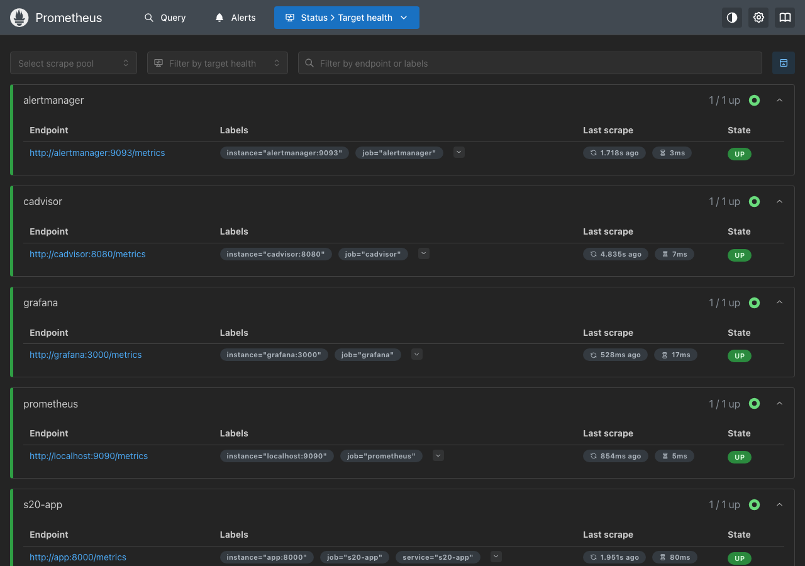
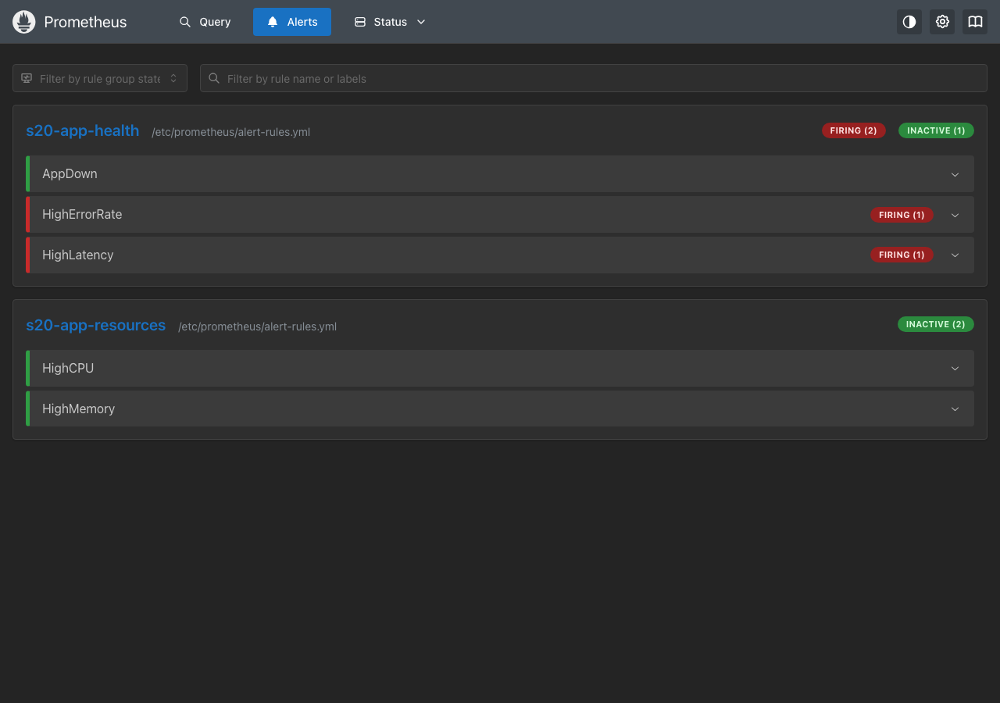
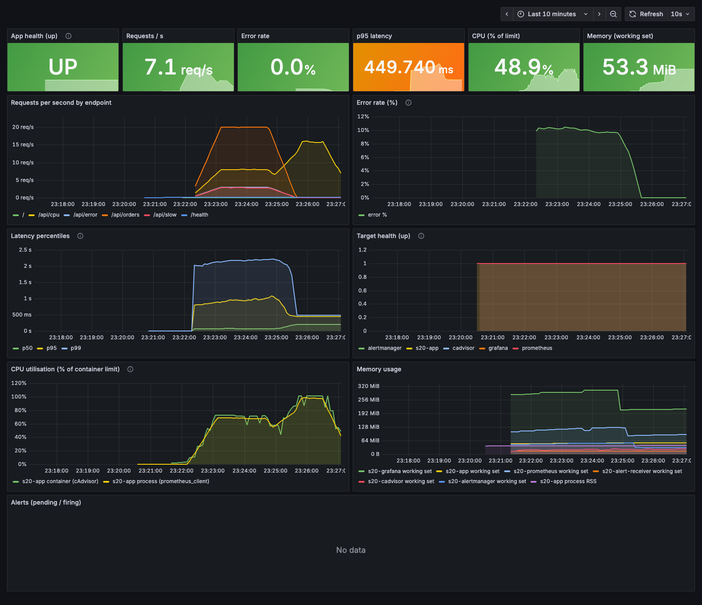
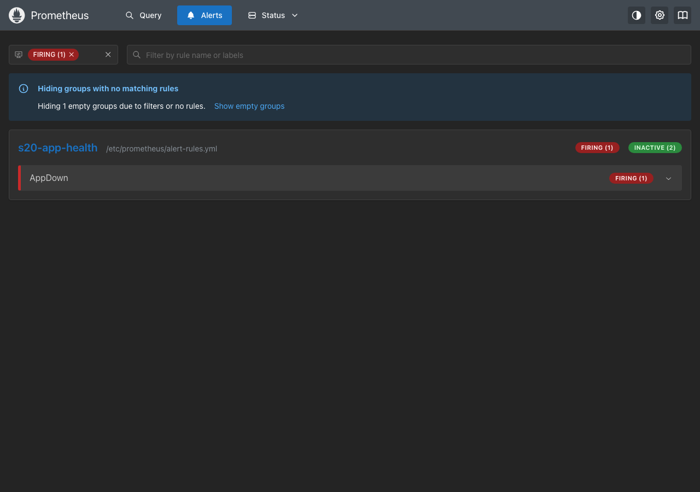
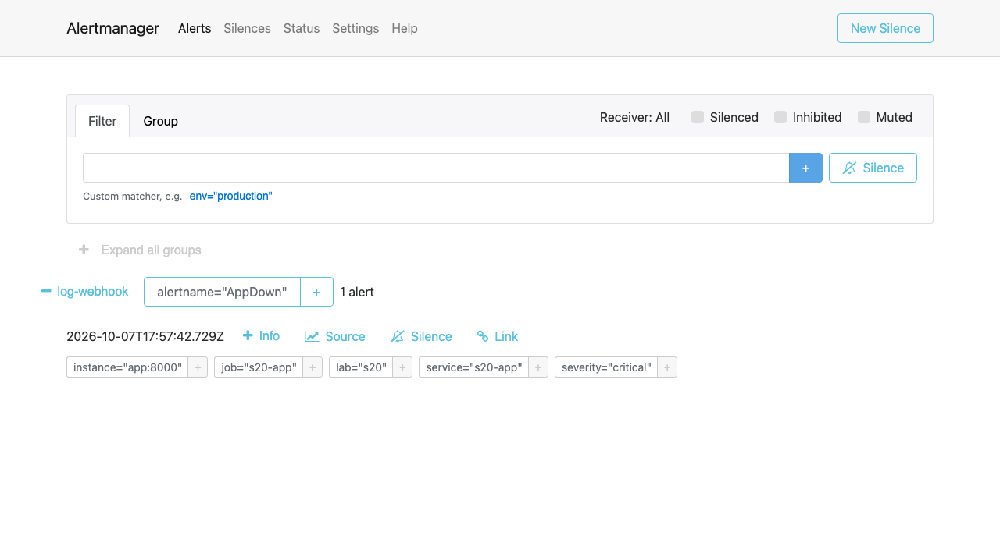
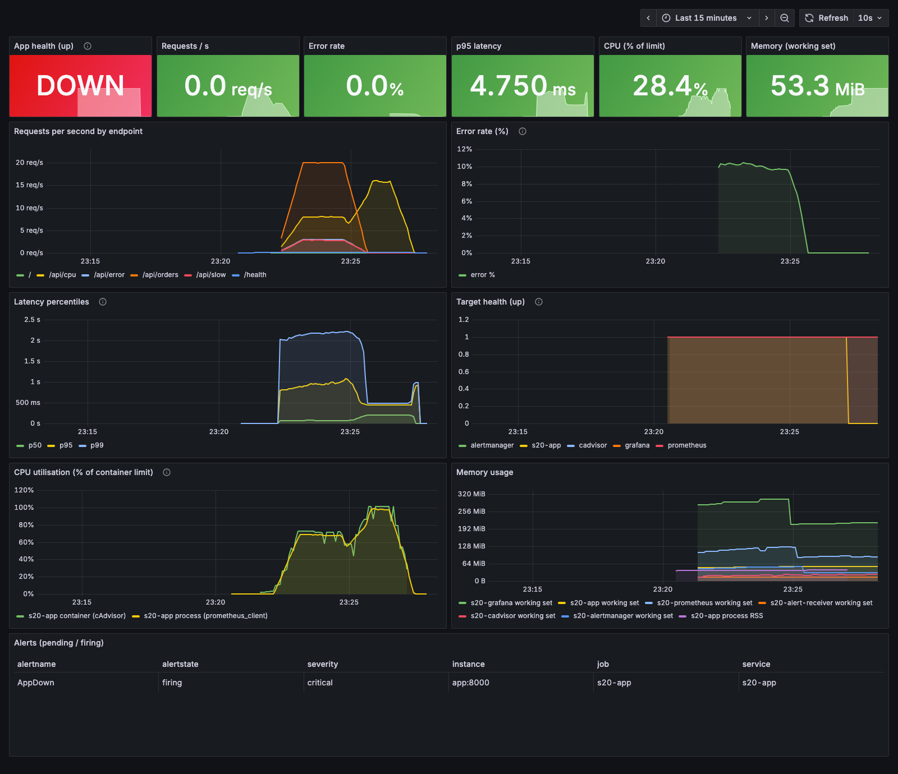

# Task 1: Monitoring

**Name:** Vansh Srivastava
**Enrollment No.:** 24bcs10567
**Session:** 20

This part is the hands-on monitoring stack for Session 20. I wrote a small Python service that exposes Prometheus metrics, a `/health` endpoint and JSON logs, and ran it with Docker Compose next to Prometheus, Alertmanager, Grafana and cAdvisor. Then I generated load, watched the metrics move, made alerts fire (HighErrorRate, HighLatency, HighCPU, AppDown), brought the app back, read the logs and tore everything down. All output below is from that run on 7 Oct 2026. API timestamps are UTC; the Grafana screenshots use my browser's time zone (IST, UTC+5:30), so 17:52Z in the API output is 23:22 on the dashboards.

Back to the [session README](../README.md).

## Folder structure

```text
01-monitoring/
├── docker-compose.yml          # the whole stack: app, prometheus, alertmanager, alert-receiver, grafana, cadvisor
├── load.sh                     # traffic generator (uses `hey`): normal, slow, failing and CPU-heavy requests
├── app/
│   ├── app.py                  # Flask app instrumented with prometheus_client, JSON logs, trace ids
│   ├── requirements.txt        # flask, prometheus-client, gunicorn (pinned)
│   ├── Dockerfile              # python:3.12-slim (ECR mirror), non-root user, HEALTHCHECK on /health
│   └── .dockerignore
├── prometheus/
│   ├── prometheus.yml          # scrape config (app, cadvisor, prometheus, alertmanager, grafana) + alerting
│   └── alert-rules.yml         # AppDown, HighErrorRate, HighLatency, HighCPU, HighMemory
├── alertmanager/
│   └── alertmanager.yml        # route everything to a webhook receiver
├── alert-receiver/
│   └── receiver.py             # tiny webhook that prints every notification Alertmanager sends
└── grafana/
    ├── provisioning/datasources/prometheus.yml   # Prometheus datasource, provisioned at start-up
    ├── provisioning/dashboards/dashboards.yml    # tells Grafana to load dashboards from a folder
    └── dashboards/s20-app-overview.json          # the dashboard (13 panels)
```

Screenshots are in [`../screenshots/`](../screenshots/).

## The stack

| Container | Image | Host port | Job |
|---|---|---|---|
| `s20-app` | `s20-app:1.0.0` (built here) | 8300 | the monitored service |
| `s20-prometheus` | `quay.io/prometheus/prometheus:v3.5.0` | 9390 | scrapes metrics every 5s, evaluates alert rules |
| `s20-alertmanager` | `quay.io/prometheus/alertmanager:v0.28.1` | 9393 | groups alerts and sends notifications |
| `s20-alert-receiver` | `public.ecr.aws/docker/library/python:3.12-slim` | none | webhook target that logs each notification |
| `s20-grafana` | `grafana/grafana:12.1.1` | 3300 | dashboards |
| `s20-cadvisor` | `ghcr.io/google/cadvisor:v0.57.0` | 8380 | per-container CPU and memory |

The app container has `cpus: 0.5` and `mem_limit: 256m`. With limits set, "CPU % of limit" and "memory % of limit" mean something, and the HighCPU and HighMemory rules use them.

All images are multi-arch and run on my arm64 Mac. I used the instructor's Prometheus and Grafana versions (v3.5.0 and 12.1.1 from `03-prometheus` and `04-grafana` in the course repo), but pulled Prometheus and Alertmanager from quay.io and Python from the AWS ECR mirror, because Docker Hub was rate limiting anonymous pulls on this machine:

```bash
$ docker pull prom/prometheus:v3.5.0
Error response from daemon: unknown: failed to resolve reference "docker.io/prom/prometheus:v3.5.0": unexpected status from HEAD request to https://registry-1.docker.io/v2/prom/prometheus/manifests/v3.5.0: 429 Too Many Requests
```

### The instrumented app (`app/app.py`)

| Endpoint | What it does |
|---|---|
| `/` | service name, version, list of endpoints |
| `/health` | `{"status":"ok", ...}`; used by the Docker HEALTHCHECK |
| `/metrics` | Prometheus metrics (served by `prometheus_client.make_wsgi_app`) |
| `/api/orders` | normal request, 10-80 ms, fails 2% of the time with a simulated database timeout |
| `/api/slow` | 0.5-1.5 s, to push latency up |
| `/api/error` | always returns 500, to push the error rate up |
| `/api/cpu?ms=100` | burns CPU for the given milliseconds |

Metrics it exports:

- `app_requests_total{method,endpoint,status}`: counter of every request
- `app_errors_total{endpoint}`: counter of 5xx responses
- `app_request_duration_seconds{endpoint}`: latency histogram (buckets from 5 ms to 5 s); every observation carries the request's `trace_id` as an exemplar
- `app_requests_in_progress`: gauge
- `app_build_info{version,service}`: always 1, so the version can be shown and joined
- `process_cpu_seconds_total`, `process_resident_memory_bytes`, ...: added automatically by `prometheus_client`

Every request writes one JSON log line to stdout with `trace_id`, `span_id`, path, status and duration. Errors are logged at `ERROR` level with the error message. If the caller sends a W3C `traceparent` header the app keeps that trace id, and it always returns the id in `X-Trace-Id` and `traceparent` response headers. [02-observability](../02-observability/README.md) uses this to link a metric, a log line and a trace id.

### Alert rules (`prometheus/alert-rules.yml`)

| Alert | Expression (short form) | for | Covers |
|---|---|---|---|
| `AppDown` | `up{job="s20-app"} == 0` | 30s | application health |
| `HighErrorRate` | 5xx rate / request rate > 5% over 1m | 30s | errors |
| `HighLatency` | p95 of `app_request_duration_seconds` > 0.5s over 1m | 30s | latency |
| `HighCPU` | cAdvisor container CPU / CPU limit > 80% | 30s | CPU utilisation |
| `HighMemory` | cAdvisor working set / memory limit > 80% | 1m | memory utilisation |

I checked both config files with the tools that ship inside the images:

```bash
$ docker run --rm --entrypoint promtool -v "$PWD/prometheus:/etc/prometheus:ro" quay.io/prometheus/prometheus:v3.5.0 check config /etc/prometheus/prometheus.yml
Checking /etc/prometheus/prometheus.yml
  SUCCESS: 1 rule files found
 SUCCESS: /etc/prometheus/prometheus.yml is valid prometheus config file syntax

Checking /etc/prometheus/alert-rules.yml
  SUCCESS: 5 rules found

$ docker run --rm --entrypoint amtool -v "$PWD/alertmanager:/etc/alertmanager:ro" quay.io/prometheus/alertmanager:v0.28.1 check-config /etc/alertmanager/alertmanager.yml
Checking '/etc/alertmanager/alertmanager.yml'  SUCCESS
Found:
 - global config
 - route
 - 0 inhibit rules
 - 1 receivers
 - 0 templates
```

### Grafana

The datasource and dashboard are provisioned from files, so nothing is set up by hand in the UI. The dashboard `s20-app overview (Session 20)` has stat panels for app health (UP/DOWN), requests/s, error rate, p95 latency, CPU % of limit and memory, then time series for requests by endpoint, error rate, p50/p95/p99 latency, `up` for every target, CPU and memory (cAdvisor and process metrics side by side), and a table of pending/firing alerts.

**Anonymous access:** for this local demo only I set `GF_AUTH_ANONYMOUS_ENABLED=true` with `GF_AUTH_ANONYMOUS_ORG_ROLE=Viewer`. Anyone who can reach port 3300 can view dashboards without logging in, which is why the headless Chrome screenshots show the dashboard and not a login page. The admin password is the demo value `demo-password-123`. I would not run either setting outside a local lab.

## Running it

### 1. Start the stack

```bash
$ docker compose up -d --build
 Image s20-app:1.0.0 Building
...
#9 [4/6] RUN pip install --no-cache-dir -r requirements.txt
...
#9 1.699 Installing collected packages: prometheus-client, markupsafe, itsdangerous, gunicorn, click, blinker, werkzeug, jinja2, flask
...
 Image s20-app:1.0.0 Built
...
 Network s20-monitoring-net Created
...
 Container s20-alert-receiver Started
 Container s20-alertmanager Started
 Container s20-cadvisor Started
 Container s20-prometheus Started
 Container s20-grafana Starting
 Container s20-app Started
 Container s20-grafana Started
```

**Problem I hit: cAdvisor could not see the containers.** My first compose file used `ghcr.io/google/cadvisor:v0.53.0`. It started, but its log was full of errors like this one:

```bash
$ docker compose logs cadvisor --tail 20
...
s20-cadvisor  | W1007 17:50:23.604070       1 manager.go:1172] Failed to process watch event {EventType:0 Name:/docker/035131dcb451578da6a614c023d606fffdd16a5704fed358f9d4c2e8f5cfc684 WatchSource:0}: failed to identify the read-write layer ID for container "035131dcb451578da6a614c023d606fffdd16a5704fed358f9d4c2e8f5cfc684". - open /rootfs/var/lib/docker/image/overlayfs/layerdb/mounts/035131dcb451578da6a614c023d606fffdd16a5704fed358f9d4c2e8f5cfc684/mount-id: no such file or directory
...
```

Docker 29 in Colima stores images with the containerd snapshotter (`docker info` shows `overlayfs [["driver-type","io.containerd.snapshotter.v1"]]`), so the old `/var/lib/docker/image/.../layerdb` files that cAdvisor v0.53 looks for do not exist. I bumped the image to `v0.57.0` and recreated only that container:

```bash
$ docker compose up -d cadvisor
...
 Container s20-cadvisor Recreated
 Container s20-cadvisor Starting
 Container s20-cadvisor Started
```

After that, cAdvisor reported per-container metrics with a `name` label (`s20-app`, `s20-prometheus`, ...). cAdvisor sees every container on the Colima VM, including ones that belong to other projects, so `prometheus.yml` keeps only series where `name=~"s20-.*"` (`metric_relabel_configs`).

### 2. Containers, health and targets

```bash
$ docker compose ps --format 'table {{.Name}}\t{{.Image}}\t{{.Status}}\t{{.Ports}}'
NAME                 IMAGE                                            STATUS                        PORTS
s20-alert-receiver   public.ecr.aws/docker/library/python:3.12-slim   Up About a minute
s20-alertmanager     quay.io/prometheus/alertmanager:v0.28.1          Up About a minute             0.0.0.0:9393->9093/tcp, [::]:9393->9093/tcp
s20-app              s20-app:1.0.0                                    Up About a minute (healthy)   0.0.0.0:8300->8000/tcp, [::]:8300->8000/tcp
s20-cadvisor         ghcr.io/google/cadvisor:v0.57.0                  Up 28 seconds (healthy)       0.0.0.0:8380->8080/tcp, [::]:8380->8080/tcp
s20-grafana          grafana/grafana:12.1.1                           Up About a minute             0.0.0.0:3300->3000/tcp, [::]:3300->3000/tcp
s20-prometheus       quay.io/prometheus/prometheus:v3.5.0             Up About a minute             0.0.0.0:9390->9090/tcp, [::]:9390->9090/tcp

$ curl -s localhost:8300/health | jq .
{
  "service": "s20-app",
  "status": "ok",
  "uptime_seconds": 83.2,
  "version": "1.0.0"
}

$ curl -s localhost:9390/api/v1/targets | jq -r '.data.activeTargets[] | [.labels.job, .scrapeUrl, .health, .lastError] | @tsv'
alertmanager	http://alertmanager:9093/metrics	up
cadvisor	http://cadvisor:8080/metrics	up
grafana	http://grafana:3000/metrics	up
prometheus	http://localhost:9090/metrics	up
s20-app	http://app:8000/metrics	up
```

All five scrape targets are `up` with no `lastError`. Docker reports the app as `(healthy)` because its HEALTHCHECK calls `/health` every 10 seconds.



What the app exposes on `/metrics` before any load (only health checks so far):

```bash
$ curl -s localhost:8300/metrics | grep -E '^(app_requests_total|app_errors_total|app_request_duration_seconds_count|app_build_info|process_resident_memory_bytes|process_cpu_seconds_total)'
process_resident_memory_bytes 4.0800256e+07
process_cpu_seconds_total 0.2
app_requests_total{endpoint="/health",method="GET",status="200"} 9.0
app_requests_total{endpoint="/",method="GET",status="200"} 1.0
app_request_duration_seconds_count{endpoint="/health"} 9.0
app_request_duration_seconds_count{endpoint="/"} 1.0
app_build_info{service="s20-app",version="1.0.0"} 1.0
```

`app_errors_total` is not listed yet because a labelled counter only appears after its first increment.

Grafana loaded the provisioned datasource and dashboard (the dashboard search works without logging in because of the anonymous viewer setting):

```bash
$ curl -s localhost:3300/api/health | jq -c .
{"database":"ok","version":"12.1.1","commit":"df5de8219b41d1e639e003bf5f3a85913761d167"}

$ curl -s localhost:3300/api/search?query=s20 | jq -c '.[] | {uid,title,folderTitle}'
{"uid":"s20-app-overview","title":"s20-app overview (Session 20)","folderTitle":"Session 20"}

$ curl -s -u admin:demo-password-123 localhost:3300/api/datasources/uid/s20-prometheus/health | jq -c .
{"details":{"application":"Prometheus","features":{"rulerApiEnabled":false}},"message":"Successfully queried the Prometheus API.","status":"OK"}
```

### 3. PromQL through the HTTP API (baseline)

```text
captured at 17:52:02Z (before load)
```

```bash
$ curl -s localhost:9390/api/v1/query --data-urlencode 'query=up' | jq -c '.data.result[] | {job: .metric.job, value: .value[1]}'
{"job":"s20-app","value":"1"}
{"job":"alertmanager","value":"1"}
{"job":"prometheus","value":"1"}
{"job":"grafana","value":"1"}
{"job":"cadvisor","value":"1"}

$ curl -s localhost:9390/api/v1/query --data-urlencode 'query=sum(rate(app_requests_total[1m]))' | jq -c '.data.result'
[{"metric":{},"value":[1791395522.761,"0.11812950368732808"]}]

$ curl -s localhost:9390/api/v1/query --data-urlencode 'query=100 * sum(rate(container_cpu_usage_seconds_total{name="s20-app"}[1m])) / max(container_spec_cpu_quota{name="s20-app"} / container_spec_cpu_period{name="s20-app"})' | jq -r '.data.result[0].value[1]'
3.5415667228334486

$ curl -s localhost:9390/api/v1/alerts | jq -c '.data.alerts'
[]
```

Before any load the app gets about 0.12 requests/s (the Docker health checks), uses 3.5% of its CPU limit, and no alert is active.

### 4. Generate load and watch the metrics move

`load.sh` runs four `hey` streams in parallel: about 20 req/s to `/api/orders`, 3 req/s to `/api/slow`, 3 req/s to `/api/error` and 8 req/s to `/api/cpu?ms=100`.

```bash
$ ./load.sh 150s
load: 150s against http://localhost:8300 (summaries in /var/folders/ly/2wnn8sz92cg25rrg2f4drh8m0000gn/T/tmp.q0TPidqtEl)
--- /api/orders
  Slowest:	0.2175 secs
  Average:	0.0795 secs
  Requests/sec:	19.9841
  [200]	2943 responses
  [500]	57 responses
--- /api/slow
  Slowest:	1.5563 secs
  Average:	1.0481 secs
  Requests/sec:	2.7650
  [200]	417 responses
--- /api/error
  Slowest:	0.1669 secs
  Average:	0.0265 secs
  Requests/sec:	2.9997
  [500]	450 responses
--- /api/cpu
  Slowest:	0.2525 secs
  Average:	0.1240 secs
  Requests/sec:	7.9930
  [200]	1200 responses
```

About 70 seconds into the load I queried Prometheus again:

```text
captured at 17:53:21Z (during load)
```

```bash
$ curl -s localhost:9390/api/v1/query --data-urlencode 'query=sum by (endpoint, status) (rate(app_requests_total[1m]))' | jq -r '.data.result[] | "\(.metric.endpoint)\t\(.metric.status)\t\(.value[1])"' | sort
/	200	0
/api/cpu	200	7.989152343606845
/api/error	500	2.986770256898889
/api/orders	200	19.423168541796457
/api/orders	500	0.5313885733132994
/api/slow	200	2.803532817825338
/health	200	0.09161871953677575

$ curl -s localhost:9390/api/v1/query --data-urlencode 'query=sum(rate(app_requests_total[1m]))' | jq -r '.data.result[0].value[1]'
33.8256312529776

$ curl -s localhost:9390/api/v1/query --data-urlencode 'query=100 * sum(rate(app_errors_total[1m])) / sum(rate(app_requests_total[1m]))' | jq -r '.data.result[0].value[1]'
10.400866738894909

$ curl -s localhost:9390/api/v1/query --data-urlencode 'query=histogram_quantile(0.95, sum by (le) (rate(app_request_duration_seconds_bucket[1m])))' | jq -r '.data.result[0].value[1]'
0.9101351351351366

$ curl -s localhost:9390/api/v1/query --data-urlencode 'query=100 * sum(rate(container_cpu_usage_seconds_total{name="s20-app"}[1m])) / max(container_spec_cpu_quota{name="s20-app"} / container_spec_cpu_period{name="s20-app"})' | jq -r '.data.result[0].value[1]'
72.66320779108852

$ curl -s localhost:9390/api/v1/query --data-urlencode 'query=container_memory_working_set_bytes{name="s20-app"} / 1024 / 1024' | jq -r '.data.result[0].value[1]'
50.828125

$ curl -s localhost:9390/api/v1/alerts | jq -c '.data.alerts[] | {alert: .labels.alertname, state: .state, activeAt: .activeAt, value: .value}'
{"alert":"HighErrorRate","state":"firing","activeAt":"2026-10-07T17:52:17.729909147Z","value":"1.0400866738894908e-01"}
{"alert":"HighLatency","state":"firing","activeAt":"2026-10-07T17:52:17.729909147Z","value":"9.101351351351366e-01"}
```

The metrics match what the load generator was doing:

- Request rate went from 0.12/s to 33.8/s. The per-endpoint rates (about 20, 8, 3 and 3 req/s) are the four `hey` streams.
- The error rate is 10.4%: the 3 req/s from `/api/error` plus about 0.5 req/s of `/api/orders` failures, out of about 34 req/s. That is over the 5% threshold, so `HighErrorRate` fired.
- p95 latency is 0.91 s, because more than 5% of requests are `/api/slow` (0.5-1.5 s). `HighLatency` (p95 > 0.5 s) fired.
- The app container used 72.7% of its 0.5 CPU limit, and memory stayed around 51 MiB of 256 MiB.
- Both alerts became active at 17:52:17 (`pending`). Because of `for: 30s` they became `firing` 30 seconds later, and Alertmanager shows `startsAt` 17:52:47.




Alertmanager received both alerts and delivered them to the webhook receiver:

```bash
$ curl -s localhost:9393/api/v2/alerts | jq -c '.[] | {alertname: .labels.alertname, state: .status.state, receivers: [.receivers[].name], startsAt}'
{"alertname":"HighLatency","state":"active","receivers":["log-webhook"],"startsAt":"2026-10-07T17:52:47.729Z"}
{"alertname":"HighErrorRate","state":"active","receivers":["log-webhook"],"startsAt":"2026-10-07T17:52:47.729Z"}

$ docker compose -f /Users/vanshsrivastava/DevOPS-ASSIGNMENT-VANSH-SRIVASTAVA/session-20-monitoring-observability-gitops/01-monitoring/docker-compose.yml logs alert-receiver --no-log-prefix
alert-receiver listening on :5001
{"notification_status": "firing", "alertname": "HighErrorRate", "severity": "warning", "alert_status": "firing", "startsAt": "2026-10-07T17:52:47.729Z", "endsAt": "0001-01-01T00:00:00Z", "summary": "s20-app error rate above 5%"}
{"notification_status": "firing", "alertname": "HighLatency", "severity": "warning", "alert_status": "firing", "startsAt": "2026-10-07T17:52:47.729Z", "endsAt": "0001-01-01T00:00:00Z", "summary": "s20-app p95 latency above 500ms"}
```

### 5. CPU stress: HighCPU

The mixed load reached about 73% of the CPU limit, below the 80% threshold. To test the CPU rule I sent only CPU-heavy requests:

```bash
$ hey -z 100s -c 6 'http://localhost:8300/api/cpu?ms=200'
  Total:	100.3082 secs
  Average:	0.3798 secs
  Requests/sec:	15.7714
...
  [200]	1582 responses
```

```text
captured at 17:56:09Z (during CPU stress)
```

```bash
$ curl -s localhost:9390/api/v1/query --data-urlencode 'query=100 * sum(rate(container_cpu_usage_seconds_total{name="s20-app"}[1m])) / max(container_spec_cpu_quota{name="s20-app"} / container_spec_cpu_period{name="s20-app"})' | jq -r '.data.result[0].value[1]'
82.30163878440922

$ curl -s localhost:9390/api/v1/query --data-urlencode 'query=rate(container_cpu_cfs_throttled_periods_total{name="s20-app"}[1m]) / rate(container_cpu_cfs_periods_total{name="s20-app"}[1m])' | jq -r '.data.result[0].value[1]'
1

$ curl -s localhost:9390/api/v1/query --data-urlencode 'query=100 * max(container_memory_working_set_bytes{name="s20-app"}) / max(container_spec_memory_limit_bytes{name="s20-app"})' | jq -r '.data.result[0].value[1]'
20.80841064453125

$ curl -s localhost:9390/api/v1/alerts | jq -c '.data.alerts[] | {alert: .labels.alertname, state: .state, activeAt: .activeAt, value: .value}'
{"alert":"HighCPU","state":"firing","activeAt":"2026-10-07T17:55:30.764991604Z","value":"1.0133035322777098e+00"}
```

What these numbers say:

- The container sat at its CPU limit: the throttled-periods ratio is `1`, so the kernel throttled it in every CFS period. The alert value was 1.01 (101% of the limit) at the last rule evaluation.
- Memory used 20.8% of the limit, well under the 80% HighMemory threshold. That rule stayed inactive for the whole run; I did not write a memory-hog endpoint.
- HighCPU only fired briefly. Prometheus' own history of the alert:

```bash
$ curl -s localhost:9390/api/v1/query_range --data-urlencode 'query=ALERTS{alertname="HighCPU"}' --data-urlencode "start=$(date -v-6M +%s)" --data-urlencode "end=$(date +%s)" --data-urlencode 'step=5' | jq -c '.data.result[] | {state: .metric.alertstate, first: (.values[0][0]|todate), last: (.values[-1][0]|todate), n: (.values|length)}'
{"state":"firing","first":"2026-10-07T17:56:01Z","last":"2026-10-07T17:56:06Z","n":2}
{"state":"pending","first":"2026-10-07T17:55:31Z","last":"2026-10-07T17:56:41Z","n":12}
```

CPU was hovering right around 80%, so the alert flapped. It was firing for about 5 seconds and then fell back to pending. Alertmanager waits `group_wait: 10s` before sending the first notification for a new group, and by then the alert was gone, so no HighCPU notification reached the receiver (the receiver log in step 7 has none). This is a useful lesson: for a noisy signal like CPU, a longer `for:` or `keep_firing_for:` gives more stable alerts.



The screenshot shows both phases. During the mixed load (23:22 to 23:24.5 local time) request rate, error rate (about 10%) and p95/p99 latency all rise. During the CPU stress (23:25 to 23:26.5) the `/api/cpu` rate goes up and CPU reaches about 100% of the limit. The cAdvisor line (container) and the `process_cpu_seconds_total` line (process) agree closely.

### 6. Trigger AppDown: stop the app

```bash
17:57:08Z
$ docker compose stop app
 Container s20-app Stopping
 Container s20-app Stopped

17:57:14Z
$ curl -s localhost:9390/api/v1/query --data-urlencode 'query=up{job="s20-app"}' | jq -c '.data.result[] | {job: .metric.job, value: .value[1]}'
{"job":"s20-app","value":"0"}

$ curl -s localhost:9390/api/v1/alerts | jq -c '.data.alerts[] | {alert: .labels.alertname, state: .state, activeAt: .activeAt}'
{"alert":"AppDown","state":"pending","activeAt":"2026-10-07T17:57:12.729909147Z"}
```

Within a few seconds the scrape failed, `up` dropped to `0` and AppDown went `pending`. After the 30-second `for:` period it was firing:

```bash
17:57:58Z
$ curl -s localhost:9390/api/v1/alerts | jq '.data.alerts[] | select(.labels.alertname=="AppDown")'
{
  "labels": {
    "alertname": "AppDown",
    "instance": "app:8000",
    "job": "s20-app",
    "service": "s20-app",
    "severity": "critical"
  },
  "annotations": {
    "description": "Prometheus could not scrape app:8000 for more than 30 seconds.",
    "summary": "s20-app is down"
  },
  "state": "firing",
  "activeAt": "2026-10-07T17:57:12.729909147Z",
  "value": "0e+00"
}

$ curl -s localhost:9393/api/v2/alerts | jq -c '.[] | {alertname: .labels.alertname, severity: .labels.severity, state: .status.state, startsAt}'
{"alertname":"AppDown","severity":"critical","state":"active","startsAt":"2026-10-07T17:57:42.729Z"}

$ docker compose logs alert-receiver --no-log-prefix | grep AppDown
{"notification_status": "firing", "alertname": "AppDown", "severity": "critical", "alert_status": "firing", "startsAt": "2026-10-07T17:57:42.729Z", "endsAt": "0001-01-01T00:00:00Z", "summary": "s20-app is down"}
```

Timeline: app stopped at 17:57:08, AppDown pending at 17:57:12, firing at 17:57:42 (exactly 30s later), and the critical notification was delivered to the webhook.







On the dashboard the "App health" stat turns red (DOWN), the `s20-app` line in "Target health" drops to 0, and the alert table lists AppDown as firing/critical. The other stat panels keep showing the last value they had, because the app is not exporting new data.

### 7. Recover

```bash
17:58:22Z
$ docker compose start app
 Container s20-app Starting
 Container s20-app Started

17:58:28Z
$ curl -s localhost:8300/health | jq -c .
{"service":"s20-app","status":"ok","uptime_seconds":5.0,"version":"1.0.0"}

$ curl -s localhost:9390/api/v1/query --data-urlencode 'query=up{job="s20-app"}' | jq -c '.data.result[] | {job: .metric.job, value: .value[1]}'
{"job":"s20-app","value":"1"}

$ curl -s localhost:9390/api/v1/alerts | jq -c '.data.alerts'
[]

17:58:53Z
$ docker compose logs alert-receiver --no-log-prefix
alert-receiver listening on :5001
{"notification_status": "firing", "alertname": "HighErrorRate", "severity": "warning", "alert_status": "firing", "startsAt": "2026-10-07T17:52:47.729Z", "endsAt": "0001-01-01T00:00:00Z", "summary": "s20-app error rate above 5%"}
{"notification_status": "firing", "alertname": "HighLatency", "severity": "warning", "alert_status": "firing", "startsAt": "2026-10-07T17:52:47.729Z", "endsAt": "0001-01-01T00:00:00Z", "summary": "s20-app p95 latency above 500ms"}
{"notification_status": "resolved", "alertname": "HighLatency", "severity": "warning", "alert_status": "resolved", "startsAt": "2026-10-07T17:52:47.729Z", "endsAt": "2026-10-07T17:55:22.729Z", "summary": "s20-app p95 latency above 500ms"}
{"notification_status": "resolved", "alertname": "HighErrorRate", "severity": "warning", "alert_status": "resolved", "startsAt": "2026-10-07T17:52:47.729Z", "endsAt": "2026-10-07T17:55:22.729Z", "summary": "s20-app error rate above 5%"}
{"notification_status": "firing", "alertname": "AppDown", "severity": "critical", "alert_status": "firing", "startsAt": "2026-10-07T17:57:42.729Z", "endsAt": "0001-01-01T00:00:00Z", "summary": "s20-app is down"}
{"notification_status": "resolved", "alertname": "AppDown", "severity": "critical", "alert_status": "resolved", "startsAt": "2026-10-07T17:57:42.729Z", "endsAt": "2026-10-07T17:58:27.729Z", "summary": "s20-app is down"}
```

Six seconds after `docker compose start` the app was healthy, `up` was back to 1 and Prometheus had no active alerts. The receiver log has the full history of the run: HighErrorRate and HighLatency firing during the load and resolving at 17:55:22 after it ended, then AppDown firing at 17:57:42 and resolving at 17:58:27. Every notification arrived because `send_resolved: true` is set.

### 8. Logs

```bash
$ docker compose logs app --tail 5
s20-app  | {"ts": "2026-10-07T17:59:03.263Z", "level": "INFO", "service": "s20-app", "version": "1.0.0", "msg": "request completed", "trace_id": "0e51f5f3395d4e75b8a7e2fbf4a154f4", "span_id": "8441b1c097364155", "method": "GET", "path": "/health", "status": 200, "duration_ms": 0.44, "client": "Python-urllib/3.12"}
s20-app  | {"ts": "2026-10-07T17:59:10.315Z", "level": "INFO", "service": "s20-app", "version": "1.0.0", "msg": "request completed", "trace_id": "6212eb05eff74e178d90c852d4d7f992", "span_id": "b251cd5930c44f81", "method": "GET", "path": "/api/orders", "status": 200, "duration_ms": 72.38, "client": "curl/8.7.1"}
s20-app  | {"ts": "2026-10-07T17:59:10.345Z", "level": "INFO", "service": "s20-app", "version": "1.0.0", "msg": "request completed", "trace_id": "0308905ec7834ccb8c3015e62714c3f6", "span_id": "800d26a2fb874789", "method": "GET", "path": "/api/orders", "status": 200, "duration_ms": 18.51, "client": "curl/8.7.1"}
s20-app  | {"ts": "2026-10-07T17:59:10.376Z", "level": "INFO", "service": "s20-app", "version": "1.0.0", "msg": "request completed", "trace_id": "2d93a514d8c6450db39fcfd6b84fedcb", "span_id": "b333b966716a47f5", "method": "GET", "path": "/api/orders", "status": 200, "duration_ms": 22.72, "client": "curl/8.7.1"}
s20-app  | {"ts": "2026-10-07T17:59:10.383Z", "level": "ERROR", "service": "s20-app", "version": "1.0.0", "msg": "request completed", "trace_id": "02f12e8ba691487aade33395af221d75", "span_id": "e5d856c74f7d4f49", "method": "GET", "path": "/api/error", "status": 500, "duration_ms": 0.09, "client": "curl/8.7.1", "error": "simulated upstream failure"}
```

Because every line is JSON, I can filter and count logs with `jq` instead of reading them line by line:

```bash
$ docker compose logs app --no-log-prefix | grep '^{' | jq -r 'select(.level=="ERROR") | "\(.path) \(.status) \(.error)"' | sort | uniq -c
 451 /api/error 500 simulated upstream failure
  57 /api/orders 500 simulated database timeout

$ docker compose logs app --no-log-prefix | grep 'simulated database timeout' | head -1 | jq -c .
{"ts":"2026-10-07T17:52:10.067Z","level":"ERROR","service":"s20-app","version":"1.0.0","msg":"request completed","trace_id":"65b5ebb21dde40bdb24a9d9b55fe7616","span_id":"c44915f9be6b4976","method":"GET","path":"/api/orders","status":500,"duration_ms":47.89,"client":"hey/0.0.1","error":"simulated database timeout"}

$ docker compose logs app --no-log-prefix | grep '^{' | jq -r 'select(.path != null) | .path' | sort | uniq -c | sort -rn
3003 /api/orders
2782 /api/cpu
 451 /api/error
 418 /api/slow
  45 /health
   1 /
```

The logs agree with the other signals. `hey` reported 450 `/api/error` and 57 `/api/orders` 500s; the logs have 451 and 57 (one extra `/api/error` from my manual curl just before). This is what logs add on top of metrics: the metric says how many requests failed, and the log line says which request failed, when, and with what error, plus a trace id to follow it further.

### 9. Tear down

```bash
$ docker compose down -v --rmi local
 Container s20-cadvisor Stopping
 Container s20-grafana Stopping
 Container s20-alert-receiver Stopping
 Container s20-alertmanager Stopping
 Container s20-app Stopping
...
 Container s20-app Removed
 Container s20-alert-receiver Stopped
 Container s20-alert-receiver Removing
 Container s20-alert-receiver Removed
 Volume s20-grafana-data Removing
 Volume s20-prometheus-data Removing
 Network s20-monitoring-net Removing
 Volume s20-grafana-data Removed
 Volume s20-prometheus-data Removed
 Network s20-monitoring-net Removed
 Image s20-app:1.0.0 Removing
 Image s20-app:1.0.0 Removed

$ docker ps -a --filter name=s20- --format '{{.Names}}'; docker network ls --filter name=s20- --format '{{.Name}}'; docker volume ls --filter name=s20- --format '{{.Name}}'; echo "remaining s20 objects: $(docker ps -aq --filter name=s20- | wc -l | tr -d ' ') containers"
remaining s20 objects: 0 containers
```

`-v` removed the Prometheus and Grafana volumes and `--rmi local` removed the locally built `s20-app` image. No `s20-` container, network or volume is left.

## How to run it yourself

```bash
cd session-20-monitoring-observability-gitops/01-monitoring
docker compose up -d --build
open http://localhost:3300            # Grafana (anonymous viewer; admin / demo-password-123)
open http://localhost:9390/targets    # Prometheus
./load.sh 150s                        # needs `hey` (brew install hey)
docker compose stop app               # AppDown fires after ~30s
docker compose start app
docker compose down -v --rmi local
```
