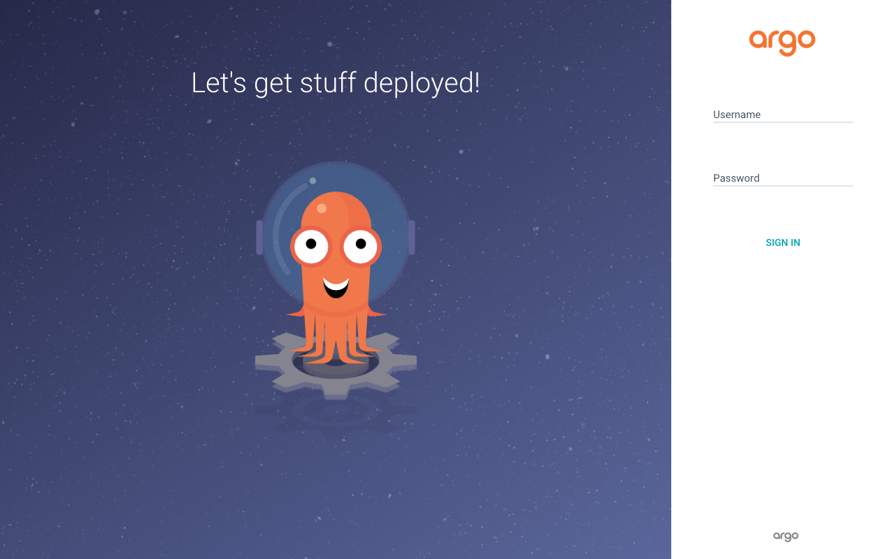

# Task 3: GitOps

**Name:** Vansh Srivastava
**Enrollment No.:** 24bcs10567
**Session:** 20

This part covers GitOps with Argo CD. I wrote plain Kubernetes manifests for a tiny web app that shows its version, an Argo CD `Application` that points at this folder of my GitHub repo, and `demo.sh`, which applies the Application, waits for Synced/Healthy and then shows Argo CD undoing manual changes (self-heal). Argo CD v3.5.4 is installed in the shared minikube cluster (namespace `argocd`) and left running. The real sync from GitHub can only happen after the repo is pushed, so its output goes in the "Live sync (after push)" section at the end. Before the push I tested the script against a temporary in-cluster chart repository with the same manifests, so the self-heal behaviour below is real, just not from GitHub yet.

Back to the [session README](../README.md).

## Folder structure

```text
03-gitops/
├── README.md
├── argocd-application.yaml     # Argo CD Application: GitHub repo + path -> namespace s20-gitops-demo
├── demo.sh                     # apply Application, wait Synced/Healthy, show resources, self-heal demo
├── app/                        # the desired state Argo CD syncs (plain YAML, no Helm/Kustomize)
│   ├── namespace.yaml          # namespace s20-gitops-demo
│   ├── deployment.yaml         # s20-web: nginx, 2 replicas, page shows APP_VERSION (v1.0.0)
│   └── service.yaml            # ClusterIP service s20-web on port 80
└── rehearsal/                  # pre-push test only (not part of the real GitOps flow)
    ├── rehearsal.sh            # packages app/ as a Helm chart, serves it in-cluster, runs demo.sh, cleans up
    ├── chart-server.yaml       # busybox httpd serving the chart repo from a ConfigMap
    └── rehearsal-application.yaml  # same sync policy, source = in-cluster chart repo
```

## GitOps concepts

### What GitOps is

GitOps is a way of running infrastructure and applications where a Git repository holds the full desired state of the system as declarative files, and an automated agent running next to the system keeps the real state matching Git. You change the system by changing Git, through commits and pull requests, not by running `kubectl apply` or clicking in a console.

The OpenGitOps project sums it up in four principles:

1. **Declarative:** the desired state is described as data ("2 replicas of image X"), not as a script of steps.
2. **Versioned and immutable:** that description is stored in Git, so every version is kept, reviewed and can be restored.
3. **Pulled automatically:** an agent inside the environment pulls the desired state from Git; CI does not push into the cluster with admin credentials.
4. **Continuously reconciled:** the agent keeps comparing actual with desired state and fixes any difference, not only at deploy time.

### Git as the source of truth

If Git is the only place where desired state is defined, then:

- **History and audit:** `git log` shows who changed what, when and why (the commit message), for every environment.
- **Review:** changes go through pull requests, so a second person and CI checks see a change before it reaches the cluster.
- **Rollback:** going back is `git revert`, and the agent applies the old state again.
- **Disaster recovery:** a new cluster plus the same Git repo plus Argo CD gives back the same workloads.
- **No snowflakes:** anything changed by hand in the cluster is drift. It shows up as `OutOfSync` and gets reverted.

Git is not the cluster. Git holds the desired state, the cluster holds the actual state, and the controller compares the two. (This idea comes from the course repo's `06-git-as-source-of-truth`.)

### Declarative configuration

`app/deployment.yaml` does not say "start two pods". It says "there should be a Deployment `s20-web` with `replicas: 2` running this image with `APP_VERSION=v1.0.0`". Kubernetes controllers already work this way. GitOps adds one more loop on top: from Git to the API server.

### Continuous reconciliation

Argo CD's application controller keeps a live cache of the resources it manages (through Kubernetes watches) and polls Git every few minutes (180 s by default, or right away with a webhook). Each time, it renders the manifests from Git, compares them with the live objects, and marks the app `Synced` or `OutOfSync`. With `automated` sync it then applies the difference. `prune: true` deletes objects that were removed from Git, and `selfHeal: true` also reverts changes made directly in the cluster, which is what the demo shows.

### The GitOps workflow

```text
developer edits app/deployment.yaml (e.g. replicas 2 -> 3, or APP_VERSION v1.0.0 -> v1.1.0)
        |
        v
git commit + pull request + review + merge to main
        |
        v
GitHub (desired state)  <-- polled every ~3 min (or webhook) --  Argo CD (in the cluster)
                                                                     |
                                              compare desired vs live, OutOfSync -> sync
                                                                     v
                                                         Kubernetes (actual state)
                                                                     |
                     someone runs kubectl scale/delete by hand -> drift -> selfHeal reverts it
```

### Kubernetes + GitOps

Kubernetes suits GitOps well because everything in it is already a declarative API object with a reconciling controller. Argo CD (and Flux) extend that model to "the source of the objects is Git". In practice:

- **Push vs pull:** in a CI push pipeline, CI holds cluster credentials and runs `kubectl apply`. In GitOps the agent inside the cluster pulls, so CI only needs write access to Git, and the cluster never exposes its API to CI.
- **Multiple environments:** separate folders or branches (`envs/dev`, `envs/prod`) or Kustomize overlays and Helm values, each with its own Argo CD Application.
- **App of apps / ApplicationSet:** Argo CD Applications can themselves be stored in Git, so adding a new service is a pull request too.
- **Secrets** should not be committed in plain text. Teams use Sealed Secrets, SOPS or External Secrets Operator.

## Task 3 files

[`app/deployment.yaml`](app/deployment.yaml) runs `public.ecr.aws/nginx/nginx:1.27-alpine` (the official nginx image on the AWS ECR mirror, multi-arch; Docker Hub was rate limiting pulls here, see [01-monitoring](../01-monitoring/README.md#the-stack)). At start-up it writes `index.html` and `version.json` containing `APP_VERSION` and the pod name, so a version change in Git becomes visible on the page after Argo CD rolls it out. It has readiness and liveness probes and small requests/limits (50m/32Mi requests, 100m/64Mi limits).

[`argocd-application.yaml`](argocd-application.yaml):

```yaml
spec:
  project: default
  source:
    repoURL: https://github.com/vanshhhhhhhhh/DevOPS-ASSIGNMENT-VANSH-SRIVASTAVA.git
    targetRevision: main
    path: session-20-monitoring-observability-gitops/03-gitops/app
  destination:
    server: https://kubernetes.default.svc
    namespace: s20-gitops-demo
  syncPolicy:
    automated:
      prune: true
      selfHeal: true
    syncOptions:
      - CreateNamespace=true
```

As in the course repo's `07-argocd` and `08-mini-project`, the Application file sits outside the synced `app/` path, so Argo CD does not end up managing its own Application object. It is the only file I `kubectl apply` by hand.

## Installing Argo CD (done now, left running)

I used the official manifest from the `stable` branch, which was Argo CD v3.5.4 on the day I installed it. I used server-side apply as in the course repo's `07-argocd`, because the Argo CD CRDs are too large for the client-side `last-applied-configuration` annotation.

```bash
$ kubectl create namespace argocd
namespace/argocd created
$ kubectl apply -n argocd --server-side --force-conflicts -f https://raw.githubusercontent.com/argoproj/argo-cd/stable/manifests/install.yaml
customresourcedefinition.apiextensions.k8s.io/applications.argoproj.io serverside-applied
customresourcedefinition.apiextensions.k8s.io/applicationsets.argoproj.io serverside-applied
customresourcedefinition.apiextensions.k8s.io/appprojects.argoproj.io serverside-applied
serviceaccount/argocd-application-controller serverside-applied
serviceaccount/argocd-applicationset-controller serverside-applied
...
deployment.apps/argocd-applicationset-controller serverside-applied
deployment.apps/argocd-dex-server serverside-applied
deployment.apps/argocd-notifications-controller serverside-applied
deployment.apps/argocd-redis serverside-applied
deployment.apps/argocd-repo-server serverside-applied
deployment.apps/argocd-server serverside-applied
statefulset.apps/argocd-application-controller serverside-applied
networkpolicy.networking.k8s.io/argocd-application-controller-network-policy serverside-applied
networkpolicy.networking.k8s.io/argocd-applicationset-controller-network-policy serverside-applied
networkpolicy.networking.k8s.io/argocd-dex-server-network-policy serverside-applied
networkpolicy.networking.k8s.io/argocd-notifications-controller-network-policy serverside-applied
networkpolicy.networking.k8s.io/argocd-redis-network-policy serverside-applied
networkpolicy.networking.k8s.io/argocd-repo-server-network-policy serverside-applied
networkpolicy.networking.k8s.io/argocd-server-network-policy serverside-applied
```

All seven components were Running within two minutes (the images come from quay.io, ghcr.io and public.ecr.aws, all arm64):

```bash
$ kubectl get pods -n argocd -o wide
NAME                                                READY   STATUS    RESTARTS   AGE    IP            NODE       NOMINATED NODE   READINESS GATES
argocd-application-controller-0                     1/1     Running   0          113s   10.244.0.13   minikube   <none>           <none>
argocd-applicationset-controller-76fd8cdd4f-gzfd4   1/1     Running   0          114s   10.244.0.7    minikube   <none>           <none>
argocd-dex-server-66c78cf887-f79bn                  1/1     Running   0          114s   10.244.0.8    minikube   <none>           <none>
argocd-notifications-controller-7fb9868fd6-2vxwm    1/1     Running   0          114s   10.244.0.9    minikube   <none>           <none>
argocd-redis-bdbdffcb4-rjkfh                        1/1     Running   0          114s   10.244.0.10   minikube   <none>           <none>
argocd-repo-server-d89c7967d-44f8t                  1/1     Running   0          114s   10.244.0.11   minikube   <none>           <none>
argocd-server-776b7cdd4d-9flrm                      1/1     Running   0          113s   10.244.0.12   minikube   <none>           <none>

$ kubectl get crd | grep argoproj
applications.argoproj.io      Namespaced   v1alpha1(storage)   2026-10-07T17:42:56Z
applicationsets.argoproj.io   Namespaced   v1alpha1(storage)   2026-10-07T17:42:56Z
appprojects.argoproj.io       Namespaced   v1alpha1(storage)   2026-10-07T17:42:56Z

$ kubectl -n argocd get deploy argocd-server -o jsonpath="{.spec.template.spec.containers[0].image}"
quay.io/argoproj/argocd:v3.5.4
```

What each component does: **application-controller** compares Git with the cluster and syncs; **repo-server** clones Git and renders manifests (plain YAML, Helm, Kustomize); **server** is the API and web UI; **redis** is a cache; **dex** handles SSO; **applicationset-controller** generates Applications from templates; **notifications-controller** sends Slack/email/webhook notifications on sync events.

### Accessing the UI and the admin password

The node IP is not reachable from my Mac, so I use a port-forward on port 18443:

```bash
kubectl port-forward svc/argocd-server -n argocd 18443:443
# then open https://localhost:18443  (self-signed certificate; user: admin)
```

The initial admin password is generated at install time and stored in a Secret. It is not written in this repo. To read it:

```bash
kubectl -n argocd get secret argocd-initial-admin-secret -o jsonpath='{.data.password}' | base64 -d; echo
```

To check that it exists without printing it, and that the API and CLI respond:

```bash
$ kubectl -n argocd get secret argocd-initial-admin-secret -o jsonpath='{.data.password}' | base64 -d | wc -c | xargs echo 'password length (characters):'
password length (characters): 16

$ curl -sk https://localhost:18443/api/version | jq -c .
{"Version":"v3.5.4"}

$ kubectl exec -n argocd deploy/argocd-server -- argocd version --client --short
argocd: v3.5.4
```



## Before the push: what Argo CD says about an empty repo

The GitHub repository exists but has nothing pushed yet. I applied the real Application once to see how Argo CD reports that, then deleted it again so the post-push demo starts clean:

```bash
$ git ls-remote https://github.com/vanshhhhhhhhh/DevOPS-ASSIGNMENT-VANSH-SRIVASTAVA.git; echo "exit code $? (no refs: the repo exists but nothing is pushed yet)"
exit code 0 (no refs: the repo exists but nothing is pushed yet)

$ kubectl apply -f argocd-application.yaml
application.argoproj.io/s20-gitops-demo created

$ kubectl get application s20-gitops-demo -n argocd
NAME              SYNC STATUS   HEALTH STATUS
s20-gitops-demo   Unknown       Healthy

$ kubectl get application s20-gitops-demo -n argocd -o jsonpath='{range .status.conditions[*]}{.type}: {.message}{"\n"}{end}'
ComparisonError: Failed to load target state: failed to generate manifest for source 1 of 1: rpc error: code = Unknown desc = failed to list refs: remote repository is empty

$ kubectl get ns s20-gitops-demo
Error from server (NotFound): namespaces "s20-gitops-demo" not found

$ kubectl delete -f argocd-application.yaml
application.argoproj.io "s20-gitops-demo" deleted from argocd namespace
```

The Application object is valid (the CRD accepted it), and the repo-server reached GitHub. It found no refs, so the sync status is `Unknown` with a `ComparisonError`, and nothing was deployed (`s20-gitops-demo` was never created). This is the expected result: in GitOps nothing happens until the desired state is actually in Git.

## Rehearsal of demo.sh before the push (not the GitHub sync)

To make sure `demo.sh` works before the lead runs it for real, I rehearsed it against a source that does not need GitHub. `rehearsal/rehearsal.sh` packages the same `app/*.yaml` files as a Helm chart (only the namespace is renamed to `s20-gitops-rehearsal`), serves the chart from a busybox web server in namespace `s20-gitops-chartrepo`, and runs `demo.sh` with `APP_FILE=rehearsal/rehearsal-application.yaml`. That Application has the same `automated` / `prune` / `selfHeal` policy as the real one. At the end it deletes everything it created.

This is real Argo CD output, but the source is the in-cluster chart repo (revision `0.1.0`), not GitHub. The HTML text "deployed by Argo CD from github.com/..." is just static text in the page and is not true for this rehearsal.

```bash
$ ./rehearsal/rehearsal.sh
--- packaging ../app as Helm chart s20-web 0.1.0
Successfully packaged chart and saved it to: /var/folders/ly/2wnn8sz92cg25rrg2f4drh8m0000gn/T/tmp.3VpXIftRVf/repo/s20-web-0.1.0.tgz
--- starting the in-cluster chart repo
namespace/s20-gitops-chartrepo created
configmap/s20-chartrepo created
deployment.apps/s20-chartrepo created
service/s20-chartrepo created
Waiting for deployment "s20-chartrepo" rollout to finish: 0 of 1 updated replicas are available...
deployment "s20-chartrepo" successfully rolled out
--- running ../demo.sh against the rehearsal Application

========== 0. Argo CD is running in namespace argocd ==========
$ kubectl get pods -n argocd
NAME                                                READY   STATUS    RESTARTS   AGE
argocd-application-controller-0                     1/1     Running   0          25m
argocd-applicationset-controller-76fd8cdd4f-gzfd4   1/1     Running   0          25m
argocd-dex-server-66c78cf887-f79bn                  1/1     Running   0          25m
argocd-notifications-controller-7fb9868fd6-2vxwm    1/1     Running   0          25m
argocd-redis-bdbdffcb4-rjkfh                        1/1     Running   0          25m
argocd-repo-server-d89c7967d-44f8t                  1/1     Running   0          25m
argocd-server-776b7cdd4d-9flrm                      1/1     Running   0          25m

========== 1. Apply the Argo CD Application (rehearsal/rehearsal-application.yaml) ==========
$ kubectl apply -f rehearsal/rehearsal-application.yaml
Warning: metadata.finalizers: "resources-finalizer.argocd.argoproj.io": prefer a domain-qualified finalizer name including a path (/) to avoid accidental conflicts with other finalizer writers
application.argoproj.io/s20-gitops-rehearsal created

========== 2. Wait for Synced / Healthy (timeout 300s) ==========
  23:38:11  sync/health = <not reported yet>
  23:38:16  sync/health = Synced/Healthy
$ kubectl get application s20-gitops-rehearsal -n argocd
NAME                   SYNC STATUS   HEALTH STATUS
s20-gitops-rehearsal   Synced        Healthy
synced revision: 0.1.0

========== 3. Resources Argo CD created from the source ==========
$ kubectl get all -n s20-gitops-rehearsal
NAME                           READY   STATUS    RESTARTS   AGE
pod/s20-web-66498b56d7-62km8   1/1     Running   0          5s
pod/s20-web-66498b56d7-cg4nz   1/1     Running   0          5s

NAME              TYPE        CLUSTER-IP      EXTERNAL-IP   PORT(S)   AGE
service/s20-web   ClusterIP   10.109.219.33   <none>        80/TCP    5s

NAME                      READY   UP-TO-DATE   AVAILABLE   AGE
deployment.apps/s20-web   2/2     2            2           5s

NAME                                 DESIRED   CURRENT   READY   AGE
replicaset.apps/s20-web-66498b56d7   2         2         2       5s
$ kubectl get application s20-gitops-rehearsal -n argocd -o jsonpath='{range .status.resources[*]}...'
Namespace	s20-gitops-rehearsal	Synced
Service	s20-web	Synced
Deployment	s20-web	Synced
$ curl -s http://localhost:8300/version.json
{"version":"v1.0.0","pod":"s20-web-66498b56d7-62km8"}
$ curl -s http://localhost:8300/
<h1>Session 20 GitOps demo</h1>
<p>version: v1.0.0</p>
<p>served by pod: s20-web-66498b56d7-62km8</p>
<p>deployed by Argo CD from github.com/vanshhhhhhhhh/DevOPS-ASSIGNMENT-VANSH-SRIVASTAVA</p>

========== 4a. Self-heal: change the replica count by hand (drift from the desired state) ==========
desired replicas (from source): 2
$ kubectl scale deployment s20-web -n s20-gitops-rehearsal --replicas=5
deployment.apps/s20-web scaled
  23:38:17  spec.replicas=5   argocd sync/health=Synced/Healthy
  23:38:19  spec.replicas=2   argocd sync/health=Synced/Healthy
$ kubectl get deployment s20-web -n s20-gitops-rehearsal
NAME      READY   UP-TO-DATE   AVAILABLE   AGE
s20-web   2/2     2            2           8s

========== 4b. Self-heal: delete the Service by hand ==========
$ kubectl delete service s20-web -n s20-gitops-rehearsal
service "s20-web" deleted from s20-gitops-rehearsal namespace
  23:38:19  service/s20-web missing   argocd sync/health=Synced/Healthy
  23:38:21  service/s20-web exists again
$ kubectl get service s20-web -n s20-gitops-rehearsal
NAME      TYPE        CLUSTER-IP       EXTERNAL-IP   PORT(S)   AGE
s20-web   ClusterIP   10.106.177.192   <none>        80/TCP    2s

========== 5. Argo CD's record of what happened ==========
$ kubectl get application s20-gitops-rehearsal -n argocd
NAME                   SYNC STATUS   HEALTH STATUS
s20-gitops-rehearsal   Synced        Healthy
$ kubectl get application s20-gitops-rehearsal -n argocd -o jsonpath='{range .status.history[*]}...'
id=0  revision=0.1.0  deployedAt=2026-10-07T18:08:11Z
last operation: Succeeded - successfully synced (all tasks run)
$ kubectl get events -n argocd --field-selector involvedObject.uid=15c49311-80b4-4d35-9b72-e3b798bf484a --sort-by=.lastTimestamp -o custom-columns=TIME:.lastTimestamp,REASON:.reason,MESSAGE:.message
TIME                   REASON               MESSAGE
2026-10-07T18:08:11Z   OperationStarted     Initiated automated sync to '0.1.0'
2026-10-07T18:08:11Z   ResourceUpdated      Updated sync status:  -> OutOfSync
2026-10-07T18:08:11Z   ResourceUpdated      Updated health status:  -> Missing
2026-10-07T18:08:11Z   OperationCompleted   Sync operation to 0.1.0 succeeded
2026-10-07T18:08:11Z   ResourceUpdated      Updated sync status: OutOfSync -> Synced
2026-10-07T18:08:11Z   ResourceUpdated      Updated health status: Missing -> Progressing
2026-10-07T18:08:13Z   ResourceUpdated      Updated health status: Progressing -> Healthy
2026-10-07T18:08:17Z   OperationStarted     Initiated automated sync to '0.1.0'
2026-10-07T18:08:17Z   ResourceUpdated      Updated sync status: Synced -> OutOfSync
2026-10-07T18:08:17Z   ResourceUpdated      Updated health status: Healthy -> Progressing
2026-10-07T18:08:18Z   OperationCompleted   Partial sync operation to 0.1.0 succeeded
2026-10-07T18:08:18Z   ResourceUpdated      Updated sync status: OutOfSync -> Synced
2026-10-07T18:08:18Z   ResourceUpdated      Updated health status: Progressing -> Healthy
2026-10-07T18:08:20Z   OperationStarted     Initiated automated sync to '0.1.0'
2026-10-07T18:08:20Z   ResourceUpdated      Updated sync status: Synced -> OutOfSync
2026-10-07T18:08:20Z   OperationCompleted   Partial sync operation to 0.1.0 succeeded
2026-10-07T18:08:20Z   ResourceUpdated      Updated sync status: OutOfSync -> Synced

Done. The Application stays in place; Argo CD keeps reconciling s20-gitops-rehearsal from the source.
Clean up with: kubectl delete -f rehearsal/rehearsal-application.yaml && kubectl delete namespace s20-gitops-rehearsal
--- cleaning up the rehearsal
application.argoproj.io "s20-gitops-rehearsal" deleted from argocd namespace
namespace "s20-gitops-chartrepo" deleted
exit=0
```

What the rehearsal shows:

- **Sync:** about 5 seconds after the Application was created, Argo CD had rendered the chart, created the namespace, Deployment and Service, and reported `Synced/Healthy`. The page shows the version string `v1.0.0`.
- **Self-heal (scale):** I scaled the Deployment to 5 by hand. Within 2 seconds `spec.replicas` was back to 2. The events show the cycle at 18:08:17-18: `Synced -> OutOfSync`, `Initiated automated sync`, `Partial sync operation ... succeeded`, `OutOfSync -> Synced`. "Partial" means Argo CD re-applied only the drifted resource.
- **Self-heal (delete):** I deleted the Service. It was back 2 seconds later (new ClusterIP, age 2s); see the cycle at 18:08:20.
- **Cleanup:** the rehearsal Application has Argo CD's resources finalizer, so deleting it also deleted everything it had created (including the `s20-gitops-rehearsal` namespace, which is why the separate namespace delete printed nothing). Afterwards no `s20-` namespace and no Application was left:

```bash
$ kubectl get ns | grep s20- || echo "no s20 namespaces"; kubectl get applications -n argocd
no s20 namespaces
No resources found in argocd namespace.
```

I ran the rehearsal three times while fixing small things in `demo.sh` (a stray "Terminated" message from the port-forward, an empty `/` status before Argo CD reports anything, and filtering events by the Application's UID so events from an earlier Application with the same name are not shown). The output above is from the final version of the script.

## Live sync (after push)

The repository was pushed to `main` on 2026-10-12, and I ran `demo.sh` against GitHub. This time Argo CD cloned the real repo and synced commit `4c9767e`, not the in-cluster chart used in the rehearsal.

```bash
cd session-20-monitoring-observability-gitops/03-gitops
./demo.sh
```

Output of `./demo.sh` against GitHub:

```text

========== 0. Argo CD is running in namespace argocd ==========
$ kubectl get pods -n argocd
NAME                                                READY   STATUS    RESTARTS   AGE
argocd-application-controller-0                     1/1     Running   0          4d2h
argocd-applicationset-controller-76fd8cdd4f-gzfd4   1/1     Running   0          4d2h
argocd-dex-server-66c78cf887-f79bn                  1/1     Running   0          4d2h
argocd-notifications-controller-7fb9868fd6-2vxwm    1/1     Running   0          4d2h
argocd-redis-bdbdffcb4-rjkfh                        1/1     Running   0          4d2h
argocd-repo-server-d89c7967d-44f8t                  1/1     Running   0          4d2h
argocd-server-776b7cdd4d-9flrm                      1/1     Running   0          4d2h

========== 1. Apply the Argo CD Application (argocd-application.yaml) ==========
$ kubectl apply -f argocd-application.yaml
application.argoproj.io/s20-gitops-demo created

========== 2. Wait for Synced / Healthy (timeout 300s) ==========
  02:00:11  sync/health = <not reported yet>
  02:00:16  sync/health = Synced/Progressing
  02:00:21  sync/health = Synced/Healthy
$ kubectl get application s20-gitops-demo -n argocd
NAME              SYNC STATUS   HEALTH STATUS
s20-gitops-demo   Synced        Healthy
synced revision: 4c9767ef2c9e2532ba5cff703368d2e1bfcfd7f8

========== 3. Resources Argo CD created from the source ==========
$ kubectl get all -n s20-gitops-demo
NAME                           READY   STATUS    RESTARTS   AGE
pod/s20-web-66498b56d7-ms2w7   1/1     Running   0          5s
pod/s20-web-66498b56d7-t5gqr   1/1     Running   0          5s

NAME              TYPE        CLUSTER-IP       EXTERNAL-IP   PORT(S)   AGE
service/s20-web   ClusterIP   10.101.248.166   <none>        80/TCP    5s

NAME                      READY   UP-TO-DATE   AVAILABLE   AGE
deployment.apps/s20-web   2/2     2            2           5s

NAME                                 DESIRED   CURRENT   READY   AGE
replicaset.apps/s20-web-66498b56d7   2         2         2       5s
$ kubectl get application s20-gitops-demo -n argocd -o jsonpath='{range .status.resources[*]}...'
Namespace	s20-gitops-demo	Synced	
Service	s20-web	Synced	
Deployment	s20-web	Synced	
$ curl -s http://localhost:8300/version.json
{"version":"v1.0.0","pod":"s20-web-66498b56d7-ms2w7"}
$ curl -s http://localhost:8300/
<h1>Session 20 GitOps demo</h1>
<p>version: v1.0.0</p>
<p>served by pod: s20-web-66498b56d7-ms2w7</p>
<p>deployed by Argo CD from github.com/vanshhhhhhhhh/DevOPS-ASSIGNMENT-VANSH-SRIVASTAVA</p>

========== 4a. Self-heal: change the replica count by hand (drift from the desired state) ==========
desired replicas (from source): 2
$ kubectl scale deployment s20-web -n s20-gitops-demo --replicas=5
deployment.apps/s20-web scaled
  02:00:23  spec.replicas=5   argocd sync/health=Synced/Healthy
  02:00:25  spec.replicas=2   argocd sync/health=Synced/Healthy
$ kubectl get deployment s20-web -n s20-gitops-demo
NAME      READY   UP-TO-DATE   AVAILABLE   AGE
s20-web   2/2     2            2           9s

========== 4b. Self-heal: delete the Service by hand ==========
$ kubectl delete service s20-web -n s20-gitops-demo
service "s20-web" deleted from s20-gitops-demo namespace
  02:00:25  service/s20-web missing   argocd sync/health=Synced/Healthy
  02:00:27  service/s20-web exists again
$ kubectl get service s20-web -n s20-gitops-demo
NAME      TYPE        CLUSTER-IP     EXTERNAL-IP   PORT(S)   AGE
s20-web   ClusterIP   10.110.91.90   <none>        80/TCP    2s

========== 5. Argo CD's record of what happened ==========
$ kubectl get application s20-gitops-demo -n argocd
NAME              SYNC STATUS   HEALTH STATUS
s20-gitops-demo   Synced        Healthy
$ kubectl get application s20-gitops-demo -n argocd -o jsonpath='{range .status.history[*]}...'
id=0  revision=4c9767ef2c9e2532ba5cff703368d2e1bfcfd7f8  deployedAt=2026-10-11T20:30:16Z
last operation: Succeeded - successfully synced (all tasks run)
$ kubectl get events -n argocd --field-selector involvedObject.uid=eb54bf4f-e56e-4464-9d87-22734be2463b --sort-by=.lastTimestamp -o custom-columns=TIME:.lastTimestamp,REASON:.reason,MESSAGE:.message
TIME                   REASON               MESSAGE
2026-10-11T20:30:16Z   OperationStarted     Initiated automated sync to '4c9767ef2c9e2532ba5cff703368d2e1bfcfd7f8'
2026-10-11T20:30:16Z   ResourceUpdated      Updated sync status:  -> OutOfSync
2026-10-11T20:30:16Z   ResourceUpdated      Updated health status:  -> Missing
2026-10-11T20:30:16Z   ResourceUpdated      Updated health status: Missing -> Healthy
2026-10-11T20:30:16Z   OperationCompleted   Sync operation to 4c9767ef2c9e2532ba5cff703368d2e1bfcfd7f8 succeeded
2026-10-11T20:30:16Z   ResourceUpdated      Updated sync status: OutOfSync -> Synced
2026-10-11T20:30:16Z   ResourceUpdated      Updated health status: Healthy -> Progressing
2026-10-11T20:30:17Z   ResourceUpdated      Updated health status: Progressing -> Healthy
2026-10-11T20:30:23Z   OperationStarted     Initiated automated sync to '4c9767ef2c9e2532ba5cff703368d2e1bfcfd7f8'
2026-10-11T20:30:23Z   ResourceUpdated      Updated sync status: Synced -> OutOfSync
2026-10-11T20:30:23Z   ResourceUpdated      Updated health status: Healthy -> Progressing
2026-10-11T20:30:23Z   OperationCompleted   Partial sync operation to 4c9767ef2c9e2532ba5cff703368d2e1bfcfd7f8 succeeded
2026-10-11T20:30:23Z   ResourceUpdated      Updated sync status: OutOfSync -> Synced
2026-10-11T20:30:23Z   ResourceUpdated      Updated health status: Progressing -> Healthy
2026-10-11T20:30:25Z   OperationStarted     Initiated automated sync to '4c9767ef2c9e2532ba5cff703368d2e1bfcfd7f8'
2026-10-11T20:30:25Z   ResourceUpdated      Updated sync status: Synced -> OutOfSync
2026-10-11T20:30:25Z   OperationCompleted   Partial sync operation to 4c9767ef2c9e2532ba5cff703368d2e1bfcfd7f8 succeeded
2026-10-11T20:30:25Z   ResourceUpdated      Updated sync status: OutOfSync -> Synced

Done. The Application stays in place; Argo CD keeps reconciling s20-gitops-demo from the source.
Clean up with: kubectl delete -f argocd-application.yaml && kubectl delete namespace s20-gitops-demo
```

The sync took about 10 seconds from `kubectl apply` to `Synced/Healthy`. The synced revision is the Git commit SHA, which proves Argo CD read the manifests from GitHub. Both kinds of manual drift were reverted within about 2 seconds: the replica count went from 5 back to 2, and the deleted Service was recreated. The "Partial sync" events are those two self-heal operations.

### Change Git, the cluster follows

This is the core GitOps loop. I changed `APP_VERSION` from `v1.0.0` to `v1.1.0` in `app/deployment.yaml`, committed it and pushed it to `main`. I did not run `kubectl apply` for the app. I only asked Argo CD to refresh instead of waiting for its 3-minute poll:

```text
$ git log --oneline -1
7a1f298 Session 20: bump GitOps demo app to v1.1.0 to show Argo CD following Git
$ git show --format= HEAD | grep -E '^[-+] '
-              value: "v1.0.0"
+              value: "v1.1.0"
$ kubectl annotate application s20-gitops-demo -n argocd argocd.argoproj.io/refresh=normal --overwrite
application.argoproj.io/s20-gitops-demo annotated
  02:01:00  revision=4c9767e  sync/health=Synced/Healthy
  02:01:03  revision=4c9767e  sync/health=Synced/Healthy
  02:01:06  revision=7a1f298  sync/health=Synced/Healthy
$ kubectl rollout status deployment/s20-web -n s20-gitops-demo
deployment "s20-web" successfully rolled out
$ kubectl get application s20-gitops-demo -n argocd -o jsonpath='{range .status.history[*]}...'
id=0  revision=4c9767ef2c9e2532ba5cff703368d2e1bfcfd7f8  deployedAt=2026-10-11T20:30:16Z
id=1  revision=7a1f298d89cc7cd3ef3f066876647be701605f23  deployedAt=2026-10-11T20:31:03Z
$ kubectl get pods -n s20-gitops-demo
NAME                       READY   STATUS      RESTARTS   AGE
s20-web-66498b56d7-ms2w7   0/1     Completed   0          50s
s20-web-7966869d68-h68p7   1/1     Running     0          2s
s20-web-7966869d68-ltp6k   1/1     Running     0          2s
$ kubectl -n s20-gitops-demo exec deploy/s20-web -- cat /usr/share/nginx/html/version.json
{"version":"v1.1.0","pod":"s20-web-7966869d68-ltp6k"}
```

Argo CD picked up commit `7a1f298` and rolled the Deployment out. The sync history now has two entries, one per Git commit, and the new pods serve `v1.1.0`. To go back, I would revert the commit in Git rather than touch the cluster.

## Cleanup (after the demo)

Argo CD itself stays installed in `argocd`. To remove only the demo app:

```bash
kubectl delete -f argocd-application.yaml      # stop Argo CD managing it (no finalizer, so resources stay)
kubectl delete namespace s20-gitops-demo        # then remove the app's resources
```
