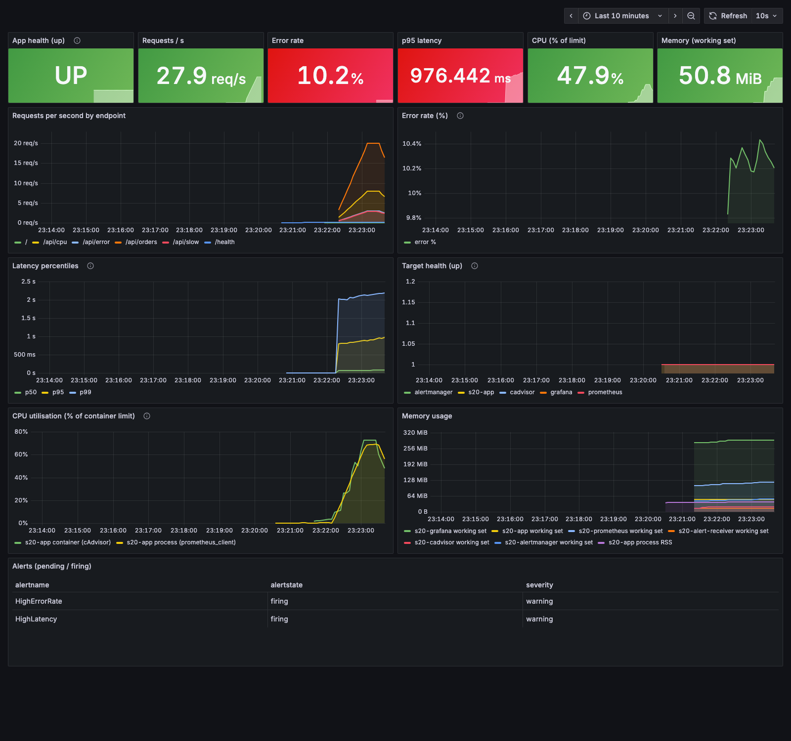

# Session 20: Monitoring, Observability & GitOps

**Name:** Vansh Srivastava
**Enrollment No.:** 24bcs10567
**Session:** 20

This session covers how to tell whether a system is healthy (monitoring), how to work out why it is not (observability), and how to keep a Kubernetes cluster matching what is declared in Git (GitOps). I built a Docker Compose monitoring stack around an instrumented Python app (Prometheus, Alertmanager, Grafana, cAdvisor), generated load, fired and resolved real alerts, wrote up the three pillars of observability with real examples from my app and the shared minikube cluster, and installed Argo CD with a GitOps demo app and a self-heal script. The work is split into three parts, each with its own README:

| Part | README | What is in it |
|---|---|---|
| Task 1: Monitoring | [01-monitoring/README.md](01-monitoring/README.md) | instrumented app, Prometheus + alert rules, Alertmanager, Grafana dashboard, load test, alerts firing and resolving, logs, teardown |
| Task 2: Observability | [02-observability/README.md](02-observability/README.md) | metrics/logs/traces, why observability, tools, Kubernetes observability, trace id linked across response/log/metric, `kubectl top/logs/events` |
| Task 3: GitOps | [03-gitops/README.md](03-gitops/README.md) | GitOps concepts, Argo CD install, Application manifest, `demo.sh`, pre-push rehearsal, **Live sync (after push)** placeholder |

## Folder structure

```text
session-20-monitoring-observability-gitops/
├── README.md                       # this file: overview and links to the three parts
├── .gitignore                      # __pycache__, venvs, logs, .env
├── 01-monitoring/                  # Task 1: docker compose monitoring stack
│   ├── README.md                   #   full walkthrough with real output
│   ├── docker-compose.yml          #   app + prometheus + alertmanager + alert-receiver + grafana + cadvisor
│   ├── load.sh                     #   load generator (hey)
│   ├── app/                        #   Flask + prometheus_client app, Dockerfile
│   ├── prometheus/                 #   scrape config and alert rules
│   ├── alertmanager/               #   routing to a webhook receiver
│   ├── alert-receiver/             #   webhook that logs notifications
│   └── grafana/                    #   provisioned datasource + dashboard JSON
├── 02-observability/               # Task 2: observability write-up
│   ├── README.md
│   └── k8s-demo/                   #   log-emitting pod used for kubectl top/logs/events (adapted from the course repo)
├── 03-gitops/                      # Task 3: GitOps with Argo CD
│   ├── README.md
│   ├── argocd-application.yaml     #   Application -> GitHub repo, path 03-gitops/app, auto sync + prune + selfHeal
│   ├── demo.sh                     #   apply, wait Synced/Healthy, show resources, self-heal demo
│   ├── app/                        #   namespace, deployment (version string), service: the desired state
│   └── rehearsal/                  #   pre-push test of demo.sh with an in-cluster chart repo
└── screenshots/                    # headless Chrome captures of Grafana, Prometheus, Alertmanager, Argo CD
```

## Environment

```text
macOS 26 on Apple Silicon (arm64), Docker 29.5.2 via Colima (containerd image store), Docker Compose 5.6.0
minikube v1.39.0, Kubernetes v1.37.0 (shared cluster, metrics-server addon), kubectl v1.37.1, helm, hey, jq
Prometheus v3.5.0, Alertmanager v0.28.1, Grafana 12.1.1, cAdvisor v0.57.0, Argo CD v3.5.4 (stable)
```

I read the instructor material in the course repo (Nency-Ravaliya/devops-heros, `session20-monitoring-observability-gitops`, folders 01-08). My Prometheus/Grafana versions come from its `03-prometheus` and `04-grafana` compose files. The Argo CD install command and the Application layout (Application file kept outside the synced `app/` path, automated sync with prune, selfHeal and CreateNamespace) follow its `07-argocd` and `08-mini-project`. The pod in `02-observability/k8s-demo` is adapted from its `02-metrics-logs-traces/k8s-demo`. Docker Hub was returning `429 Too Many Requests` for anonymous pulls on this machine, so images come from quay.io, ghcr.io and the AWS ECR public mirror wherever possible (details in Task 1).

## Task 1: Monitoring

Full details: [01-monitoring/README.md](01-monitoring/README.md).

- **Metrics:** the app exports a request counter, a latency histogram, an error counter, an in-flight gauge and build info. cAdvisor adds container CPU and memory. Prometheus scrapes 5 targets, all `up`.
- **Logs:** one JSON line per request with `trace_id`, path, status, duration and error message; counted with `jq` (451 + 57 errors, matching what `hey` reported).
- **Application health:** a `/health` endpoint, a Docker HEALTHCHECK, and the `up` metric.
- **CPU / memory utilisation:** container usage as a percentage of its limits (0.5 CPU / 256 MiB). CPU went from 3.5% (idle) to 73% (mixed load) to about 100% (CPU stress, throttled in every CFS period). Memory stayed around 50 MiB (about 21%).
- **Alerts:** under load, HighErrorRate (10.4%) and HighLatency (p95 0.91 s) fired after their 30 s `for:`. HighCPU fired briefly and flapped, which I explain. Stopping the app fired AppDown (pending about 5 s later, firing 30 s after that). Alertmanager delivered firing and resolved notifications to a webhook. Everything resolved after recovery. Then `docker compose down -v` removed all of it.



| Screenshot | Shows |
|---|---|
| [02-prometheus-targets.png](screenshots/02-prometheus-targets.png) | all 5 scrape targets UP |
| [03-prometheus-alerts-under-load.png](screenshots/03-prometheus-alerts-under-load.png) | HighErrorRate and HighLatency firing |
| [04-grafana-dashboard-after-load-and-cpu-stress.png](screenshots/04-grafana-dashboard-after-load-and-cpu-stress.png) | load phase and CPU-stress phase on the dashboard |
| [05-prometheus-alerts-appdown-firing.png](screenshots/05-prometheus-alerts-appdown-firing.png) | AppDown firing |
| [06-alertmanager-appdown.png](screenshots/06-alertmanager-appdown.png) | AppDown in Alertmanager, routed to `log-webhook` |
| [07-grafana-dashboard-app-down.png](screenshots/07-grafana-dashboard-app-down.png) | dashboard with the app DOWN |

Grafana runs with anonymous Viewer access (`GF_AUTH_ANONYMOUS_ENABLED=true`) for this local demo only, so the screenshots show the dashboard and not a login page.

## Task 2: Observability

Full details: [02-observability/README.md](02-observability/README.md).

- Explains metrics, logs and traces, how they differ, and why observability is needed on top of monitoring.
- Covers the common tools (Prometheus, Alertmanager, Grafana, Loki, ELK, Fluent Bit, Jaeger, Tempo, OpenTelemetry, cAdvisor) and the Kubernetes pieces (kubelet cAdvisor, metrics-server, kube-state-metrics, `kubectl top/logs/events/describe`, Prometheus Operator).
- Real example 1: one trace id `4bf92f35...` sent in a `traceparent` header comes back in the response headers, appears in the app's JSON log line (with the parent span id), and is stored by Prometheus as an exemplar on the latency histogram bucket.
- Real example 2: on the shared cluster, `kubectl top nodes/pods`, the raw `metrics.k8s.io` API, the kubelet's `/metrics/cadvisor`, `kubectl logs`, events and `describe` for a demo pod in `s20-observability` (deleted afterwards).

## Task 3: GitOps

Full details: [03-gitops/README.md](03-gitops/README.md).

- Covers what GitOps is, Git as the source of truth, declarative configuration, continuous reconciliation, the GitOps workflow, and Kubernetes + GitOps (push vs pull, environments, secrets).
- **Argo CD v3.5.4** is installed from the official stable manifest into namespace `argocd`. All 7 pods are Running, and it is **left running**. UI: `kubectl port-forward svc/argocd-server -n argocd 18443:443`, then https://localhost:18443 as user `admin`. Password: `kubectl -n argocd get secret argocd-initial-admin-secret -o jsonpath='{.data.password}' | base64 -d; echo`.
- `03-gitops/app/` has plain manifests (namespace `s20-gitops-demo`, Deployment `s20-web` showing `version: v1.0.0`, Service). `argocd-application.yaml` points Argo CD at `https://github.com/vanshhhhhhhhh/DevOPS-ASSIGNMENT-VANSH-SRIVASTAVA.git`, `main`, path `session-20-monitoring-observability-gitops/03-gitops/app`, with automated sync, prune and selfHeal.
- Before the push, applying the Application gave `ComparisonError ... remote repository is empty` and deployed nothing. I deleted it again.
- A rehearsal of `demo.sh` against an in-cluster Helm chart repo built from the same manifests showed a real sync to Synced/Healthy and real self-heal: a manual scale to 5 was reverted to 2 within 2 s, and a deleted Service was recreated within 2 s.
- **Still to do after the push:** run `03-gitops/demo.sh` and paste its output into the `TODO-POSTPUSH` block in [03-gitops/README.md](03-gitops/README.md#live-sync-after-push).

## What I learned

- A metric is only useful with the right labels and a limit to compare against. Setting container CPU/memory limits turned raw usage into "percent of limit", and the CPU throttling ratio showed the container was being capped.
- `for:` in an alert rule trades speed for stability. With a value hovering at the threshold, HighCPU flapped and Alertmanager's `group_wait` swallowed it. Noisy signals need a longer `for:` or `keep_firing_for:`.
- Structured JSON logs can be queried like data. Counting errors by path with `jq` matched the load generator's numbers exactly.
- Exemplars connect a point on a latency graph to a trace id, and the same id in the log line connects it to the full story. Without shared ids the three pillars are separate tools.
- Tools change underneath you: cAdvisor v0.53 could not read containers on Docker 29's containerd image store, and v0.57 could. Docker Hub rate limits are a real operational problem, and mirrors (quay.io, ECR public) fix them.
- In GitOps nothing happens until the change is in Git. Argo CD reported the empty repo as a ComparisonError instead of deploying anything.
- `selfHeal` reverts manual drift within seconds, so in a GitOps cluster the way to change something is a commit, not `kubectl scale`.
